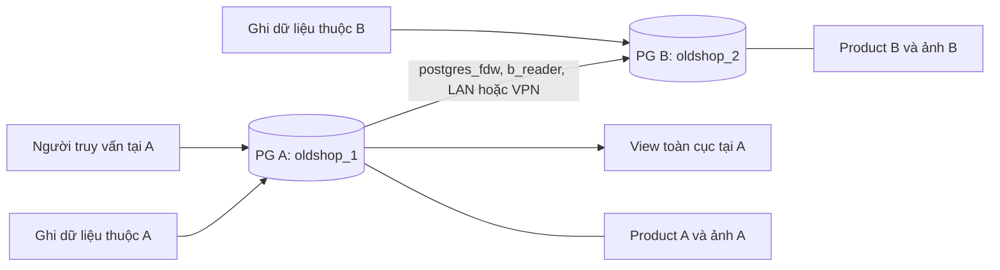

# OldShop — Đánh giá tính khả thi và kế hoạch CSDL phân tán theo Lab02

**Ngày lập:** 04/11/2026. **Mốc mã nguồn khảo sát:** `a24c5ef`.

**Cập nhật triển khai 04/11/2026:** M1 đã được hiện thực bằng hai PostgreSQL độc lập trên hai IP Docker, dùng database `oldshop_1`/`oldshop_2`. Người dùng xác nhận chưa có máy B và cho phép mô phỏng bằng IP ảo. Có schema/FDW/view, fixture, kiểm thử và gateway đọc riêng; M2 chưa chuyển giỏ hàng/thanh toán hoặc dữ liệu thật. Xem [hướng dẫn và kết quả thực hiện](HUONG_DAN_CSDL_PHAN_TAN.md). Bằng chứng này chưa xác nhận hai host vật lý.

## 1. Kết luận đánh giá

**OldShop có thể triển khai mô hình hai site PostgreSQL, phân mảnh ngang và truy vấn thống nhất bằng FDW như Lab02.** Phương án phù hợp để bắt đầu là một môi trường thử nghiệm riêng cho **danh mục sản phẩm**, sau đó mới đánh giá chuyển ứng dụng sang kiến trúc nhiều site.

Hai mức hoàn thành cần được nghiệm thu riêng:

| Mức | Kết quả cần đạt | Đánh giá hiện tại |
|---|---|---|
| M1 — Chứng minh nguyên lý Lab02 trên dữ liệu OldShop | Hai site có các mảnh sản phẩm riêng, ghi cục bộ được; A đọc B bằng FDW; có view toàn cục, truy vấn và bằng chứng kiểm thử | Đã triển khai và kiểm chứng bằng hai IP ảo theo lựa chọn người dùng; chưa nghiệm thu hai host vật lý |
| M2 — Ứng dụng OldShop vận hành trên dữ liệu phân tán | API đọc/ghi đúng site; giỏ hàng, tồn kho, đơn hàng, thanh toán, metadata và ETL hoạt động đúng khi lỗi mạng | Khả thi có điều kiện; cần thay đổi kiến trúc và kiểm thử bổ sung đáng kể |

Hoàn thành M1 **chỉ chứng minh phân tán phân hệ danh mục**, chưa chứng minh toàn bộ OldShop đã vận hành phân tán. Việc tạo view toàn cục không tự giải quyết định tuyến ghi, ràng buộc xuyên site hoặc giao dịch thanh toán.

## 2. Căn cứ và phạm vi khảo sát

### 2.1. Tài liệu tham khảo Lab02

- `fragmentation.md`: phân mảnh ngang chính/dẫn xuất, ba tính chất đúng đắn và nhân bản danh mục.
- `HuongDan_Lab02_Ket_Noi_LAN_VPN_NguoiA_NguoiB.md`: hai máy PostgreSQL, kết nối LAN/VPN, tài khoản chỉ đọc, FDW và kiểm thử lỗi/phục hồi.
- `Plan_Lab02_Distributed.md`: schema chung, view toàn cục, Q1–Q6, năm nhóm kiểm chứng và hồ sơ nộp bài.

Đây là ba tài liệu của bài tham khảo; chưa đối chiếu `Lab02 - Distributed.pdf` gốc. Các tiêu chí OldShop bên dưới là **đề xuất chuyển đổi bài toán**, không phải khẳng định thầy yêu cầu đúng các bảng/truy vấn thương mại điện tử này. Tên file, công cụ VPN và lịch thực hiện trong bài tham khảo không tự trở thành yêu cầu bắt buộc của dự án.

### 2.2. Nguồn trong dự án đã đối chiếu

| Nguồn | Nội dung làm căn cứ |
|---|---|
| [README](../README.md) | OldShop là marketplace; mô hình dữ liệu nhiều hệ quản trị hiện tại nằm trên một host |
| [Database session](../backend/app/core/database.py), [cấu hình](../backend/app/core/config.py) | Một engine/session PostgreSQL chính; `PG_NODE_B_URL` là biến dự kiến, chưa có logic sử dụng |
| [Schema SQL](../database/01_schema/), [migrations](../database/04_migrations/) | PK/FK/CHECK, partition, user split, metadata, outbox và cleanup |
| [Model danh mục](../backend/app/models/catalog.py) | Product liên kết seller, category, moderator; ảnh và review phụ thuộc product |
| [Giỏ hàng](../backend/app/crud/shopping_cart.py), [đơn hàng](../backend/app/crud/order.py) | Giữ hàng khi thêm giỏ, khóa dòng product, ghi order/detail/transaction và cập nhật voucher |
| [Trigger order detail](../database/02_functions/order_detail/triggers.sql) | Kiểm tra người bán không tự mua bằng cách đọc order và product |
| [ETL extract](../backend/etl/extract.py), [load](../backend/etl/load.py) | Đọc một nguồn PG; Mongo upsert theo định danh thực thể |
| [Cleanup media](../backend/etl/pipelines/media_cleanup.py) | Kiểm tra tham chiếu trong PG/Mongo trước khi xóa file |
| [Báo cáo bán hàng](../backend/app/services/sales_report.py) | Báo cáo đọc bảng tổng hợp trên primary; có thông tin thời điểm cập nhật |
| [Compose dữ liệu](../deploy/docker-compose.distributed.yml) | PG primary/standby, Mongo, MinIO và ứng dụng dùng mạng Compose trên một host |
| [Chiến lược hiện hữu](design/02_distribution_strategy.md), [ma trận phân mảnh](design/02_fragmentation_matrix.md) | FDW nhiều máy là hướng mở rộng, ngoài phạm vi MVP trước đây |
| [Kế hoạch indexing](KE_HOACH_THIET_KE_INDEXING.md) | Có migration 007 trong source; tài liệu ghi chưa áp vào DB người dùng ở thời điểm cập nhật đó |

Mốc cấu trúc chính để phân tích là baseline cộng migrations `001`–`006`; migration `007` cần được kiểm tra riêng khi dựng môi trường. Không suy số migration đã áp dụng từ danh sách file trong repository. Những tài liệu ghi “Ngày 2” mô tả bối cảnh lịch sử; phải đọc cùng migration và cập nhật sau đó.

## 3. Hiện trạng so với yêu cầu phân tán

| Hạng mục | Bằng chứng trong source | Khoảng trống so với Lab02 |
|---|---|---|
| Phân vùng đơn hàng | Migration 002 tạo bốn partition HASH theo `order_id` | Các partition vẫn thuộc cùng database; chưa được phân bổ sang hai máy |
| Phân vùng log | Migration 002 dùng RANGE theo tháng, có DEFAULT | Chưa có phân bổ log theo site |
| Phân mảnh dọc người dùng | Migration 003 tạo `user_core/profile/secret/wallet`, view `users_full` | Các bảng vẫn trong cùng PostgreSQL |
| Sao chép PostgreSQL | Có streaming standby trong profile `resilience` | Standby sao chép dữ liệu primary; không phải site B sở hữu mảnh ghi độc lập |
| MongoDB/MinIO | Có document, replica set, object storage và ETL | Khác hệ lưu trữ không thay thế việc chứng minh phân mảnh PostgreSQL trên hai site |
| Kết nối từ xa | Có cấu hình dự kiến `PG_NODE_B_URL` | Chưa có foreign server, user mapping, foreign table và global view cho hai site |
| API đọc/ghi | Các CRUD nhận một `Session` từ database chính | Chưa có bộ định tuyến đến site sở hữu dữ liệu |
| Hạ tầng mạng | PG primary publish mặc định `127.0.0.1:55432`; container dùng bridge nội bộ | Máy khác không truy cập được qua IP LAN/VPN bằng cấu hình này |

**Điểm cần bổ sung là phân bổ các mảnh dữ liệu sang hai PostgreSQL ghi độc lập trên hai máy.** Có thể giữ partition/index cục bộ bên trong mỗi site nếu hữu ích; chúng là một lớp thiết kế khác với việc phân bổ qua mạng.

Theo [PostgreSQL 16 về partition](https://www.postgresql.org/docs/16/ddl-partitioning.html), partition chia một bảng logic thành các phần vật lý. Việc repository có partition không tự chứng minh các phần đó nằm trên những máy khác nhau.

## 4. Đánh giá các phương án

| Phương án | Lợi thế | Chi phí/giới hạn | Kết luận |
|---|---|---|---|
| Chuyển PG standby sang máy thứ hai | Tận dụng replication có sẵn | Hai bản sao cùng dữ liệu; B không sở hữu mảnh nghiệp vụ riêng | Hữu ích cho dự phòng, chưa đạt mục tiêu phân mảnh Lab02 |
| Chia product theo category | Dễ thấy điều kiện chọn | Category có cây cha/con và có thể đổi; phân bố tải dễ lệch | Không chọn làm khóa site ban đầu |
| Chia product theo site quản lý seller | Quan hệ chủ sở hữu rõ; ảnh đi cùng product; dễ tạo phép bán nối | Phải bổ sung ánh xạ seller–site; order/cart hiện có sẽ gặp quan hệ xuyên site | **Chọn cho M1** |
| Chia order theo buyer/site | Order, detail và transaction có thể đi cùng nhau | Stock thuộc seller khác site; liên quan contact, voucher, wallet và PayPal | Đánh giá trong M2, sau khi giải quyết giao dịch |
| Chuyển đồng thời PG, Mongo, MinIO thành hệ nhiều máy | Phạm vi toàn diện | Nhiều cơ chế đồng bộ và điểm lỗi cùng thay đổi | Chia thành các bước sau M1 |

Seller được gán một site quản lý cố định trong thử nghiệm. Không dùng địa chỉ giao hàng hoặc suy khu vực từ chuỗi địa chỉ làm khóa phân mảnh: source chưa có trường vùng nghiệp vụ chuẩn hóa để dùng cho mục đích này.

## 5. Kiến trúc đề xuất cho M1

### 5.1. Topology và phạm vi dữ liệu



- Đích LAN/VPN là hai máy trên hai host riêng. Triển khai hiện tại theo xác nhận người dùng dùng hai container có IP `172.29.82.11`/`172.29.82.12` trên một host.
- Cả hai database dùng cùng DDL nghiệp vụ thử nghiệm, cùng tên cột/kiểu/ràng buộc/trigger. Cấu hình site và dữ liệu khác nhau; đối tượng FDW/view tổng hợp chỉ cần ở A.
- B là database ghi độc lập, không dùng volume standby hiện tại để chứa mảnh B.
- Mỗi site được phép tạo/cập nhật sản phẩm thuộc mình khi site kia ngừng hoạt động, miễn không có phụ thuộc ngoài site trong thao tác thử nghiệm đó.
- FDW A → B chỉ đọc. Ghi tại B bằng kết nối trực tiếp và tài khoản writer của B.
- Một host với hai container có thể dùng để kiểm tra sơ bộ script; bằng chứng hai máy phải được thu trên môi trường hai host thực.

Tên database ở trên là tên đề xuất cho môi trường riêng, không đổi tên database `oldshop` đang dùng.

### 5.2. Phân bổ cụ thể

| Quan hệ/nhóm dữ liệu | A | B | Quy tắc trong M1 |
|---|---|---|---|
| `product` | Mảnh seller do A quản lý | Mảnh seller do B quản lý | Mỗi product có đúng một nơi ghi chính |
| `product_image` | Ảnh của product A | Ảnh của product B | FK cục bộ đến product |
| `category` | Bản danh mục chuẩn | Bản giống A | Nhân bản toàn bộ, chỉ quản trị A thay đổi danh mục |
| `seller_site` — bảng mới | Bản ánh xạ dùng chung | Bản giống A | Một seller gắn một site; cố định trong phiên thử nghiệm |
| `site_config` — bảng mới | Một dòng nhận diện A | Một dòng nhận diện B | Cùng cấu trúc, chỉ quản trị được sửa |
| Nhóm user/role hỗ trợ FK | Tài khoản giả lập cần thiết | Cùng bộ tham chiếu giả lập | Không đồng nghĩa đã phân mảnh tài khoản thật |
| Order/cart/payment/review và bảng vận hành khác | Giữ cấu trúc nếu clone schema đầy đủ; không tham gia demo nghiệp vụ M1 | Tương tự | Không nạp giao dịch thật hoặc chạy checkout |
| Mongo, MinIO, ETL | Giữ môi trường hiện hữu tách biệt | Chưa mở rộng sang B trong M1 | Không cho worker hiện hữu xử lý database thử nghiệm |

`product.seller_id` và `product.approved_by` đang tham chiếu `user_core`; vì vậy chỉ sao chép product/category sẽ thiếu các hàng cha. Bộ tham chiếu giả lập phải bao phủ cả seller và moderator, và giữ đủ các fragment user nếu có dùng view/function phụ thuộc chúng. Không nhân bản password, token, ví hay thông tin cá nhân thật chỉ để làm demo.

### 5.3. Chuẩn bị schema chung

1. Biên dịch cùng một bộ schema từ SQL source và migration `001`–`007`, bỏ include seed thương mại hiện hữu; lưu checksum và source hash.
2. Áp bộ schema chung trực tiếp vào database rỗng ở A/B, gồm sequence, function, trigger, view và extension. Cách hiện thực này tái sử dụng SQL-first source thay cho xuất schema từ một template đã nạp dữ liệu.
3. Nạp fixture riêng theo đúng thứ tự FK, thay vì nạp toàn bộ seed thương mại vào cả hai site rồi xóa tùy ý.
4. Áp một bộ DDL bổ sung chung cho `site_config`, `seller_site`, thuộc tính/ràng buộc định tuyến product.
5. So sánh catalog A/B; ghi baseline và phiên bản thử nghiệm bằng manifest riêng.

`database/init.sql` hiện nạp cả schema, function và seed. `backend/scripts/init_db.py` còn tự chạy migration và đồng bộ media; vì vậy không dùng entrypoint ứng dụng hiện hữu để khởi tạo tùy tiện database thử nghiệm đã biến đổi. Không sửa checksum/lịch sử migration cũ, và chưa đưa DDL thử nghiệm vào chuỗi migration mặc định của ứng dụng.

## 6. Thiết kế phân mảnh và tính đúng đắn

### 6.1. Thuộc tính và ràng buộc bổ sung

Đề xuất thêm `product.site_id`, nhận `A` hoặc `B`, `NOT NULL`. Bảng `seller_site` có một dòng/seller và cặp khóa duy nhất `(seller_id, site_id)`; product tham chiếu cặp này để không gán sản phẩm của seller A sang site B.

Ngoài kiểm tra miền giá trị, cần trigger chung trên cả hai site kiểm `product.site_id` trùng dòng `site_config` cục bộ. Writer không được sửa cấu hình site hoặc ánh xạ seller. Không chỉ kiểm bằng tham số HTTP, biến session tự đặt hoặc `CHECK (site_id IN ('A','B'))`, vì những cách đó chưa ngăn việc lưu dữ liệu đúng miền nhưng sai máy.

FK `product_image.product_id → product.product_id` giữ ảnh cùng mảnh với sản phẩm. Cấm đổi site/seller sở hữu product trong M1; việc di chuyển mảnh cần quy trình riêng.

### 6.2. Biểu thức phân mảnh

Ký hiệu `P` là tập product toàn cục của **bộ dữ liệu thử nghiệm**, `I` là product_image và `C` là category:

```text
P_A = σ(site_id = 'A')(P)
P_B = σ(site_id = 'B')(P)

I_A = I ⋉(I.product_id = P_A.product_id) P_A
I_B = I ⋉(I.product_id = P_B.product_id) P_B

C_A = C_B = C
```

Phép bán nối giữ nguyên tập cột của bảng con. Product là phân mảnh ngang chính theo site quản lý seller; ảnh là phân mảnh ngang dẫn xuất theo product. Category là bản sao danh mục.

### 6.3. Ba tính chất cần chứng minh

| Tính chất | Product | Product image | Bằng chứng cần thu |
|---|---|---|---|
| Đầy đủ | Mọi product trong bộ nguồn có site hợp lệ A/B và được phân bổ đúng một nơi | Mọi ảnh có product cha được phân bổ | Đối soát bộ nguồn với hợp hai mảnh theo cả hai chiều; không chỉ so count |
| Tái tạo được | `P = P_A ∪ P_B` | `I = I_A ∪ I_B` | View toàn cục khớp bộ nguồn cả khóa và nội dung |
| Không giao nhau | Site loại trừ nhau và khóa product toàn cục không trùng | Parent product thuộc một site; khóa image cũng không trùng | Kiểm giao khóa rỗng, parent đúng site, thử chèn sai site bị chặn |

Phép kiểm tương đương cần phát hiện cả dòng thiếu, dòng dư và nội dung khác, ví dụ so sánh đa tập bằng `EXCEPT ALL` hai chiều trên danh sách cột tường minh. Mọi đối soát toàn cục phải dùng cùng mốc dữ liệu đã ngừng ghi hoặc bộ fixture bất biến; FDW không cung cấp một thời điểm snapshot chung tự động cho hai máy đang thay đổi độc lập.

### 6.4. Khóa toàn cục

Các bảng hiện dùng nhiều khóa `SERIAL`/integer; hai sequence độc lập đều bắt đầu từ 1 sẽ gây trùng khóa toàn cục dù mỗi site không vi phạm PK cục bộ.

**Trong M1, chỉ dùng fixture giả lập:** product ID và image ID tại A là số nguyên dương lẻ, tại B là số nguyên dương chẵn. Cấu hình sequence bước nhảy 2 và kiểm tra phần dư khi ghi, kể cả ID truyền tường minh. Cùng cơ chế trên hai site, cấu hình khác nhau theo site. Không dùng `MAX(id)+1`.

Nếu tái sử dụng nội dung seed thì lập bảng ánh xạ ID cũ → ID fixture và cập nhật toàn bộ tham chiếu ảnh. Đây là dựng bộ dữ liệu thử nghiệm; **không áp đổi khóa lên dữ liệu thật**. Việc chia chẵn/lẻ là quy tắc cấp ID, không phải hàm HASH partition PostgreSQL.

Đối với M2, cần chọn lại chiến lược trước migration: giữ ID lịch sử cùng registry chủ sở hữu và các dải ID mới không giao nhau, hoặc thêm định danh toàn cục theo lộ trình tương thích API. Rà soát toàn bộ FK, URL, Mongo key, object key và dữ liệu tích hợp trước khi đổi kiểu/giá trị khóa. M1 chưa chứng minh phương án migration khóa của dữ liệu thật.

## 7. Nhân bản danh mục, FDW và view toàn cục

### 7.1. Bản sao danh mục

- `category` và `seller_site` dùng cùng fixture/version ở A/B, kiểm nội dung hai chiều trước khi chạy query.
- Writer nghiệp vụ không được thay đổi các bản danh mục; trong M1 chỉ quản trị thực hiện cập nhật có phiên bản, theo đợt có kiểm soát.
- Nếu thử đổi category, cập nhật cả hai site và xác nhận đồng nhất trước khi mở lại thao tác phụ thuộc. Không tuyên bố bản sao tự đồng bộ.
- Khi mất B, không tự nhận cập nhật danh mục toàn cục đã hoàn tất nếu B chưa nhận phiên bản mới.

Logical replication cho danh mục là lựa chọn nghiên cứu sau M1. Nó không tự sao chép DDL hoặc trạng thái sequence; cần quản lý hai phần này riêng theo [giới hạn logical replication PostgreSQL 16](https://www.postgresql.org/docs/16/logical-replication-restrictions.html).

### 7.2. Quyền và kết nối

| Role dự kiến | Nơi sử dụng | Quyền |
|---|---|---|
| `site_admin` | Mỗi site | Quản trị cấu trúc thử nghiệm; không dùng cho truy vấn thông thường |
| `site_writer` | Kết nối trực tiếp từng site | Ghi product/image hợp lệ tại site đó; không sửa cấu hình/DDL |
| `b_reader` | User mapping từ A tới B | CONNECT, USAGE và SELECT đúng bảng/view được phép |
| `global_reader` | A | Đọc view toàn cục; không ghi foreign table/bảng cục bộ |

Chỉ import các bảng/view cần thiết vào `site_b`, ưu tiên `product`, `product_image`; category/seller mapping chỉ đọc thêm khi cần đối chiếu. Không import toàn schema rồi cấp quyền đọc `user_secret`, `user_wallet`, `users_full` hoặc bảng giao dịch.

Không dùng role `oldshop_repl` cho FDW: role đó phục vụ replication. Test quyền phải chứng minh `b_reader` thật sự bị PostgreSQL B từ chối ghi, bao gồm khi đăng nhập trực tiếp bằng role này; việc chỉ thiếu quyền ghi foreign table ở A chưa đủ kết luận.

### 7.3. View toàn cục tại A

| View đề xuất | Định nghĩa logic |
|---|---|
| `v_product` | Product cục bộ A `UNION ALL` product từ B |
| `v_product_image` | Ảnh cục bộ A `UNION ALL` ảnh từ B |
| `v_category` | Chỉ category tại A |
| `v_seller_site` | Chỉ ánh xạ seller–site tại A |

Liệt kê cột tường minh, cùng kiểu/thứ tự, giữ `site_id` để kiểm tra nguồn. View tái tạo nên giữ toàn bộ dòng kể cả xóa mềm; truy vấn nghiệp vụ mới áp `is_deleted/status` theo mục đích. Không hợp hai bản category hoặc seller mapping vì chúng là dữ liệu nhân bản.

Các view này cung cấp **minh bạch vị trí khi đọc**. Cấm ghi qua chúng bằng quyền, và vẫn định tuyến ghi tới bảng vật lý của site sở hữu.

Trong PostgreSQL 16, giao dịch từ xa qua FDW giữ snapshot trong cùng giao dịch; sau khi B commit cần kết thúc giao dịch đọc cũ ở A rồi đọc lại. FDW cũng chưa hỗ trợ prepare giao dịch từ xa cho two-phase commit, nên không coi một `commit()` là bảo đảm nguyên tử cho mọi thao tác trên A/B. Xem phần Transaction Management trong [tài liệu postgres_fdw](https://www.postgresql.org/docs/16/postgres-fdw.html).

## 8. Kết nối LAN/VPN và điều kiện môi trường

Thông số phải ghi trước khi triển khai: hostname/IP A, hostname/IP B, IP nguồn mà B nhìn thấy, phiên bản PG, cổng ngoài host B, cổng container, database, schema, role và cách cung cấp credential.

Thứ tự kiểm tra:

1. PostgreSQL B đang chạy và lắng nghe trên giao diện phù hợp.
2. Nếu dùng Docker, publish cổng trên IP LAN/VPN đã chọn; cấu hình loopback hiện tại không đủ. Nếu dùng PG trực tiếp, kiểm tra cổng/giao diện tương ứng.
3. Firewall và `pg_hba.conf` cho phép IP nguồn thực tế, đúng database/role. Với container/NAT, không mặc định IP PostgreSQL nhìn thấy luôn là IP laptop A.
4. Từ A kiểm tra TCP tới đúng IP/cổng B; ping chỉ là kiểm tra phụ.
5. Đăng nhập trực tiếp B bằng `b_reader`, xác nhận database/user/server address và đọc dữ liệu chỉ có ở B.
6. Từ **tiến trình PostgreSQL A** kiểm tra đường kết nối FDW. Host A truy cập B thành công chưa chứng minh container PG A có cùng đường định tuyến VPN.
7. Tạo FDW/view, đặt timeout kết nối và timeout câu lệnh phù hợp, rồi kiểm thử mất mạng/phục hồi.

LAN và VPN là hai phương án thay thế. Không dùng IP Docker bridge của một host làm địa chỉ liên host; không yêu cầu B kết nối ngược A trong M1. Nếu PostgreSQL nằm sau publish/NAT, `inet_server_addr()` có thể là IP nội bộ container: cần kèm hostname/định danh site và cấu hình publish để chứng minh máy B, không kết luận sai chỉ vì nó khác IP host nhập vào client.

Đề xuất ban đầu mỗi máy có ít nhất 2 vCPU, 4 GiB RAM và dung lượng trống cho fixture/backup; đây là **ước lượng chuẩn bị cho PG và công cụ demo**, chưa đo trên hai máy và không phải sizing đầy đủ Mongo/MinIO/ứng dụng. Có thể kiểm tra script trước bằng container, sau đó mới bố trí máy độc lập để nghiệm thu.

## 9. Bộ truy vấn OldShop tham khảo Q1–Q6

Đây là bộ truy vấn mới cho phân hệ danh mục, kế thừa mục tiêu kiểm chứng của Lab02. Không coi chúng là nguyên văn Q1–Q6 bài quản lý sinh viên.

| Mã | Truy vấn tại A | Điều kiện nghiệm thu |
|---|---|---|
| Q1 | Đọc product chỉ tồn tại ở B qua `site_b.product` | Đúng ID/nội dung B; phiên vẫn kết nối database A |
| Q2 | Danh mục toàn hệ thống, kèm tên category và site | Có product của cả A/B; không nhân dòng khi nối category |
| Q3 | Tra cứu một product B cùng danh sách ảnh | Thông tin và số ảnh khớp B; product không có ảnh vẫn tra cứu được |
| Q4 | Thống kê số product theo category | Category không có product vẫn hiện với 0; đếm product ID, không dùng số dòng sau JOIN ảnh |
| Q5 | Thống kê số product và giá trung bình theo category trong khoảng `[from, to)` | Category không có product trong khoảng vẫn hiện 0/NULL; giữ đúng điều kiện lọc với LEFT JOIN |
| Q6 | Seller chưa có product trong khoảng `[from, to)` | Xét seller ở cả hai site; bắt được seller không có product và seller chỉ có product ngoài khoảng |

Q2/Q4/Q5/Q6 mặc định xét product chưa xóa mềm; trạng thái approved/pending phải được ghi rõ trong đặc tả và expected result. Giá trung bình tính theo từng product, không theo số ảnh. Q6 dựa trên `seller_site` chung nên vẫn thấy seller chưa có product.

Dataset tối thiểu đề xuất: mỗi site có 2 seller và 5 product, ít nhất 8 ảnh; chung ít nhất 3 category. Chủ động có seller rỗng, category rỗng, product không ảnh, product nhiều ảnh, product xóa mềm, nhiều status và product nằm ngoài khoảng thời gian truy vấn. Mỗi query có kết quả mong đợi tính từ fixture cố định.

Đây là định mức tự đặt cho OldShop để kiểm đủ nhánh dữ liệu, không phải chuyển máy móc mức “2 lớp/5 sinh viên/8 đăng ký” của Lab02.

## 10. Ma trận kiểm chứng tính khả thi

T01–T12 đã có kết quả kiểm thử trên kiến trúc hai IP ảo. Xem [test_results.json](evidence/distributed/test_results.json) và [kiểm thử API](evidence/distributed/api_results.json). Bằng chứng partition/ETL cũ không thay thế kết quả mới; mô phỏng một host không chứng minh chịu mất host.

| Mã | Tình huống | PASS khi | Bằng chứng |
|---|---|---|---|
| T01 | Kết nối thật A → B | Đúng hai host, đúng DB/role; đọc được product riêng B | IP/hostname/site marker, TCP, session info, query/result |
| T02 | B cập nhật product hoặc thêm ảnh rồi COMMIT | A thấy thay đổi trong giao dịch mới, không dump/import lại mảnh B | Trước/sau, commit, ID đối chiếu |
| T03 | Quyền chỉ đọc | SELECT được; UPDATE/INSERT/DELETE bị B từ chối; không đọc được secret/wallet | Cả test trực tiếp bằng b_reader và qua mapping A |
| T04 | Dừng PG B hoặc ngắt mạng B | Đọc/ghi cục bộ A vẫn được; query cần B lỗi trong timeout; phục hồi rồi đọc lại B được | Lệnh dừng/bật, kết quả local/remote, thời gian lỗi |
| T05 | Toàn vẹn | Chặn trùng PK, sai FK category/product, giá/quantity âm, sai site và sai seller–site | Error và constraint/trigger gây lỗi |
| T06 | Đầy đủ/tái tạo/không giao | Hợp mảnh khớp fixture hai chiều; không trùng khóa toàn cục | Báo cáo đối soát theo bảng/khóa/nội dung |
| T07 | Nhân bản danh mục | Category/seller mapping đồng nhất; view chỉ lấy một bản | Version, so sánh hai chiều, count query |
| T08 | Truy vấn Q1–Q6 | Từng kết quả khớp expected result, gồm các trường hợp rỗng | SQL, tham số, kết quả và DB đang kết nối |
| T09 | Cấp ID đồng thời | Hai writer tạo nhiều product/ảnh, không trùng ID; chèn ID sai quy tắc bị chặn | ID hai site, intersection rỗng, error |
| T10 | Tự chủ của B | Khi A dừng, B vẫn đọc/ghi product/image của B với danh mục đã có | Giao dịch B và dữ liệu sau khi A phục hồi |
| T11 | Dựng lại từ đầu | Dùng script trên hai DB mới cho cùng kết quả; không phụ thuộc thao tác nhập tay | Log chạy sạch và manifest phiên bản |
| T12 | Hiệu năng qua mạng | Có số đo local/remote/global ở tải và mạng đã ghi rõ | Plan, median/p95, timeout, số dòng/kích thước trả về |

Sau lỗi remote, kết thúc/rollback giao dịch lỗi trước khi thử lại. Phục hồi phải truy vấn một ID **chỉ nằm tại B** hoặc trực tiếp foreign table; `LIMIT` trên view có thể trả đủ dòng A mà chưa đọc B, nên không dùng riêng cách đó để chứng minh kết nối đã phục hồi.

T12 trước hết thu baseline, sau đó chốt ngưỡng chấp nhận theo workload và LAN/VPN thực tế. Dùng fixture nhỏ để kiểm tính đúng; tăng dữ liệu ở DB benchmark riêng để đo hiệu năng. Không khẳng định FDW nhanh hơn local hoặc hệ thống mở rộng tốt chỉ từ vài chục dòng demo.

## 11. Các vấn đề phải giải quyết để đạt M2

### 11.1. Phân bổ đích đề xuất khi tích hợp toàn bộ ứng dụng

M2 ưu tiên tiếp tục phân mảnh danh mục và **giữ cụm giao dịch mua hàng tại A**. Một hệ thống phân tán không bắt buộc chia mọi bảng; cách phân bổ này giảm số nghiệp vụ tiền phải phối hợp xuyên máy, đồng thời ứng dụng vẫn sử dụng product thuộc cả A và B.

| Nhóm bảng/dữ liệu | Nơi ghi chính đề xuất | Cách dùng ở site còn lại |
|---|---|---|
| `product`, `product_image` | Site của seller | FDW cho đọc tổng hợp; gọi dịch vụ owner cho thao tác ghi/giữ hàng |
| `category`, `seller_site` | A | B giữ bản tham chiếu có version |
| `user_core/profile/secret/wallet`, `user_role`, `role`, `contact_info` | A | B chỉ nhận projection định danh công khai tối thiểu cần cho seller/moderator; không sao chép secret/wallet |
| `shopping_cart`, `shopping_cart_item` | A | Stock được giữ tại owner product, qua reservation có ID bền vững |
| `order`, `order_detail`, `transaction`, `voucher`, `payment_method` | A | Không cho B tự ghi bản sao giao dịch; order có thể tham chiếu product B |
| `review`, `violation_log`, `system_feedback` | A trong bước tích hợp đầu | Khi cần, truy vấn ghép với product toàn cục; chưa phân mảnh thêm |
| `system_log`, outbox/provenance, trạng thái worker, hàng đợi xóa media | Cục bộ nơi phát sinh thay đổi | Định danh kèm site, thu thập/đối soát ở lớp quản trị |
| `report_daily_sales` | A | Tổng hợp từ order tại A; không cộng thêm một bản báo cáo trùng tại B |
| Mongo product metadata | Dịch vụ metadata được chỉ định | Khóa theo global product ID; PG owner giữ authority cho giá/tồn kho/trạng thái |
| Byte file | Object store được chỉ định | Metadata biết nguồn/key; chưa mặc định có bản sao object ở hai máy |

Hai loại bảng tham chiếu mới cần được đặc tả: `user_public_ref` để product có thể giữ FK seller/moderator cục bộ, và `product_ref` để cart/order/review tại A tham chiếu được product B. Chúng chỉ là projection có owner/version và dữ liệu đã cho phép công bố; **không phải bản tồn kho hoặc số dư có quyền quyết định giao dịch**. FK hiện hữu phải được migration sang quan hệ thích hợp, kiểm tra/bảo toàn trước sau; không thể tham chiếu FK trực tiếp tới `v_product`.

Nạp/ACK projection cần hoàn tất trước thao tác phụ thuộc; nếu projection thiếu hoặc quá cũ cho nghiệp vụ, hệ thống đợi đồng bộ hoặc từ chối có thể retry. Quyền seller/moderator vẫn phải được xác thực, không suy từ việc có một dòng tham chiếu. Bản sao user giả lập trong M1 không phải thiết kế nhân bản user thật của M2.

Khi A ngừng hoạt động, M2 chưa cam kết đăng nhập mới, checkout, payment hoặc cập nhật danh mục dùng chung vẫn chạy tại B. Khi B ngừng hoạt động, giỏ/đơn có product B phải xử lý trạng thái chờ/lỗi theo đặc tả; không được xác nhận còn hàng từ projection. Việc phân mảnh order/user theo site là bước mở rộng sau nếu có nhu cầu và đặc tả riêng.

### 11.2. Bản đồ tác động lên mã nguồn

| Khu vực | Hiện trạng | Thay đổi cần thiết trước khi sử dụng hai site trong ứng dụng |
|---|---|---|
| `core/database.py`, `api/deps.py` | Một nguồn Session chính | Connection/session theo site, timeout, đóng session và health riêng |
| `models/catalog.py`, CRUD/API product | ORM đọc/ghi bảng product local; product detail còn tăng view_count | Tách đường đọc toàn cục khỏi entity ghi; view_count, sửa/xóa, moderation và ảnh đều ghi đúng owner |
| Category và seller mapping | CRUD danh mục local | Một chủ ghi, phát phiên bản và kiểm trạng thái bản sao |
| Cart | Khóa product và giảm stock khi thêm giỏ | Reservation tại site giữ stock, idempotency, hạn giữ/chính sách giải phóng và retry |
| Order/payment/voucher | Order/detail/transaction và voucher dùng cùng Session | Chốt nơi sở hữu order; xử lý đơn nhiều seller/site và kết quả không xác định khi mất mạng |
| User/auth | Core/profile/secret/wallet và tính duy nhất username/email trong một DB | Giữ authority danh tính rõ ràng; nếu chia user cần cơ chế uniqueness toàn cục và chính sách credential |
| Trigger order_detail | Tra buyer/seller cục bộ để chặn tự mua | Thiết kế lại dữ liệu tham chiếu/bất biến nghiệp vụ khi product khác site |
| ETL/outbox | Worker kết nối một PG nguồn | Worker theo site, định danh sự kiện có site, checkpoint/retry/ACK độc lập |
| Mongo | Tìm/upsert theo ID thực thể hiện tại | Global ID hoặc khóa ghép nhất quán; chống ghi đè document khác site, giữ attributes/tags do Mongo sở hữu |
| Media/cleanup | Kiểm tham chiếu PG local và Mongo trước khi xóa | Object key không xung đột; biết tham chiếu ở các site; trì hoãn GC nếu không xác nhận được an toàn |
| Báo cáo | Tổng hợp từ nguồn PG hiện tại | Xác định quyền sở hữu dòng tổng hợp, tránh cộng lặp và công bố site/độ trễ dữ liệu |
| Tests/deploy | Một stack và dependency chính | Môi trường hai site, fixture, lỗi mạng, migration/rollback và quan sát từng site |

`PG_NODE_B_URL` chỉ là biến cấu hình dự kiến; điền biến này chưa tạo FDW hay định tuyến ORM. Không đổi `Product.__tablename__` thành `v_product` rồi kỳ vọng toàn bộ CRUD, relationship, flush và khóa dòng hoạt động như trước.

### 11.3. Ranh giới giao dịch và ràng buộc

Cart hiện giữ stock tại thời điểm thêm sản phẩm; order có thể chứa nhiều product, từ nhiều seller. Nếu product thuộc B còn giỏ/order thuộc A, thao tác không còn nằm trọn trong một PostgreSQL. Cần thiết kế ít nhất:

1. Site giữ stock xác thực và tạo reservation bằng khóa/cập nhật nguyên tử cục bộ.
2. Mỗi yêu cầu có idempotency key; retry không giữ stock hoặc tạo thanh toán hai lần.
3. Order có trạng thái chờ/xác nhận/hủy và quy tắc xử lý reservation hết hạn.
4. Khi bước sau thất bại, có thao tác bù giải phóng reservation; lưu tiến độ bền vững để khôi phục sau crash.
5. Callback/retry PayPal, voucher usage và wallet có authority rõ ràng, có đối soát; không dùng số dư/tồn kho từ bản đọc trễ để quyết định ghi.

Đây là hướng quy trình nhiều giao dịch cục bộ có bù trừ, cần đặc tả riêng trước khi code. M1 chưa hiện thực hoặc chứng minh quy trình này. Chỉ cho mua hàng cùng site có thể giảm phạm vi triển khai đầu, nhưng đó là **thay đổi nghiệp vụ cần được chốt**, không tự giới hạn giỏ hàng hiện có.

Ràng buộc trên foreign table không thay thế PK/FK cục bộ; các quan hệ xuyên database phải được thiết kế bằng dữ liệu tham chiếu và quy trình kiểm chứng riêng. Xem [CREATE FOREIGN TABLE của PostgreSQL 16](https://www.postgresql.org/docs/16/sql-createforeigntable.html). Không bỏ FK đang có chỉ để migration chạy qua.

### 11.4. ETL, media và dự phòng

- Mỗi nguồn PG phải ghi outbox cùng transaction dữ liệu nguồn; dùng khóa sự kiện có site để tránh hai `event_id` cục bộ trùng nhau. Toàn bộ luồng full/incremental/delete/retry đều cần nhận biết nguồn.
- Một sự kiện product B có thể ảnh hưởng order/report tại site khác; trigger hiện hữu chỉ tìm thấy dữ liệu local. Cần cơ chế phát và xử lý phụ thuộc xuyên site, không chỉ chạy hai bản worker cũ.
- Không để worker A và B tự coi dữ liệu không thấy ở site mình là đã bị xóa toàn cục.
- Byte ảnh và metadata có thể tách nơi lưu. Mất B không tự làm ảnh B còn phục vụ được; phải xác định endpoint/object store và chính sách lỗi rõ ràng.
- GC file dùng chung phải xác nhận tham chiếu liên quan; nếu chưa đọc được site cần kiểm tra thì trì hoãn xóa. M1 không chạy cleanup hiện hữu trên dữ liệu phân tán.
- Hai mảnh A/B không phải bản dự phòng cho nhau. Muốn chịu mất máy cần backup ngoài máy/bản sao cho từng mảnh và diễn tập restore riêng. HA tự động chưa nằm trong tiêu chí M1.

## 12. Kế hoạch thực hiện theo giai đoạn

Ước lượng dưới đây tính theo **ngày công**, giả định người thực hiện đã quen dự án, hai máy có quyền quản trị và mạng kết nối được. Không phải cam kết thời gian hay công việc đã thực hiện. Tên vai trò là đề xuất phân công.

| Giai đoạn | Công việc | Sản phẩm cụ thể | Điều kiện qua bước | Ước lượng |
|---|---|---|---|---|
| P0 — Chốt hiện trạng | Kiểm schema_migrations, fingerprint, dependency, hai host, cổng và tài nguyên; chốt phạm vi catalog | Inventory và quyết định thiết kế | Xác định rõ DB nguồn/DB thử nghiệm, version và ownership | 0,5–1 ngày |
| P1 — DDL và fixture | Dựng template; schema chung; site/seller mapping; khóa; fixture và expected result | DDL thử nghiệm, ERD, manifest nguồn | A/B cùng contract; constraint và đối soát local đạt | 1–2 ngày |
| P2 — Hai máy và quyền | Dựng PG độc lập trên B; cấu hình LAN/VPN, publish/listen/HBA/firewall, role | Runbook mạng, direct connection | T01 và phần trực tiếp của T03 đạt | 0,5–1 ngày |
| P3 — FDW và truy vấn | Foreign server/mapping/table, view toàn cục; Q1–Q6 | Script FDW/view/query | Q1–Q6, T02/T06/T07/T08 đạt | 1–2 ngày |
| P4 — Lỗi, tải và hồ sơ | Tất cả T01–T12; dựng lại sạch; đo tải; ghi giới hạn | Báo cáo kết quả, evidence, hướng dẫn tái lập | Đủ tiêu chí M1, không còn lỗi dữ liệu/quyền | 1–2 ngày |
| P5 — Tích hợp đọc thử nghiệm | API catalog đọc toàn cục; global pagination/filter; ghi view_count đúng site; health/lỗi | API thử nghiệm và test hợp đồng | Kết quả/API đúng, outage không trả dữ liệu thiếu như thể đủ | 2–4 ngày |
| P6 — Định tuyến ghi và dữ liệu phụ | Product/image/moderation theo owner; ETL/Mongo/media/GC theo site | Luồng danh mục nhiều site hoàn chỉnh | Không ghi sai site; retry/outbox/media đạt | 3–5 ngày |
| P7 — Giao dịch và migration M2 | Đặc tả/hiện thực reservation, order/payment/voucher; chuyển dữ liệu; diễn tập lỗi và rollback | Thiết kế nghiệp vụ, migration/restore, test đầu cuối | Các bất biến tiền/hàng, uniqueness và đối soát đều đạt | 5–10+ ngày |

**Tổng M1:** khoảng 4–8 ngày công, làm tròn từ P0–P4. **M2 bổ sung:** khoảng 10–19+ ngày công, có thể tăng sau khi chốt giao dịch xuyên site và trạng thái dữ liệu thật. Các bước phụ thuộc không được chạy vượt gate chỉ để khớp lịch.

Phân công đề xuất: người phụ trách A quản lý template/schema/FDW/view; người phụ trách B quản lý máy B/mạng/quyền; người kiểm thử chuẩn bị fixture/expected result/lỗi/tải; người tài liệu tổng hợp ERD/topology/evidence/runbook. Một người có thể kiêm các vai trò.

### 12.1. Bộ file đã tạo cho triển khai M1

Các đường dẫn thực tế dùng tên chức năng `distributed`/`sites`; tên bài tham khảo không được dùng để đặt tên database hoặc thành phần triển khai:

```text
database/distributed/
  01_site_schema.sql
  02_reference_fixture.sql
  03_permissions.sql
  04_fdw.sql
  05_global_views.sql
  queries/Q1.sql ... Q6.sql
  fixture_manifest.json
  expected_results.json
deploy/sites/
  compose.site-a.yml
  compose.site-b.yml
  compose.catalog.yml
  env.example
deploy/scripts/
  sites.py
  verify_sites.py
  verify_catalogue.py
backend/app/catalogue_gateway.py
docs/evidence/distributed/
  inventory.json
  source_manifest.json
  schema_comparison.json
  test_results.json
  clean_rebuild.json
  performance_results.json
  api_results.json
docs/HUONG_DAN_CSDL_PHAN_TAN.md
```

`sites.py` biên dịch schema từ source chung, nạp cấu hình/fixture riêng cho A/B và truyền password qua stdin. File mẫu chỉ chứa placeholder. Các phép thử dừng/bật chỉ tác động project được chọn; diễn tập dựng sạch tạo project tạm riêng.

### 12.2. Trình tự migration dữ liệu thật khi đã đủ điều kiện M2

1. Xác minh trạng thái schema thực, chọn ID/ownership và đặc tả tương thích API; xử lý record chưa có site và quan hệ qua hai site.
2. Backup có kiểm chứng restore; lập manifest count/khóa/nội dung, object metadata và watermark outbox.
3. Dựng B bằng schema cùng phiên bản; thử chuyển dữ liệu trên bản sao và chạy đối soát toàn bộ quan hệ liên quan.
4. Trong cửa sổ chuyển đổi có kiểm soát, dừng đường ghi và worker liên quan để có mốc nhất quán; phân bổ dữ liệu theo owner, không chỉ copy rồi để hai nơi cùng nhận ghi.
5. Kiểm tra khóa/FK/sequence/site rule, đồng bộ danh mục, FDW và API; xử lý sự kiện tồn đọng theo ownership mới.
6. Chuyển endpoint theo kế hoạch, mở lại ghi và worker đúng thứ tự; theo dõi lỗi/độ trễ/đối soát.
7. Giữ bản nguồn trước chuyển đổi trong thời gian rollback đã định. Không xóa mảnh gốc trước khi nghiệm thu và kết thúc thời gian này.

Nếu chưa mở ghi theo topology mới, có thể quay endpoint về nguồn cũ sau khi xác nhận nguồn còn nguyên. Nếu A/B đã nhận ghi mới, rollback phải thu hồi/đối soát các ghi đó và sự kiện liên quan trước khi quay về; chỉ đổi connection string sẽ mất dữ liệu. Không sửa ngược migration lịch sử để giả lập rollback.

## 13. Rủi ro, điều kiện quyết định và nghiệm thu

### 13.1. Ma trận rủi ro chính

| Rủi ro | Mức ảnh hưởng | Biện pháp và điều kiện kiểm soát |
|---|---|---|
| Hai site cấp cùng ID | Cao | Quy tắc cấp ID và chặn ID tường minh sai; T09; M2 cần kế hoạch ID lịch sử |
| Chia product làm đứt FK/trigger order, cart, review | Cao | M1 tách biệt; M2 lập dependency đầy đủ và kiểm từng luồng nghiệp vụ |
| Giữ stock/thanh toán nửa chừng khi mất mạng | Rất cao với M2 | Reservation/idempotency/trạng thái bền vững/bù trừ và diễn tập crash |
| Category hoặc seller mapping lệch | Trung bình–cao | Một nơi quản trị, version, đối soát trước khi mở ghi phụ thuộc |
| Global query mất B | Trung bình với M1 | Timeout, lỗi rõ ràng; local vẫn chạy; chưa cam kết global luôn sẵn sàng |
| ETL ghi đè hoặc GC xóa file còn tham chiếu | Cao với M2 | Nguồn/ID rõ ràng; outbox theo site; GC trì hoãn khi thiếu thông tin |
| Dùng nhầm DB/volume hiện hữu | Cao | Tên DB/Compose/volume riêng, kiểm target trước thao tác; fixture không dùng dữ liệu thật |
| Nhầm kế hoạch với kết quả đã chứng minh | Cao với báo cáo | Mỗi tiêu chí có trạng thái và evidence; không dùng screenshot một host để kết luận hai host |

### 13.2. Các điểm cần chốt trước khi triển khai

- Hai máy thực tế, OS, khả năng quản trị, LAN hay VPN và cổng truy cập được.
- Mục tiêu tiếp theo là M1 hay cả M2; M1 mặc định dùng database thử nghiệm riêng.
- Site quản lý seller là đơn vị nghiệp vụ nào; ai có quyền phân công/chuyển seller.
- Chuỗi migration dùng cho template và dữ liệu fixture được phép dùng.
- Với M2: cần giữ nguyên mua hàng xuyên site hay cho phép giới hạn giai đoạn đầu; authority danh tính, voucher, payment và kế hoạch global ID.
- Ngưỡng timeout/hiệu năng sau khi có baseline mạng và tải đại diện.

Những điểm này là đầu vào của bước thực hiện sau; không cản việc hoàn thiện bản đánh giá hiện tại và không có nghĩa đã được người dùng chấp thuận thay đổi nghiệp vụ.

### 13.3. Điều kiện nghiệm thu M1

- [x] Hai PG ghi độc lập trên hai IP ảo, cùng contract schema; phạm vi mô phỏng được người dùng xác nhận.
- [x] Mỗi site chỉ nhận product đúng owner; ảnh theo FK cục bộ; ID không trùng toàn cục.
- [x] Category và seller mapping có bản sao đồng nhất, chỉ quản trị cập nhật.
- [x] A đọc B qua mạng bằng b_reader, có global view tái tạo đúng.
- [x] Q1–Q6 và T01–T12 có kết quả, expected result và bằng chứng.
- [x] B commit thì A thấy khi đọc giao dịch mới, không cần copy lại mảnh.
- [x] Site còn hoạt động vẫn đọc/ghi local khi site kia dừng; query cần site lỗi trả lỗi có timeout.
- [x] Đã dựng lại trên DB sạch; tài liệu ghi đúng giới hạn, credential chỉ nằm ở file riêng.
- [x] Database, volume và dịch vụ hiện hữu không được dùng để chạy các phép thử mới.
- [ ] Kiểm chứng lại trên hai host vật lý qua LAN/VPN khi có máy B.

M2 chỉ được nghiệm thu sau khi có thêm bằng chứng định tuyến toàn bộ đường ghi, hợp đồng API, giao dịch tiền/hàng khi lỗi và phục hồi, đồng bộ ETL/media cùng migration/rollback dữ liệu thật. Hai site phân mảnh không tự đem lại HA hoặc khả năng giao dịch nguyên tử xuyên máy.

## 14. Tài liệu đối chiếu

Ba nguồn Lab02 người dùng cung cấp:

- [Phân tích phân mảnh](</home/phat/Documents/Study/AdvancedDb/Labs nộp bài/CSDLNC01 – 49.01.104.107 – Trần Hoàng Phát – Lab02/docs/fragmentation.md>).
- [Hướng dẫn LAN/VPN A–B](</home/phat/Documents/Study/AdvancedDb/Labs nộp bài/CSDLNC01 – 49.01.104.107 – Trần Hoàng Phát – Lab02/HuongDan_Lab02_Ket_Noi_LAN_VPN_NguoiA_NguoiB.md>).
- [Kế hoạch Lab02](</home/phat/Documents/Study/AdvancedDb/Labs nộp bài/CSDLNC01 – 49.01.104.107 – Trần Hoàng Phát – Lab02/plan/Plan_Lab02_Distributed.md>).

Các liên kết này là đường dẫn trên máy người lập; khi đóng gói để chia sẻ cần thay bằng bản tham khảo/đường dẫn phù hợp nếu được phép. Nguồn dự án và tài liệu PostgreSQL được gắn cạnh nhận định tương ứng trong các mục trên.
