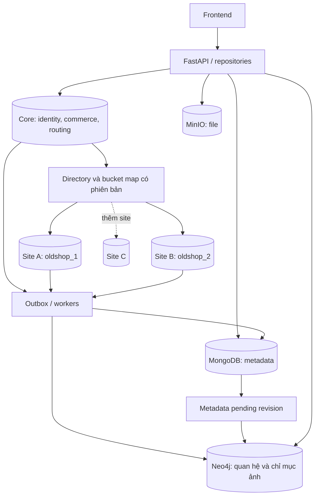
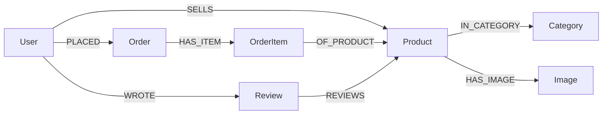

# Kế hoạch tái cấu trúc seeding, phân mảnh bucket–site và tích hợp Neo4j

Ngày lập: **17/11/2026**, múi giờ Việt Nam. Trạng thái cập nhật: **đã triển khai và kiểm chứng trên stack local riêng; chưa cutover dữ liệu cũ**.

Các mục bên dưới giữ lại thiết kế ban đầu. Kết quả thực thi, phiên bản đã pin, evidence và giới hạn thực tế nằm trong [báo cáo triển khai](BAO_CAO_TRIEN_KHAI_BUCKET_SITE_NEO4J.md) và [runbook](runbooks/bucket_site_neo4j.md). CLI trong mục 6.6 là phác thảo ban đầu; dùng cú pháp đã kiểm chứng trong runbook. Không cần xóa database hiện có.

## 1. Mục tiêu và phạm vi

### 1.1. Kết quả cần đạt

1. Ứng dụng, seeder, công cụ migration và bộ kiểm chứng dùng **cùng một hợp đồng phân bổ**.
2. Dữ liệu nghiệp vụ được sinh thành một tập toàn cục có liên kết hợp lệ rồi nạp vào đúng nơi sở hữu.
3. Sản phẩm phân mảnh theo `seller_id → bucket_id → site_id`; ảnh phân mảnh dẫn xuất theo sản phẩm. Hai site ban đầu là A/`oldshop_1` và B/`oldshop_2`.
4. Bỏ việc suy site từ ID chẵn/lẻ trong contract mới. Một site chứa nhiều bucket và nhiều seller; user vừa mua vừa bán không tạo thêm site.
5. Có quy trình chuyển bucket sang server khác mà giữ nguyên ID và API nghiệp vụ.
6. Neo4j có bản chiếu quan hệ để truy vấn sản phẩm liên quan và **tìm đúng ảnh qua `caption`/`description`**.
7. PostgreSQL, MongoDB và Neo4j có quyền sở hữu trường rõ ràng; việc replay, seed lại hoặc đổi site không làm nhân đôi thực thể hay ghi đè metadata người dùng.

### 1.2. Phạm vi của lần nâng cấp

- Phân tán phần catalogue và tồn kho; điều chỉnh các luồng ứng dụng đang phụ thuộc catalogue cùng database.
- Giữ đầu mối quản lý tài khoản và giao dịch tại core trong giai đoạn này; bổ sung điều phối khi giỏ hàng chạm nhiều site.
- Dùng Neo4j cho Cypher và tìm kiếm văn bản trên metadata ảnh. Không yêu cầu train AI, embedding, LLM hoặc nhận diện nội dung pixel.
- Tạo môi trường kiểm chứng tách biệt trước khi áp dụng lên dữ liệu đang dùng.
- Chưa bao gồm HA cho control plane, Neo4j cluster, tự động cân bằng tải hoặc tự động di chuyển bucket. Thêm site không đồng nghĩa tự có khả năng chịu lỗi của mọi thành phần.

## 2. Hiện trạng đã đối chiếu từ mã nguồn

| Thành phần | Hiện trạng | Công việc cần xử lý |
|---|---|---|
| [Bootstrap chính](../backend/scripts/init_db.py) và [init SQL](../database/init.sql) | Chạy schema/seed theo database ứng dụng; backend mặc định dùng `oldshop` | Tách schema, migration, seed và projection thành các bước có trạng thái |
| [Dựng hai site](../deploy/scripts/sites.py) | Loại các include `03_seeds`, dùng fixture catalogue nhỏ riêng | Thay nhánh seed nghiệp vụ bằng generator dùng chung contract; giữ fixture nhỏ cho regression |
| [Contract hiện tại](../database/distributed/fragmentation.json) | `fragmentation-v1`, chỉ A/B, owner là `seller_site`, ID modulo 2 | Tạo contract mới, có phiên bản và adapter chuyển tiếp |
| [Router](../backend/app/services/fragment_router.py) và [gateway](../backend/app/catalogue_gateway.py) | Site bị giới hạn A/B; định tuyến product theo parity | Thêm registry site, lookup directory và bucket mapping động |
| [Site SQL](../database/distributed/01_site_schema.sql) | Constraint/trigger kiểm parity và chặn đổi owner | Migration bổ sung cơ chế bucket và hàng rào quyền ghi; không chỉ sửa Python |
| [Order detail](../database/01_schema/order_details.sql), [cart item](../database/01_schema/shopping_cart_items.sql), [review](../database/01_schema/reviews.sql) | Có FK tới `product` cùng database | Thiết kế tham chiếu catalogue ở core và repository theo site |
| [Giỏ hàng](../backend/app/crud/shopping_cart.py) | Giữ/trả hàng bằng khóa và cập nhật product local | Giữ nguyên ý nghĩa nghiệp vụ khi chuyển thành reservation tại owner site |
| [Outbox](../database/04_migrations/005_etl_outbox.sql) và [worker](../backend/etl/run.py) | Trạng thái xử lý hiện gắn với pipeline đang có | Bổ sung trạng thái theo từng consumer/đích |
| [Document contract](../backend/app/schemas/documents.py), [metadata ảnh](../backend/app/services/image_metadata.py) | Mã nguồn đã có `product_details.image_metadata`; ảnh do SQL sở hữu, caption/description do Mongo sở hữu | Thêm revision, sự kiện metadata, bản chiếu Neo4j và kiểm chứng tích hợp |
| Neo4j | Chưa có tích hợp trong cấu hình/backend được rà soát | Bổ sung hạ tầng, driver, schema graph, worker và API |

Đây là kết luận về source đang có trong workspace, không phải báo cáo kiểm kê database/container đang chạy. Không coi code metadata ảnh đã có là bằng chứng database thật đã được cập nhật validator.

## 3. Kiến trúc đích



`oldshop` có thể được giữ làm core cho identity, giao dịch và control plane. Sau cutover, sản phẩm/tồn kho có nguồn ghi chính tại các site; bảng tham chiếu ở core chỉ phục vụ định tuyến/FK/snapshot, không duy trì thêm một bản tồn kho có quyền ghi độc lập.

### 3.1. Ma trận quyền sở hữu

| Dữ liệu | Nguồn có thẩm quyền | Bản sao/bản chiếu và nguyên tắc |
|---|---|---|
| User, role, thông tin đăng nhập, ví | Core PostgreSQL | Site chỉ nhận reference cần thiết cho FK/hiển thị; không sao chép secret hoặc quyền ghi ví |
| Category, payment method, quy tắc trạng thái | Core/reference authority | Reference readonly ở nơi cần dùng, có version/checksum |
| Contract, bucket map, global ID allocator, catalogue directory | Control plane tại core | Cache được kiểm phiên bản; khi không xác định owner phải báo lỗi |
| Product, quantity, moderation, reservation tồn kho | Site sở hữu bucket của seller | Mongo/Neo4j là projection, không quyết định giao dịch tồn kho |
| Product image: ID, product ID, object reference, thứ tự, ảnh chính, alt text | Cùng site với product | FK ảnh–sản phẩm vẫn local |
| Binary ảnh/video | MinIO/storage hiện có | Khóa object ổn định, không chứa địa chỉ vật lý của PostgreSQL |
| Caption/description ảnh, attributes/tags | MongoDB | Neo4j đọc bản chiếu; SQL ETL không ghi đè trường Mongo sở hữu |
| Cart, order, payment, voucher usage, review/report | Core ở giai đoạn này | Tham chiếu product qua directory; các thao tác tồn kho đi qua owner site |
| Graph nodes/relationships, chỉ mục tìm ảnh | Neo4j | Có thể dựng lại từ nguồn; không là nơi sửa caption/description chính |

## 4. Hợp đồng phân bổ dùng chung

### 4.1. Quy tắc đề xuất để đóng băng ở P0

**Mặc định đề xuất:** 256 bucket logic, đánh số `0..255`. Số bucket giữ cố định trong revision phân bổ; thêm server chỉ đổi mapping. Tăng số bucket là thay đổi contract/migration riêng.

Quy tắc hash phải xác định đến từng byte:

```python
payload = f"oldshop:seller:v1:{seller_id}".encode("ascii")
digest = sha256(payload).digest()
bucket_id = int.from_bytes(digest[:8], byteorder="big", signed=False) % 256
```

- `seller_id` là số nguyên dương, biểu diễn thập phân chuẩn, không khoảng trắng hoặc số 0 thừa ở đầu; từ chối boolean.
- Không dùng `hash()` mặc định của Python hoặc modulo theo số server đang hoạt động.
- Site ban đầu: bucket `0..127 → A`, `128..255 → B`. Đây là cấu hình khởi tạo; sau đó mapping được cập nhật có kiểm soát.
- Giữ bucket của seller ổn định; đổi vai trò buyer/seller hoặc địa chỉ không đổi bucket.
- Sản phẩm không tự đổi seller/bucket qua API cập nhật thường. Chuyển ownership nghiệp vụ là chức năng riêng ngoài đợt này.

Test vector đã tính theo công thức đề xuất, không phải kết quả từ DB đang chạy:

| seller_id | bucket_id | Site với mapping ban đầu |
|---|---|---|
| 3 | 197 | B |
| 8 | 94 | A |
| 12 | 2 | A |
| 101 | 37 | A |
| 202 | 75 | A |

Seller 202 trong fixture cũ có thể thuộc B; theo quy tắc mới có thể thuộc A. Chuyển contract phải đối chiếu owner thực tế và di chuyển dữ liệu, không chỉ đổi file cấu hình.

### 4.2. Thành phần hợp đồng và registry dự kiến

| Thành phần | Trường tối thiểu / trách nhiệm |
|---|---|
| Contract bất biến | `schema_version`, `revision`, hash algorithm/prefix/byte order, `bucket_count`, owner key, derived relations, ID policy, ownership-update policy |
| `site_registry` | `site_id`, alias DSN, trạng thái, capability; DSN/secret lấy từ env, không nằm trong manifest hoặc response public |
| `bucket_assignment` | `bucket_id` PK, `owner_site_id`, `ownership_epoch`, trạng thái migration, `mapping_revision` |
| `seller_bucket` | `seller_id` PK, `bucket_id`, contract revision; kết quả materialize được tính bằng shared module |
| `catalogue_directory` | `product_id` PK, `seller_id`, `bucket_id`, lifecycle, publication state; tra site qua bucket map |
| `bucket_lease` tại site | Bucket, epoch, trạng thái nhận ghi/đọc; DB kiểm request epoch và quyền owner |

Mỗi bucket có đúng một owner active. Cache chỉ là bản sao; không có bảng `seller_site` được sửa tay độc lập với bucket map. Có thể giữ `seller_site` như adapter/view trong giai đoạn chuyển tiếp.

Digest contract bất biến và digest snapshot mapping là hai giá trị riêng: chuyển bucket không thay thuật toán hash. Manifest/evidence ghi cả hai cùng revision/epoch.

### 4.3. Một implementation dùng chung

Module dự kiến `backend/app/services/allocation.py` cung cấp:

```text
load_contract()
bucket_for_seller(seller_id)
resolve_bucket(bucket_id, expected_revision=None)
resolve_seller(seller_id)
resolve_product(product_id)
validate_target(entity, site_identity, ownership_epoch)
```

Ứng dụng, seeder, backfill, công cụ chuyển bucket và verifier import module này. Generator không viết thêm một công thức modulo riêng. SQL kiểm bucket qua reference đã xác nhận/lease và FK local; nếu cần tự tính hash trong SQL thì bắt buộc dùng cùng test vector và digest, không tự đặt thuật toán thứ hai.

### 4.4. Định danh toàn cục

Đề xuất giữ các ID integer hiện tại trong lần đầu để hạn chế phá vỡ API/FK, bổ sung **allocator dải ID tại core** cho những entity được ghi từ nhiều site:

- Cấp các dải không giao nhau theo entity, ghi nhận bền vững việc cấp phát; dải đã cấp không tái sử dụng kể cả sau lỗi.
- Site cấp ID từ dải được cấp; ID không mã hóa site hoặc bucket. Thêm site không đổi ID cũ.
- Seed dùng logical key ổn định và bảng `seed_key → global_id`, có namespace dataset; không tự chọn ID đè lên dữ liệu hiện hữu.
- Migration đặt high-water mark sau khi kiểm kê toàn bộ ID được chọn làm nguồn, bao gồm các dải đã cấp. Nếu có xung đột thật, phải lập mapping và sửa toàn bộ tham chiếu trước cutover.
- Theo dõi giới hạn `integer` đang dùng trong SQL/router; kế hoạch chuyển `bigint` là migration có kiểm chứng riêng, không âm thầm sinh ID vượt giới hạn hiện tại.
- Quy tắc cấp ID cho entity chỉ ghi tại core có thể tiếp tục qua sequence core; quyền seed ID tường minh tách khỏi quyền writer ứng dụng.

## 5. Định tuyến ứng dụng và hợp đồng nghiệp vụ

### 5.1. Luồng đọc/ghi

| Thao tác | Cách xử lý đích |
|---|---|
| Đăng sản phẩm | Xác thực user ở core → bucket seller → provision reference readonly → cấp ID/directory pending → ghi owner site và outbox → publish directory khi xác nhận |
| Lỗi giữa ghi site và publish directory | Dùng `operation_id` và trạng thái provisioning để retry/reconcile; không trả thành công khi directory chưa dùng được, không tạo product lần hai |
| Xem/sửa product theo ID | Directory → bucket assignment → owner site; client không gửi DSN/site để quyết định quyền |
| Đọc ảnh | Theo owner product, tải theo lô; caption/description ghép từ Mongo bằng ID ổn định |
| Danh sách của seller | Tính bucket và query một owner site |
| Catalogue toàn cục | Query các site active theo snapshot mapping, lọc owner đúng epoch, merge sort rồi phân trang; deduplicate bằng global ID |
| Thiếu một site trong truy vấn global | Trả lỗi phạm vi toàn cục; không báo một trang thiếu dữ liệu là toàn bộ kết quả |
| Site khác phạm vi bị lỗi | Truy vấn đã định tuyến một site vẫn có thể thành công nếu các phụ thuộc bắt buộc sẵn sàng |

Giữ API nghiệp vụ ổn định khi chuyển bucket. `product_id → bucket` phải có directory; không dò ID chẵn/lẻ và không scan mọi site để che lỗi mapping. FDW/view hardcode A/B chỉ là lớp tương thích có kiểm chứng; đường mở rộng nhiều site dùng registry/repository, không mặc định FDW tự tìm server mới.

Không dùng một SQLAlchemy session với quan hệ ORM như thể các FK/join xuyên site vẫn local. Tách repository core/catalogue và adapter response; kiểm cả API chính lẫn catalogue gateway.

### 5.2. Bảo toàn order/cart/review khi product rời core

Đây là hạng mục bắt buộc trước khi chuyển ứng dụng chính sang các mảnh:

1. Tạo reference catalogue ở core, giữ ID và seller ID phục vụ FK. Price/title trong đơn là snapshot lúc mua; không lấy giá hiện tại làm giá lịch sử.
2. Thay FK product của cart item, order detail, review sang reference thích hợp bằng migration mới; cập nhật ORM và trigger nghiệp vụ đang đọc bảng `product` local.
3. Kiểm seller qua reference và xác nhận owner; vẫn chặn tự mua hàng của mình. `contact_id` phải thuộc buyer, voucher/payment/status dùng chung enum và đơn vị VND.
4. Tồn kho chỉ do owner site cập nhật. Reservation có `operation_id`, số lượng, hạn giữ, state và version; thao tác giữ/trả/commit idempotent trong transaction local.
5. Giữ ý nghĩa hiện tại là giữ hàng khi thêm vào giỏ. Nếu muốn chuyển sang giữ ở checkout phải là thay đổi nghiệp vụ được chốt riêng.
6. Cart/order ở core điều phối reservation qua nhiều bucket. Đơn cha và fulfillment con gắn seller/bucket; site vật lý được resolve khi xử lý để không đóng băng nơi lưu cũ trong lệnh retry.
7. Khi một bước thất bại: saga/bù trừ giải phóng phần giữ chưa commit; với payment đã thành công phải có trạng thái phục hồi rõ ràng, không giả định rollback SQL sẽ hoàn tác thanh toán ngoài hệ thống.
8. Thử timeout sau khi site đã giữ hàng nhưng core chưa nhận ACK; retry không trừ tồn kho lần hai. Reservation đang sống phải được tính trong quy trình chuyển bucket.

Trong khi chưa hoàn tất mục này, chỉ nghiệm thu được seed/catalogue phân tán ở môi trường lab; chưa được công bố luồng mua bán toàn ứng dụng đã chuyển xong. Reference ở core không được chứa một bản tồn kho độc lập để lách điều phối này.

## 6. Tái cấu trúc seeding

### 6.1. Tách bốn công việc hiện đang dễ bị trộn

```text
Schema/bootstrap → Migrations → Dataset generation/seed → Projections/indexes
```

- Dựng schema không tự nạp dữ liệu demo khi restart ứng dụng.
- Giữ baseline và migration lịch sử; tạo migration bổ sung, không sửa checksum file đã phát hành.
- Profile legacy giữ dữ liệu cần cho regression cũ trong DB tách biệt; mặc định demo mới dùng contract bucket.
- Mỗi bước có lock, completion marker và kiểm tra partial state. Không dùng việc một bảng tồn tại làm bằng chứng seed đủ.

### 6.2. Cấu trúc nguồn và công cụ dự kiến

Các đường dẫn sau là đầu ra cần tạo khi triển khai, chưa phải công cụ đã tồn tại:

```text
database/distributed/contracts/bucket-v2.json
database/seeding/datasets/demo-v2.json
database/seeding/scenarios/             # logical entities, nghiệp vụ, expected queries
database/seeding/media_manifest.json    # file/key/checksum và caption có căn cứ
backend/app/services/allocation.py
backend/seeding/{generate,allocate,load,verify,manifest}.py
backend/scripts/seed.py
backend/scripts/verify_seed.py
backend/scripts/migrate_catalogue_to_buckets.py
backend/scripts/move_bucket.py
```

Sinh toàn bộ đồ thị nghiệp vụ bằng logical key, kiểm invariant, cấp/map ID rồi mới phân bổ đích. Seed đi qua application/domain services hoặc import adapter dùng cùng validator, transaction và event contract; không cần gọi HTTP cho từng hàng. Import adapter phải có kiểm thử so với luồng ứng dụng.

### 6.3. Dataset và kịch bản

| Profile | Mục đích | Quy mô đề xuất để chốt ở P0 |
|---|---|---|
| `contract-small` | Hash, routing, FK, failure injection | Vài seller ở cả A/B, vài chục sản phẩm, đủ ca biên |
| `demo-v2` | Demo nghiệp vụ và tìm ảnh/graph | Khoảng 40 user, 24 seller, 1.000 product, 2.000 image, 120 order; số chi tiết được ghi cố định trong manifest |
| `benchmark-v2` | Đo hiệu năng/tải lệch | Scale bằng tham số; tách dữ liệu benchmark khỏi bộ expected demo |

Số lượng là đề xuất, không được diễn đạt thành kết quả đã seed. Profile nhỏ có expected data kiểm tra bằng tay; profile lớn vẫn phải dùng cùng contract và cơ chế cấp ID.

Dataset phải có:

- User chỉ mua, chỉ bán, vừa mua vừa bán; admin/moderator phục vụ luồng duyệt.
- Seller thuộc nhiều bucket trên cả A/B, seller không có sản phẩm và một seller tải lớn để quan sát lệch tải.
- Product đang chờ duyệt, được duyệt, bị từ chối, bị ẩn, hết hàng và đã xóa; đủ cây category có parent.
- Order buyer mua của seller khác; có order chạm cả A/B; ngày phân bố nhiều tháng theo mốc thời gian dataset cố định.
- Contact thuộc đúng buyer; tổng tiền/discount/shipping/transaction và status nhất quán; voucher đúng đơn vị và thời hạn tương đối với mốc dataset.
- Tồn kho có sổ đối soát giữa số ban đầu, số đã bán, số đang giữ và số khả dụng; đơn hủy không làm mất hàng. Seed không gọi PayPal/email thật.
- Review hợp lệ, report rating 0 tách khỏi review; tập mua chung/sở thích chung có expected recommendation, loại đơn hủy khỏi tín hiệu mua thành công.
- Ảnh có caption/description riêng, gồm cùng product nhiều góc chụp, ảnh không metadata, ảnh đã xóa, ảnh chỉ thuộc product chưa duyệt và từ tìm chỉ xuất hiện trong mô tả ảnh.
- Tập từ tiếng Việt có dấu/không dấu, chữ hoa/thường, ký tự đặc biệt và chuỗi không có kết quả.

Caption/description phải dựa trên asset đã kiểm tra. Với ảnh dùng lại hoặc ảnh không đủ thông tin, dùng mô tả trung tính theo nội dung đã biết; không tự khẳng định màu sắc/khuyết điểm không nhìn thấy. Không nhân bản mô tả sản phẩm thành mô tả của mọi ảnh rồi coi đó là dữ liệu kiểm chứng tìm ảnh.

### 6.4. Trình tự nạp

1. Validate config/contract và quyền truy cập; ghi plan liệt kê target aliases, không xuất secret.
2. Sinh logical dataset từ PRNG seed và `reference_time` cố định; kiểm invariant trước khi ghi.
3. Cấp ID hoặc khôi phục mapping `dataset + logical_key → global_id`; ghi manifest ID.
4. Nạp identity/reference/control plane; xác nhận reference cần thiết tại từng site.
5. Nạp product/image/reservation vào owner site bằng shared allocator; ghi theo chunk/transaction local và directory provisioning như ứng dụng.
6. Nạp các cart/order/payment/review tại core theo contract nghiệp vụ đã hoàn thành ở mục 5.2.
7. Upload/kiểm object theo checksum và key ổn định, giữ lifecycle media chưa được publish nếu file chưa sẵn sàng.
8. Chạy projection SQL → Mongo; chỉ sau khi có document hợp lệ mới nạp caption/description qua metadata service, phát revision pending như lúc người bán sửa.
9. Chạy graph backfill/incremental từ các nguồn chính; không tạo một bộ seed Neo4j ngẫu nhiên khác.
10. Chờ delivery/index đạt trạng thái yêu cầu, verify manifest và expected queries rồi mới đánh dấu toàn bộ seed run hoàn tất.

### 6.5. Idempotency và phục hồi

- `seed_runs` ghi `dataset_id/version`, contract digest, mapping revision, seed/reference time, phase, chunk, error và trạng thái.
- `seed_entities` ghi logical key, global ID và content hash. Restart tiếp tục từ trạng thái đã xác nhận; mỗi phase kiểm lại dữ liệu, không tin marker đơn lẻ.
- Manifest có counts/hash theo entity/site/bucket, tập ID toàn cục, object checksum và expected queries. Loại runtime timestamp, secret và số lần retry khỏi checksum nội dung tất định.
- Chạy lại cùng dataset giữ nguyên ID, không tạo thêm user/order/image/node hoặc tái áp dụng bán hàng/reservation.
- Khi target dataset đã được người dùng sửa, mặc định chỉ thêm phần thiếu hoặc báo drift; cập nhật dữ liệu seed do hệ thống sở hữu phải có mode tường minh.
- Metadata Mongo do người dùng sửa được bảo vệ bằng provenance/revision; không ghi đè chỉ vì chạy seed lại.
- Reset chỉ dành cho dataset/môi trường tách biệt đã nhận diện, không có bước mặc định `TRUNCATE`, xóa volume hoặc reseed DB hiện hữu.

### 6.6. CLI dự kiến

Ví dụ giao diện cần xây dựng, **chưa phải lệnh có thể chạy ngay**:

```bash
python -m scripts.seed plan --dataset demo-v2 --contract database/distributed/contracts/bucket-v2.json
python -m scripts.seed apply --plan <plan-id>
python -m scripts.seed resume --run-id <run-id>
python -m scripts.verify_seed --run-id <run-id> --include-graph
python -m scripts.move_bucket plan --bucket <bucket-id> --to-site C
```

Plan gắn với target fingerprint và mapping revision; nếu môi trường thay đổi trước apply phải lập lại plan. Credential được cung cấp từ cấu hình môi trường, không truyền trực tiếp qua argv.

## 7. Metadata ảnh và sự kiện từ MongoDB

### 7.1. Giữ ownership hiện có

- PostgreSQL sở hữu `image_id`, `product_id`, object reference, `alt_text`, thứ tự và trạng thái ảnh.
- MongoDB sở hữu `caption` tối đa 255 và `description` tối đa 4.000 ký tự theo contract đang có; giữ nullable cho ảnh chưa được biên tập.
- `product_details.images` vẫn là projection từ SQL. `image_metadata` thuộc Mongo; full/incremental/reconcile SQL không ghi đè.
- Neo4j chỉ chứa bản chiếu các trường cần tìm kiếm, version và quan hệ. Không lưu binary hoặc signed URL hết hạn.

### 7.2. Đóng khoảng trống đồng bộ khi sửa caption

Chỉ theo dõi outbox PostgreSQL không nhận được việc người bán sửa metadata trực tiếp trong Mongo. Đề xuất dùng **atomic update trong cùng document**:

1. Metadata API kiểm owner và image membership trên owner site.
2. Một lần cập nhật Mongo thay annotation, tăng `metadata_revision` và đặt `graph_pending_revision`.
3. Worker đọc revision pending, lấy snapshot metadata tương ứng và ghi Neo4j.
4. ACK chỉ xóa cờ pending khi revision vẫn bằng revision đã xử lý. Nếu người dùng sửa tiếp, revision mới phải còn pending.
5. Worker có thể gộp các sửa trung gian để chiếu trạng thái mới nhất; không được bỏ mất trạng thái cuối. Nếu cần audit mọi lần sửa, bổ sung event log riêng có transaction phù hợp.

Cách này không cần giả định hai lần ghi độc lập vào metadata và outbox collection là nguyên tử. Thêm validation, index phục vụ quét pending và metrics trước khi bật worker.

`metadata_revision`, cờ pending và provenance cũng là trường Mongo sở hữu: bổ sung chúng vào document contract và danh sách `OWNED` của ETL, chỉ khởi tạo khi insert. Cập nhật validator trước khi backend bắt đầu ghi các trường mới; job init/worker phiên bản cũ không được chạy lại để thu hẹp validator sau rollout.

Mỗi đích có checkpoint riêng. Sửa metadata đã ghi Mongo thành công có thể trả thành công cùng trạng thái đang đồng bộ; Neo4j lỗi không làm yêu cầu sửa mất dữ liệu. Clear caption/description hoặc xóa phần tử metadata cũng phải phát revision và gỡ trường tương ứng trên graph.

## 8. Thiết kế tích hợp Neo4j

### 8.1. Hạ tầng và client

- Chọn và pin image/version Neo4j, Python driver và phiên bản Cypher tại P0 sau khi kiểm tra hỗ trợ, Python/runtime và tài nguyên máy triển khai. Không dùng tag `latest`.
- Bắt đầu với một instance cho lab; named volume, giới hạn memory, health/readiness, cấu hình backup/restore và network nội bộ. Không mặc định cần Enterprise, APOC hoặc GDS cho các truy vấn này.
- Cấu hình dự kiến: `NEO4J_URI`, `NEO4J_DATABASE`, thông tin xác thực qua secret/env, `GRAPH_ENABLED`, timeout, batch size và giới hạn số candidate.
- Client dùng pool và lifecycle của ứng dụng/worker, query tham số hóa, timeout hữu hạn; không tạo driver cho từng request. Không nhận Cypher tùy ý từ client.
- Driver có thể retry transaction; projector phải có tính idempotent và kiểm revision. Tham khảo [Neo4j Python transactions](https://neo4j.com/docs/python-manual/current/transactions/).

### 8.2. Graph model đề xuất



| Node | ID nghiệp vụ và trường chính |
|---|---|
| User | Global user ID, trạng thái tối thiểu; không password, token, ví hoặc địa chỉ cá nhân |
| Product | Product ID, seller ID, category ID, bucket ID, publication/deleted state và revision |
| Image | Image ID, product ID, caption, description, `search_text`, `search_text_folded`, object key/bucket, deleted state |
| Category | Category ID, tên và quan hệ cha nếu cần |
| Order / OrderItem | Order ID / order detail ID, status, thời gian, số lượng và snapshot cần cho truy vấn |
| Review | Review ID, rating, verified/deleted state; report không dùng như review tích cực |

Graph key gồm namespace dataset và global ID, không gồm site vật lý. Chuyển bucket không tạo node mới. Neo4j không dùng internal node ID làm định danh API.

Tạo uniqueness constraint cho `key` ở từng label; kiểm trường bắt buộc ở projector. Không dựa vào node-key/existence constraint nếu edition được chọn không hỗ trợ. [Neo4j constraints](https://neo4j.com/docs/cypher-manual/current/schema/constraints/).

`OrderItem` có ID riêng để không gộp nhầm hai dòng mua cùng sản phẩm; quan hệ được merge bằng business identity. Các lượt mua chỉ đóng góp vào recommendation khi trạng thái thanh toán/đơn phù hợp contract; hủy/hoàn phải cập nhật tín hiệu. Gợi ý loại sản phẩm của chính user, bị ẩn/xóa/chưa duyệt hoặc không còn đáp ứng điều kiện mua; có fallback cùng category khi lịch sử còn ít.

### 8.3. Pipeline đồng bộ và khôi phục

| Nguồn thay đổi | Cách chuyển | Consumer |
|---|---|---|
| Product/image/reference tại các site | Outbox cùng transaction SQL | Mongo projection, graph catalogue |
| Identity/order/review ở core | Outbox cùng transaction SQL | Graph quan hệ và projection cần thiết |
| Caption/description ở Mongo | Revision pending nguyên tử ở mục 7.2 | Graph image metadata |

- Event có `source_instance_id`, `event_id`, schema version, entity key, operation, entity revision và ownership epoch khi liên quan site. Event ID local không được coi là duy nhất toàn hệ thống.
- Ledger delivery khóa theo nguồn + event + đích; Mongo ACK không đánh dấu graph hoàn tất. Thêm lease/claim, retry/backoff, dead-letter và thao tác replay.
- Revision của trường SQL và revision metadata Mongo là hai luồng riêng. Graph giữ `catalogue_revision` và `metadata_revision`; event SQL không xóa caption, event Mongo không ghi đè ownership/visibility.
- Quy tắc projector kiểm revision/tombstone và ghi trong cùng transaction graph, có khóa/serialize theo entity để tránh hai worker cùng áp phiên bản cũ. Không so sánh event ID giữa hai database độc lập.
- Khi event metadata đến trước ảnh SQL, có thể retry tới khi image membership được xác nhận; không public node mồ côi. Khi xóa ảnh/product, tombstone ngăn sự kiện cũ hồi sinh dữ liệu.
- Backfill ghi checkpoint/delivery trong lúc vẫn giữ sự kiện mới: bật capture trước, đọc snapshot nhất quán theo nguồn, ghi graph có revision, replay backlog và đối soát. Không dùng `MAX(id)` hoặc đồng hồ làm cursor duy nhất.
- Nguồn cũ đã chuyển bucket không còn quyền ghi projection. Migration có cách phân loại event của epoch cũ và bảo toàn event hợp lệ chưa áp; không vứt mọi backlog chỉ vì site đổi.
- Các script khởi tạo schema/index, backfill, incremental, reconcile và rebuild graph phải tách biệt; rebuild có generation, không xóa graph đang phục vụ trước khi có bản thay thế đã kiểm chứng.

### 8.4. Tìm hình ảnh theo caption/description

Đây là tìm **metadata văn bản của ảnh**, có thể trả về ảnh dù từ tìm không xuất hiện trong mô tả sản phẩm. Không suy nội dung pixel khi metadata không chứa thông tin đó.

Ví dụ nghiệm thu: ảnh có caption “Mặt sau laptop”, description “Vết trầy nhỏ ở góc trái”; truy vấn “vết trầy” phải trả đúng `image_id` và product tương ứng, trong khi ảnh khác cùng product không tự được coi là khớp.

Hướng thực hiện:

1. Index các trường văn bản của node `Image` bằng full-text index. Giữ caption/description gốc; tính các trường tìm kiếm bằng hàm normalization có phiên bản dùng chung.
2. Chuẩn hóa Unicode, chữ hoa/thường; trường folded bỏ dấu và xử lý `đ/Đ` theo test vector. Chọn analyzer bằng danh sách hỗ trợ của phiên bản Neo4j đã pin, kiểm thực tế tiếng Việt.
3. Public API nhận từ khóa thường; backend escape cú pháp tìm kiếm và xây truy vấn theo chính sách “các token đều phải khớp”. Parameter hóa Cypher không tự vô hiệu cú pháp Lucene trong giá trị truy vấn.
4. Neo4j lấy candidate image + product + score; backend kiểm lại membership/visibility ở owner SQL và metadata revision hiện tại ở Mongo trước khi trả. Graph stale không được làm lộ ảnh của listing đã ẩn/xóa/chưa duyệt.
5. Resolve URL qua media gateway hiện có. Không cấp quyền truy cập object chỉ vì Neo4j trả một key.
6. Lấy candidate theo batch, lọc trước phân trang và giới hạn scan/time. Cursor ghi query/mode/generation và vị trí đã scan; nếu generation đổi phải yêu cầu tìm lại hoặc theo contract kết quả best-effort đã công bố. Không bịa total chính xác từ số candidate graph.

Neo4j full-text là tìm theo token có score; không tự tương đương regex substring hiện tại. Giữ rõ mode tương thích của endpoint cũ, không đổi ngầm nghĩa `image_search`. [Neo4j full-text indexes](https://neo4j.com/docs/cypher-manual/current/indexes/search-indexes/full-text-indexes/).

Ví dụ minh họa dùng cú pháp **Cypher 5**, cần kiểm lại theo phiên bản sẽ pin; ví dụ chưa bao gồm revalidation/pagination của API:

```cypher
CREATE CONSTRAINT image_key_unique IF NOT EXISTS
FOR (i:Image) REQUIRE i.key IS UNIQUE;

CREATE FULLTEXT INDEX image_metadata_text IF NOT EXISTS
FOR (i:Image) ON EACH [i.search_text, i.search_text_folded];

CALL db.index.fulltext.queryNodes('image_metadata_text', $prepared_query)
YIELD node AS image, score
MATCH (product:Product)-[:HAS_IMAGE]->(image)
WHERE image.deleted = false AND product.deleted = false
RETURN image.image_id, product.product_id, score
ORDER BY score DESC, image.image_id ASC
LIMIT $candidate_limit;
```

Với Cypher 25 trên các bản mới, tài liệu hiện tại có `SEARCH` và thay đổi trạng thái hỗ trợ procedure cũ; chọn một đường query đã kiểm thử theo phiên bản thay vì ghép cú pháp tùy ý. Index phải ONLINE trước khi bật tính năng; cấu hình eventual consistency của index và lag projection phải được đo riêng.

### 8.5. API/frontend dự kiến

- `GET /api/v1/images/search?q=...`: trả `image_id`, `product_id`, caption, description, media URL và cursor; trả chính ảnh khớp, không chỉ danh sách sản phẩm chứa ảnh.
- Endpoint catalogue `image_search` đang có giữ compatibility substring ở chặng đầu; lộ trình chuyển sang full-text phải có version/mode rõ trong API và test. Nếu tiếp tục hỗ trợ substring fallback Mongo, response phải thể hiện khi khả năng tìm đã giảm.
- `GET /api/v1/products/{id}/related`: graph query có giới hạn, không yêu cầu AI; SQL revalidate kết quả trước trả về.
- Seller editor tiếp tục ghi metadata Mongo; có trạng thái “đang đồng bộ tìm kiếm”, giữ nội dung khi lỗi. Tìm ảnh trên frontend có ảnh khớp, caption và đường dẫn về product.
- Neo4j lỗi: product detail và sửa metadata vẫn dùng nguồn chính; riêng tìm kiếm graph báo trạng thái không khả dụng, không biến thành kết quả rỗng. Fallback chỉ bật nếu công bố đúng khác biệt ngữ nghĩa.
- Một owner site cần để kiểm quyền/visibility bị lỗi: endpoint strict trả lỗi phụ thuộc, không đánh dấu ảnh chưa kiểm là đã hợp lệ.

## 9. Chuyển dữ liệu hiện hữu và thử chuyển bucket

### 9.1. Chuyển từ `oldshop`/fixture sang contract mới

1. Kiểm kê từng nguồn bằng truy vấn readonly: ID, FK, user/ref, media, metadata Mongo, trạng thái outbox và migration checksum. Chọn rõ dataset nghiệp vụ làm nguồn.
2. Fixture lab có thể trùng ID với sản phẩm thật; không merge chúng theo ID mặc định. Tách namespace/lab hoặc lập mapping được kiểm đủ tham chiếu nếu cần nhập dữ liệu thật từ nhiều nguồn.
3. Backup nguồn và thử restore trước; dựng target độc lập, chạy schema/migration mới và contract v2.
4. Chốt identity/reference authority, giải quyết dữ liệu không hợp lệ bằng báo cáo correction có thể rà soát; không âm thầm bỏ hàng để vượt FK.
5. Import giữ ID, tính bucket từ seller, ghi directory và catalog site, sao chép metadata Mongo được chọn bằng ID mapping; không suy owner từ parity cũ.
6. Nâng adapter order/cart/review và reservation; dual-read chỉ dành cho kiểm chứng, một owner nhận ghi ở từng giai đoạn. Bản rehearsal đầu dùng maintenance window để giới hạn độ phức tạp.
7. Chạy backfill Mongo/graph, verify toàn bộ invariant và expected queries; chuyển router bằng config/contract có phiên bản.
8. Giữ dữ liệu nguồn readonly trong thời hạn rollback. Không xóa product cũ khi cart/order/review vẫn còn FK tới nó hoặc ứng dụng cũ vẫn ghi.

### 9.2. Chuyển một bucket A/B → C

State machine đề xuất:

```text
PLANNED → FREEZING → FROZEN → COPYING → VERIFIED → CUTOVER → ACTIVE → RETIRED_SOURCE
```

1. Đăng ký C, đồng bộ schema/reference và kiểm đủ tài nguyên; chọn bucket dựa trên số hàng, dung lượng và tải, không chỉ số seller.
2. Khóa job theo bucket; đóng nhận ghi mới, chờ transaction đang chạy hoàn tất và xử lý reservation/tác vụ đang sống.
3. DB nguồn dùng hàng rào epoch và cơ chế khóa transaction để không còn writer cũ lọt qua sau freeze; request epoch cũ bị từ chối có thể retry.
4. Copy product, image, reservation và trạng thái nguồn liên quan vào staging C; xác minh counts/keys/checksum/FK/media references. Giữ Mongo-owned metadata và global ID.
5. Trong thời gian đổi owner nhiều bước, cho bucket ở trạng thái chuyển tiếp và trả lỗi tạm thời có kiểm soát thay vì cho hai writer cùng active.
6. Cutover registry bằng transaction control plane, tăng epoch, kích hoạt target tương ứng rồi invalidate cache. Quy trình bù trừ phải định nghĩa nếu lỗi giữa đổi registry và mở lease target.
7. Read trực tiếp site cũ phải kiểm epoch/lease; query global/FDW chỉ thấy owner active để không nhân đôi bản source và staging target.
8. Kiểm API trước/sau giữ nguyên ID; replay events hợp lệ, đối soát Mongo/Neo4j. Graph key/object key không đổi theo site.
9. Retire bản nguồn sau thời hạn xác nhận. Dọn bản copy vật lý không phát sự kiện xóa product nghiệp vụ hoặc media cleanup làm mất object vẫn được target tham chiếu.

Đợt đầu cho phép tạm dừng ghi bucket đang chuyển, không cam kết zero downtime. Sau khi C nhận ghi mới, rollback phải giữ/reconcile những ghi đó; không đơn giản trỏ mapping lại bản nguồn cũ. Đổi server không đồng nghĩa tăng `bucket_count`.

## 10. Các chặng triển khai và điều kiện chuyển chặng

| Chặng | Công việc chính | Đầu ra | Điều kiện hoàn tất |
|---|---|---|---|
| P0 — Contract và inventory | Kiểm source/DB, chốt hash/256 bucket, authority, ID policy, nguồn migration, ngữ nghĩa tìm kiếm và phiên bản Neo4j | Contract v2, decision log trong tài liệu triển khai, inventory, test vectors | Không còn mơ hồ owner/FK/ID/search; dry-run target rõ ràng |
| P1 — Routing/control | Shared allocation, registry/map/directory, allocator, DB guards, adapter gateway/API | Migration mới, repositories, verifier | App và seeder cho cùng bucket; sai site/epoch bị DB từ chối; dynamic site ID không chỉ A/B |
| P2 — Seeder | Tách bootstrap, logical generator, loader/manifest/resume, profile nhỏ và demo | CLI plan/apply/resume/verify, expected datasets | Seed lặp không nhân đôi; lỗi giữa chừng resume đúng; core/site/Mongo khớp |
| P3 — Nghiệp vụ phân tán | Reference FK, cart reservation, order saga, review/seller dashboard/moderation và media routing | API/frontend dùng catalogue thật trên A/B | Luồng mua/bán/duyệt hoạt động; test lỗi site và retry không bán vượt tồn |
| P4 — Neo4j/projection | Compose/client, graph schema/index, delivery riêng, Mongo pending revision, backfill/reconcile | Graph dựng từ nguồn và tự cập nhật | Replay không trùng; update/delete/metadata clear đúng; rebuild có kiểm chứng |
| P5 — Tìm ảnh/quan hệ | API ảnh khớp, token normalization, revalidation, frontend và related products | Truy vấn ảnh caption/description và Cypher nghiệp vụ | Expected queries đạt; không lộ ảnh không hợp lệ; có hành vi outage rõ |
| P6 — Migration/scale rehearsal | Restore thử, chuyển dataset hiện hữu, thêm C/chuyển bucket, rehearsal rollback | Evidence JSON/log, runbook, báo cáo benchmark | ID/API ổn định; đủ/rời nhau/tái tạo; rollback không mất ghi đã xác nhận |

P4 có thể chuẩn bị hạ tầng sau P0, nhưng nghiệm thu đồng bộ đa nguồn phụ thuộc contract/revision đã ổn định. Không đánh dấu toàn bộ kế hoạch hoàn tất chỉ vì P2 seed đúng hoặc Neo4j container healthy.

## 11. Bản đồ thay đổi mã nguồn

| Khu vực hiện có | Nội dung sửa/bổ sung dự kiến |
|---|---|
| `database/distributed/`, `database/04_migrations/` | Contract v2, registry/directory/reference, bucket/epoch guards, FK và delivery migrations; không sửa lịch sử |
| `backend/app/services/fragment_router.py`, `backend/app/catalogue_gateway.py` | Adapter contract cũ, resolver mới, site registry động, kiểm phạm vi và migration state |
| `backend/scripts/init_db.py`, `deploy/scripts/sites.py` | Schema-only, seed CLI thống nhất, completion/partial-state contract |
| `backend/app/models/`, `backend/app/crud/`, `backend/app/api/` | Core/site repositories, FK mới, reservation/order orchestration, ảnh/related API |
| `backend/app/schemas/documents.py`, `backend/app/services/image_metadata.py` | Metadata revision/pending flag, validator/patch semantics, quyền và revalidation |
| `backend/etl/`, `backend/app/services/neo4j.py` mới | Multi-source delivery, graph projector, metadata worker, backfill/reconcile |
| `database/neo4j/` mới | Versioned constraint/index/query definitions và checksum runner |
| `backend/requirements*.{txt,lock}`, env example | Driver pin, cấu hình graph và site registry; regenerate lock theo quy trình repo |
| `deploy/docker-compose.distributed.yml`, `deploy/sites/`, overlay graph mới | Neo4j/worker/volume/health, cấu hình thêm site bằng alias |
| `frontend/src/app/features/seller/`, `frontend/src/app/features/shop/` | Trạng thái metadata, ảnh khớp, truy vấn graph có lỗi/độ mới rõ ràng |
| `backend/tests/`, frontend specs, docs evidence/runbooks | Contract/integration/E2E/failure/recovery và số đo thực nghiệm |

Tên migration mới chỉ được đặt sau khi kiểm version lớn nhất ở thời điểm triển khai. Không hardcode số tiếp theo dựa trên snapshot tài liệu này.

## 12. Kiểm chứng và tiêu chí nghiệm thu

| Nhóm | Ca kiểm bắt buộc | Tiêu chí |
|---|---|---|
| Shared contract | Test vector, đầu vào sai, site không tồn tại, digest/reference drift | Tất cả entry point cho cùng bucket/owner; fail rõ khi contract lệch |
| Phân mảnh | Hợp tập ID, giao hai mảnh, owner theo bucket, FK ảnh–product | Đủ 100% theo manifest, không trùng active owner, không ảnh mồ côi |
| ID | Cấp song song, crash khi dùng một phần dải, seed/rerun, thêm C | Không trùng/tái dùng; ID cũ không đổi; không vượt kiểu SQL/API |
| Seed | Cùng seed/reference time, retry mỗi phase/chunk, target bị sửa | Hash nội dung tất định; resume đúng; không ghi đè dữ liệu người dùng |
| Nghiệp vụ | User mua/bán, tự mua bị chặn, contact buyer, đơn A+B, hủy/timeout/payment retry | Tổng tiền đúng, tồn kho đối soát được, không reserve/charge hai lần |
| Mongo ownership | SQL ETL full/incremental/reconcile, đổi caption, clear metadata | Metadata giữ nguyên trừ thay đổi hợp lệ từ owner; revision pending không mất |
| Graph | Backfill, duplicate/out-of-order event, crash trước ACK, xóa rồi replay cũ | Một node mỗi business key, đúng quan hệ, không hồi sinh tombstone |
| Tìm ảnh | Caption-only, description-only, dấu/không dấu, token/substring, nhiều ảnh cùng product | Đúng image ID theo expected mode; không coi mọi ảnh product đều khớp |
| Quyền/visibility | Seller khác sửa, product pending/hidden/deleted, ảnh đã xóa, graph stale | Từ chối ghi sai quyền; response public không có ảnh chưa được xác minh |
| Chuyển bucket | Epoch cũ, in-flight transaction, reservation sống, copy lỗi, cutover lỗi, ghi mới tại C | Một writer active; không trùng global read; retry/rollback không mất dữ liệu |
| Outage | Neo4j/Mongo/site/core mất kết nối ở từng phạm vi | Báo lỗi/phương án dự phòng đúng contract, không trả empty-success che lỗi |
| Phục hồi | Restore core/site/Mongo, dựng lại graph, phát lại pending | Dữ liệu gốc/metadata không mất; graph đối soát lại được |

Kiểm unit không thay integration. Cần test thực tế tối thiểu hai PostgreSQL độc lập, MongoDB và Neo4j ở môi trường tách biệt, rồi thêm site C cho rehearsal. Hai container trên cùng host không chứng minh chịu lỗi hai host vật lý.

Benchmark ghi rõ dataset, máy, concurrency, warm/cold, p50/p95/p99, query plan/index state, write cost và độ trễ graph. Mốc mục tiêu sơ bộ cho demo: p95 search dưới 1 giây với 10 request đồng thời và projection lag dưới 30 giây khi không có backlog; P0 phải xác nhận lại theo tài nguyên, không coi đây là kết quả đo hoặc SLA đã đạt.

## 13. Rollout và rollback

- Triển khai additive trước: schema mới, dual-contract reader, target sites và graph tách biệt; thu shadow comparison trước khi bật writer mới.
- Feature flags theo lớp: routing contract, distributed commerce, graph projection, graph image search. Dùng cùng contract/mapping snapshot trong một request/job.
- Bản backup được thử restore; ghi điểm cutover và high-water/revision của từng nguồn. Graph có thể rebuild, còn metadata Mongo phải được backup như dữ liệu chính.
- Trước target nhận ghi mới: có thể quay về nguồn đã freeze sau khi xác minh. Sau khi có ghi mới: cần reverse migration/reconcile hoặc forward recovery, không dùng rollback config đơn lẻ.
- Rollback graph chỉ chuyển query về chế độ tương thích đã công bố; giữ backlog metadata để đồng bộ lại. Không xóa metadata người bán hoặc reset seed để sửa graph.
- Core/registry hiện là phụ thuộc tập trung. Việc cache routing hoặc thêm server catalogue không thay thế kế hoạch HA/backup của core; ghi rõ giới hạn khi bàn giao.

## 14. Checklist bàn giao

- [x] Contract và test vectors được đóng băng, có revision/hash/mapping snapshot.
- [x] Schema/migrations, backup–restore và sửa FK/trigger nghiệp vụ được kiểm thực tế trên stack local.
- [x] Seeder mới dùng shared allocator, có plan/manifest/resume và bảo vệ dữ liệu đã sửa.
- [x] Ứng dụng chính và gateway dùng resolver chung khi bật bucket mode; đường contract v2 không dùng parity.
- [x] Seed demo đi xuyên core/A/B/Mongo/Neo4j bằng cùng ID và provenance.
- [x] API trả đúng ảnh khớp caption/description, giữ quyền và visibility khi graph trễ.
- [x] Metadata Mongo phát pending revision bền vững; từng consumer có ACK riêng.
- [x] Neo4j schema/index/queries được pin và kiểm với phiên bản runtime đã chọn.
- [x] Rehearsal thêm C/chuyển bucket/rollback có evidence thực tế.
- [x] Tài liệu phân biệt kết quả local và giới hạn còn tồn tại.
- [ ] Đối soát 30 contact–buyer mismatch và 5 transaction state ở nguồn legacy trước khi migration dữ liệu thực.
- [ ] Nghiệm thu tải/HA và cutover môi trường đang dùng. Các mục này chưa được suy ra từ kết quả demo local.

## 15. Nguồn tham khảo kỹ thuật

Các liên kết dưới đây dùng cho thiết kế tính năng Neo4j; phải kiểm lại phiên bản khi triển khai:

- [Full-text indexes — Neo4j Cypher](https://neo4j.com/docs/cypher-manual/current/indexes/search-indexes/full-text-indexes/): token/analyzer, score, trạng thái index và API query theo phiên bản.
- [Full-text indexes — Cypher 5](https://neo4j.com/docs/cypher-manual/5/indexes/search-indexes/full-text-indexes/): đối chiếu ví dụ Cypher 5 trong mục 8.4.
- [Constraints — Neo4j Cypher](https://neo4j.com/docs/cypher-manual/current/schema/constraints/): chọn uniqueness và phân biệt constraint theo edition.
- [Transactions — Neo4j Python Driver](https://neo4j.com/docs/python-manual/current/transactions/): transaction, retry, tham số và idempotency của projector.
- [Neo4j Docker](https://neo4j.com/docs/operations-manual/current/docker/introduction/): đối chiếu cách dựng instance và lưu trữ bền vững.

Ưu tiên thực thi: **contract/control plane → seeder → hoàn thiện nghiệp vụ phân tán → graph projection → tìm ảnh/quan hệ → rehearsal migration và mở rộng**.
