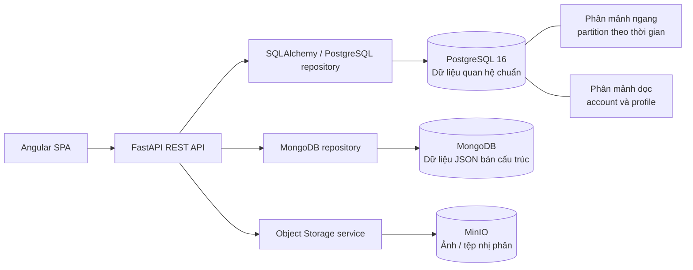

# KẾ HOẠCH 7 NGÀY MỞ RỘNG CSDL — Epic-Ecommerce-FastAPI / OldShop

> **Mục tiêu:** lập kế hoạch thiết kế và tích hợp lưu trữ đa mô hình cho marketplace OldShop trong 7 ngày: PostgreSQL cho dữ liệu quan hệ, MongoDB cho dữ liệu bán cấu trúc, MinIO cho tệp/đối tượng; bổ sung indexing, phân mảnh ngang/dọc, chiến lược phân tán, kiểm thử và tài liệu báo cáo.
>
> **Phạm vi tài liệu:** đây là kế hoạch triển khai, không phải xác nhận rằng các thành phần MongoDB, MinIO hay phân mảnh đã tồn tại trong mã nguồn.

## 1. Hiện trạng rút ra từ tài liệu dự án

- Backend: FastAPI, SQLAlchemy, Pydantic; frontend: Angular.
- PostgreSQL 16 là CSDL quan hệ hiện tại. Schema, index, constraint, function, trigger và seed được quản lý theo hướng **SQL-first** trong `database/`; `backend/app/models/` ánh xạ schema chứ không phải nguồn định nghĩa schema chuẩn.
- Những miền dữ liệu hiện có gồm người dùng/vai trò, danh mục/sản phẩm/ảnh sản phẩm, voucher, giỏ hàng, đơn hàng/chi tiết đơn/giao dịch/thanh toán, review, system logs, feedback và violation logs.
- `backend/app/core/database.py` quản lý kết nối SQLAlchemy; `backend/app/core/config.py` đọc cấu hình môi trường; `backend/app/services/storage.py` đang xử lý media. Tài liệu mô tả media hiện được phục vụ qua `/media` và có Docker volume `media`.
- Có `database/init.sql`, `database/01_schema/`, `database/02_functions/`, `database/03_seeds/`; có bộ integration test backend cần PostgreSQL thật.
- Tài liệu hiện có **chưa mô tả** kết nối MongoDB, MinIO hoặc một cụm PostgreSQL phân mảnh theo nhiều node. Vì vậy cần bổ sung cấu hình, adapter/service, kiểm thử và tài liệu tương ứng.
- Lưu ý vận hành quan trọng: `backend/scripts/init_db.py` có thể bỏ qua toàn bộ `init.sql` nếu đã phát hiện bảng người dùng hiện hữu. Không được giả định khởi động lại container sẽ tự áp dụng thay đổi schema; phải có SQL migration/cập nhật rõ ràng và thử trên DB test.

## 2. Mục tiêu và tiêu chí hoàn thành sau 7 ngày

### Kết quả bắt buộc

- [ ] Có sơ đồ kiến trúc lưu trữ và ERD/mô hình dữ liệu, thể hiện rõ dữ liệu nằm ở PostgreSQL, MongoDB hay MinIO.
- [ ] Có ma trận phân loại dữ liệu: quan hệ, bán cấu trúc, phi cấu trúc; ghi rõ nguồn dữ liệu chuẩn và khóa tham chiếu giữa các hệ.
- [ ] PostgreSQL vẫn là nguồn dữ liệu chuẩn cho giao dịch cốt lõi; có rà soát và bổ sung index dựa trên truy vấn thực tế.
- [ ] Có một phương án phân mảnh ngang và một phương án phân mảnh dọc được thiết kế rõ ràng; có bản thử nghiệm và kiểm thử phù hợp với phạm vi 7 ngày.
- [ ] MongoDB chạy được trong môi trường local, có collection/document mẫu, validation và index cơ bản.
- [ ] MinIO chạy được trong môi trường local, có bucket, upload/download ảnh và lưu object key/metadata trong PostgreSQL.
- [ ] FastAPI đọc/ghi được các kho dữ liệu cần thiết qua lớp service riêng; lỗi một kho dữ liệu không làm lộ credential hoặc gây hỏng âm thầm dữ liệu giao dịch.
- [ ] Có hướng dẫn chạy, cấu hình `.env.example`, hướng dẫn migration/seed, kết quả kiểm thử, báo cáo và dàn ý PPT.

### Ngoài phạm vi cần kiểm soát

- Không chuyển toàn bộ giao dịch đơn hàng/thanh toán ra MongoDB.
- Không lưu nội dung ảnh nhị phân trong MongoDB hoặc PostgreSQL; PostgreSQL chỉ lưu metadata/object key cần thiết.
- Không tuyên bố có sao chép dự phòng, tự động failover hoặc sharding nhiều node nếu chưa triển khai và kiểm thử thật.
- Không sửa schema trực tiếp trên DB có dữ liệu thật mà không backup và có kế hoạch rollback.

## 3. Kiến trúc đích đề xuất



> Sơ đồ thể hiện các dịch vụ lưu trữ tách biệt. Việc chạy PostgreSQL, MongoDB và MinIO ở các container riêng **chưa tự nó chứng minh PostgreSQL đã được sharding vật lý nhiều node**. Báo cáo cần phân biệt: (1) hệ lưu trữ phân tán/đa mô hình ở mức kiến trúc; (2) partition/phân mảnh logic trong PostgreSQL; (3) sharding PostgreSQL qua nhiều node là hạng mục nâng cao nếu giảng viên yêu cầu rõ phân phối từng shard sang máy chủ khác.

### 3.1 Phân công dữ liệu cho từng hệ

| Kho dữ liệu | Dữ liệu đề xuất | Nguồn dữ liệu chuẩn / nguyên tắc |
|---|---|---|
| PostgreSQL | User/account cốt lõi, role, category, product core, voucher, cart, order, order detail, transaction/payment, review và các quan hệ cần khóa ngoại/giao dịch | Nguồn dữ liệu chuẩn cho nghiệp vụ có ràng buộc và giao dịch. Không tạo bản sao có thể ghi độc lập ở MongoDB. |
| MongoDB | Thuộc tính sản phẩm linh hoạt theo danh mục (ví dụ cấu hình laptop, tình trạng đồ cũ, thông số khác nhau); hoặc sự kiện moderation/activity có cấu trúc thay đổi theo thời gian | Document tham chiếu bằng `product_id`, `user_id` hoặc mã nghiệp vụ. Không dựa vào MongoDB để thay thế khóa ngoại PostgreSQL. |
| MinIO | Ảnh sản phẩm, ảnh đại diện và tệp tải lên phù hợp phạm vi ứng dụng | Tên bucket/object key được quản lý rõ ràng; PostgreSQL lưu key, MIME type, kích thước và liên kết nghiệp vụ. Không đưa secret MinIO ra frontend. |

### 3.2 Quy ước đồng bộ giữa các kho

- Dùng ID nghiệp vụ hiện có từ PostgreSQL làm tham chiếu logic trong MongoDB; giữ đúng kiểu và định dạng ID theo schema thật.
- Không thực hiện giả định có transaction ACID chung giữa PostgreSQL, MongoDB và MinIO.
- Các thao tác liên kho cần thứ tự rõ ràng, xử lý lỗi và cơ chế bù trừ. Ví dụ upload ảnh: upload MinIO thành công rồi ghi metadata; nếu ghi metadata thất bại thì xóa object vừa tạo hoặc ghi log để retry.
- Khi xóa sản phẩm, xác định rõ hành vi với document MongoDB và object MinIO (xóa ngay, đánh dấu xóa mềm hay tác vụ nền). Không để tệp mồ côi không kiểm soát.
- Không lưu mật khẩu, access token, secret, dữ liệu thanh toán nhạy cảm hoặc dữ liệu cá nhân không cần thiết trong document log.

## 4. Thiết kế phân mảnh

### 4.1 Phân mảnh ngang — bản thử nghiệm an toàn

**Ưu tiên thử trên bảng log có tính chất ghi nối tiếp** như `system_logs` hoặc `violation_logs`, theo dải thời gian (RANGE partitioning). Ngày 1 phải xác nhận tên cột thời gian, khóa chính, ràng buộc, trigger và truy vấn hiện hữu trước khi chốt bảng. Không mặc định tên cột là `created_at` nếu DDL thực tế dùng tên khác.

- Ví dụ ý tưởng: các partition theo tháng/quý dựa trên cột thời gian thực tế; có partition mặc định hoặc quy trình tạo partition tiếp theo.
- Lý do: log thường tăng theo thời gian, truy vấn/xóa lưu trữ thường theo kỳ; ít rủi ro hơn việc lập tức phân mảnh `orders` đang có quan hệ với order details và payment/transaction.
- Kiểm thử: dữ liệu ở các mốc thời gian rơi đúng partition; truy vấn có bộ lọc thời gian trả đúng; constraint/FK, trigger, seed và báo cáo cũ vẫn hoạt động.
- Nếu yêu cầu môn học bắt buộc phân mảnh ngang trên dữ liệu đơn hàng, hãy lập thiết kế thứ hai cho `orders` sau khi rà soát khóa chính/khóa ngoại. PostgreSQL partitioned table có các giới hạn về unique key và tham chiếu; không chuyển bảng đơn hàng chỉ bằng một câu lệnh mà chưa kiểm chứng toàn bộ quan hệ.

### 4.2 Phân mảnh dọc — tách thuộc tính theo trách nhiệm

Thiết kế quan niệm tách dữ liệu người dùng thành hai phần, giữ một khóa định danh chung:

- **Account/core**: định danh, email đăng nhập, password hash, trạng thái tài khoản và các trường cần cho xác thực/phân quyền.
- **Profile**: tên hiển thị, avatar/object key, thông tin liên hệ hoặc thuộc tính hồ sơ phù hợp với chính sách bảo mật.

Cách triển khai tuần đầu: tách thành bảng riêng `user_profile` (hoặc tên theo quy ước hiện tại), có `user_id` làm khóa định danh/tham chiếu logic; chỉ đưa sang PostgreSQL node/database thứ hai (`PG_PROFILE`) khi nhóm đã chuẩn bị được session/engine riêng, xử lý lỗi và đồng bộ vòng đời account. Nếu chưa đủ thời gian tích hợp an toàn, hoàn thành tách bảng trong PostgreSQL hiện tại trước, mô tả rõ đây là **phân mảnh dọc logic**, không báo cáo nhầm thành phân phối vật lý qua nhiều node.

Các nguyên tắc bắt buộc:

- Xác minh đúng tên bảng, kiểu ID và các trường thực tế từ `database/01_schema/` trước khi viết SQL.
- Cập nhật SQL trước, sau đó đồng bộ ORM, Pydantic schema, CRUD/service, API và test.
- Khi profile nằm ở node khác, không có FK xuyên database; backend phải kiểm tra account tồn tại, xử lý account bị xóa/khôi phục, timeout, retry và lỗi đọc profile.
- Không chuyển email/password hash khỏi account store chỉ vì muốn minh họa phân mảnh dọc.

### 4.3 Phân biệt với sharding vật lý nhiều node

- Partition PostgreSQL theo thời gian thường chia dữ liệu thành các partition trong cùng hệ PostgreSQL; không mặc nhiên chia tải ghi/đọc qua nhiều máy chủ độc lập.
- Phân tán profile sang PostgreSQL instance khác là phân phối vật lý ở cấp ứng dụng, nhưng phải tự quản lý kết nối và tính nhất quán giữa hai DB.
- Nếu tiêu chí bắt buộc là **các shard PostgreSQL nằm trên nhiều node và ứng dụng định tuyến truy vấn đến shard**, hãy ghi thành tiêu chí nâng cao riêng, nghiên cứu công nghệ phù hợp (ví dụ giải pháp sharding PostgreSQL hoặc application-level shard router), và chỉ xác nhận hoàn thành sau khi có demo định tuyến, kiểm thử phân bố dữ liệu và giải thích giới hạn giao dịch liên shard.

## 5. Kế hoạch Indexing sơ bộ

Trước khi tạo index mới, rà soát index/constraint đã được định nghĩa trong `database/01_schema/` và đo truy vấn bằng `EXPLAIN (ANALYZE, BUFFERS)` trên DB test. Không tạo trùng index đã có; index giúp đọc nhanh nhưng tăng chi phí ghi và dung lượng.

| Kho / bảng hoặc collection | Index đề xuất | Truy vấn được hỗ trợ / lý do | Việc cần xác nhận |
|---|---|---|---|
| PostgreSQL — user/account | Unique B-tree trên email/login nếu schema và nghiệp vụ bảo đảm duy nhất | Đăng nhập, tra cứu tài khoản; đồng thời bảo đảm không trùng | Tên cột, chuẩn hóa chữ hoa/thường và index hiện có |
| PostgreSQL — products | B-tree trên khóa ngoại/thường lọc như `category_id`, `seller_id`, `status`; có thể dùng composite index theo mẫu truy vấn catalogue | Lọc sản phẩm theo danh mục/người bán/trạng thái | Kiểm tra điều kiện `WHERE`, `ORDER BY`, selectivity và index hiện hữu |
| PostgreSQL — orders | B-tree trên `user_id` và cột thời gian phù hợp; composite `(user_id, <timestamp>)` khi truy vấn lịch sử đơn theo người dùng | Lấy lịch sử đơn hàng và sắp xếp theo thời gian | Cột thật, chiều sắp xếp và các FK đã có |
| PostgreSQL — order details/cart | Index trên FK hay dùng để join, ví dụ `order_id`, `cart_id` | Join chi tiết đơn/giỏ hàng; FK không phải lúc nào cũng tự tạo index ở phía tham chiếu | Kiểm tra query plan và index có sẵn |
| PostgreSQL — tìm kiếm tên sản phẩm | GIN/GiST với `pg_trgm` nếu ứng dụng thực sự dùng tìm kiếm gần đúng/`ILIKE` | Tìm kiếm chuỗi con; dự án hiện đã bật extension `pg_trgm` theo tài liệu | Xác nhận truy vấn và benchmark trước/sau |
| MongoDB — product documents | Unique index trên `product_id` nếu mỗi sản phẩm chỉ có một document; index ghép theo các trường lọc thường dùng như `category_id`, `updated_at` | Tìm document theo sản phẩm, lọc/sắp xếp | Chọn đúng cardinality và quy tắc một/nhiều document mỗi sản phẩm |
| MongoDB — moderation/activity events (nếu chọn) | Compound index theo đối tượng và thời gian, ví dụ `{ target_id: 1, created_at: -1 }` | Tra lịch sử sự kiện mới nhất theo đối tượng | Không index mọi field JSON tùy tiện; cân nhắc TTL chỉ cho dữ liệu có chính sách lưu trữ rõ ràng |
| MinIO | Quy ước object key có prefix theo loại tài nguyên/ID, metadata và tag khi hữu ích | Quản lý, tra cứu và vòng đời đối tượng; đây không phải index SQL | Không nhầm object key/metadata của object store với index B-tree |

## 6. Thiết kế JSON mẫu cho MongoDB

Ví dụ document `product_documents` cho các thuộc tính linh hoạt của một sản phẩm. Đây là **mẫu minh họa**, tên trường và kiểu ID phải đồng bộ theo schema thật:

```json
{
  "product_id": 1001,
  "category_id": 2,
  "schema_version": 1,
  "attributes": {
    "brand": "ExampleBrand",
    "model": "X-14",
    "condition": "used_good",
    "ram_gb": 16,
    "storage_gb": 512
  },
  "search_tags": ["laptop", "used", "office"],
  "updated_at": "2026-10-25T09:00:00Z"
}
```

Checklist cho thiết kế JSON:

- [ ] Mô tả trường bắt buộc/tùy chọn, kiểu dữ liệu, đơn vị và giá trị hợp lệ.
- [ ] Có `schema_version` để quản lý thay đổi cấu trúc document.
- [ ] Đặt tên nhất quán (`snake_case` hoặc quy ước đã chọn) và thống nhất timezone ISO-8601 UTC cho timestamp.
- [ ] Xác định `product_id` có duy nhất trong collection hay không; đặt unique index nếu đúng nghiệp vụ.
- [ ] Có chiến lược document cũ khi schema thay đổi: đọc tương thích, migration hoặc chuyển đổi khi ghi.
- [ ] Không sao chép các trường giá, trạng thái, tồn kho đang là dữ liệu giao dịch chuẩn sang MongoDB để cập nhật độc lập.

Ví dụ metadata ảnh lưu trong PostgreSQL (không lưu bytes ảnh trong JSON):

```json
{
  "product_id": 1001,
  "object_key": "products/1001/8f2a-image.webp",
  "bucket": "oldshop-media",
  "content_type": "image/webp",
  "size_bytes": 245760
}
```

## 7. Kế hoạch theo từng ngày

> Gợi ý nhịp làm việc: đầu ngày thống nhất mục tiêu và người phụ trách; cuối ngày commit mã/tài liệu, cập nhật checklist, ghi rõ blocker và chạy ít nhất một kiểm tra có thể lặp lại. Nếu làm cá nhân, một người có thể nhận nhiều vai trò.

### Ngày 1 — Khảo sát hiện trạng, chốt phạm vi và thiết kế tổng thể

**Mục tiêu:** hiểu rõ schema/truy vấn hiện tại trước khi sửa, xác định phương án ít rủi ro và tiêu chí demo.

- [ ] Đọc `PROJECT_GUIDE.md`, `README.md`, `docker-compose.yml`, `backend/app/core/config.py`, `backend/app/core/database.py`, `backend/app/services/storage.py`.
- [ ] Rà soát `database/init.sql` và từng SQL trong `database/01_schema/`: bảng, PK/FK, constraint, index, trigger, cột timestamp và quan hệ giữa `orders`, `order_details`, `transactions`, users và products.
- [ ] Chạy stack hiện tại; xác nhận API docs, kết nối PostgreSQL và baseline integration tests. Ghi lại lệnh chạy và lỗi nền có sẵn.
- [ ] Lập ma trận: dữ liệu nào ở PostgreSQL, dữ liệu JSON nào chuyển sang MongoDB, tệp nào chuyển sang MinIO; xác định data owner và ID tham chiếu.
- [ ] Chốt bảng ít rủi ro cho bản thử nghiệm phân mảnh ngang (ưu tiên log theo thời gian sau khi kiểm tra DDL); quyết định phạm vi phân mảnh dọc và có/không triển khai profile node riêng.
- [ ] Vẽ ERD hiện trạng và ERD đích bản đầu; vẽ sơ đồ thành phần phân tán.
- [ ] Tạo danh sách index hiện có và truy vấn nghiệp vụ cần benchmark.

**Đầu ra cuối ngày:** `docs/database-design/current-state.md`, ERD bản đầu, ma trận lưu trữ, checklist rủi ro/migration.

**Tiêu chí hoàn thành:** nhóm giải thích được dữ liệu nào là nguồn chuẩn, vì sao chọn dữ liệu cho MongoDB/MinIO, và có danh sách thay đổi schema cụ thể.

### Ngày 2 — Thiết kế ERD, phân mảnh dọc và SQL migration

**Mục tiêu:** hoàn thiện mô hình quan hệ và tạo thay đổi SQL an toàn, không phá vỡ dữ liệu hiện tại.

- [ ] Chốt ERD/mô hình quan niệm và mô hình ứng dụng; thể hiện PK, FK, cardinality và quan hệ logic sang MongoDB/MinIO.
- [ ] Thiết kế phân mảnh dọc account/profile: ánh xạ từng cột thật vào phần core hoặc profile, giữ chung định danh; không đưa password/token sang profile.
- [ ] Nếu tách `user_profile` thành bảng trong cùng PostgreSQL: tạo SQL migration idempotent hoặc có kiểm tra trạng thái; bổ sung backfill dữ liệu, constraint/index và kế hoạch rollback.
- [ ] Nếu profile đặt trên PostgreSQL instance thứ hai: thêm quyết định kiến trúc, biến môi trường, engine/session riêng và hành vi khi profile node không sẵn sàng; chỉ bắt đầu di chuyển nếu có đủ thời gian kiểm thử. Không tuyên bố phân phối vật lý nếu chưa chạy được node riêng.
- [ ] Cập nhật ORM mapping, Pydantic schema, CRUD/service và API liên quan theo nguyên tắc SQL-first.
- [ ] Kiểm tra tương thích frontend Angular nếu response profile thay đổi; giữ API contract ổn định khi có thể.
- [ ] Chạy migration trên DB test sạch và DB test có dữ liệu seed; kiểm tra số lượng/bản ghi sau backfill.

**Đầu ra cuối ngày:** ERD đã chốt, SQL migration và rollback note, bảng ánh xạ cột trước/sau, cập nhật backend đầu tiên.

**Tiêu chí hoàn thành:** có thể khởi tạo schema test mới và nâng cấp DB test hiện hữu theo hướng dẫn mà không phải nạp lại toàn bộ seed một cách mù quáng.

### Ngày 3 — Phân mảnh ngang và tối ưu Indexing PostgreSQL

**Mục tiêu:** triển khai bản thử nghiệm phân mảnh ngang và chứng minh index hỗ trợ truy vấn cần thiết.

- [ ] Chốt bảng log phù hợp và cột timestamp theo DDL thật; xem xét PK/FK/trigger trước khi phân vùng.
- [ ] Viết SQL partition theo RANGE (tháng/quý tùy lượng dữ liệu), quy trình tạo partition kế tiếp và cách xử lý bản ghi ngoài dải.
- [ ] Kiểm tra cách tương thích với `database/init.sql`, seed và `backend/scripts/init_db.py`; bổ sung migration riêng nếu init script không áp dụng cho DB đã tồn tại.
- [ ] Rà soát index hiện có; chỉ thêm index còn thiếu cho các đường truy vấn thật: đăng nhập, catalogue, lịch sử đơn, join FK và tìm kiếm chuỗi nếu có dùng.
- [ ] Thu thập `EXPLAIN (ANALYZE, BUFFERS)` trước/sau với bộ dữ liệu thử nghiệm; ghi lại thời gian và kế hoạch truy vấn, không hứa cải thiện nếu chưa đo.
- [ ] Kiểm thử dữ liệu sát ranh giới partition, bộ lọc thời gian, insert/update/delete, trigger và truy vấn báo cáo.
- [ ] Viết chú thích giải thích index: query nào dùng, lợi ích dự kiến, chi phí ghi/dung lượng và khi nào cần xem lại.

**Đầu ra cuối ngày:** SQL partition/index, bảng kết quả benchmark, kịch bản kiểm thử phân mảnh ngang.

**Tiêu chí hoàn thành:** partition nhận dữ liệu đúng và không làm sai kết quả truy vấn; các index mới có lý do dựa trên query plan.

### Ngày 4 — Bổ sung MongoDB cho dữ liệu bán cấu trúc

**Mục tiêu:** chạy MongoDB local và tích hợp một use case thật, giới hạn phạm vi rõ ràng.

- [ ] Thêm MongoDB vào Compose dùng cho phát triển; khai báo volume, health check, network và thông tin kết nối qua `.env.example`.
- [ ] Chọn một use case duy nhất để triển khai trước, ưu tiên `product_documents.attributes` vì thuộc tính sản phẩm đồ cũ có thể khác nhau theo danh mục. Phương án thay thế là moderation/activity events nếu phù hợp hơn sau khảo sát.
- [ ] Chọn driver tương thích với cách gọi sync/async trong backend; thêm dependency và cấu hình riêng, không ghép logic MongoDB vào `core/database.py` của PostgreSQL.
- [ ] Tạo `MongoDB` repository/service riêng với hàm đọc, ghi, cập nhật, xử lý lỗi và đóng kết nối đúng vòng đời ứng dụng.
- [ ] Định nghĩa cấu trúc JSON, `schema_version`, quy tắc ID, timestamp và validation phía ứng dụng/database phù hợp.
- [ ] Tạo index cơ bản dựa trên truy vấn thật, ví dụ unique `product_id` và compound index cho trường lọc/sắp xếp được sử dụng.
- [ ] Thêm test cho ghi/đọc document, document thiếu trường, dữ liệu sai kiểu, MongoDB mất kết nối và trường hợp sản phẩm PostgreSQL không tồn tại.
- [ ] Viết hướng dẫn seed/clean dữ liệu demo; bảo đảm MongoDB không trở thành nguồn chuẩn cho giá/tồn kho/trạng thái giao dịch.

**Đầu ra cuối ngày:** service MongoDB, document mẫu, index, test và hướng dẫn chạy local.

**Tiêu chí hoàn thành:** có thể đọc/ghi một thuộc tính bán cấu trúc qua FastAPI mà không làm ảnh hưởng luồng sản phẩm cốt lõi hiện tại.

### Ngày 5 — Bổ sung MinIO cho dữ liệu phi cấu trúc

**Mục tiêu:** chuyển upload ảnh thử nghiệm từ filesystem sang object storage, hoặc tạo adapter tương thích cho cả hai backend lưu trữ.

- [ ] Thêm MinIO vào Compose, volume, health check, bucket khởi tạo và cấu hình endpoint/access key/secret trong môi trường local.
- [ ] Không commit thông tin xác thực thật; chỉ cung cấp giá trị mẫu an toàn trong `.env.example`.
- [ ] Thiết kế adapter trong/bao quanh `backend/app/services/storage.py` để API không phụ thuộc trực tiếp vào chi tiết MinIO; giữ local storage làm fallback nếu cần.
- [ ] Quyết định cách trả ảnh: URL presigned có thời hạn hoặc endpoint backend proxy. Không tạo URL public vô thời hạn nếu dữ liệu cần bảo vệ.
- [ ] Lưu object key, bucket, content type, kích thước và ID tài nguyên trong PostgreSQL; điều chỉnh bảng hiện có sau khi kiểm tra schema `product_images`/avatar.
- [ ] Thực hiện upload, tải/xem ảnh, xóa ảnh, kiểm tra giới hạn dung lượng và loại file; giữ hành vi URL/media tương thích frontend nếu có thể.
- [ ] Kiểm thử tình huống upload thành công nhưng ghi metadata thất bại, object không tồn tại, quyền truy cập sai và MinIO tạm ngừng.
- [ ] Quy định cách xử lý ảnh seed hiện có và media cũ; không xóa volume cũ cho đến khi đã xác minh chuyển đổi.

**Đầu ra cuối ngày:** cấu hình MinIO, storage adapter, hướng dẫn bucket/keys, ảnh minh họa đã lưu object storage và test upload.

**Tiêu chí hoàn thành:** FastAPI có thể upload và trả đường dẫn truy cập ảnh; PostgreSQL lưu metadata, MinIO lưu bytes.

### Ngày 6 — Tích hợp phân tán, kiểm thử xuyên tầng và độ tin cậy

**Mục tiêu:** xác minh các kho phối hợp được qua API và có hành vi lỗi được kiểm soát.

- [ ] Hoàn thiện sơ đồ luồng dữ liệu: Angular → FastAPI → PostgreSQL/MongoDB/MinIO; đánh dấu nơi có giao dịch ACID và nơi chỉ có tham chiếu logic.
- [ ] Kiểm thử luồng sản phẩm: tạo/cập nhật product core ở PostgreSQL, thuộc tính linh hoạt ở MongoDB và ảnh ở MinIO; kiểm tra ID liên kết chính xác.
- [ ] Kiểm thử account/profile sau phân mảnh dọc: tạo, đọc, cập nhật, xóa/khóa account; xác định cách xử lý profile không còn account tương ứng.
- [ ] Kiểm thử phân mảnh ngang với dữ liệu nằm ở nhiều partition; xác minh kết quả tổng hợp và bộ lọc theo thời gian.
- [ ] Chạy backend pytest/integration tests trên PostgreSQL test sạch; chạy test mới của MongoDB/MinIO riêng hoặc theo Compose test; chạy lint/format theo quy ước hiện tại.
- [ ] Thêm timeout, thông báo lỗi, retry có giới hạn và log đủ ngữ cảnh nhưng không ghi secret/PII; xác định tác vụ nào có thể retry an toàn.
- [ ] Kiểm tra bảo mật cấu hình, volume persistence, backup/restore tối thiểu và cách khởi động lại từng dịch vụ.
- [ ] Cập nhật cấu hình Compose và hướng dẫn để một thành viên khác có thể dựng môi trường từ đầu.
- [ ] Ghi rõ giới hạn chưa giải quyết: transaction liên kho, consistency, node failure, khả năng sharding vật lý; không mô tả quá mức kết quả đã đạt.

**Đầu ra cuối ngày:** test report, sơ đồ kiến trúc cuối, hướng dẫn vận hành/khôi phục và danh sách hạn chế đã biết.

**Tiêu chí hoàn thành:** luồng quan trọng hoạt động trong môi trường sạch; các lỗi dịch vụ được xử lý hoặc báo lỗi rõ ràng, không mất dữ liệu âm thầm.

### Ngày 7 — Chốt tài liệu, báo cáo và PPT

**Mục tiêu:** đóng gói kết quả có thể trình bày và tái hiện.

- [ ] Hoàn thiện báo cáo thiết kế dữ liệu: hiện trạng, mục tiêu, lựa chọn công nghệ, ma trận dữ liệu, ERD/mô hình quan niệm và mô hình ứng dụng.
- [ ] Hoàn thiện sơ đồ hệ thống phân tán, mô tả tuyến dữ liệu, nơi lưu dữ liệu, tham chiếu giữa kho và chiến lược xử lý khi một dịch vụ lỗi.
- [ ] Ghi lại phân mảnh ngang/dọc: phương án, cách phân chia, khóa định danh, truy vấn minh họa, giới hạn và bằng chứng kiểm thử.
- [ ] Hoàn thiện mục JSON: tài liệu field/type/required, document mẫu, validation, index và chính sách versioning.
- [ ] Hoàn thiện bảng indexing: bảng/collection, trường, loại index, truy vấn phục vụ, kết quả đo trước/sau và index đã có để tránh tạo trùng.
- [ ] Viết README/runbook: cách chạy Compose, biến môi trường, init/migration/seed, cách kiểm tra dữ liệu từng kho, test và cleanup an toàn.
- [ ] Chuẩn bị PPT theo luồng: bài toán/hiện trạng → kiến trúc đích → ERD → phân mảnh và indexing → JSON/MongoDB → MinIO → demo/test → kết quả, giới hạn, hướng phát triển.
- [ ] Chuẩn bị hình minh họa: ERD, sơ đồ kiến trúc, ví dụ document JSON, ví dụ object key, ảnh chụp dữ liệu trong PostgreSQL/MongoDB/MinIO và log/test result.
- [ ] Rà soát thuật ngữ, tính nhất quán của tên bảng/cột, đánh dấu nội dung nào đã triển khai và nội dung nào mới là đề xuất.
- [ ] Diễn tập demo theo checklist, có dữ liệu mẫu và phương án dự phòng nếu một container không khởi động.

**Đầu ra cuối ngày:** báo cáo Markdown/PDF theo yêu cầu môn học, PPT, source/config đã cập nhật, kết quả test và kịch bản demo.

**Tiêu chí hoàn thành:** người khác làm theo tài liệu có thể dựng demo, hiểu sơ đồ, kiểm tra dữ liệu và phân biệt chính xác phần đã triển khai với phần định hướng.

## 8. Phân công nhiệm vụ gợi ý

Điều chỉnh theo số thành viên thực tế. Nếu làm một mình, dùng các vai trò này làm nhóm công việc tuần tự.

| Vai trò | Phụ trách | Kết quả bàn giao |
|---|---|---|
| A — Data/DB designer | Khảo sát DDL, ERD, SQL migration, partition, indexing và benchmark | ERD, migration, ma trận index, kết quả `EXPLAIN` |
| B — Backend/integration | Cấu hình kết nối, repository/service MongoDB và MinIO, API, validation, xử lý lỗi | Backend thay đổi, `.env.example`, tests/service |
| C — DevOps/QA | Docker Compose, volumes/health checks, test integration, backup/restore và kịch bản dựng mới | Compose chạy được, test report, runbook |
| D — Documentation/presentation | Báo cáo, sơ đồ, JSON data dictionary, PPT và kịch bản demo | Báo cáo/PPT đồng bộ với mã triển khai |

**Điểm bàn giao giữa các vai trò:** A chốt schema/ID trước khi B tích hợp; B thông báo API/response thay đổi cho C kiểm thử và kiểm tra frontend; D chỉ ghi “đã triển khai” khi có commit hoặc kết quả test chứng minh.

## 9. Mốc kiểm tra cuối tuần

- [ ] **D1:** baseline dự án và thiết kế tổng thể được chốt.
- [ ] **D2:** ERD và migration phân mảnh dọc có thể kiểm thử.
- [ ] **D3:** partition ngang và indexing có test/benchmark.
- [ ] **D4:** MongoDB chạy được và có use case JSON qua service.
- [ ] **D5:** MinIO upload/download được, metadata nằm trong PostgreSQL.
- [ ] **D6:** test xuyên tầng, kiểm tra lỗi và hướng dẫn triển khai được cập nhật.
- [ ] **D7:** báo cáo, PPT, sơ đồ và demo hoàn chỉnh.

### Định nghĩa “hoàn thành” cho từng hạng mục

Một hạng mục chỉ được đánh dấu hoàn thành khi có đủ: (1) mã hoặc tài liệu được commit; (2) lệnh kiểm tra có thể chạy lại; (3) kết quả kiểm tra được ghi lại; (4) cấu hình/ảnh hưởng tới môi trường hiện tại được mô tả; và (5) không làm hỏng luồng PostgreSQL/API hiện hành.

## 10. Rủi ro và phương án giảm thiểu

| Rủi ro | Cách giảm thiểu |
|---|---|
| Schema thực tế khác giả định trong ERD | Đọc SQL trong `database/01_schema/` và mô hình SQLAlchemy trước khi viết migration; ghi tên cột thực tế trong tài liệu. |
| Khởi động lại không áp dụng schema mới | Tạo migration/update SQL rõ ràng; không dựa vào `init_db.py` để tự nâng cấp DB hiện hữu. |
| Phân mảnh làm lỗi PK/FK, trigger hoặc query cũ | Chọn bảng log ít rủi ro cho bản thử đầu; chạy integration tests và kiểm tra toàn bộ đường tham chiếu. |
| Hai PostgreSQL instance không có transaction chung | Giữ giao dịch cốt lõi cùng một DB; profile node chỉ dùng nếu có lý do và có chính sách lỗi/đồng bộ rõ ràng. |
| PostgreSQL, MongoDB và MinIO bị lệch dữ liệu | Chỉ định nguồn chuẩn, thứ tự ghi, retry/compensation và quy trình đối soát; không dual-write không kiểm soát. |
| Index làm chậm ghi hoặc tăng dung lượng | Chỉ thêm sau khi rà soát index có sẵn; đo query plan trước/sau trên DB test. |
| MinIO URL/credential không an toàn | Secret ở environment, bucket policy tối thiểu, URL có thời hạn hoặc proxy backend; không đưa secret vào frontend. |
| Không đủ thời gian cho sharding nhiều node thực sự | Hoàn thiện kiến trúc đa kho + partition/index trước; trình bày sharding vật lý là hạng mục nâng cao nếu chưa có demo định tuyến thật. |

## 11. Cấu trúc tài liệu đề xuất trong repository

```text
docs/
  database-design/
    current-state.md             # Hiện trạng schema và truy vấn
    target-architecture.md       # Kiến trúc, ma trận dữ liệu, chiến lược phân tán
    erd.mmd                      # ERD bằng Mermaid hoặc nguồn sơ đồ khác
    fragmentation.md             # Phân mảnh ngang/dọc và giới hạn
    indexing.md                  # Danh sách index và benchmark
    json-schema.md               # Data dictionary và document mẫu
    operations.md                # Cấu hình, chạy, migration, backup/restore
    test-report.md               # Kết quả kiểm thử và hạn chế
  report/
    database-design-report.md
    presentation-outline.md
```

> Tên thư mục/file có thể thay đổi theo quy ước của nhóm; điều quan trọng là các sơ đồ, báo cáo và hướng dẫn phải khớp với schema, mã nguồn và kết quả kiểm thử thực tế.
