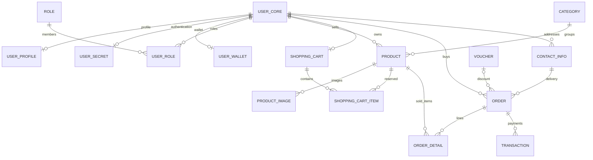
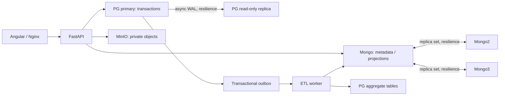
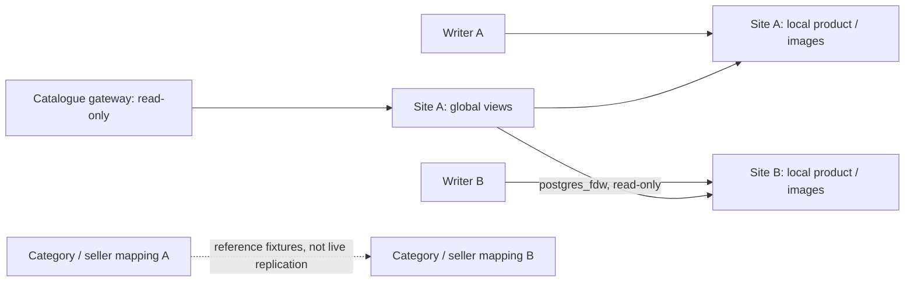

# Phân tích lỗi cấu hình trên Windows và khuyến nghị quyết định — 04-11-26

Ngày lập: **04/11/2026**, múi giờ Việt Nam. Đối tượng: nhóm triển khai OldShop và nhóm chuẩn bị báo cáo/PPT.

**Phạm vi:** chỉ bổ sung tài liệu phân tích này. Không sửa script, Compose, cấu hình, SQL, dữ liệu hoặc tài liệu cũ; không chạy dựng lại, seed, migration hay phục hồi trên stack hiện hữu. Các lệnh bên dưới là hướng dẫn cho người vận hành thực hiện sau khi xác định đúng tình trạng máy.

**Căn cứ:** đọc source trong workspace tại thời điểm phân tích, HEAD `4dbca62`, bao gồm các thay đổi chưa commit đã có sẵn. Chưa có log nguyên bản, phiên bản Docker/WSL, cấu hình phần cứng hoặc quyền truy cập máy Windows gặp lỗi. Evidence trong repository là kết quả lịch sử của môi trường được ghi trong từng file, không chứng minh máy Windows này đã chạy thành công.

## 1. Đề xuất quyết định

**Giữ thiết kế dữ liệu và cơ chế bảo vệ secret; ưu tiên hoàn thiện quy trình vận hành Windows và thu bằng chứng trước khi thay kiến trúc.** Chưa đủ căn cứ để kết luận phải bỏ replica, MongoDB, MinIO hoặc ETL.

| Nội dung cần quyết định | Đề xuất | Căn cứ và điều kiện |
|---|---|---|
| Không ghi đè `deploy/.env.data` | **Giữ** | Đây là bảo vệ chủ ý; sửa thành tự ghi đè có thể làm credentials lệch với volume cũ. |
| Traceback `FileExistsError` khi chạy lại generator | **Có thể cải thiện thông báo sau** | Bắt đúng ngoại lệ, giải thích dùng lại file; vẫn giữ `O_EXCL`. Không coi file tồn tại là cấu hình hợp lệ và không báo “đã tạo” nếu bỏ qua. |
| Giải thích EOF/125 là do job init ghi đĩa nặng | **Thay cách kết luận** | Đây là giả thuyết, chưa có log/resource metrics xác nhận. Phải phân biệt lỗi shell, CLI/Engine và tiến trình trong container. |
| Giải thích 500/502 named pipe chắc chắn do quá tải | **Thay cách kết luận** | Xác định được tầng giao tiếp Docker Desktop/Engine bị lỗi; nguyên nhân gốc còn có thể là WSL/daemon/storage/context/API/version. |
| Hướng dẫn bật `resilience` ngay từ đầu | **Bổ sung nhánh lựa chọn, ưu tiên khởi động từng chặng** | Compose đã có base và profile riêng. Với máy mới có thể nghiệm thu base trước; stack Mongo đã có 3 voter phải giữ quorum. |
| `dc run --rm --no-deps` cho công việc một lần | **Giữ cho chạy bình thường; thêm nhánh chẩn đoán giữ container** | `--no-deps` đã có trong hướng dẫn. Bỏ `--rm` khi cần xem lại trạng thái thất bại; `-T` chỉ giúp loại yếu tố terminal. |
| Database bootstrap và migration | **Giữ kiểm tra checksum/lock; ưu tiên xem xét phục hồi init dở** | `init_db` chỉ dùng sự tồn tại `user`/`user_core` để bỏ qua baseline. Mất kết nối giữa baseline có thể để lại schema thiếu. |
| Mô hình báo cáo phân tán | **Giữ cả kiến trúc ứng dụng và bài kiểm chứng hai site, trình bày riêng** | Replication/partition trên một host khác phân mảnh product qua hai PostgreSQL độc lập. Chưa được khẳng định chịu mất máy vật lý. |
| PPT/báo cáo hiện có | **Tái sử dụng, đề xuất cập nhật phần mới** | Bản Ngày 7 dựa trên schema đến 006; indexing JSON ngày 03/11 và hai site ngày 04/11 cần được đối chiếu khi xuất bản tiếp. |

Ưu tiên thực hiện: **(1)** kiểm Engine độc lập; **(2)** nhận diện env/volume/topology hiện hữu; **(3)** khởi động giảm đồng thời; **(4)** nghiệm thu đúng phạm vi; **(5)** chỉ đề xuất sửa code khi có lỗi tái hiện hoặc rủi ro source cụ thể. Không dùng giảm tải làm bằng chứng rằng giả thuyết quá tải đã được xác nhận.

## 2. Bằng chứng đã đối chiếu trong repository

| Nguồn | Điều quan sát được | Ý nghĩa |
|---|---|---|
| [Hướng dẫn cấu hình và chạy](HUONG_DAN_CAU_HINH_VA_CHAY_HE_THONG.md), mục 1, 3.1, 4–7, 10 | Đã phân biệt cài mới/chạy lại, đã giải thích FileExistsError, đã chạy init tuần tự với `--no-deps`; nhánh chính bật `resilience`. | Không nên đề nghị “thêm --no-deps” hay “bổ sung cảnh báo env tồn tại” như thể tài liệu chưa có. Cần làm rõ điểm rẽ và chẩn đoán. |
| [prepare-data-env.py](../deploy/scripts/prepare-data-env.py) | `os.open(..., os.O_WRONLY | os.O_CREAT | os.O_EXCL, 0o600)`. | Xác nhận cơ chế từ chối ghi đè; không kiểm được nội dung env chỉ bằng ngoại lệ tồn tại. |
| [Compose dữ liệu](../deploy/docker-compose.distributed.yml) | Project `oldshop-data`; base/profile; limit từng service; named volumes; job init `restart: "no"`. | Có thể giảm tải khởi động qua cách gọi lệnh, chưa cần sửa file Compose. |
| [Mongo init](../deploy/data/mongo/init.js) | Khởi tạo 1 member; thêm 2/3 lần lượt; chờ committed config và SECONDARY; không thu nhỏ set khi chạy lại. | Không được tắt 2 secondary rồi coi một voter còn lại là base hoạt động bình thường. |
| [MinIO init](../deploy/data/minio/init.sh) | Tạo **4** bucket, policy và app user; không upload cả bộ media. | Gọi đây là job I/O nặng chỉ dựa tên là thiếu căn cứ. Hướng dẫn mục 5.2 còn ghi “ba bucket”, khác mã và mục 6. |
| [PG replica](../deploy/data/postgres/start-replica.sh) | Dùng `pg_basebackup` với volume mới; từ chối volume không rỗng nhưng thiếu `PG_VERSION`. | Đây là một nguồn I/O đáng kiểm tra; retry không tự chữa volume khởi tạo dở. |
| [init_db.py](../backend/scripts/init_db.py), [init.sql](../database/init.sql), [migrate.py](../backend/scripts/migrate.py) | Baseline được chạy bằng `psql -v ON_ERROR_STOP=1 -q -f init.sql`, không có `--single-transaction`; migration sau đó có lock/checksum và transaction theo phiên bản. | Không đánh đồng tính an toàn migration với tính nguyên tử của toàn bộ bootstrap ban đầu. |
| [Dockerfile backend](../backend/Dockerfile), [entrypoint](../backend/docker-entrypoint.sh) | Backend tự gọi bootstrap lúc start; healthcheck image gọi `/health`. | Backend restart có thể kiểm migration lại; liveness đạt không thay được kiểm `/health/ready`. |
| [Index catalog](../database/indexing/catalog.json), [validation 03/11](evidence/index_config_validation.json) | `index-v1`: 98 khai báo root PG = 61 application + 37 constraint; 19 Mongo application/ETL. | Đây là số khai báo, không phải số physical index relations gồm partition children. |
| [Hướng dẫn hai site](HUONG_DAN_CSDL_PHAN_TAN.md), [kết quả site](evidence/distributed/test_results.json), [kết quả API](evidence/distributed/api_results.json) | Evidence lưu PASS, `physical_hosts_verified: false`; gateway chỉ đọc tách khỏi commerce API. | Có cơ sở trình bày phân tán logic và giới hạn một host; chưa có chứng cứ hai máy hoặc checkout đa site. |
| [Nhật ký Ngày 7](DAY7_FINDINGS_LOG.md), [nguồn báo cáo](report/07_report.md), [nguồn slide](report/07_slides.md) | Hồ sơ Ngày 7 đã có; artifact PDF/PPTX cũng hiện diện trong workspace nhưng là generated/ignored. | Không cần làm lại toàn bộ; cần kiểm nội dung hiện hành khi xuất bản mới. Lần phân tích này không tái kiểm tính toàn vẹn Office/PDF. |

## 3. Phân tích từng nhóm lỗi

### 3.1. `FileExistsError`: đã xác nhận hành vi, chưa xác nhận chất lượng cấu hình

Nhận định người dùng cung cấp **đúng với source**: `O_CREAT | O_EXCL` yêu cầu tạo file mới độc quyền; file đã có sẽ làm thao tác thất bại trước khi ghi đè. Đây không phải lỗi Docker hoặc lỗi riêng Windows.

Giữ nguyên file nếu muốn dùng dữ liệu cũ. Password PostgreSQL/Mongo/MinIO được tạo hoặc cài vào dịch vụ khi khởi tạo; đổi nội dung `.env.data` không tự thay password trong dịch vụ. `MONGO_KEYFILE` còn phải thống nhất giữa các member. Sinh lại env có thể khiến cả stack không xác thực được.

Tuy nhiên, file tồn tại có thể là bản mẫu còn `CHANGE_ME`, file thiếu biến, hoặc file sinh dở. Generator mở file rồi mới ghi, không thay thế nguyên tử qua file tạm. Khi gặp trường hợp đó, đối chiếu cấu hình/backup và trạng thái volumes; không tự coi “đã tồn tại” là “đã sẵn sàng”, cũng không tự xóa file. Máy mới thực sự chưa có dữ liệu khác với máy đã khởi tạo DB.

**Đề xuất sửa sau nếu được chọn:** xử lý riêng `FileExistsError` bằng thông báo có đường dẫn và chỉ dẫn dùng lại/kiểm tra; vẫn mở bằng `O_EXCL` để tránh race. Không thêm `--force` mặc định, không nuốt `PermissionError` hay lỗi ghi đĩa. Nếu làm chế độ “ensure env”, chỉ trả thành công sau khi kiểm đầy đủ điều kiện, không chỉ `exists()`.

### 3.2. `unexpected EOF` và mã `125`: cần lấy lỗi nguyên bản

`unexpected EOF` có ít nhất ba ngữ cảnh khác nhau:

| Vị trí báo lỗi | Hướng điều tra trước |
|---|---|
| Bash/sh báo thiếu dấu nháy, here-document hoặc `unexpected EOF while looking for ...` | Kiểm cú pháp, dòng kết thúc, CRLF/BOM và file script được mount; đây có thể là lỗi parser trong container/WSL. |
| Docker báo EOF khi pull/build | Kiểm registry, mạng/proxy, image layer, cache/storage và daemon; không quy ngay về job ứng dụng. |
| Docker báo EOF khi create/start/attach/wait | Kiểm trạng thái Engine, container thực đã tạo/chạy/xong chưa và log daemon cùng thời điểm. |

Tài liệu Docker định nghĩa **125 cho `docker run`** là lỗi phía Docker khi chạy container; nó không mã hóa nguyên nhân “I/O timeout”. Với **`docker compose run`**, phải thu cả exit code của CLI và `State.ExitCode` của container; không áp máy móc mọi quy ước của `docker run` lên toàn bộ thao tác Compose. [Docker: exit status](https://docs.docker.com/engine/containers/run/#exit-status).

Đối chiếu công việc thực tế:

- `mongo-init`: xác thực, initiate set nếu cần, chờ primary, tạo app user; `mongo-expand`: reconfigure rồi chờ secondary. Mongo initial sync có thể phát sinh I/O ở các member, nhưng không chứng minh `mongosh` init tự ghi một khối dữ liệu lớn.
- `minio-init`: tạo bucket/policy/user; upload seed nằm ở `scripts.seed_media` riêng. Chưa có dữ liệu nào xác nhận job này nặng.
- `scripts.init_db`: baseline, seed, indexes/migrations và chép media; có khả năng tốn tài nguyên tùy dữ liệu/thời điểm.
- `pg-replica`: base backup lần đầu; Mongo secondary: initial sync; build image và full ETL cũng có thể tạo tải. Cần đo toàn bộ chặng, không chỉ container mang tên init.

Job một lần kết thúc `Exited (0)` là bình thường. Lỗi attach/wait sau khi job đã commit thành công không đồng nghĩa phải seed lại. Ngược lại, CLI bị ngắt không bảo đảm job đã rollback toàn bộ.

### 3.3. `500/502` tại `//./pipe/dockerDesktopLinuxEngine`: đúng tầng lỗi, chưa rõ nguyên nhân gốc

Đường dẫn này biểu diễn named pipe của Docker Desktop Linux Engine trên Windows; nó không phải URL website OldShop. HTTP 500/502 trong thông báo Docker cho thấy request quản lý container không được xử lý thành công ở đường giao tiếp đó. Không thể từ đó kết luận FastAPI route hay Nginx của dự án lỗi.

Các giả thuyết cần kiểm gồm: Docker Desktop/WSL vừa khởi động lại hoặc bị treo; RAM/swap/đĩa hoặc VHDX gặp vấn đề; daemon/container runtime lỗi; context hay `DOCKER_HOST`/`DOCKER_CONTEXT`/`DOCKER_API_VERSION` bị override; phiên bản thành phần không tương thích. Tải khởi động đồng thời là một giả thuyết hợp lý **nếu** có metrics và log trùng thời điểm. Docker cung cấp quy trình đọc log/diagnostics để phân biệt những trường hợp này. [Docker Desktop troubleshooting](https://docs.docker.com/desktop/troubleshoot-and-support/troubleshoot/).

Nếu `docker version` không lấy được Server hoặc `docker info` cũng lỗi khi chưa chạy project, ưu tiên phục hồi Engine. Nếu Engine đáp ứng ổn và chỉ một job thất bại với traceback/SQL/auth cụ thể, chuyển sang sửa lỗi job/cấu hình tương ứng.

Nếu trình duyệt thực sự nhận 500/502 tại `http://localhost:58080/...` hoặc `:58000/...`, cần log frontend/backend và `/health/ready` riêng; không gộp sự cố này vào named pipe chỉ vì cùng mã HTTP.

### 3.4. Tài nguyên: có cơ sở giảm tải, chưa có ngưỡng tối thiểu đã đo

Tổng hợp từ limit trong Compose hiện tại, chỉ tính dịch vụ thường trực:

| Nhóm | Base | Khi bật `resilience` |
|---|---:|---:|
| PG primary / primary + replica | 512 MiB | 1.024 MiB |
| Mongo 1 / 3 member | 768 MiB | 2.304 MiB |
| MinIO | 512 MiB | 512 MiB |
| Backend | 768 MiB | 768 MiB |
| ETL worker | 512 MiB | 512 MiB |
| Frontend | 128 MiB | 128 MiB |
| **Tổng limit** | **3.200 MiB ≈ 3,125 GiB; 6 service** | **5.248 MiB ≈ 5,125 GiB; 9 service** |

Đây là tổng trần cấu hình, **không phải** RAM thực dùng, phần RAM được giữ trước hay yêu cầu tối thiểu. Chưa tính job chạy riêng, build, Engine, Linux/Windows, filesystem cache và container ngoài dự án. Job `run ... backend` là container mới, cấu hình backend hiện giới hạn 768 MiB. Container vẫn có thể bị OOM theo limit riêng dù host còn RAM; chỉ tăng RAM WSL không tự nâng limit đó.

Hướng dẫn ghi thực nghiệm khoảng 7,5 GiB/8 CPU không phải cấu hình tối thiểu đã nghiệm thu cho mọi Windows. Khi cần cấu hình RAM/CPU/swap của WSL, căn cứ tài nguyên host và measurements; không phát hành một cấu hình `.wslconfig` cố định cho mọi máy. [.wslconfig của Microsoft](https://learn.microsoft.com/en-us/windows/wsl/wsl-config).

Compose đang dùng named volumes cho dữ liệu PG/Mongo/MinIO/media. Những mount từ Windows chủ yếu là script; source còn được đọc lúc build. Nếu source ở NTFS và dùng bind mount/build nhiều, lưu repository trong filesystem Linux của WSL có thể cải thiện I/O; chỉ chạy `cd /mnt/c/...` vẫn là truy cập filesystem Windows. Đây là biện pháp giảm chi phí I/O, không bảo đảm chữa mọi lỗi pipe. [Docker WSL best practices](https://docs.docker.com/desktop/features/wsl/best-practices/).

### 3.5. Rủi ro bootstrap dở và hai điểm thiếu trong hướng dẫn

**Bootstrap dở — ưu tiên P1:** baseline không được bọc trong một transaction chung. Nếu dừng sau `CREATE TABLE "user"` nhưng trước khi nạp đủ bảng/seed, lần tiếp theo `schema_exists()` có thể trả true và bỏ qua `init.sql`. Migration runner kiểm baseline contract rồi dừng nếu khác; đó là bảo vệ đúng, nhưng không phải cơ chế tự phục hồi. Nếu schema đủ mà seed mới nạp một phần, kiểm schema cũng không chứng minh seed đủ. Đây là rủi ro source, **chưa xác nhận đã xảy ra ở máy Windows**.

Đề xuất sau: thiết kế trạng thái bootstrap hoàn tất và kiểm kê cấu trúc/seed; xem xét baseline trong transaction sau khi rà các lệnh SQL; khóa toàn chặng bootstrap để tránh hai init cùng lúc. Với trạng thái không hoàn chỉnh, dừng và đưa quy trình khôi phục rõ ràng. Giữ nguyên checksum migration cũ. Kiểm thử bằng ngắt có chủ đích trên project/volume thử riêng trước khi đưa vào runbook.

**Sai số bucket — ưu tiên P1 tài liệu:** mục 5.2 của hướng dẫn nói ba bucket; script và mục 6 có bốn: `product-images`, `product-videos`, `user-avatars`, `attachments`. Đề nghị sửa câu mô tả khi được phép, không thay script để khớp tài liệu cũ.

**Timezone trên Windows — ưu tiên P2 môi trường:** checker host gọi `ZoneInfo("Asia/Ho_Chi_Minh")`. Windows thường không có IANA database; nếu Python không có `tzdata`, checker có thể lỗi `ZoneInfoNotFoundError` dù Docker hoạt động. Đây là khả năng bổ sung, không phải lời giải cho EOF/125 đã báo. Nên thêm preflight timezone và hướng dẫn dùng đúng Python/venv có `tzdata`, hoặc dùng nhánh WSL. [Python zoneinfo: data sources](https://docs.python.org/3/library/zoneinfo.html#data-sources).

## 4. Hướng dẫn xử lý trên máy Windows

### 4.1. Thu thập tối thiểu và kiểm tra Engine trước

Chạy từ repository root bằng **PowerShell 7.3+**. Các lệnh kiểm tra không tự khởi tạo database. Ghi lại giờ xảy ra lỗi, nguyên lệnh, đầy đủ stderr và exit code ngay sau lệnh hỏng. Không gửi `.env.data`, nội dung `docker compose config` đã nội suy hay toàn bộ `docker inspect` vào nhóm chat; chỉ chia sẻ trạng thái/log đã loại secret.

```powershell
$PSVersionTable.PSVersion
if ($PSVersionTable.PSVersion -lt [version]"7.3") {
    throw "Can PowerShell 7.3+ hoac nhanh Bash trong WSL."
}
$PSNativeCommandArgumentPassing = "Windows"
wsl --version
wsl --status
wsl -l -v
docker context show
docker context ls
docker version
if ($LASTEXITCODE -ne 0) { throw "Docker Client/Server chua san sang." }
docker info --format 'OS={{.OSType}} CPUs={{.NCPU}} MemoryBytes={{.MemTotal}} Server={{.ServerVersion}}'
if ($LASTEXITCODE -ne 0) { throw "Engine chua tra loi on dinh." }
docker compose version
if ($LASTEXITCODE -ne 0) { throw "Khong doc duoc Compose plugin." }
py -3 --version
Test-Path -LiteralPath .\deploy\.env.data
```

Server phải sẵn sàng và `OSType=linux`. Kiểm context phù hợp với Docker Desktop Linux containers; không đổi context nếu chưa xác định đang kết nối Engine nào. Kiểm riêng trong terminal xem có override Docker connection/API không; loại thông tin đăng nhập nếu endpoint có credential. Compose cần hỗ trợ `--wait`, `--wait-timeout` và `depends_on.required`; trường `required` được hỗ trợ từ Compose 2.20.0. Xác minh bằng `version`, `up --help` và `config --quiet`, không suy từ phiên bản PowerShell. [Compose depends_on](https://docs.docker.com/reference/compose-file/services/#depends_on).

Kiểm thêm dung lượng trống ổ Windows chứa Docker disk image, ổ source, RAM/CPU và disk latency trong Task Manager lúc lỗi. Khi Engine còn đáp ứng có thể chạy `docker system df` và `docker stats --no-stream`; dung lượng Docker sử dụng không thay phép đo dung lượng trống của ổ host/VHDX.

Nếu lỗi Engine lặp lại: lấy log/diagnostics Docker Desktop tại thời điểm lỗi, rồi Restart Docker Desktop có kiểm soát. Nếu cần `wsl --shutdown`, lưu công việc và dừng các workload WSL trước vì lệnh ảnh hưởng **mọi distro đang chạy**; sau đó mở lại Desktop, chờ Server đáp ứng và kiểm tra lại. Restart không đồng nghĩa reset dữ liệu. [Microsoft: WSL shutdown](https://learn.microsoft.com/en-us/windows/wsl/wsl-config#the-8-second-rule-for-configuration-changes).

Không dùng factory reset, xóa VHDX, `down -v`, `docker volume prune` hoặc xóa env để chẩn đoán bước đầu. Chưa có bằng chứng các thao tác đó cần thiết, trong khi chúng có thể làm mất dữ liệu phục vụ đồ án.

### 4.2. Xác định cài mới hay phục hồi stack cũ

Định nghĩa helper chỉ trong phiên PowerShell; không ghi vào file hiện hữu:

```powershell
function dc {
    $composeArgs = @(
        "compose", "--parallel", "1",
        "--env-file", "deploy/.env.data",
        "-f", "deploy/docker-compose.distributed.yml",
        "--profile", "resilience"
    )
    & docker @composeArgs @args
    if ($LASTEXITCODE -ne 0) {
        throw "Docker Compose that bai, exit code: $LASTEXITCODE"
    }
}

dc config --quiet
dc ps --all
docker volume ls --filter label=com.docker.compose.project=oldshop-data
```

Nếu env chưa tồn tại, **không chạy ngay** nhóm trên; xác định trước có volume cũ không. Chỉ với cài mới thực sự, chưa có credentials/dữ liệu cần giữ, chạy `py -3 deploy/scripts/prepare-data-env.py` rồi mới dùng `dc`. Nếu đã có volume nhưng mất env, tìm bản sao cấu hình hoặc lập kế hoạch phục hồi credentials; không sinh password mới rồi gắn vào volume cũ.

Nếu env đã có, bỏ qua generator. Kiểm đủ biến theo mục 3.3 hướng dẫn gốc; có thể phát hiện placeholder mà không in giá trị:

```powershell
if (Select-String -LiteralPath .\deploy\.env.data -Pattern '=CHANGE_ME\s*$' -Quiet) {
    throw "Env con placeholder; can doi chieu truoc khi khoi dong."
}
```

Đoạn kiểm này chỉ phát hiện placeholder, không xác thực password hoặc chứng minh file đầy đủ. `config --quiet` kiểm nội suy/cú pháp, không kiểm đăng nhập thật.

`--parallel 1` giới hạn số thao tác Compose gửi đồng thời; nó không hạ tài nguyên tổng của các service đã chạy và không loại mọi song song bên trong image build. Tách build backend/frontend thành hai lệnh để tránh dựng cả hai cùng lúc; không dựa vào một flag để hạn chế mọi tác vụ BuildKit. [Compose parallelism](https://docs.docker.com/reference/cli/docker/compose/#configuring-parallelism).

### 4.3. Nhánh A — stack cũ hoặc bootstrap trước đó bị ngắt

Giữ env, image/data version và project `oldshop-data`. Kiểm log trước khi chạy lại job:

```powershell
dc ps --all
dc logs --tail 100 pg-primary pg-replica mongo1 mongo2 mongo3 minio
```

Với container có dấu hiệu lỗi, lấy ID từ `dc ps --all`, rồi chỉ inspect phần trạng thái, ví dụ `docker inspect --format '{{json .State}}' <ID>` (thay `<ID>` bằng ID thực). Thu `Status`, `ExitCode`, `OOMKilled`, `Error`, timestamps và health log. Nếu Engine treo, các lệnh này cũng có thể thất bại; dùng log Desktop/WSL thay vì tiếp tục gọi init.

Nếu đã từng mở rộng Mongo thành 3 voter, khởi động lại cả `mongo1`, `mongo2`, `mongo3`; không chuyển sang base bằng cách bỏ profile. Với PostgreSQL, kiểm có đủ schema, lịch sử migration và số lượng dữ liệu phù hợp trước khi quyết định bootstrap lại. Nếu nghi baseline thiếu, dừng tại đây để đối chiếu/backup và lập phương án phục hồi; không chạy lại `init.sql` toàn bộ hoặc tự drop bảng đang có.

Nếu schema/data hiện hữu hoàn chỉnh, dùng mục 10 hướng dẫn gốc; có thể bật từng dịch vụ như nhánh B để giảm tải. Không chạy lại full ETL khi worker đang giữ lock. Không đổi Mongo 7↔8 trên volume hiện hữu để thử chữa pipe. Không tự dọn volume PG replica bị init dở; script đã chủ ý từ chối trạng thái đó.

### 4.4. Nhánh B — cài mới, cần đủ profile `resilience`

Chỉ áp dụng khi các bước 4.1–4.2 đã đạt và đã xác nhận đây là môi trường mới. Các lệnh dưới **ghi dữ liệu** khi người vận hành chạy, không được thực thi trong lần phân tích này. Helper `dc` ở trên giữ profile đầy đủ và giới hạn đồng thời.

**Chặng 1 — build riêng, bật từng dịch vụ dữ liệu:**

```powershell
dc build backend
dc build frontend
dc up -d --wait --wait-timeout 240 pg-primary
dc up -d --wait --wait-timeout 240 minio
dc up -d --wait --wait-timeout 240 mongo1
dc up -d --wait --wait-timeout 240 pg-replica
dc up -d --wait --wait-timeout 240 mongo2
dc up -d --wait --wait-timeout 240 mongo3
dc ps --all
```

Chưa chạy init nếu một chặng thất bại. Ping Mongo khỏe lúc này chưa chứng minh đã có primary/secondary. `--wait-timeout` là thời gian CLI chờ readiness, không phải nút sửa named pipe; tăng nó cũng không tự thay `healthcheck.retries/timeout` trong service.

**Chặng 2 — init tuần tự, kiểm kết quả từng lệnh:**

```powershell
dc run --rm -T --interactive=false --no-deps mongo-init
dc run --rm -T --interactive=false --no-deps mongo-expand
dc run --rm -T --interactive=false --no-deps minio-init
dc run --rm -T --interactive=false --no-deps mongo-schema-init
dc run --rm -T --interactive=false --no-deps --entrypoint python backend -m scripts.init_db
```

Giữ `--no-deps` vì đã bật phụ thuộc trước; job không cần stdin nên đóng interactive và bỏ pseudo-TTY để giảm yếu tố terminal khi chẩn đoán. Các tùy chọn này không bảo đảm sửa lỗi Engine. `scripts.init_db` là module chạy bằng service `backend`, **không có service tên `init_db`** trong Compose này. [Compose run](https://docs.docker.com/reference/cli/docker/compose/run/).

Sau init PG, chạy SQL kiểm migrations/count theo mục 5.3 hướng dẫn gốc. DB mới dự kiến migrations `001`–`007`, 15 user, 1.000 product, 2.000 product_image, 30 order và 30 transaction; không dùng số seed này để phán lỗi DB đã có thao tác người dùng. Nếu thiếu schema/seed, kiểm nhánh A trước khi retry.

**Chặng 3 — media rồi ETL, sau đó ứng dụng:**

```powershell
dc run --rm -T --interactive=false --no-deps --entrypoint python backend -m scripts.seed_media
```

Chỉ khi `missing: []`, người vận hành mới làm bước chuyển storage theo mục 6 hướng dẫn gốc: `py -3 deploy/scripts/prepare-media-env.py --enable-minio`. Bước đó **sửa `.env.data`**, do đó chỉ là chỉ dẫn vận hành tương lai; lần phân tích này không chạy. Sau đó:

```powershell
dc run --rm -T --interactive=false --no-deps --entrypoint python backend -m etl.run full
dc run --rm -T --interactive=false --no-deps --entrypoint python backend -m etl.run reconcile
dc run --rm -T --interactive=false --no-deps --entrypoint python backend -m etl.run status
dc up -d --wait --wait-timeout 240 backend
dc up -d --wait --wait-timeout 240 etl-worker
dc up -d --wait --wait-timeout 240 frontend
dc ps --all
```

Chỉ mở ứng dụng sau `full/reconcile` thành công, `pending=0`, `dead=0`, `last_run.status=success`. `run` tạo container riêng; không nên giả định kết quả đó thay cho mọi container dependency chuẩn của `up`. Khi bật backend, Compose có thể tạo/chạy lại các init dependency theo `service_completed_successfully`; scripts hiện có kiểm trạng thái hiện hữu. Vì vậy vẫn giữ thứ tự phụ thuộc, không bỏ toàn bộ `depends_on` để né lỗi.

**Chặng 4 — kiểm chứng:**

```powershell
curl.exe -fsS http://localhost:58000/health
if ($LASTEXITCODE -ne 0) { throw "Liveness failed." }
curl.exe -fsS http://localhost:58000/health/ready
if ($LASTEXITCODE -ne 0) { throw "Readiness failed." }
curl.exe -fsS http://localhost:58080/api/v1/categories
if ($LASTEXITCODE -ne 0) { throw "Frontend/API proxy failed." }
py -3 -c "from zoneinfo import ZoneInfo; print(ZoneInfo('Asia/Ho_Chi_Minh'))"
if ($LASTEXITCODE -ne 0) { throw "Python host thieu timezone data; xu ly truoc khi chay checker." }
py -3 deploy/scripts/check-data-stack.py --resilience --day6
if ($LASTEXITCODE -ne 0) { throw "Stack checker failed; xem nguyen nhan cu the." }
```

Điều chỉnh URL nếu env dùng port khác. Nếu lỗi timezone, dùng môi trường Python host có `tzdata` hoặc nhánh WSL rồi kiểm lại; không đổi schema để chữa checker. `--day6` có GET product detail nên tăng `view_count`; muốn tránh probe đó dùng `--resilience --day5` và bổ sung kiểm chức năng riêng. PASS cần đủ 9 service, PG streaming, Mongo 1 PRIMARY/2 SECONDARY, media/readiness và ETL bắt kịp. Không chỉ chụp màn hình container màu xanh.

### 4.5. Giữ lại một job lỗi để chẩn đoán

Khi Engine ổn, đã rõ điều kiện retry và cần xem trạng thái một job init, chạy **một lần** không `--rm`, đặt tên riêng. Ví dụ cho `mongo-init`:

```powershell
$jobName = "oldshop-debug-mongo-init-" + (Get-Date -Format "yyyyMMddHHmmss")
dc run -T --interactive=false --no-deps --name $jobName mongo-init
```

Nếu `dc` ném lỗi, chạy riêng các lệnh sau ở prompt; không yêu cầu đoạn code sau lỗi tự tiếp tục:

```powershell
docker inspect --format '{{json .State}}' $jobName
docker logs --timestamps --tail 150 $jobName
```

Container không tồn tại: điều tra create/start/Engine. Container đang chạy dù CLI EOF: theo dõi job hiện tại, không tạo thêm init song song. Container đã thoát: đối chiếu exit code, `OOMKilled` và log nghiệp vụ. Exit 137 đơn lẻ chưa đủ kết luận OOM; cần cờ OOMKilled hoặc log kernel/daemon. Giữ container tới khi thu đủ bằng chứng; nếu dọn sau đó, chỉ xóa đúng debug container đã dừng, không xóa volumes.

### 4.6. Nhánh nhẹ và phương án tách buổi demo

| Tình huống | Cách làm đề xuất | Điều kiện đạt yêu cầu đồ án |
|---|---|---|
| Cài mới, tài nguyên chưa đủ profile | Base với PG primary, Mongo 1-member replica set, MinIO, backend, frontend, ETL. | Vẫn trình bày ERD, JSON, indexing, ETL; chưa gọi đây là chứng cứ replication 3 member. |
| Đã có Mongo 3 voter | Giữ đủ quorum và cấu hình hiện hữu; giảm đồng thời hoặc chuyển workload sang host phù hợp. | Không tự thu nhỏ set hoặc đổi project như thể vẫn cùng dữ liệu. |
| Cần chứng minh phân mảnh liên site | Dùng bài kiểm chứng `oldshop-sites` riêng; có thể chạy ở buổi khác với full app. | Ghi rõ hai IP cùng host hay hai host thật; thu truy vấn/tái tạo/quyền/lỗi. |
| Máy Windows không ổn định sau khi xử lý Engine | Có thể dùng Windows làm client, chạy stack trên Linux host đủ tài nguyên và có quyền vận hành. | Cần cấu hình endpoint/kết nối và bằng chứng host cụ thể; không coi chuyển host là đã thực hiện. |

Với **cài mới base**, định nghĩa helper tương tự nhưng bỏ `--profile resilience`, bảo đảm không kế thừa `COMPOSE_PROFILES=resilience`; không chạy `pg-replica`, `mongo2`, `mongo3`, `mongo-expand`. Giữ các bước Mongo init/schema, MinIO, PG init, media và ETL; checker dùng `--day6` không `--resilience`. Service có profile được chỉ định đích danh vẫn có thể được Compose chạy, nên không gọi tên replica trong nhánh base. [Compose profiles](https://docs.docker.com/compose/how-tos/profiles/).

Base chỉ là nhánh nghiệm thu ứng dụng nhẹ hơn. Để đáp ứng phần chiến lược phân tán, bổ sung thiết kế và bằng chứng riêng phù hợp; không hạ yêu cầu học thuật xuống “website mở được là đủ”. Không đồng thời mở cả full stack, hai site và bộ benchmark nếu đang điều tra tài nguyên máy yếu.

## 5. Nội dung phục vụ sáu yêu cầu báo cáo và PPT

### 5.1. Tổng hợp thiết kế dữ liệu và ERD — yêu cầu 1

| Thành phần | Dữ liệu/chức năng | Nguồn có thẩm quyền |
|---|---|---|
| PostgreSQL | Tài khoản, quyền, category, lõi product/giá/tồn kho, cart, order, transaction, voucher; outbox và bảng tổng hợp. | Nguồn giao dịch/ACID. Password/token, ví và dữ liệu liên lạc không đưa vào bản đọc Mongo công khai. |
| MongoDB | `product_details`, `reviews`, `order_snapshots`, `system_logs`, `violation_logs`, `contact_messages`; metadata ETL và lỗi. | Projection từ PG; riêng `attributes/tags` và một số trường mở rộng thuộc Mongo, ETL không ghi đè. |
| MinIO | Bytes ảnh, video, avatar, attachment trong bốn bucket private. | Kho object; PG/Mongo giữ URL/key và metadata theo chủ sở hữu, không lưu file nhị phân vào index JSON. |
| ETL | Full/incremental/reconcile, transactional outbox, retry và upsert theo ID ổn định. | Đồng bộ eventual; không phải distributed transaction ACID qua ba kho. |

ERD rút gọn cho slide (không thay ERD đầy đủ):



App tạo đủ các mảnh user trong cùng transaction; ERD dùng phía con `0..1` để phản ánh FK/PK không tự bắt buộc mỗi core có đủ mọi bảng con khi DBA ghi SQL trực tiếp. `users_full` là view JOIN chỉ đọc. Sơ đồ rút gọn lược bỏ cột, log, review và các bảng vận hành; dùng [ERD đầy đủ](diagram/07_erd_current.dbml) cùng [migrations](../database/04_migrations/) khi trình bày schema vật lý.

Nguồn ERD Ngày 7 ghi phạm vi đến 006; thay đổi indexing 007 và extension hai site cần chú thích riêng. Không dùng số 18 bảng baseline để mô tả toàn bộ schema hiện tại, cũng không cộng partition children như bảng nghiệp vụ độc lập.

### 5.2. Chiến lược phân tán và sơ đồ — yêu cầu 2

**Mô hình ứng dụng hiện hữu:**



Các Mongo member đều là member dữ liệu, không cố định `mongo1` luôn primary. Toàn bộ mô hình Compose này ở một host: kiểm chứng lỗi dịch vụ, không chịu mất host. PostgreSQL replica async/read-only, không có tự promote/fencing. MinIO hiện single-node.

Phân mảnh trong schema ứng dụng: `order` HASH(`order_id`) thành 4 partition; `system_log` RANGE theo tháng và DEFAULT; user tách dọc core/profile/secret/wallet, tái tạo qua JOIN. Partition cùng PostgreSQL instance không tự tạo phân tán nhiều host; lookup order_id có pruning nhưng lịch sử theo buyer không tự prune theo HASH(order_id).

**Bài kiểm chứng hai site đã có trong repository:**



Đặt `P_A = σ(site_id='A')(Product)`, `P_B = σ(site_id='B')(Product)`. Ownership được quyết định theo mapping seller–site, không tự suy từ IP hoặc số chẵn/lẻ. Product image phân mảnh dẫn xuất theo product tại site. ID lẻ A/chẵn B là quy tắc cấp khóa để chống trùng giữa site; không phải vị từ phân mảnh nghiệp vụ.

- **Đầy đủ:** toàn bộ product trong tập thử có owner A hoặc B.
- **Không giao nhau:** mỗi product có một owner; constraint/trigger chặn seller/site sai và đổi ownership ngoài quy trình.
- **Tái tạo:** view product/ảnh toàn cục dùng hợp các fragment; bản category tham chiếu lấy một phía để tránh đếm lặp.
- **Nhất quán:** ghi cục bộ tại site; FDW A đọc B trong giao dịch đọc. Category/mapping là fixture nhân bản, chưa có cơ chế cập nhật nhiều site tự động.
- **Giới hạn đã kiểm:** khi B mất, A vẫn làm việc local; truy vấn toàn cục/gateway báo lỗi hoặc 503 thay vì trả thiếu như đủ. Gateway chưa thay commerce backend/frontend, không hỗ trợ checkout liên site.

Dùng [schema site](../database/distributed/01_site_schema.sql), [global views](../database/distributed/05_global_views.sql), [Q1–Q6](../database/distributed/queries/) và evidence T01–T12 để minh họa. `physical_hosts_verified=false` nghĩa là hai IP/container trên cùng host, chưa phải nghiệm thu LAN/VPN hai máy. [Hướng dẫn Tailscale Windows/Linux](HUONG_DAN_TAILSCALE_WINDOWS_LINUX.md) là phương án triển khai tiếp, không phải bằng chứng đã làm xong.

### 5.3. Thiết kế cấu trúc JSON — yêu cầu 3

Phân biệt **JSON document nghiệp vụ** với **JSON cấu hình index**. Hợp đồng document hiện hành ở [documents.py](../backend/app/schemas/documents.py); phép chiếu ETL ở [documents pipeline](../backend/etl/pipelines/documents.py). [Ví dụ thiết kế cũ](design/03_document_examples.json) dùng một số `_id` như `p_1`, trong khi ETL hiện tạo dạng `product:1`; khi làm slide runtime nên dùng dạng hiện hành bên dưới.

| Collection | Trường chính và kiểu dữ liệu | Ràng buộc/lý do |
|---|---|---|
| `product_details` | `_id`: string; `schema_version`: 1; `product_id/category_id`: positive integer; `attributes`: object; `tags`: string[]; `images`: reference[]; `updated_at`: aware datetime; `deleted`: boolean; `etl`: metadata. | Unique product_id; metadata động tách khỏi giá/tồn kho có thẩm quyền ở PG. |
| `reviews` | `review_id/product_id/buyer_id`: integer; `type`: review/report; `rating`: integer 0..5; content, evidence, moderation/status. | Rating=0 tương ứng report; review có rating 1..5; moderation thuộc Mongo được ETL bảo toàn. |
| `order_snapshots` | order_id, buyer{id,region}, items[], payments[], tổng tiền integer VND, order_status, order_date, etl. | Chỉ bản đọc; không chứa password/token, địa chỉ/số điện thoại; không diễn giải lại payment status chưa chốt. |
| `system_logs` | log_id, created_at, action, actor_id, payload, etl. | Danh tính nguồn gồm log_id và thời điểm; TTL Mongo không xóa log nguồn PG. |
| `violation_logs` | log_id, target_user_id, reason, action_taken, created_at. | Không tự bịa actor_id nếu nguồn thiếu; áp xử lý nội dung nhạy cảm. |
| `contact_messages` | feedback_id, subject/content đã xử lý, status, attachments[], created_at. | Không đồng nhất collection này với bảng `contact_info` chứa sổ địa chỉ PG. |

Ví dụ **minh họa hợp đồng**, không phải dump từ máy lỗi và không phải seed để import:

```json
{
  "_id": "product:1",
  "schema_version": 1,
  "product_id": 1,
  "category_id": 1,
  "description": "Điện thoại đã qua sử dụng",
  "condition": {"grade": 8, "warranty_months": 0, "defects": []},
  "attributes": {"brand": "Example", "ram_gb": 8},
  "tags": ["used"],
  "images": [
    {
      "bucket": "product-images",
      "key": "products/1/example.jpg",
      "content_type": "image/jpeg",
      "size": 123456,
      "image_id": 1,
      "is_primary": true,
      "display_order": 0
    }
  ],
  "updated_at": "2026-11-04T02:00:00Z",
  "deleted": false,
  "etl": {"synced_at": "2026-11-04T02:01:00Z", "run_id": "demo-041126"}
}
```

Ảnh/key/size và brand/RAM trên là giả định minh họa, không xác nhận object tồn tại. BSON lưu timestamp dạng Date; JSON trình bày bằng ISO 8601 UTC. Validator/driver phải chuyển kiểu phù hợp; không chép chuỗi ngày vào Mongo rồi coi TTL chắc chắn hoạt động. `schema_version` phục vụ version hợp đồng; `etl.synced_at` cho biết độ mới. Seed nguồn không tự có brand/RAM nên `attributes` rỗng là hợp lệ. ETL upsert theo ID ổn định và giữ trường Mongo sở hữu, thay vì ghi đè toàn document một cách mù quáng.

### 5.4. Thiết kế indexing — yêu cầu 4

Giữ [catalog.json](../database/indexing/catalog.json) làm khai báo; PG áp qua SQL migration, Mongo qua công cụ quản lý index. Không xóa index để chữa Docker pipe. Định nghĩa index trong JSON không có nghĩa nhóm tự cài bộ máy B-tree/GIN; bộ máy CSDL thực thi index. Không thay PK/UNIQUE/constraint bằng app check.

| Trường / nhóm trường | Thiết kế đã có | Lý do và giới hạn cần trình bày |
|---|---|---|
| `user_core.email`, username; PK/FK nghiệp vụ | Unique/B-tree theo constraint và schema. | Login/identity, toàn vẹn; không thêm unique trùng lặp chỉ để có thêm index. |
| `product(created_at DESC, product_id ASC)` | `idx_product_visible_date_id`, partial `status=1 AND is_deleted=false`. | Catalogue công khai có thứ tự ổn định; không phục vụ mọi trạng thái moderation. |
| Product title/description | GIN `gin_trgm_ops` partial cho sản phẩm công khai. | Phù hợp tìm chuỗi/ILIKE hiện hành; không khẳng định full-text tiếng Việt hoàn chỉnh. |
| Order buyer/date, order_detail.order_id | B-tree theo lịch sử và join. | Lọc/join theo nghiệp vụ; HASH(order_id) không tự prune theo buyer. |
| `order.voucher_id` | Index parent và children tương ứng. | Fan-out voucher, gồm cả dòng xóa mềm theo workload; phân biệt logical index và relation vật lý. |
| `product_image.image_url`, `user_profile.avatar_url` | B-tree không unique. | Kiểm tham chiếu media cleanup; seed có ảnh dùng chung nên không áp unique URL. |
| Outbox pending/retry | B-tree ghép event_id/available_at và entity_type/entity_key/event_id, partial theo trạng thái. | Claim queue và tìm entity cần retry; giữ index cũ tới khi có số đo usage, tính chi phí ghi nóng. |
| Mongo `product_id`, `review_id`, `order_id` | Unique index từng ID nguồn. | Chống nhân đôi projection khi ETL replay; phối hợp `_id` ổn định. |
| Mongo `attributes.$**`, category_id/attributes.brand | Wildcard và compound như catalog. | Thuộc tính linh hoạt; không tự bảo đảm mọi AND filter được covered scan. |
| Mongo `images.key` | Partial multikey index khi `deleted=false`. | Kiểm tham chiếu object; tài liệu có mảng ảnh nên cần xét fan-out và điều kiện partial. |
| Mongo reviews product/date, snapshots buyer.id/date | Compound theo equality rồi thời gian. | Lịch sử review/đơn; thứ tự khóa phải theo query thực. |
| Mongo `system_logs.created_at` | TTL 7.776.000 giây ≈ 90 ngày. | Retention bản sao Mongo; không phải xóa chính xác tại một giây, không phải retention PG. |

Evidence 03/11 kiểm kê **61 application + 37 constraint root PG, 19 Mongo**.
Các kết quả fixture lớn cũ đã được gỡ. [Benchmark hiện tại](benchmark/README.md) đo trực
tiếp dữ liệu ứng dụng ngày 05/11/2026, không tạo thêm bản ghi hoặc thay index.

Khi cập nhật PPT, ghi kích thước dữ liệu, phiên bản, query plan và median hiện tại.
Không trình bày phép đo này như so sánh trước/sau hoặc kết quả máy Windows chưa được đo.
Giữ lịch sử 001–007; thay đổi index tương lai cần migration/revision mới, không sửa checksum cũ.

### 5.5. Kế hoạch hoàn thiện sản phẩm — yêu cầu 5

Trạng thái tại 04/11 dưới đây phản ánh source và evidence đã có, không phải một vòng nghiệm thu mới trên Windows:

| Hạng mục | Trạng thái hiện tại | Việc còn lại |
|---|---|---|
| PG/Mongo/MinIO, outbox ETL, phân mảnh user/order/log | Đã có implementation và evidence lịch sử. | Kiểm lại trên Windows mục tiêu, xác nhận dữ liệu/credentials và restart giữ dữ liệu. |
| Indexing 007 và cấu hình JSON | Có catalog/release/validation PASS lịch sử. | Đồng bộ nội dung báo cáo/slide với revision đang triển khai; không tự áp thay đổi mới. |
| Hai site product/ảnh và gateway chỉ đọc | Có evidence PASS trong phạm vi 2 IP cùng host. | Nếu chọn hai máy thật, kiểm routing/HBA/firewall và thu bằng chứng mới; commerce đa site vẫn là phần riêng. |
| Báo cáo, 18 slide và demo Ngày 7 | Có nguồn và generated artifacts; nội dung gốc theo 006. | Rà tính cập nhật của 007/JSON/hai site, bổ sung sự cố Windows và giới hạn kiểm chứng. |
| Điều tra máy Windows gặp lỗi | Chỉ có mô tả tổng hợp người dùng. | Thu raw logs/exit/state/version/metrics, tái hiện có kiểm soát và kết luận theo bằng chứng. |

**Lịch đề xuất để nhóm chốt**, không phải deadline đã được người dùng giao; thời hạn theo giờ Việt Nam. A/B/C/D là vai trò từ kế hoạch nhóm, chưa có tên thành viên được xác nhận. Người phụ trách nhóm điền tên thực tế trước khi giao việc.

| Ưu tiên / hạn đề xuất | Phụ trách | Công việc | Sản phẩm và tiêu chí hoàn thành |
|---|---|---|---|
| P0 — 05/11/2026, 12:00 | D: hạ tầng + C: backend | Lấy thông tin máy Windows, chạy preflight, nhận diện env/volume và chặng lỗi. | Có timeline lỗi, command/CLI exit/container state; phân loại Engine hay job; không lộ secret. |
| P1 — 05/11/2026, 18:00 | D + A: PostgreSQL | Thử quy trình từng chặng trên môi trường đúng phạm vi; phục hồi có kế hoạch nếu init dở. | Checklist base/resilience tương ứng PASS; restart giữ dữ liệu; còn lỗi thì ghi blocker cụ thể, không đánh dấu xong. |
| P1 — 06/11/2026, 12:00 | A + C | Đề xuất thiết kế chống bootstrap dở và ca kiểm ngắt giữa init. | Có phương án review được, không sửa migration cũ; chỉ triển khai ở đợt sửa được cho phép sau. |
| P1 — 06/11/2026, 18:00 | B: Mongo/storage + D | Rà bucket, Mongo version/quorum, nhánh giữ job lỗi và preflight Windows. | Danh sách sửa tài liệu cụ thể, bằng chứng topology/storage; ca timezone được phân biệt với Docker. |
| P1 — 07/11/2026, 18:00 | A + D | Chốt yêu cầu phân tán một host hay hai host; nếu có hai máy thì chạy bộ kiểm phù hợp. | Sơ đồ allocation, Q1–Q6, quyền và fail/recovery; ghi rõ số host thật, không tái dùng nhãn PASS sai phạm vi. |
| P1 — 08/11/2026, 18:00 | A + B + C + D | Hoàn thiện nội dung báo cáo/PPT theo sáu mục. | ERD, phân tán, JSON, index, tiến độ; dẫn nguồn/evidence và giới hạn thống nhất. |
| P1 — 09/11/2026, 18:00 | C + D; cả nhóm phản biện | Tổng duyệt demo, xuất bản hồ sơ ở đợt được phép. | Một lượt demo có log, bộ slide đọc được, thời lượng phù hợp; phương án trình bày evidence nếu máy live lỗi. |

Chưa đưa vào sửa để chữa lỗi Windows lần này: Patroni/auto failover, Mongo sharding, MinIO distributed, checkout cross-site, CDC thay outbox hoặc viết lại hệ thống index. Những việc đó làm tăng phạm vi và không có quan hệ nhân quả đã chứng minh với named pipe.

### 5.6. Chuẩn bị báo cáo và PPT — yêu cầu 6

Đề xuất thứ tự báo cáo: **bài toán/phạm vi → thiết kế dữ liệu → phân tán → JSON → indexing → kết quả triển khai và sự cố Windows → kế hoạch hoàn thiện → kết luận/giới hạn**. Gắn nhãn từng hình: thiết kế, đã triển khai, hoặc đã kiểm chứng trong môi trường nào. Giữ các chương gốc còn đúng, thêm phần mới trong đợt sửa được cho phép sau.

Khung nội dung PPT gợi ý, có thể ghép vào bộ 18 slide hiện có:

| Slide | Thông điệp và hình minh họa | Yêu cầu |
|---:|---|---|
| 1 | OldShop: bài toán, phạm vi và môi trường demo. | Mở đầu |
| 2 | Phân loại dữ liệu; bảng PG/Mongo/MinIO và ownership. | 1 |
| 3 | ERD rút gọn; phụ lục ERD đầy đủ. | 1 |
| 4 | User tách dọc; order HASH/log RANGE; điều kiện tái tạo. | 1, 2 |
| 5 | Kiến trúc ứng dụng, outbox ETL, consistency. | 2 |
| 6 | Hai site product/ảnh; seller ownership, ID và FDW/global views. | 2 |
| 7 | Evidence truy vấn/quyền/lỗi; phân biệt hai IP cùng host và hai host thật. | 2 |
| 8 | JSON product_details với chú thích field/type và object reference. | 3 |
| 9 | JSON order/review/log; ID ổn định, UTC, PII và Mongo-owned fields. | 3 |
| 10 | Query → trường index → lý do; PG B-tree/GIN, Mongo compound/wildcard/TTL. | 4 |
| 11 | JSON catalog và vòng đời validate/plan/migration/apply/verify. | 4 |
| 12 | Benchmark có nhãn workload, query plan, bytes và chi phí ghi. | 4 |
| 13 | Kết quả ứng dụng/ETL/media; ảnh hoặc log có nguồn/thời điểm. | Tổng hợp triển khai |
| 14 | Ba nhóm lỗi Windows; bằng chứng và giả thuyết cần kiểm. | Tổng hợp triển khai |
| 15 | Ma trận giữ/sửa, tiến độ, người phụ trách và hạn đề xuất. | 5 |
| 16 | Giới hạn, hướng tiếp theo, nguồn kỹ thuật và Q&A. | 6 |

Với mỗi mục phải có đầu ra kiểm được: ERD/ownership; sơ đồ/vị từ/tái tạo; JSON/type/example; index/query/lý do; tiến độ/owner/deadline; báo cáo/slide có thứ tự và bằng chứng. Không để phần Docker troubleshooting thay toàn bộ nội dung thiết kế dữ liệu của đồ án.

Đề xuất demo thành hai phần khi máy hạn chế: phần ứng dụng (catalogue → JSON metadata → MinIO → ETL) và phần phân tán (ghi cục bộ B → truy vấn toàn cục A → B mất/phục hồi trong môi trường thử). Không thử lỗi bằng cách dừng DB đang phục vụ người dùng. Video/evidence lịch sử phải ghi là bản ghi trước, không trình bày như trạng thái live.

## 6. Danh sách thay đổi để quyết định ở đợt tiếp theo

Tất cả các mục sau là **đề xuất**, chưa chỉnh file tương ứng:

| Mức | File/nhóm liên quan | Thay đổi cụ thể nên cân nhắc | Điều kiện nghiệm thu |
|---|---|---|---|
| P1 | `docs/HUONG_DAN_CAU_HINH_VA_CHAY_HE_THONG.md` | Làm nổi điểm rẽ cài mới/chạy lại; base/resilience; khởi động từng chặng; kiểm Engine và giữ job lỗi; sửa mô tả 4 bucket. | Người mới chọn được đúng nhánh; không tái sinh secret, không mất quorum hoặc reseed volume cũ. |
| P1 | `backend/scripts/init_db.py`, tài liệu bootstrap | Thiết kế tính nguyên tử/marker/lock toàn bootstrap và phát hiện partial seed. | Ngắt giữa baseline/seed trên stack thử; retry hoàn tất đúng hoặc dừng kèm đường phục hồi; không báo PASS khi thiếu dữ liệu. |
| P2 | `deploy/scripts/prepare-data-env.py` | Thông báo existing-env rõ hơn, giữ tạo độc quyền và kiểm lỗi ghi file. | File cũ giữ nguyên byte; chưa có file tạo đúng; lỗi permission/disk vẫn báo lỗi thật. |
| P2 | Checker và hướng dẫn Python host | Preflight timezone/dependency, phân biệt CLI error với service error; tham chiếu công cụ index catalog mới khi phù hợp. | Windows thiếu tzdata có thông báo xử lý đúng; không gọi đó là lỗi DB; không biến PASS hạ tầng thành chứng nhận nghiệp vụ đầy đủ. |
| P1 | Nguồn báo cáo/slide | Đối chiếu 006, 007, JSON ngày 03/11 và site ngày 04/11; thêm decision log Windows. | Sáu yêu cầu có mục/hình/evidence tương ứng; generated artifacts được xuất lại ở đợt riêng. |
| Có điều kiện | `deploy/docker-compose.distributed.yml` | Chỉ đổi mem_limit, healthcheck hoặc profile khi log/metrics và test tái hiện chứng minh cần thiết. | So sánh trước/sau cùng workload; giữ auth, dữ liệu, readiness và quorum. |

**Chưa nên sửa:** nguồn sự thật tài chính/tồn kho ở PG; outbox/idempotency; tách user và các constraint; MinIO private/app credentials; migration checksum; Mongo keyfile và quorum; không ghi đè env; `--no-deps` ở các job đã khởi động phụ thuộc. Những cơ chế này đang bảo vệ dữ liệu hoặc tính đúng đắn của đồ án.

## 7. Mẫu kết luận sự cố và tiêu chí đóng

Có thể dùng đoạn sau trong báo cáo kỹ thuật:

> FileExistsError xuất phát từ cơ chế tạo file cấu hình không ghi đè, đã xác nhận qua source. EOF/125 và lỗi 500/502 qua Docker Desktop Linux Engine cần được phân loại theo raw log, trạng thái container và sức khỏe Engine; hiện chưa đủ bằng chứng quy nguyên nhân gốc cho I/O hoặc số lượng container. Nhóm ưu tiên giữ credentials/dữ liệu, khởi động theo chặng và thu metrics trước khi chọn thay đổi cấu hình. Các mô hình ERD, JSON, indexing, ETL và phân tán vẫn được giữ; phạm vi kiểm chứng một host và nhiều host được trình bày riêng.

Chỉ đóng sự cố Windows khi có phiên bản/môi trường ghi nhận, command thất bại tái hiện hoặc lý do không tái hiện, nguyên nhân được chứng minh ở mức phù hợp, bước xử lý có kết quả, restart giữ dữ liệu và checklist nghiệm thu đúng topology. Nếu chỉ restart Desktop rồi chạy được, ghi “phục hồi sau restart, chưa xác định nguyên nhân gốc”, không ghi “đã chứng minh do quá tải”.

Tài liệu này hoàn thành **phân tích và hỗ trợ quyết định**. Nó không xác nhận máy Windows đã được sửa, không thay thế báo cáo/PPT cuối và không tự cấp trạng thái hoàn tất cho các công việc đề xuất.
