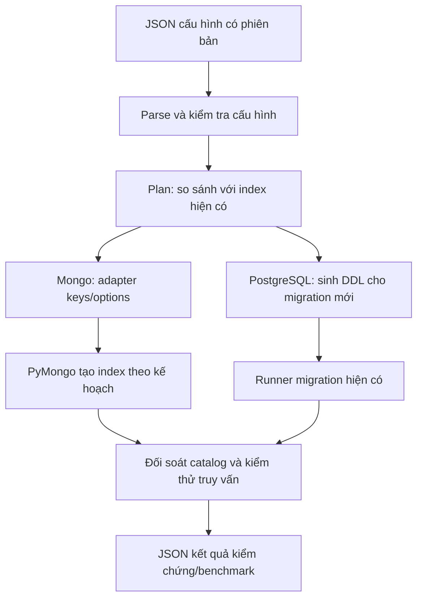

# Phân tích tính khả thi: định nghĩa index bằng cấu hình JSON

Ngày phân tích: **03/11/2026**. Phạm vi: đọc source OldShop và mẫu Lab do người dùng chỉ định;
đề xuất cách triển khai, **chưa thay đổi cơ chế tạo index hoặc áp dụng lên database**.

## 1. Kết luận và mức đáp ứng hiện tại

**Khả thi.** Dự án có thể dùng file JSON làm nguồn khai báo trường, thứ tự khóa, chiều
sắp xếp và các tùy chọn index; chương trình Python đọc cấu hình rồi gọi database tạo index.
Không cần tự viết B-tree hoặc thay PostgreSQL/MongoDB bằng một bộ máy tìm kiếm khác.

Hiện dự án đã tự thiết kế các index nhưng khai báo bằng SQL/Python. Các JSON benchmark
không được dùng làm đầu vào tạo index. Vì vậy, hiện trạng **chưa phải cấu hình index qua
file JSON bên ngoài**, dù thiết kế index và bằng chứng đo đã có.

| Hướng triển khai | Khả thi | Độ phức tạp tương đối | Nhận xét |
|---|---|---|---|
| JSON cho MongoDB | Cao | Thấp–trung bình | Gần nhất với mẫu Lab; thay nguồn của `INDEXES`, giữ driver hiện có |
| JSON cho PostgreSQL | Cao nếu giới hạn phạm vi | Trung bình–cao | Cần bộ sinh DDL và giữ đúng lịch sử migration/checksum |
| Một danh mục JSON bao phủ hai hệ | Cao theo từng giai đoạn | Trung bình–cao | Có hai bộ chuyển đổi riêng; không ép hai hệ dùng cùng mọi tùy chọn |
| Tự xây index rồi lưu các node/cây vào JSON | Ngoài phạm vi đề xuất | Cao | Không phải cách mà `INDEX_SPECS` trong mẫu Lab đang thực hiện |

Khuyến nghị: chọn kiến trúc đích bao phủ hai hệ, triển khai **MongoDB trước, PostgreSQL
sau**. Nếu yêu cầu chỉ áp dụng cho MongoDB như bài Lab, giai đoạn đầu đã có thể đáp ứng;
nếu yêu cầu toàn dự án lấy JSON làm nguồn cấu hình thì phải hoàn thành cả hai giai đoạn.

## 2. File tham khảo thực sự làm gì?

Đã đọc [indexes.js của Lab 3](/home/phat/Documents/Study/AdvancedDb/Lab_3/scripts/lib/indexes.js)
và các script Lab gọi `INDEX_SPECS`/`createIndex`. Đây là **JavaScript chứa object cấu hình**,
không phải JSON thuần: có `const`, comment, function và `module.exports`.

Mẫu có hai phần cần phân biệt:

| Thành phần | Ý nghĩa | Cách áp dụng vào OldShop |
|---|---|---|
| `INDEX_SPECS` | Khai báo key và options: index đơn/ghép, `1`/`-1`, unique, sparse | Có thể chuyển phần dữ liệu này sang JSON |
| Các script bài tập gọi `createIndex(spec.key, spec.options)` | Biến khai báo thành index thực tế | Dùng Python/PyMongo hiện có, không bắt buộc bổ sung Node.js |
| `resetIndexes()` | Xóa index ngoài danh sách giữ lại, mặc định chỉ giữ `_id_`; thử xóa plan cache | Chỉ thích hợp cho thí nghiệm có kiểm soát; không đưa vào đường khởi tạo DB ứng dụng |

Các file `ketqua/explain/*.json` của Lab là kết quả đo, khác với `INDEX_SPECS`.
Phần function trong file tham khảo được xem là nội dung để phân tích, không phải yêu cầu
chạy reset hoặc thay đổi DB của dự án.

Một điểm không được sao chép nguyên trạng: Lab có các spec thay thế nhau, ví dụ bản thường
và bản unique cùng dùng tên `idx_email`. Trong ứng dụng không được coi chúng là hai index
độc lập rồi áp dụng đồng thời. Cần chọn một cấu hình hoặc có profile thí nghiệm riêng.

## 3. Phân biệt ba loại JSON

| Loại | Ví dụ nội dung | Vai trò |
|---|---|---|
| Cấu hình index đề xuất | `keys`, `unique`, `partialFilterExpression`, loại B-tree/GIN | Đầu vào thực sự cho bộ tạo/đối soát index |
| JSON Schema của document | `properties`, `required`, `bsonType` | Kiểm tra cấu trúc dữ liệu MongoDB, không quyết định đường truy cập |
| JSON kết quả/đối chiếu | `executionStats`, `Plan`, thời gian, baseline schema | Bằng chứng hoặc hợp đồng kiểm tra; không phải lệnh tạo index |

`database/baseline_v0.json` là hợp đồng đối chiếu schema ban đầu được migration runner
đọc để phát hiện drift, không phải nguồn DDL mới. `docs/design/03_mongo_validators.json`
và `05_mongo_validators.json` liên quan validator document. Các JSON trong
`docs/benchmark/` lưu kết quả đo. Không đổi tên các file này thành cấu hình index.

JSON mới vẫn là cấu hình tĩnh có phiên bản, không tự lựa chọn trường theo dữ liệu.
Điểm thay đổi là người thiết kế sửa khai báo trong JSON thay vì sửa trực tiếp cấu trúc
Python/SQL. Logic đọc, kiểm tra và thực thi vẫn nằm trong chương trình.

## 4. Các điểm trong source hiện tại đã đối chiếu

| File hiện có | Vai trò và điều cần lưu ý |
|---|---|
| [`database/01_schema/*.sql`](../database/01_schema/) | Baseline có PK, UNIQUE và index ban đầu; không chỉ có index trong 001/007 |
| [`001_indexes.sql`](../database/04_migrations/001_indexes.sql) | Index ghép, partial, GIN trigram và UNIQUE |
| [`002_partitioning.sql`](../database/04_migrations/002_partitioning.sql) | Index/constraint liên quan partition; cần kiểm cả parent và children |
| [`003_vertical_split.sql`](../database/04_migrations/003_vertical_split.sql) | Đổi cấu trúc user; cấu hình mới phải nhắm bảng hiện tại, không nhắm view/bảng cũ tùy tiện |
| [`005_etl_outbox.sql`](../database/04_migrations/005_etl_outbox.sql), [`006_media_cleanup.sql`](../database/04_migrations/006_media_cleanup.sql) | Index vận hành ETL/cleanup cũng là phần inventory |
| [`007_indexing_v2.sql`](../database/04_migrations/007_indexing_v2.sql) | 9 index được chọn sau thử nghiệm; có partial predicate trên JSONB và trên bảng partition |
| [`mongo_schema.py`](../backend/app/services/mongo_schema.py) | `INDEXES` hiện khai báo key/options bằng Python; `validators()` là phần riêng |
| [`etl/errors.py`](../backend/etl/errors.py) | Còn một index Mongo trên `etl_errors`, nằm ngoài `INDEXES`; không được bỏ sót khi nói bao phủ toàn bộ Mongo |
| [`init_mongo.py`](../backend/scripts/init_mongo.py) | Đọc `INDEXES`, tạo/cập nhật validator và gọi `create_index` |
| [`migrate.py`](../backend/scripts/migrate.py) | Đọc các file SQL, kiểm baseline, khóa migration, checksum và lịch sử phiên bản |
| [`init_db.py`](../backend/scripts/init_db.py), [`docker-entrypoint.sh`](../backend/docker-entrypoint.sh) | Bootstrap/khởi động có thể áp migration; thêm cấu hình phải xét đường chạy này |
| [`verify_indexing_v2.py`](../backend/scripts/verify_indexing_v2.py) | Có `SPECS` kiểm cấu trúc index; phải tránh trở thành nguồn định nghĩa thứ hai bị lệch JSON |
| [`backend/app/models/`](../backend/app/models/) | ORM cũng có khai báo index; không có nghĩa sửa model sẽ tự đổi index DB đang dùng |

Không cần sửa frontend, API nghiệp vụ, bảng `product_image`, file ảnh/video hay topology
phân tán chỉ để chuyển nguồn khai báo index sang JSON.

## 5. Kiến trúc đề xuất



JSON không được database tự theo dõi để cập nhật liên tục. Phải có bước đọc và apply
cụ thể. Đổi trường/chiều trong JSON chưa làm index đang tồn tại tự đổi theo.

Với PostgreSQL, vẫn có SQL sau khi sinh mã là bình thường: **thiết kế đầu vào ở JSON,
DDL SQL là sản phẩm được sinh và áp dụng có phiên bản**. Điều quan trọng là chứng minh
JSON được chương trình sử dụng, không chỉ là một bản mô tả để trưng bày.

## 6. Dạng JSON minh họa

Đây là mẫu phân tích, không phải manifest đầy đủ hoặc file đã được triển khai. Các index
được chọn từ cấu hình hiện có để minh họa chuyển đổi tương đương, không đề xuất tạo thêm
index trùng lặp.

```json
{
  "schema_version": 1,
  "postgresql": [
    {
      "name": "idx_product_visible_date_id",
      "schema": "public",
      "table": "product",
      "method": "btree",
      "unique": false,
      "keys": [
        { "column": "created_at", "order": "DESC" },
        { "column": "product_id", "order": "ASC" }
      ],
      "predicate": {
        "all": [
          { "column": "status", "op": "eq", "value": 1 },
          { "column": "is_deleted", "op": "eq", "value": false }
        ]
      }
    }
  ],
  "mongodb": [
    {
      "collection": "reviews",
      "keys": [["product_id", 1], ["created_at", -1]],
      "options": { "name": "product_id_1_created_at_-1" }
    },
    {
      "collection": "product_details",
      "keys": [["images.key", 1]],
      "options": {
        "name": "idx_live_product_image_key",
        "partialFilterExpression": { "deleted": false }
      }
    }
  ]
}
```

Lựa chọn thiết kế:

- Dùng array để giữ thứ tự khóa ghép. Theo [RFC 8259, mục 4–5](https://www.rfc-editor.org/rfc/rfc8259.html#section-4),
  JSON object không định nghĩa thứ tự thành viên, còn array có thứ tự. Không phụ thuộc
  vào việc một thư viện cụ thể tình cờ giữ thứ tự các property.
- Mongo adapter chuyển các cặp trong array thành key/options phù hợp với driver.
  Mẫu Lab dùng `key` là object JavaScript; có thể nhận dạng đó ở đầu vào tương thích,
  nhưng nên chuẩn hóa cấu hình lưu lâu dài sang danh sách khóa có thứ tự.
- PostgreSQL có `method`, opclass và predicate riêng; không dùng chung toàn bộ options
  với Mongo. Chiều `ASC/DESC` không được gán tùy tiện cho mọi loại index.
- Predicate PostgreSQL là cấu trúc có kiểm tra, không phải chuỗi SQL tùy ý. Các operator
  chưa hỗ trợ phải bị từ chối, không bỏ qua âm thầm hoặc đưa vào `eval`.

MongoDB hỗ trợ cách khai báo key và options này qua
[`createIndex`](https://www.mongodb.com/docs/manual/reference/method/db.collection.createindex/).
PostgreSQL hỗ trợ các thành phần DDL tương ứng qua
[`CREATE INDEX` phiên bản 16](https://www.postgresql.org/docs/16/sql-createindex.html).

## 7. Phạm vi bộ đọc và kiểm tra cần có

### MongoDB

Cần biểu diễn được các index hiện tại: đơn/ghép, chiều `1`/`-1`, unique, partial, wildcard,
text và TTL. `sparse` chỉ bổ sung khi có truy vấn và test phù hợp; không thêm hàng loạt chỉ
vì mẫu Lab có. Cần kiểm tổ hợp tùy chọn hợp lệ theo loại index, chẳng hạn không kết hợp
partial và sparse trên cùng index; TTL không được coi như một tùy chọn hợp lệ cho mọi
khóa ghép.

Các index hiện chưa đặt tên tường minh có tên database sinh tự động. Khi chuyển cấu hình,
phải giữ tên thực tế hoặc có kế hoạch đổi riêng, để script benchmark/verify không bị lệch.
Index `etl_errors` phải đưa vào inventory chung hoặc đánh dấu rõ là ngoài phạm vi quản lý.

### PostgreSQL

Phạm vi đầu tiên nên hỗ trợ chính các cấu hình dự án đang dùng: B-tree, GIN/trigram,
unique, khóa ghép và partial predicate. Inventory cần lưu cả opclass, chiều và quy tắc
NULL mặc định/tường minh để đối chiếu đúng với catalog, thay vì chỉ so tên và số cột.

Predicate hiện có đòi hỏi ít nhất các phép so sánh, `AND`, `IN` và phép kiểm key JSONB
như `details ? 'aggregate'`. Nếu chưa hỗ trợ một loại cấu hình, báo lỗi rõ và giữ index
đó dưới migration SQL đã có; không tuyên bố đã chuyển toàn bộ sang JSON.

PG partition cần kiểm index parent và các index con. Index thuộc PK/UNIQUE constraint
phải được đánh dấu do constraint quản lý; không đưa vào danh sách tự xóa/tạo tùy ý.

### Kiểm tra chung

- Từ chối JSON sai cú pháp, key trùng trong một object và phiên bản cấu hình không hỗ trợ.
- Giữ thứ tự khóa; phát hiện tên trùng nhưng định nghĩa khác, trường/phương thức không hợp lệ.
- Từ chối thuộc tính lạ để tránh gõ sai mà chương trình vẫn báo thành công.
- Kiểm bảng/cột/collection, giới hạn tên và options; không chứa credentials trong manifest.
- Quote identifier đúng khi sinh SQL, dùng literal an toàn và operator được cho phép;
  không nối trực tiếp tên bảng/cột hay predicate chưa kiểm tra vào SQL.
- Phân biệt index đang tồn tại và khớp, index còn thiếu, index xung đột, index không thuộc
  phạm vi quản lý. Không chỉ dùng `IF NOT EXISTS` rồi coi cùng tên là cùng cấu trúc.
- Đổi unique/TTL/text/partial không được mặc định xử lý như thêm một index mới vô hại.

## 8. Giữ tương thích với migration và DB đang dùng

Không sửa lại migration `001`–`007` đã phát hành, không sửa `baseline_v0.json` để ép DB
vượt kiểm tra. Runner hiện kiểm SHA-256 của SQL đã áp; thay nội dung sẽ làm checksum lệch.

Lộ trình thích hợp:

1. **Tiếp nhận cấu hình hiện có:** chuyển khai báo sang manifest và đối soát với index
   hiện hữu. Khớp hoàn toàn thì ghi nhận kết quả kiểm tra, không drop/recreate chỉ để đổi
   nguồn cấu hình.
2. **Mongo:** đổi loader lấy cấu hình từ JSON, dùng adapter giữ giao diện `INDEXES` cho
   các script đang import. Index khớp giữ nguyên; index thiếu có thể tạo theo plan; xung
   đột phải báo và xử lý qua thay đổi được kiểm thử riêng.
3. **PostgreSQL:** từ thay đổi manifest đã review, sinh migration số tiếp theo còn trống
   (hiện source mới nhất là `007`; `008` chỉ là ví dụ nếu chưa có thay đổi khác). Chỉ tạo
   migration khi có thay đổi DDL thực sự.
4. **Đóng băng đầu vào:** lưu snapshot manifest của bản phát hành và hash của nó, liên
   kết với migration sinh ra. Không để migration cũ đọc file JSON đang được sửa ở lần
   chạy sau, khiến cùng một version có thể tạo DDL khác nhau.
5. **Phân biệt desired và applied:** file cấu hình đang đề xuất thay đổi phục vụ plan;
   verify trạng thái đã áp phải dùng đúng snapshot phiên bản, không bắt DB đang chạy
   phải giống một bản thiết kế chưa được triển khai.
6. **Đối soát sau áp dụng:** kiểm method, keys, directions, predicate, options, validity,
   constraint và partition children. PostgreSQL và Mongo không có một transaction DDL
   chung; cần ghi kết quả từng hệ và cho phép tiếp tục khi một bên lỗi.

Runner PostgreSQL hiện áp từng SQL trong transaction. `CREATE INDEX CONCURRENTLY`
không chạy được trong transaction đó; nếu sau này cần build online phải thiết kế đường
thực thi và xử lý index invalid riêng. JSON không tự giải quyết vấn đề này.

Chỉnh `ASC` thành `DESC` trong cấu hình cũng không có nghĩa index tự đổi ngay; có thể
phải build lại. Việc bỏ một mục khỏi manifest không được tự động drop index trên DB.

## 9. Các file đề xuất thêm và thay đổi

Các đường dẫn có nhãn **Thêm** dưới đây là đề xuất, chưa được tạo trong lần phân tích.

| Đường dẫn | Hành động | Mục đích |
|---|---|---|
| `database/indexing/catalog.json` | Thêm | Nguồn thiết kế index được quản lý cho PG/Mongo |
| `database/indexing/catalog.schema.json` | Thêm | Mô tả cấu trúc cấu hình để editor/validator kiểm tra |
| `database/indexing/snapshots/<revision>.json` | Thêm khi phát hành | Cố định đầu vào của bản đã triển khai |
| `backend/app/services/index_config.py` | Thêm | Đọc/kiểm JSON, chuẩn hóa keys/options và trả cấu hình đã kiểm |
| `backend/scripts/plan_indexes.py` | Thêm | Chỉ đọc DB để báo khớp/thiếu/xung đột, không tự thay đổi |
| `backend/scripts/generate_index_migration.py` | Thêm | Sinh DDL PG cho version mới từ thay đổi đã xác định |
| `backend/app/services/mongo_schema.py` | Sửa | Nguồn `INDEXES` lấy từ loader, giữ riêng `validators()` |
| `backend/scripts/init_mongo.py` | Sửa | Dùng cấu hình đã kiểm, xử lý xung đột rõ ràng và xuất kết quả |
| `backend/etl/errors.py` | Sửa nếu bao phủ toàn Mongo | Lấy khai báo index `etl_errors` từ cùng nguồn; giữ validator/error handling |
| `backend/scripts/verify_indexing_v2.py` | Sửa có kiểm soát | Đối chiếu cùng snapshot; giữ chế độ kiểm 007 lịch sử khi cần |
| `backend/scripts/migrate.py` | Ưu tiên giữ nguyên runner DDL | Chỉ sửa nếu bổ sung xác thực snapshot/hash; không thay hợp đồng version/checksum hiện có |
| `backend/tests/test_index_config.py` | Thêm | Parse, validate, giữ thứ tự, options và compiler |
| `backend/tests/test_index_config_integration.py` | Thêm | Đối soát/apply lặp, conflict, upgrade và tương đương trên DB riêng |

Các file cần rà phụ thuộc trước khi sửa:

- [`archive_day4.py`](../backend/scripts/archive_day4.py) đang import `INDEXES`.
- [`benchmark_current.py`](../backend/scripts/benchmark_current.py) đọc trực tiếp dữ liệu
  ứng dụng; các bộ sinh fixture benchmark lớn cũ đã được gỡ.
- [`test_indexing_v2.py`](../backend/tests/test_indexing_v2.py) và
  [`test_day4_migrations.py`](../backend/tests/test_day4_migrations.py) kiểm migration,
  checksum, rollback và index; cần giữ các bảo đảm này.
- [`Dockerfile`](../backend/Dockerfile) đã copy `database` vào `/opt/database` và đặt
  `DATABASE_SRC`; loader phải chạy được cả trên host lẫn container. Đặt config trong
  `database/indexing` tận dụng đường copy này; vẫn phải kiểm artifact thực tế.
- [`.dockerignore`](../.dockerignore), [`package-day7.py`](../deploy/scripts/package-day7.py),
  [`build-day7.py`](../deploy/scripts/build-day7.py): kiểm cấu hình/schema/snapshot có
  nằm trong image và gói phát hành; không chỉ kiểm ở working tree.
- [`docker-compose.distributed.yml`](../deploy/docker-compose.distributed.yml): kiểm
  `mongo-schema-init`, backend bootstrap và đường mount/đóng gói; không cần đổi topology.
- [`apply-indexing-v2.sh`](../deploy/scripts/apply-indexing-v2.sh): giữ như runbook lịch
  sử 007, bổ sung hướng dẫn hoặc runner cho bản sau thay vì đổi ý nghĩa upgrade cũ.
- [`HUONG_DAN_CAU_HINH_VA_CHAY_HE_THONG.md`](HUONG_DAN_CAU_HINH_VA_CHAY_HE_THONG.md),
  [`HUONG_DAN_KIEM_CHUNG_THU_CONG_7_NGAY.md`](HUONG_DAN_KIEM_CHUNG_THU_CONG_7_NGAY.md),
  [`KE_HOACH_THIET_KE_INDEXING.md`](KE_HOACH_THIET_KE_INDEXING.md): cập nhật nguồn cấu
  hình, cách plan/apply/verify và phạm vi đã chuyển đổi.

Các model ORM và baseline SQL cần kiểm độ tương đương, không cần đồng loạt sửa để làm
đẹp tên file. Những DDL lịch sử tiếp tục là lịch sử; cấu hình JSON là nguồn thiết kế cho
quy trình mới, không phải công cụ viết lại quá khứ.

## 10. Lộ trình triển khai đề xuất

| Giai đoạn | Công việc | Điều kiện hoàn thành |
|---|---|---|
| 1. Inventory | Liệt kê index từ source và catalog DB test, phân nhóm constraint/ứng dụng/ETL/benchmark | Biết rõ index nào được JSON quản lý, index nào không |
| 2. Contract | Chốt cấu trúc JSON, tên, phiên bản, keys có thứ tự và options được hỗ trợ | Mọi khai báo hiện có trong phạm vi đều biểu diễn được, không mất nghĩa |
| 3. Mongo parity | Xuất khai báo hiện có, viết loader/adapter và chuyển init sang đọc JSON | Trên DB riêng, keys/options trước–sau không đổi; apply lặp không nhân bản |
| 4. PG parity | Biểu diễn index đã chọn và sinh/đối chiếu DDL | Method/opclass/predicate/order/constraint/partition đúng; không sửa SQL lịch sử |
| 5. Versioned changes | Thử một thay đổi cấu hình trên DB test, sinh bản mới và kiểm tình huống lỗi | Có snapshot, plan, quy trình áp dụng/khôi phục; không reset toàn bộ index |
| 6. Nghiệm thu | Chạy API/ETL/benchmark, kiểm image/ZIP và hoàn thiện demo | JSON là đầu vào thực; kết quả và phạm vi được ghi lại rõ |

Không cần làm UI quản lý index ở vòng đầu. Cấu hình lưu trong Git, có review, dùng
Python và driver hiện có là đủ cho yêu cầu tự thiết kế cấu hình.

## 11. Kiểm thử và tiêu chí nghiệm thu

### Đúng cấu hình

- JSON hợp lệ, thiếu trường/key lạ/tên trùng/sai chiều bị phát hiện trước khi gọi DB.
- Compound index giữ đúng thứ tự; đảo thứ tự trường phải tạo ra khác biệt trong plan.
- Phân biệt `unique: false` với `true`; kiểm riêng dữ liệu vi phạm unique trên DB test.
- Partial, TTL, text, wildcard, GIN/opclass và parent/child có test theo phạm vi hỗ trợ.
- Cùng tên nhưng khác keys/options phải báo conflict; không coi là thành công vì tên đã có.

### Tương thích và khả năng vận hành

- DB mới và DB test sau 007 đều đi đúng đường khởi tạo/upgrade; schema và dữ liệu không mất.
- 001–007 vẫn qua kiểm checksum; cấu hình phiên bản cũ không bị nội dung JSON mới thay nghĩa.
- Apply lần hai không thêm index trùng, không tự bỏ `_id_`, PK, UNIQUE hoặc index ngoài phạm vi.
- Xóa mục trong JSON chỉ báo chênh lệch; đổi/xóa index phải có thay đổi phiên bản rõ ràng.
- API, ETL, cleanup và archive vẫn hoạt động; các import `INDEXES`/`SPECS` không bị gãy.
- Loader tìm được file trong image/gói phát hành và không ghi credentials vào output.

### Đúng hiệu quả

Giữ cùng dữ liệu và truy vấn khi so sánh định dạng cũ với JSON. Nếu index vật lý giữ
nguyên thì đổi cách khai báo **không tự làm truy vấn nhanh hơn**. Trọng tâm parity là
cùng kết quả/cấu trúc, còn thay đổi lựa chọn index mới phải đo lại đọc, ghi và dung lượng.

EXPLAIN tự nhiên mới chứng minh optimizer chọn đường truy cập nào; ép hint chỉ dùng
cho đối chứng có nhãn rõ. Index catalogue `(created_at DESC, product_id ASC)` không
mặc nhiên tối ưu API moderator mới đang sắp xếp ID giảm dần. Mọi index bổ sung cho
moderator phải dựa vào truy vấn và benchmark riêng, không gắn nhãn hiệu quả vì đã có JSON.

MinIO tiếp tục lưu object; cấu hình JSON này quản lý index PostgreSQL/MongoDB, không
biến MinIO thành database có B-tree/GIN do ứng dụng cấu hình.

## 12. Demo phù hợp với yêu cầu của thầy

Kịch bản trên DB/collection test riêng:

1. Mở `catalog.json`, chỉ ra một compound index: trường thứ nhất, trường thứ hai, chiều
   sắp xếp và điều kiện. Đối chiếu ý tưởng với `INDEX_SPECS` trong Lab.
2. Chạy validate và plan bằng công cụ dự án: cho thấy chương trình thực sự đọc JSON.
3. Apply trên DB test, mở kết quả verify gồm tên index, keys và options thực tế.
4. Chạy một truy vấn đại diện, xem kế hoạch/số document hoặc block phải xét.
5. Đổi một cấu hình thử nghiệm, chạy plan để thấy khác biệt. Thực hiện thay đổi theo
   quy trình phiên bản, không dùng reset toàn collection ở môi trường ứng dụng.
6. Chỉ ra hai file khác vai trò: JSON đầu vào định nghĩa index và JSON đầu ra ghi kết quả.

Để tuyên bố đạt, phải chứng minh được chuỗi **JSON → kiểm tra → tạo/đối soát index thật**.
Chỉ thêm một file JSON mô tả những index vẫn được hardcode độc lập trong SQL/Python
thì chưa hoàn thành yêu cầu nguồn cấu hình JSON.

## 13. Những quyết định còn cần chốt trước khi viết code

- Phạm vi nộp bài là Mongo theo mẫu Lab hay cả PostgreSQL và MongoDB? Kiến trúc đề xuất
  hỗ trợ mở rộng cả hai, nhưng không công bố đã bao phủ PG nếu mới làm loader Mongo.
- Phạm vi quản lý là toàn bộ index ứng dụng hay nhóm index được chọn? PK/constraint,
  index hạ tầng và benchmark phải được phân loại rõ.
- Những loại index/options nào được hỗ trợ ở bản đầu? Không cần viết một trình biên
  dịch bao phủ mọi tính năng PostgreSQL/MongoDB để đáp ứng đồ án.
- Cơ chế snapshot/hash và nhận diện bản đã áp dụng được lưu thế nào? Đây là phần cần
  thiết kế cùng migration runner, không thể chỉ chuyển đuôi file.

Không cần quyết định triển khai nhiều máy, đổi nơi lưu ảnh hoặc tự viết thuật toán cây
để thực hiện đề xuất này. Trong lần phân tích này chỉ tạo tài liệu; mọi file JSON,
loader, compiler và migration mới nêu trên đều là công việc tương lai.
