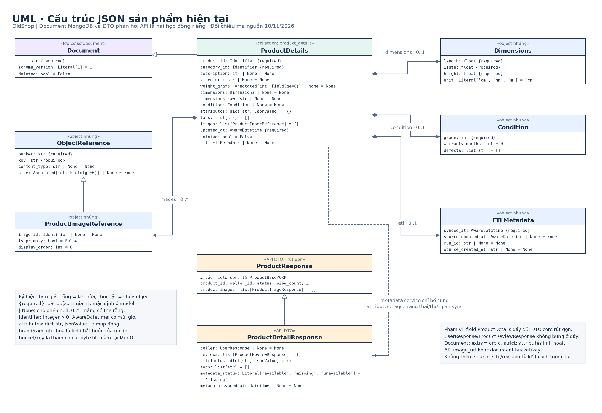
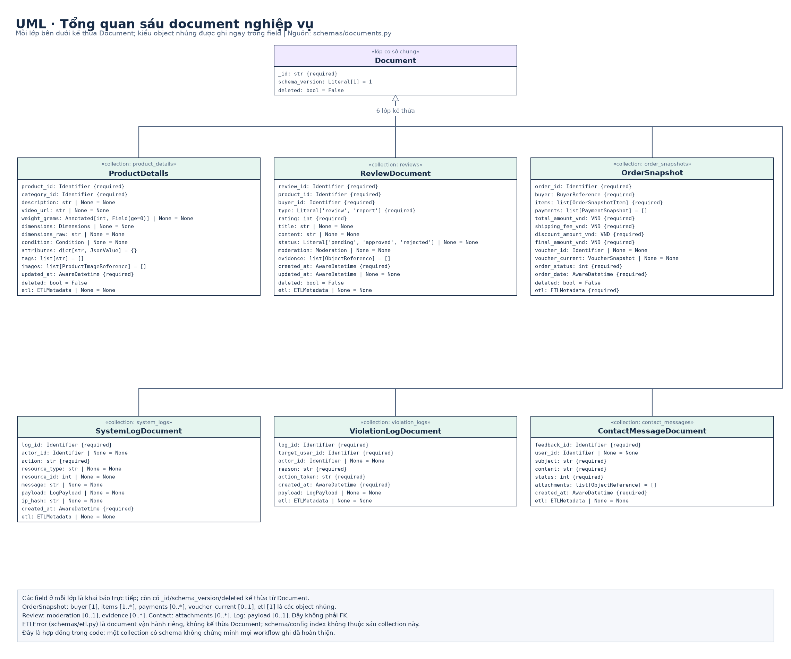
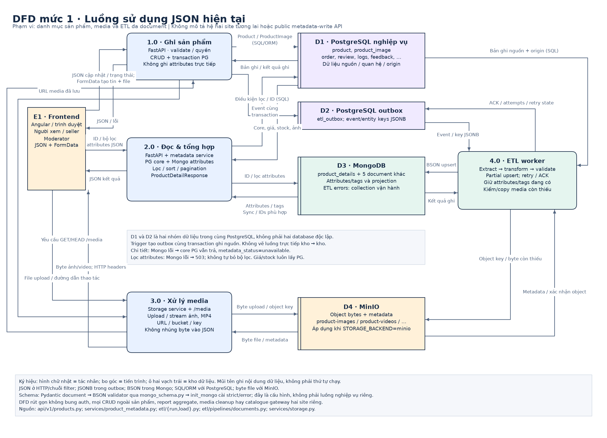

# OldShop — UML cấu trúc JSON và DFD luồng sử dụng JSON

**Ngày đối chiếu mã nguồn:** 10/11/2026.  
**Phạm vi:** hợp đồng dữ liệu và đường xử lý có trong repository; không xác nhận trạng thái runtime hoặc kết quả triển khai hai máy. Các thành phần dự kiến trong kế hoạch nâng cấp không được trình bày như đã triển khai.

## 1. UML chi tiết: document sản phẩm và response API



Tải [SVG để phóng to/in](08_json_product_uml_current.svg), [PNG](08_json_product_uml_current.png) hoặc [nguồn PlantUML để chỉnh sửa](08_json_product_uml_current.puml).

### Cách đọc

- `ProductDetails` là model của document trong collection `product_details`, kế thừa `_id`, `schema_version`, `deleted` từ `Document`. `deleted` cũng được khai báo lại ở lớp con trong code hiện tại.
- Tam giác rỗng chỉ **kế thừa**. Hình thoi đặc chỉ **object nhúng**: `dimensions`, `condition`, `images`, `etl`. Đây là cấu trúc document, không phải FK hoặc yêu cầu tạo collection riêng cho mỗi lớp.
- `0..1` là không có hoặc có một object; `0..*` là mảng có thể rỗng. Số lượng ở hình biểu diễn sự có mặt của object; khả năng bỏ field/nhận null còn được mô tả trong thuộc tính.
- `{required}`: phải cung cấp field. `= ...`: giá trị mặc định trong model ứng dụng. `| None`: chấp nhận null. Validator MongoDB không tự chèn default chỉ vì model có default.
- `attributes: dict[str, JsonValue]` là map động. `brand`, `ram_gb`, `size` là ví dụ nội dung có thể có, chưa phải field bắt buộc chung theo code hiện tại. Validator BSON đang giới hạn `attributes` ở mức object; không khẳng định đã kiểm schema riêng theo từng danh mục.
- `Identifier` là integer lớn hơn 0 và không quá `2^63-1`; `AwareDatetime` phải có múi giờ. `Dimensions` yêu cầu kích thước dương; `Condition.grade` từ 1 đến 10; `warranty_months` không âm; các giới hạn chi tiết theo model nguồn.
- `ObjectReference` chứa bucket/key và metadata file. Byte ảnh/video nằm trong object store. Document MongoDB thực tế lưu BSON; khi biểu diễn qua JSON, datetime được serialize thành chuỗi phù hợp.
- Phần màu vàng là hợp đồng phản hồi API. `ProductDetailResponse` kế thừa `ProductResponse`; khối `ProductResponse` được rút gọn để dễ nhìn, không phải danh sách toàn bộ field. Các model seller/review chỉ được ghi tên, chưa bung cây ở hình này.
- Mũi tên nét đứt từ document sang DTO thể hiện **ánh xạ dữ liệu**: metadata service đọc attributes/tags/thời điểm đồng bộ rồi bổ sung trạng thái. Không có thao tác trả nguyên Mongo document cho frontend và không sao chép tất cả field ETL nội bộ vào API.

### Nguồn đối chiếu

| Thành phần trên hình | Nguồn |
|---|---|
| Document và object nhúng | [documents.py](../../backend/app/schemas/documents.py) |
| DTO phản hồi sản phẩm | [catalog.py](../../backend/app/schemas/catalog.py) |
| Ghép metadata và trạng thái | [product_metadata.py](../../backend/app/services/product_metadata.py), [products.py](../../backend/app/api/v1/products.py) |
| Document → JSON Schema → BSON validator | [mongo_schema.py](../../backend/app/services/mongo_schema.py) |

## 2. UML tổng quan: sáu document nghiệp vụ



Tải [SVG](08_json_collections_uml_current.svg), [PNG](08_json_collections_uml_current.png) hoặc [PlantUML đầy đủ các object nhúng](08_json_collections_uml_current.puml).

Hình tổng quan liệt kê toàn bộ field khai báo trực tiếp của sáu model trong `DOCUMENT_MODELS` và lớp cơ sở chung. Sáu đường kế thừa nhập vào một nhánh chung dẫn tới `Document`, đi ngoài các khối thuộc tính. Nguồn PlantUML biểu diễn đủ các đường kế thừa và composition tới object nhúng, gồm buyer/item/payment/voucher/moderation/payload/media/ETL.

| Model | Collection | Mục đích |
|---|---|---|
| `ProductDetails` | `product_details` | Thuộc tính/tags và projection sản phẩm |
| `ReviewDocument` | `reviews` | Đánh giá hoặc báo cáo vi phạm; rating=0 tương ứng report |
| `OrderSnapshot` | `order_snapshots` | Bản đọc đơn hàng, dòng hàng và thanh toán; nguồn giao dịch vẫn là PG |
| `SystemLogDocument` | `system_logs` | Projection log hệ thống |
| `ViolationLogDocument` | `violation_logs` | Projection xử lý vi phạm |
| `ContactMessageDocument` | `contact_messages` | Projection phản hồi/liên hệ, có cấu trúc attachment reference |

`ETLError` trong [schemas/etl.py](../../backend/app/schemas/etl.py) là hợp đồng document vận hành riêng, không kế thừa `Document` và không nằm trong sáu model của bảng này. Cấu hình indexing JSON cũng là một loại hợp đồng khác, không phải document nghiệp vụ thứ bảy. Có cấu trúc attachment/moderation không đồng nghĩa đã hoàn thiện mọi endpoint ghi tương ứng.

## 3. DFD mức 1: luồng sử dụng JSON



Tải [SVG để phóng to/in](08_json_dfd_current.svg), [PNG](08_json_dfd_current.png) hoặc [nguồn PlantUML](08_json_dfd_current.puml).

### Các thành phần

| Mã | Loại | Ý nghĩa |
|---|---|---|
| E1 | Tác nhân ngoài hệ backend | Angular/trình duyệt, đại diện người xem, seller và moderator |
| 1.0 | Tiến trình | Validate, kiểm quyền, ghi sản phẩm và thông tin ảnh |
| 2.0 | Tiến trình | Đọc PG, tra metadata Mongo, lọc và tạo response JSON |
| 3.0 | Tiến trình | Upload/stream media qua storage service và route `/media` |
| 4.0 | Tiến trình | ETL đọc nguồn/event, transform/validate, ghi đích rồi ACK hoặc retry |
| D1 | Kho dữ liệu | Dữ liệu nghiệp vụ/nguồn trong PostgreSQL |
| D2 | Kho dữ liệu logic | Outbox trong **cùng PostgreSQL** với D1; không phải database độc lập |
| D3 | Kho dữ liệu | MongoDB: sáu document và collection lỗi ETL |
| D4 | Kho dữ liệu | MinIO khi cấu hình storage backend là MinIO |

DFD dùng tiến trình bo góc, tác nhân chữ nhật và kho dữ liệu có vạch trái. Bản PlantUML dùng các hình có sẵn để người đọc chỉnh sửa thuận tiện, nên hình thức bố trí có thể khác SVG/PNG. Nội dung mũi tên là dữ liệu, không phải biểu diễn thứ tự gọi hàm. Không có mũi tên trực tiếp giữa hai kho hoặc từ frontend tới database.

### Luồng chính và định dạng thực tế

1. **Ghi:** tạo sản phẩm dùng multipart/form-data vì có file; cập nhật thông thường dùng JSON. API kiểm quyền, ghi PG và gọi storage service khi cần upload. Trigger PostgreSQL tạo outbox trong transaction ghi nguồn; vì vậy trên DFD, 1.0 tạo dữ liệu nghiệp vụ D1 và event D2, không vẽ D1 tự chuyển dữ liệu thẳng sang D2.
2. **Đọc:** API lấy core/giá/stock/ảnh từ PG; chi tiết bổ sung attributes/tags/sync từ Mongo. Danh sách hiện trả `list[ProductResponse]`, còn chi tiết trả `ProductDetailResponse`; không mặc định mọi endpoint danh sách đều có attributes trong response.
3. **Lọc attributes:** frontend truyền chuỗi JSON trong query parameter; metadata service parse/validate rồi tìm candidate product IDs ở Mongo; PG áp visibility/bộ lọc và pagination lên tập phù hợp. Đây không phải frontend gửi truy vấn MongoDB tùy ý.
4. **ETL:** đọc event và nguồn PG, dựng model document rồi validate; loader dùng partial upsert BSON, giữ các field Mongo sở hữu. Ghi đích thành công mới ACK đúng event PG; lỗi lưu trạng thái và retry. Pipeline sản phẩm kiểm/copy media còn thiếu từ nguồn local/seed khi cần; mũi tên ETL–MinIO không phải truyền base64 trong JSON.
5. **Media:** trình duyệt gửi yêu cầu `/media/...`; storage service lấy byte từ MinIO và trả stream/headers. JSON API chỉ chứa đường dẫn/tham chiếu. Ở backend LocalStorage, kho file thay MinIO; không thể khẳng định MinIO đang chạy chỉ dựa vào hình.

| Endpoint trong router sản phẩm | Input | Output tiêu biểu |
|---|---|---|
| `POST /products` | FormData + ảnh, có thể kèm MP4 | JSON `ProductResponse` |
| `PUT /products/{id}` | JSON `ProductUpdate` | JSON `ProductResponse` |
| `PUT /products/{id}/listing` | FormData chứa chuỗi JSON `details`, có thể kèm MP4 | JSON `ProductResponse` |
| `PATCH /products/{id}/status` | JSON `StatusUpdate` | JSON message |
| `GET /products` | Query parameters; `attributes` có thể chứa JSON đã encode | JSON array `ProductResponse` |
| `GET /products/{id}` | ID trên URL | JSON `ProductDetailResponse` |
| `GET/HEAD /media/{path}` | Path/range request | Byte media hoặc headers |

Các đường `/products` là đường trong router; prefix API thực tế lấy từ `settings.API_V1_STR`. `DELETE` sản phẩm/ảnh có thể trả 204 không body, không phải mọi response đều chứa JSON.

### Ranh giới hiện tại cần giữ khi thuyết trình

- Chưa có endpoint seller ghi attributes/tags trực tiếp trong router sản phẩm được đối chiếu. DFD không vẽ luồng ghi Mongo đó như chức năng đã có.
- Chi tiết sản phẩm khi Mongo không truy cập được vẫn có thể trả core PG với `metadata_status=unavailable`; lọc attributes khi Mongo lỗi trả 503. Đây là hành vi code hiện tại, không thay bằng chính sách mục tiêu trong kế hoạch.
- ETL hiện dùng nguồn PG ứng dụng. Không thêm `source_site`, checkpoint hai nguồn hoặc operation pending/ready theo kế hoạch nếu code chưa có.
- Catalogue gateway hai site là module đọc riêng. Hình này không tuyên bố frontend commerce đã tích hợp với gateway đó.
- DFD tập trung danh mục/media và worker đa document; không bung toàn bộ checkout/auth/admin, aggregate report hoặc quy trình media cleanup. Một DFD cho toàn bộ ứng dụng cần thêm các tiến trình đó.
- Pydantic model sinh validator qua `mongo_schema.py`; `init_mongo.py` cài `strict/error`. Cấu hình validator/index là luồng quản trị, được ghi chú thay vì trộn vào luồng request sản phẩm.

Nguồn: [products.py](../../backend/app/api/v1/products.py), [metadata service](../../backend/app/services/product_metadata.py), [ETL projection](../../backend/etl/pipelines/documents.py), [ETL loader](../../backend/etl/load.py), [ETL runner](../../backend/etl/run.py), [media ETL](../../backend/etl/pipelines/media.py), [storage](../../backend/app/services/storage.py), [Mongo init](../../backend/scripts/init_mongo.py).

## 4. Tái tạo và cập nhật hình

Từ gốc repository, chạy:

```bash
MPLCONFIGDIR=/tmp/oldshop-json-mpl python docs/diagram/render_json_diagrams.py
```

Script cần `matplotlib`; đọc AST model trong repository, không import ứng dụng, không kết nối hoặc thay đổi database. Field và default được lấy từ code; bố trí hình và quan hệ UML/DFD được khai báo trong script, nên phải rà lại luồng và quan hệ khi code thay đổi. PNG/SVG được render trực tiếp bằng script; PlantUML là bản nguồn ngữ nghĩa để chỉnh sửa riêng, không khẳng định ảnh đã được render bằng PlantUML.

SVG thích hợp phóng to và chèn báo cáo; PNG tiện xem nhanh. Khi cần trình bày ngắn, dùng UML sản phẩm và DFD; hình sáu document để ở phụ lục.
