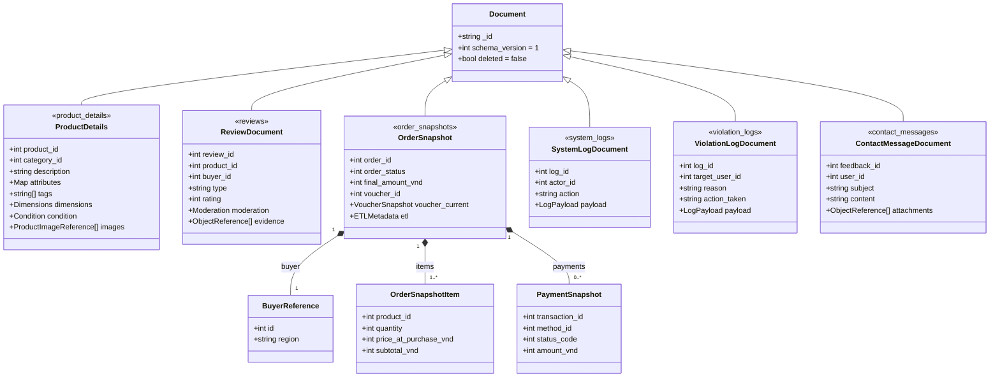

# UML tổng quan cấu trúc JSON của OldShop

Đối chiếu mã nguồn ngày 12/11/2026. Phạm vi: sáu document nghiệp vụ trong `DOCUMENT_MODELS`, không phải toàn bộ mô hình quan hệ PostgreSQL hay JSON cấu hình indexing. Chỉ trình bày các thuộc tính chính; không liệt kê toàn bộ field.

- Tam giác rỗng biểu diễn kế thừa; hình thoi đặc biểu diễn object nhúng trong document. Tên trong `<<...>>` là tên collection MongoDB. Các lớp nhúng không phải collection riêng.
- Đây là sơ đồ rút gọn: kiểu không ghi `null` và giá trị mặc định không có nghĩa field bắt buộc. `dimensions`, `condition`, `moderation`, `payload`, `voucher_current` có thể null; các mảng ảnh/bằng chứng/đính kèm/thanh toán có thể rỗng. `buyer` bắt buộc và `items` có ít nhất một phần tử.
- Cả sáu document đều có `etl: ETLMetadata`; riêng `OrderSnapshot` bắt buộc có object này, năm document còn lại cho phép null. Không đưa `etl` vào lớp cha vì mã nguồn khai báo tại từng lớp con.
- Các ID nguồn như `product_id`, `buyer_id`, `order_id` tham chiếu logic tới PostgreSQL; MongoDB không tự bảo đảm khóa ngoại. Hai document chứa cùng `product_id` không tạo thành quan hệ nhúng hay kế thừa với nhau.
- `attributes` là map JSON linh hoạt; `Dimensions`, `Condition`, `Moderation`, `LogPayload`, `VoucherSnapshot` là các object nhúng được rút gọn bằng tên kiểu. `ObjectReference` chứa `bucket`, `key` và metadata file; `ProductImageReference` kế thừa nó và bổ sung metadata ảnh. Byte file nằm ngoài document, qua storage backend.
- `OrderSnapshot` là bản đọc đồng bộ; PostgreSQL vẫn là nguồn chuẩn cho giao dịch. Giá mua được lưu tại `price_at_purchase_vnd`; các field có hậu tố `_current` phản ánh thông tin hiện tại, không phải lịch sử tại thời điểm mua.
- `ReviewDocument.type` nhận `review` hoặc `report`: đánh giá có rating 1–5, báo cáo có rating 0.
- MongoDB lưu BSON; JSON là cách biểu diễn/trao đổi. `ETLError` là hợp đồng vận hành riêng, không thuộc sáu document nghiệp vụ này.

Nguồn: [model document](../../backend/app/schemas/documents.py), [validator BSON](../../backend/app/services/mongo_schema.py), [ETL projection](../../backend/etl/pipelines/documents.py).
