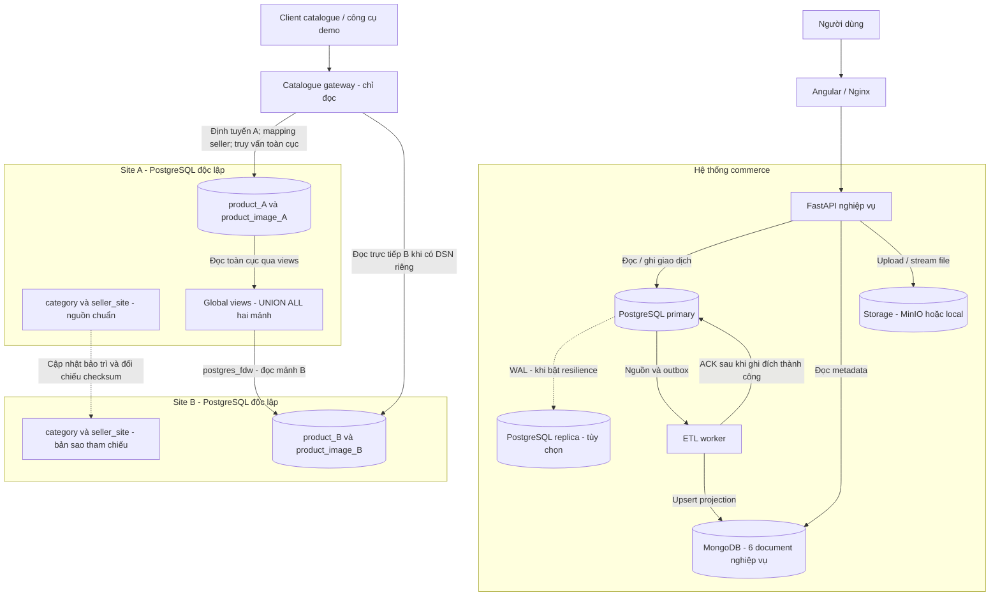
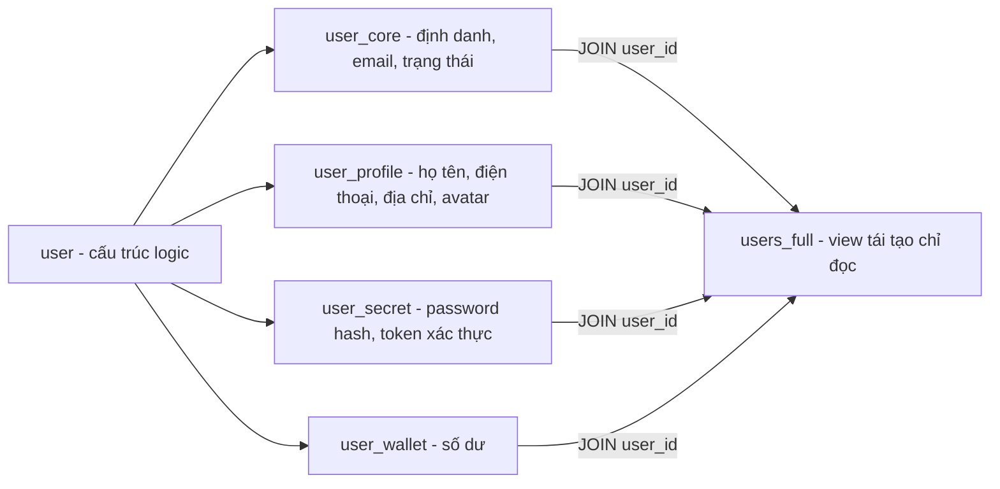

# Sơ đồ hệ phân tán OldShop

Đối chiếu cấu hình và mã nguồn ngày 12/11/2026; đây là sơ đồ logic, không xác nhận các dịch vụ đang chạy hoặc đã đặt trên các máy vật lý khác nhau.

`product_A`, `product_B`, `product_image_A`, `product_image_B` là ký hiệu mảnh trên hình. Tên bảng vật lý tại mỗi site vẫn là `product` và `product_image`. Global views tại A là các view `v_product`, `v_product_image`; mũi tên biểu diễn hướng truy cập dữ liệu.

## Phân mảnh ngang

| Nhóm dữ liệu | Cách chia | Tái tạo / giới hạn |
|---|---|---|
| `product` giữa A/B | Owner được xác định bởi `seller_site(seller_id, site_id)`. Sản phẩm của seller thuộc A ở A; thuộc B ở B. ID được cấp lẻ tại A, chẵn tại B để không trùng và hỗ trợ định tuyến detail. | `product_A UNION ALL product_B`. Parity ID không thay thế mapping seller. Trigger/FK chặn sai site và đổi owner. |
| `product_image` giữa A/B | Phân mảnh ngang dẫn xuất: metadata ảnh nằm cùng site với sản phẩm cha qua `product_id`. | `product_image_A UNION ALL product_image_B`. Không phải phân phối byte file giữa hai kho MinIO. |
| Bảng `order` trong commerce | Partition HASH theo `order_id`, 4 partition. | Phân vùng nội bộ PostgreSQL, không phải 4 site; không dùng `order_id % 4` thay cho hàm hash PostgreSQL. |
| Bảng `system_log` trong commerce | Partition RANGE theo tháng của `created_at`, có DEFAULT nhận ngày ngoài khoảng đã tạo. | Phân vùng nội bộ PostgreSQL; truy vấn thời gian có thể bỏ qua partition không liên quan. |

## Phân mảnh dọc người dùng

Đây là tách cột thành bảng vật lý, không hàm ý đặt secret ở B hay wallet ở A. Schema site cũng được dựng với bốn bảng này; việc tách dọc không định nghĩa quy tắc chia ngang user giữa các site. Mỗi bảng có PK `user_id`; ba bảng con có FK về core. Service tạo/cập nhật các bảng trong transaction cục bộ. FK một chiều chưa bảo đảm mọi core luôn có đủ ba dòng con khi ghi ngoài service. View tái tạo bằng JOIN khi invariant đủ dòng được giữ.

## Cách vận hành và ranh giới

- Catalogue gateway là module đọc độc lập, chưa nối thay đường commerce/checkout. Không có luồng ETL hai nguồn A/B sang MongoDB được khẳng định trong hình; ETL hiện lấy nguồn từ PostgreSQL commerce.
- Truy vấn detail định tuyến A/B theo ID đã kiểm contract; truy vấn seller tra mapping tại A. Truy vấn toàn cục dùng global views tại A, đọc B qua FDW và cần cả hai site. Khi có DSN B riêng, detail B có thể hoạt động lúc A lỗi; nếu không thì đọc B cũng phụ thuộc A.
- Hai site commit độc lập, không có transaction hay snapshot nguyên tử toàn cục. Reference tại B là bản sao được quản lý bằng bảo trì/checksum, không phải streaming replication tự động từ A.
- PostgreSQL replica tùy chọn sao chép toàn cluster commerce; Mongo replica set cũng là sao chép, chưa phải sharding. Hai cơ chế này khác phân mảnh ngang A/B.
- MinIO là backend có cấu hình; mặc định có thể dùng local storage. JSON/document chỉ lưu URL/key/metadata. ETL sang MongoDB là đồng bộ bất đồng bộ nên có thể trễ.
- Các site có thể chạy container trên một máy hoặc triển khai hai máy theo hướng dẫn; sơ đồ logic không chứng minh khả năng chịu mất máy.

Nguồn đối chiếu: [contract phân mảnh](../../database/distributed/fragmentation.json), [runbook hiện hành](../runbooks/fragmentation_indexing.md), [gateway](../../backend/app/catalogue_gateway.py), [global views](../../database/distributed/05_global_views.sql), [migration tách dọc](../../database/04_migrations/003_vertical_split.sql), [compose commerce](../../deploy/docker-compose.distributed.yml).
