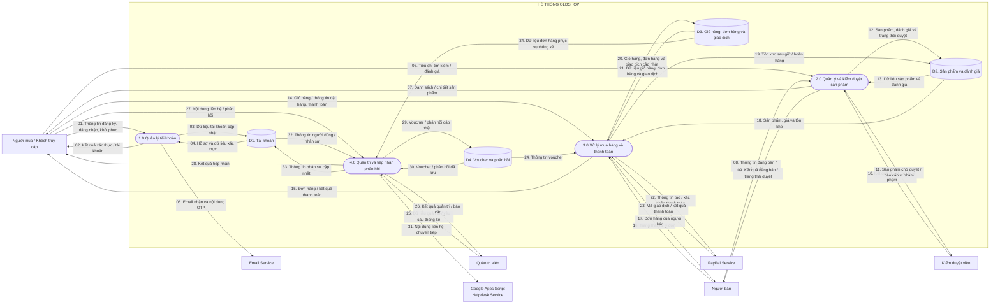

# DFD mức 1 — OldShop

Sơ đồ khái quát các luồng dữ liệu chính. Các số trên mũi tên là mã luồng dữ liệu, không phải thứ tự thực thi. Hình chữ nhật là External Entity, hình bo tròn là tiến trình, hình trụ biểu diễn kho dữ liệu logic.

Để giữ sơ đồ khái quát, luồng tài khoản dùng chung cho các Actor chỉ được minh họa qua Người mua / Khách truy cập. Người bán, Kiểm duyệt viên và Quản trị viên cũng sử dụng tiến trình 1.0. Kho dữ liệu được nhóm theo nghiệp vụ, không theo công nghệ lưu trữ. Các luồng phụ, như quản lý địa chỉ và khóa tài khoản, được lược bỏ.
