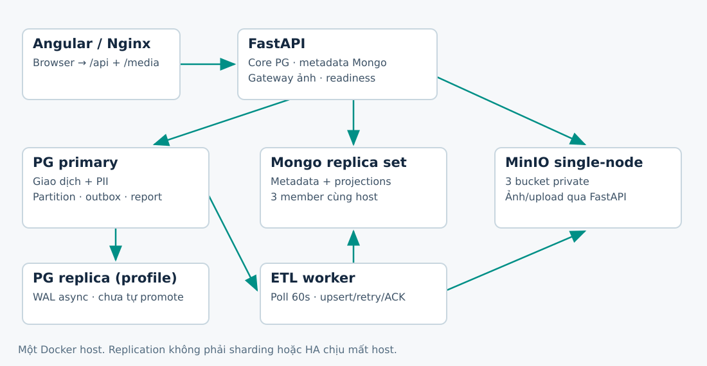
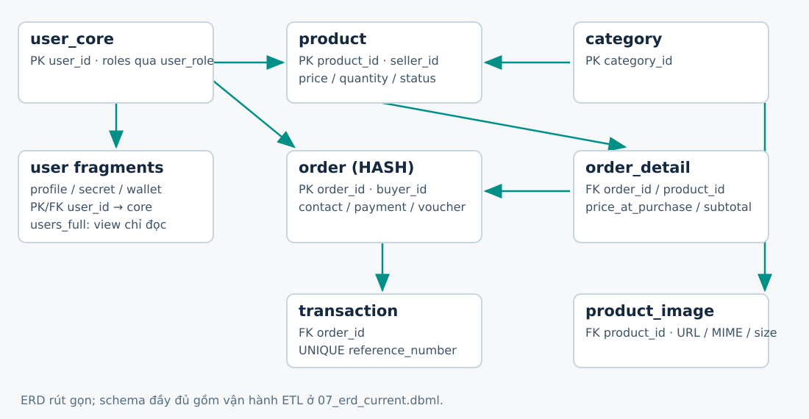
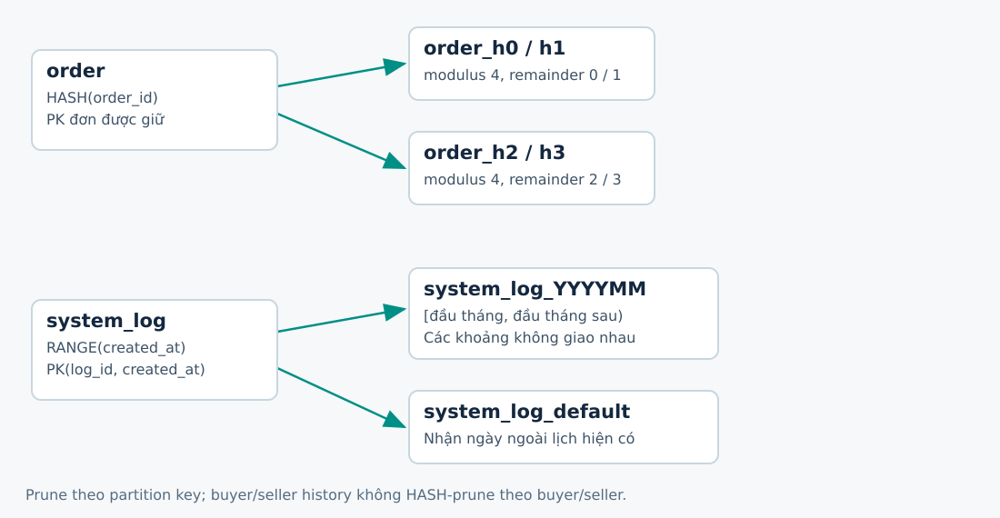
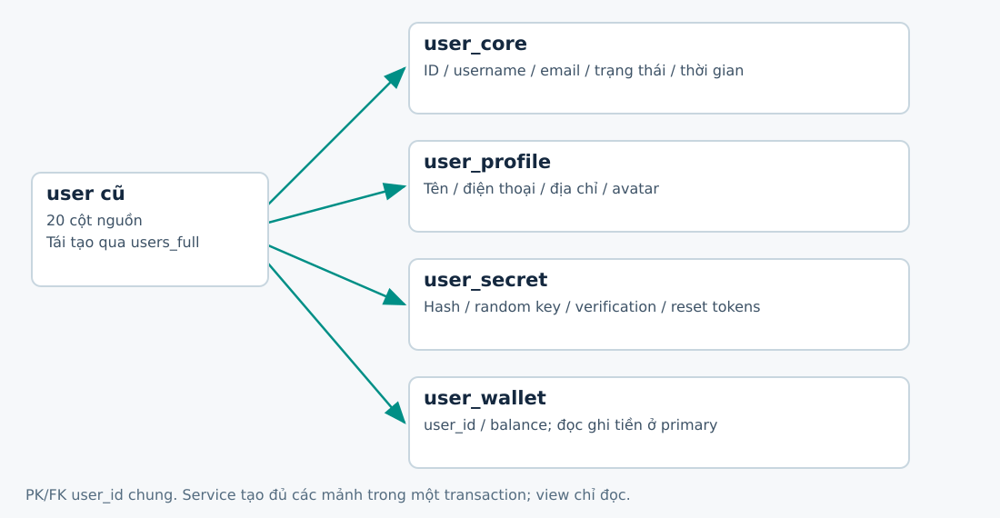
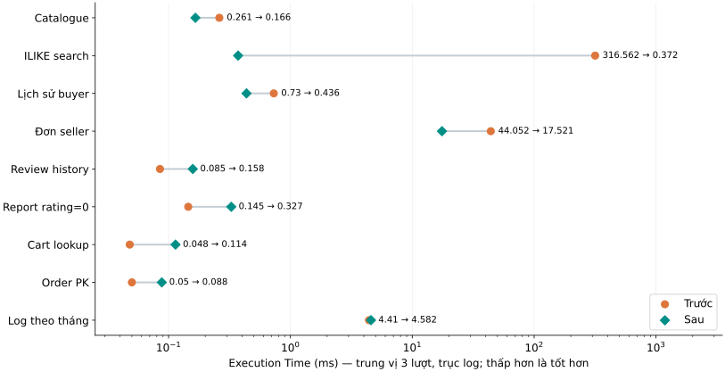
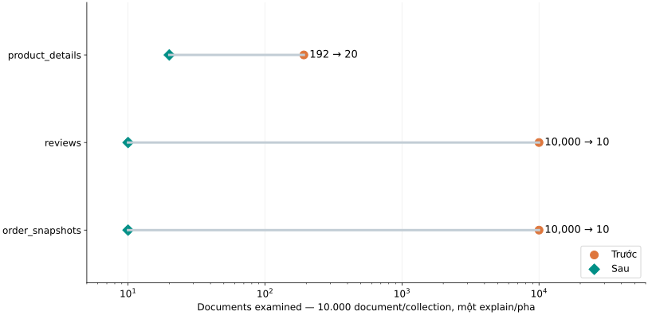
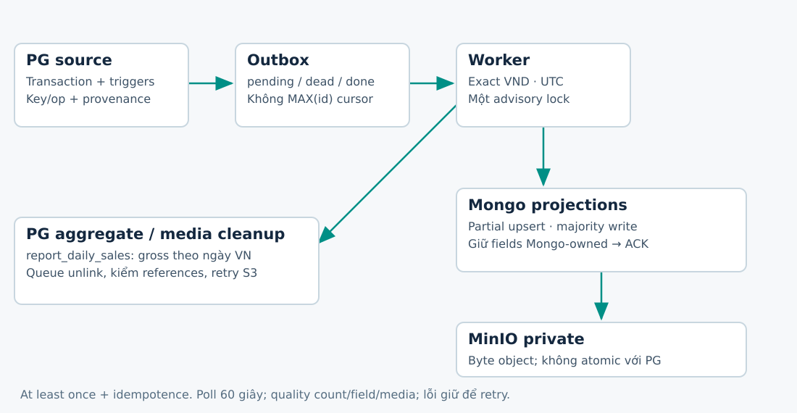
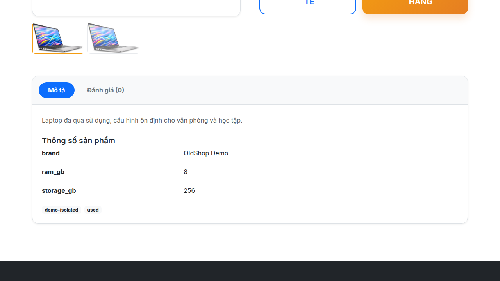

# OldShop — 18 slide và lời dẫn

## 01. OldShop

- PostgreSQL · MongoDB · MinIO
- Phân mảnh, ETL và kiểm chứng trên một máy
- Báo cáo đồ án · 30/10/2026

Lời dẫn: Giới thiệu phạm vi đồ án. Không gọi mô hình một máy là HA đa máy.

## 02. Bài toán và mục tiêu

- Giao dịch tiền/tồn kho cần ràng buộc và khóa dòng.
- Thuộc tính sản phẩm khác nhau giữa danh mục.
- Ảnh cần object storage, metadata cần định danh rõ.
- Nâng cấp giữ contract và dữ liệu đang dùng.

Lời dẫn: Nguồn: inventory, decisions D1–D6. Không chuyển giỏ hàng/ví sang Mongo.

## 03. Kiến trúc hiện hành

Lời dẫn: Nguồn: compose distributed, app/services, etl. Tất cả node ở cùng host; PG replica/Mongo2/3 thuộc profile resilience.

## 04. ERD: giao dịch vẫn ở PostgreSQL

Lời dẫn: Đây là ERD rút gọn, không thay ERD đầy đủ 07_erd_current.dbml. Order_detail giữ giá mua; transaction giữ UNIQUE reference_number.

## 05. Ba nhóm dữ liệu, ba trách nhiệm

- PG: user, role, product core, cart, order, transaction, voucher.
- Mongo: attributes/tags mới và bản đọc nhúng có allowlist.
- MinIO: byte ảnh; URL/bucket/key vẫn là metadata.
- pgAdmin4 / Compass là công cụ quản trị, không phải loại dữ liệu.

Lời dẫn: D1 ownership. Nội dung contact/violation riêng tư vẫn ở PG; Mongo không nhận password/token/địa chỉ/số dư.

## 06. Phân mảnh ngang có điều kiện

Lời dẫn: HASH(order_id) bốn phần giữ PK đơn; chỉ query theo order_id prune. Log RANGE theo tháng có DEFAULT và PK ghép. Không dùng id%4 thay hash PG.

## 07. Phân mảnh dọc và tái tạo user

Lời dẫn: Đủ 20 cột nguồn, khóa chung user_id; users_full chỉ đọc. Service tạo đủ mảnh cùng transaction, FK một chiều chưa bảo đảm tính đầy đủ. Product vẫn expand/contract.

## 08. Replication và ranh giới chịu lỗi

- PG standby nhận WAL async, chưa có tự promote.
- Mongo 3 member dùng majority; replication khác sharding.
- Mất MinIO: ảnh/upload 503; phần PG vẫn phục vụ.
- Cùng một host: chưa chứng minh chịu mất máy.

Lời dẫn: Day6 có 9 scenario lỗi/phục hồi. Không suy rộng thử tắt replica thành automatic failover PG primary.

## 09. Document JSON / BSON

- product_id: 1, category_id: 1
- attributes: {brand: Demo, ram_gb: 8}
- tags: [used], images: [{bucket, key, size}]
- Date UTC; schema_version; unique business key

Lời dẫn: Ví dụ minh họa, không phải ảnh chụp dữ liệu nguồn. Sáu contract + etl_errors. Mongo lưu BSON, không cần file JSON cho từng hàng.

## 10. Nhúng và tham chiếu

- Order snapshot nhúng items/payments để đọc cùng nhau.
- Buyer/seller chỉ ID và dữ liệu allowlist, tránh nhân bản PII.
- Image reference chứa bucket/key; byte nằm MinIO.
- Partial upsert giữ attributes/tags do Mongo sở hữu.

Lời dẫn: Không replace document toàn bộ khi ETL. Moderation/evidence/attachment metadata cần giữ khi rebuild.

## 11. PostgreSQL: đo cả kết quả bất lợi

Lời dẫn: Median ba lượt, warmup, cùng DB riêng; 50.016 product / 100.030 order. ILIKE 316,562→0,372 ms. Review/cart/PK/log không chứng minh nhanh hơn. Index bytes 35.225.600→58.736.640. Trục log; không dùng số text plan thay median.

## 12. MongoDB: documents examined

Lời dẫn: Mongo7.0.43, 10.000 document/collection; before chỉ _id. Product192→20, review10000→10, snapshot10000→10. Một lượt mỗi pha, không tuyên bố Mongo8 đã test.

## 13. ETL: transaction → outbox → projection

Lời dẫn: Poll60s, một advisory lock. Write majority xong mới ACK đúng event. Không MAX(id) cursor; ID nhỏ có thể commit muộn. At least once + idempotence, không exactly once.

## 14. Chất lượng và số liệu có nghĩa

- 57 document nguồn: 16 product + 30 order + 11 violation.
- 32/32 image reference hợp lệ; 95 object gồm avatar/alias.
- VND nguyên, UTC có provenance; giữ lỗi thay vì làm tròn.
- Gross line subtotal khác total_revenue theo final_amount.

Lời dẫn: Nguồn Day6 rollout. Rows_in/out là số thao tác, không phải số document duy nhất khi có replay. UTC không viết lại timestamp nguồn.

## 15. Demo trực tiếp 5–7 phút

- Stack riêng → partition/WAL → Mongo document → MinIO ảnh.
- Full ETL lặp và kiểm count/metadata.
- EXPLAIN: raw bằng chứng cũ + pruning hiện hành.
- Tắt mongo2, khôi phục; ứng dụng vẫn trả dữ liệu.

Lời dẫn: Dùng 07_demo_script.md và video dự phòng. Snapshot SQL có nhãn, không giả là GUI pgAdmin. Không dừng stack oldshop-data.

## 16. Kết quả kiểm chứng

- 146 test backend khác nhau; 15 test frontend đạt.
- 9 kịch bản lỗi/phục hồi trên project riêng đạt.
- 64 path API cũ cùng method/field được giữ.
- Backup/restore và digest 18 bảng nguồn khớp.

Lời dẫn: Các số là bằng chứng Day6 qua nhiều lượt, không tuyên bố một pytest process hoặc remote CI. CLI status lỗi đã được sửa và có test hồi quy.

## 17. Kế hoạch còn lại và giới hạn

- CI đã cấu hình; chưa có lượt GitHub Actions remote.
- Mongo8 cần kernel tương thích; hiện dùng Mongo7 local.
- Trước public: rotate key, TLS, backup ngoài host, kiểm PII/upload.
- Sau MVP: CDC/Kafka, Patroni, shard/FDW, MinIO distributed.

Lời dẫn: A/B/C/D là vai trò, chưa gán tên cá nhân. ETL N+1/rebuild và search cap5000 là nợ kỹ thuật, chưa benchmark throughput100k.

## 18. Q&A — Điều gì đã được chứng minh?

- ACID ở đâu? Giao dịch PG, không phải transaction ba kho.
- Mất node khác mất host như thế nào?
- Replay tại sao không nhân bản? ACK sau write, upsert theo key.
- Partition pruning tại sao chưa chắc nhanh hơn?

Lời dẫn: Kết thúc bằng phạm vi và bằng chứng. Câu trả lời chi tiết tại 07_qa.md; không hứa SLA hay production HA.
