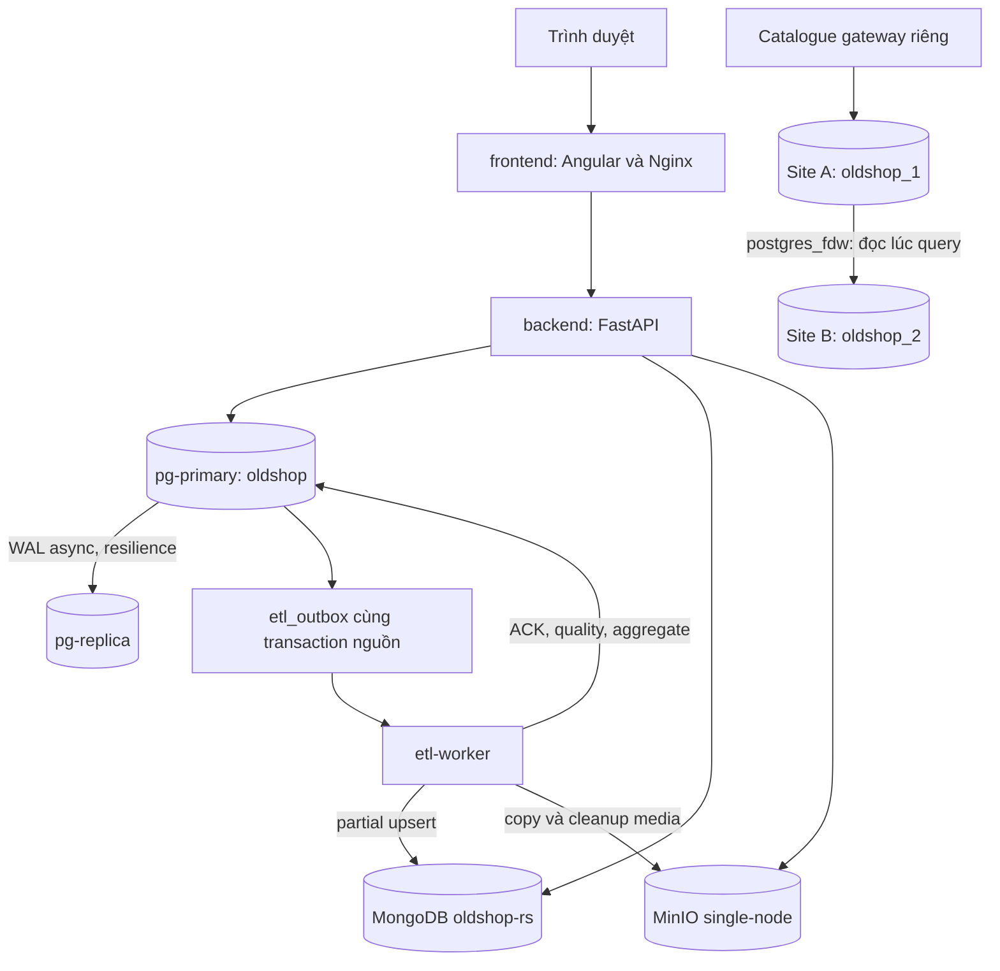
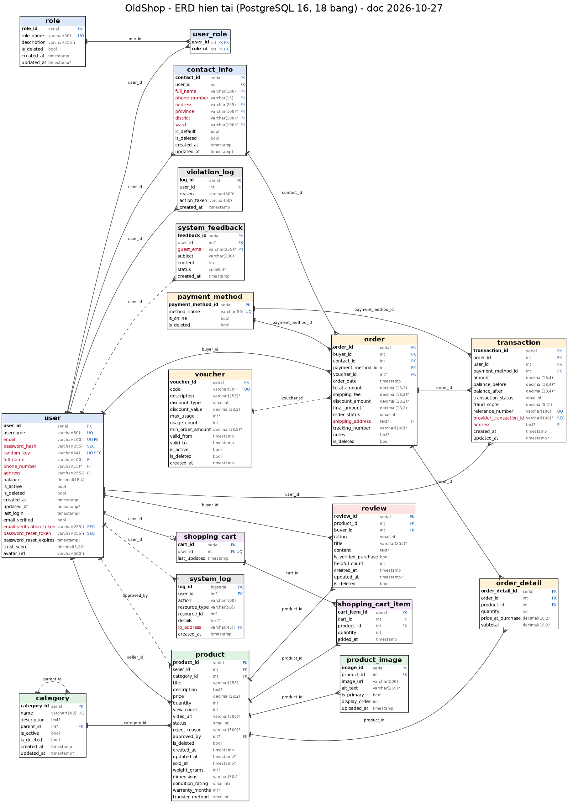
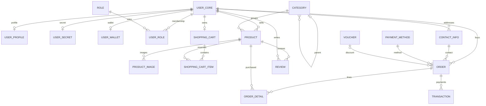
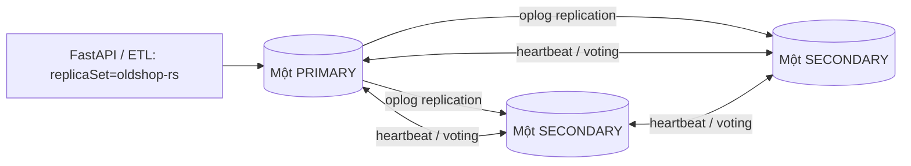
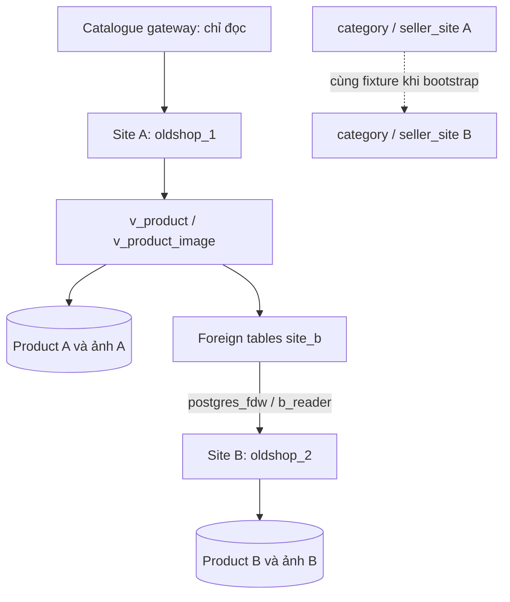
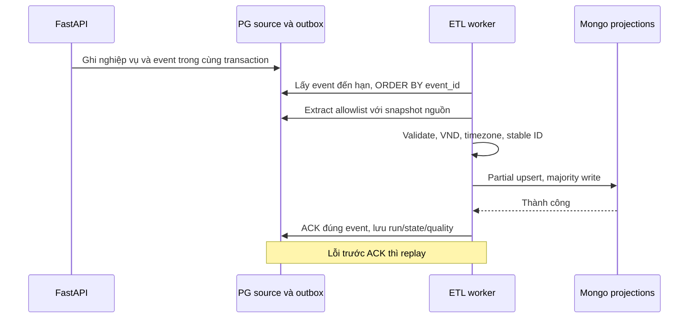

# BÁO CÁO KIẾN TRÚC VÀ KIỂM CHỨNG CƠ SỞ DỮ LIỆU OLDSHOP

**Dự án:** OldShop — Epic-Ecommerce-FastAPI.

**Ngày rà soát:** 05/11/2026, giờ Việt Nam.

**Phạm vi:** PostgreSQL, MongoDB, MinIO, Docker, ETL, phân tán danh mục hai site và indexing. Báo cáo đối chiếu các tệp hiện có; lần rà soát này không triển khai hệ thống, chạy lại benchmark hoặc thay đổi dữ liệu.

## 1. Giới thiệu và phương pháp đánh giá

### 1.1. Bài toán và mục tiêu kiến trúc

OldShop phục vụ mua bán đồ cũ. Một tài khoản có thể vừa đăng bán vừa mua hàng; moderator kiểm duyệt tin đăng, admin quản lý tài khoản và hoạt động hệ thống. Luồng chính là tài khoản → tin đăng/media → giỏ hàng → đơn hàng/chi tiết đơn → giao dịch và báo cáo.

Giá, tồn kho, ví và quan hệ đơn hàng cần ràng buộc và transaction. Thuộc tính thay đổi theo danh mục cần object linh hoạt; ảnh/video cần lưu byte file ngoài bảng nghiệp vụ. Dự án vì vậy kết hợp PostgreSQL, MongoDB và MinIO, dùng ETL tạo bản đọc/tổng hợp. Module phân tán danh mục sử dụng hai PostgreSQL độc lập, chạy riêng với ứng dụng thương mại hiện hữu.

Mục tiêu báo cáo là giải thích quyết định thiết kế và xác định bằng chứng cho từng kết quả. Có mã nguồn, đã từng kiểm chứng và đang hoạt động tại thời điểm đọc là ba nhận định khác nhau.

### 1.2. Quy ước trạng thái và nguồn

| Trạng thái | Tiêu chí |
|---|---|
| **Đã thiết kế** | Có đặc tả/sơ đồ, chưa tìm thấy triển khai tương ứng. |
| **Đã cấu hình/triển khai** | Có code, DDL hoặc cấu hình thực hiện chức năng; chưa mặc định đã chạy thành công. |
| **Đã kiểm chứng** | Có kết quả thực thi lưu trong repository, với phạm vi, phiên bản và chỉ số cụ thể. |
| **Chưa đủ bằng chứng** | Thiếu kết quả hoặc kết quả chỉ chứng minh một phần của nhận định. |

Đường dẫn trong dấu mã tính từ gốc dự án; liên kết Markdown tính từ báo cáo. Ưu tiên SQL/migration/code để xác định chức năng và output thực thi để xác định kết quả. Tài liệu mô tả không thay thế output bị thiếu. Evidence ngày 30/10 và benchmark ngày 05/11 có dữ liệu/phiên bản khác nhau, không được ghép thành một lượt kiểm thử. Không công bố credential hoặc backup chứa dữ liệu cá nhân.

### 1.3. Đối chiếu sáu yêu cầu

| Yêu cầu | Phần đáp ứng |
|---|---|
| 1. Tổng hợp thiết kế dữ liệu | Chương 2–3: ownership, bảng/khóa/quan hệ, document và media. |
| 2. Thiết kế hệ thống phân tán | Chương 2, 4: container, replication, phân mảnh, FDW, chịu lỗi. |
| 3. Thiết kế JSON | Mục 3.2 và Chương 5: kiểu, required/default, ví dụ, validator, ETL. |
| 4. Thiết kế indexing | Chương 6: danh mục, cơ sở lựa chọn, cấu hình JSON, kết quả đo. |
| 5. Kế hoạch hoàn thiện | Chương 8: trạng thái, ưu tiên, điều kiện nghiệm thu; không giao người hoặc đặt deadline mới. |
| 6. Tổng hợp phục vụ báo cáo/thuyết trình | Sơ đồ, bảng, kết luận và phụ lục kiểm chứng trong tài liệu; không tạo Word/PPT hoặc kịch bản. |

## 2. Tổng quan các thành phần và kiến trúc Docker

### 2.1. Vai trò và quyền sở hữu dữ liệu

| Thành phần | Dữ liệu và trách nhiệm | Đường truy cập chính |
|---|---|---|
| PostgreSQL primary, DB `oldshop` | Nguồn chuẩn tài khoản/quyền, giá, stock, cart, order, payment, PII; outbox, ETL state, aggregate. | FastAPI qua `backend/app/core/database.py`; ETL qua kết nối PG. |
| PostgreSQL standby | Bản sao WAL bất đồng bộ của primary. | Chưa triển khai routing commerce tự động hoặc tự promote. |
| MongoDB `oldshop-rs` | Nguồn chuẩn attributes/tags; sáu nhóm bản đọc và lỗi ETL. | `backend/app/services/mongo.py`, `product_metadata.py`. |
| MinIO single-node | Byte ảnh, MP4 upload, avatar, attachment theo cấu hình bucket. | `backend/app/services/storage.py`, media gateway và ETL. |
| Site A/B, DB `oldshop_1`/`oldshop_2` | Fragment danh mục theo site của seller; reference data nạp tại cả hai. | Gateway riêng `backend/app/catalogue_gateway.py` đọc view tại A. |

Một trường có thể xuất hiện ở nhiều kho nhưng chỉ có một nguồn ghi chuẩn. Description, giá/stock và quan hệ ảnh vẫn do PG quản lý; Mongo nhận projection. Attributes/tags được giữ khi ETL chạy lại. Không chuyển số dư, mật khẩu/token hoặc địa chỉ khách hàng sang bản đọc chỉ vì Mongo có schema linh hoạt.

### 2.2. Sơ đồ kiến trúc tổng thể



Không có transaction ACID chung cho PG, Mongo và MinIO. ACK sau ghi Mongo cho phép retry nhưng tạo độ trễ eventual consistency. Các node đã kiểm chứng nằm cùng Docker host, chưa tạo miền lỗi vật lý độc lập.

### 2.3. Số service theo chế độ triển khai

[Compose dữ liệu](../../deploy/docker-compose.distributed.yml) định nghĩa **14 service**, không có nghĩa cần 14 container chạy liên tục.

| Chế độ của `deploy/docker-compose.distributed.yml` | Service được chọn | Dài hạn | Một lần |
|---|---:|---:|---:|
| Mặc định | 9 | 6 | 3 |
| `resilience` | 13 | 9 | 4 |
| Mặc định + `test` | 10 | 6 | 4 |
| `resilience` + `test` | 14 | 9 | 5 |

Đây là số từ cấu hình, không phải ảnh chụp `docker ps`. Job init hoàn tất có thể còn container `Exited (0)`. Số đang running thấp hơn số service đã tạo. Trong evidence Ngày 7, `checks.healthy_services` có chín service dài hạn của profile resilience.

### 2.4. Chức năng toàn bộ service của stack dữ liệu

| Service | Nhóm/profile | Vòng đời | Chức năng | Phụ thuộc được khai báo |
|---|---|---|---|---|
| `pg-primary` | CSDL/mặc định | Dài hạn | PostgreSQL 16 nghiệp vụ và WAL. | Không. |
| `pg-replica` | CSDL/resilience | Dài hạn | Base backup ban đầu, replay WAL read-only. | Primary healthy. |
| `mongo1` | CSDL/mặc định | Dài hạn | Member ban đầu của oldshop-rs. | Không. |
| `mongo2` | CSDL/resilience | Dài hạn | Data-bearing voting member thứ hai. | Không; expand thêm vào set. |
| `mongo3` | CSDL/resilience | Dài hạn | Data-bearing voting member thứ ba. | Không; expand thêm vào set. |
| `mongo-init` | Khởi tạo/mặc định | Một lần | Init set một member, tạo app user. | Mongo1 healthy. |
| `mongo-expand` | Khởi tạo/resilience | Một lần | Thêm member tuần tự, chờ SECONDARY/committed config. | Init completed, mongo2/3 healthy. |
| `mongo-schema-init` | Khởi tạo/mặc định | Một lần | `scripts.init_mongo`: validator và index. | Mongo-init completed. |
| `minio` | Object store/mặc định | Dài hạn | S3/Console, volume riêng. | Không. |
| `minio-init` | Khởi tạo/mặc định | Một lần | Tạo bucket private và policy/app user. | MinIO healthy. |
| `backend` | Ứng dụng/mặc định | Dài hạn | Bootstrap/migration, API/media. | PG và MinIO healthy; init/schema jobs completed; mongo-expand là dependency tùy chọn. |
| `frontend` | Ứng dụng/mặc định | Dài hạn | Angular/Nginx, proxy API/media. | Backend healthy. |
| `etl-worker` | Nền/mặc định | Dài hạn | `python -m etl.run worker`. | Backend healthy. |
| `etl-test` | Helper/test | Một lần | Mặc định chạy `python -m scripts.init_mongo` với Mongo admin URI; runner có thể override entrypoint. | Không. |

Tên `etl-test` không chứng minh service tự chạy pytest: phải đọc command/entrypoint thực tế. `mongo-schema-init` cũng không trực tiếp đợi mongo-expand; backend đợi riêng các job tương ứng. `depends_on` chờ healthy/completed ở startup, không bảo đảm dependency luôn sống sau đó. Ping Mongo không chứng minh đã có PRIMARY; heartbeat worker không chứng minh dữ liệu đã đối soát đủ.

Tách container giúp mỗi tiến trình có image, volume, credential, network, resource limit và vòng đời riêng. Có thể restart worker mà không restart database, thay member mà không nhân bản frontend, để job init kết thúc sau cấu hình. Đổi lại, hệ thống cần timeout/retry và điều phối dependency. Gom mọi tiến trình vào một container làm mất các ranh giới vận hành này; tách container trên một host vẫn không tạo HA chịu mất host.

### 2.5. Các Compose khác và cách tránh đếm trùng

Toàn repo có **10 tệp Compose, 37 mục khai báo service, 29 tên service khác nhau**. Các overlay và phương án thay thế không được cộng thành 37 container phải chạy cùng nhau.

| Tệp/cấu hình | Service và chức năng | Vòng đời/phụ thuộc |
|---|---|---|
| `docker-compose.yml` | postgres; backend; frontend — stack phát triển cơ bản, ba service. | Dài hạn; backend→PG, frontend→backend. |
| `deploy/docker-compose.yml` | postgres, backend, frontend, caddy — stack production bốn service. | Dài hạn; Caddy reverse proxy/TLS, phụ thuộc frontend. |
| `deploy/docker-compose.monitoring.yml` | prometheus, node-exporter, postgres-exporter, grafana. | Dài hạn; PG exporter→postgres, Grafana→Prometheus. |
| `deploy/docker-compose.loki.yml` | loki lưu log, promtail thu log; bổ sung cấu hình grafana đã có. | Dài hạn; promtail→Loki. Production+monitoring+Loki: 10 service. |
| `deploy/docker-compose.elk.yml` | elasticsearch, es-setup, kibana, filebeat; bổ sung grafana. | es-setup một lần sau ES healthy; Kibana đợi setup; Filebeat đợi ES. Production+monitoring+ELK: 12 service, 11 dài hạn. |
| `deploy/docker-compose.gui.yml` | Override mongo1 để publish 127.0.0.1:57017. | Không thêm service hoặc instance mới. |
| `deploy/sites/compose.site-a.yml` | pg-a, DB oldshop_1. | Dài hạn, độc lập. |
| `deploy/sites/compose.site-b.yml` | pg-b, DB oldshop_2. | Dài hạn, độc lập. |
| `deploy/sites/compose.catalog.yml` | catalogue, gateway chỉ đọc, profile catalogue. | Dài hạn, đợi pg-a healthy. Hai site+gateway: ba service. |

`deploy/scripts/lib.sh` ghép production/monitoring và **một** hệ log; đây không phải overlay tự động cho oldshop-data. pgAdmin4/Compass là client quản trị trong hướng dẫn, không có service pgAdmin/Compass được thêm ở đây. Bootstrap sites chạy qua `deploy/scripts/sites.py`, không có container init sites riêng.

## 3. Thiết kế dữ liệu quan hệ, JSON và media

### 3.1. PostgreSQL

#### 3.1.1. Nguồn schema và chuỗi migration

Baseline `database/01_schema/*.sql` có **18 bảng nghiệp vụ**. `database/init.sql`, `backend/scripts/init_db.py`, `backend/scripts/migrate.py` là đường bootstrap/migration; ORM tại `backend/app/models/` được đối chiếu cùng DDL. Runner kiểm baseline fingerprint, checksum và advisory lock, áp từng migration trong transaction, lưu schema_migrations.

| Migration trong `database/04_migrations/` | Thay đổi chính |
|---|---|
| 001_indexes.sql | Sáu index workload, gồm unique cart/product. |
| 002_partitioning.sql | Order HASH bốn partition; system_log RANGE tháng, DEFAULT và PK ghép; giữ FK. |
| 003_vertical_split.sql | User core/profile/secret/wallet và view users_full. |
| 004_media_metadata.sql | Product_image.content_type, size_bytes. |
| 005_etl_outbox.sql | Năm bảng outbox/provenance/run/state/report, trigger nguồn. |
| 006_media_cleanup.sql | Hàng đợi xóa media và trigger. |
| 007_indexing_v2.sql | Chín index bổ sung, không thêm bảng/cột. |

Sau split có 21 bảng nghiệp vụ; cộng năm bảng 005, một bảng 006 và schema_migrations thành **28 bảng logic**. Không cộng partition con lần nữa. Module sites có extension riêng, không gộp vào con số DB ứng dụng.

#### 3.1.2. Bảng, khóa và quan hệ

| Bảng | PK và cột/quan hệ quan trọng | Ý nghĩa/ràng buộc |
|---|---|---|
| user_core | user_id; username/email UNIQUE, trạng thái, trust_score, thời gian | Gốc tài khoản. |
| user_profile | user_id vừa PK vừa FK→core; full_name/phone/address/avatar_url | Hồ sơ/PII, tối đa một dòng mỗi core. |
| user_secret | user_id PK/FK→core; password_hash, random_key, token/expiry | Bí mật xác thực, không qua ETL Mongo. |
| user_wallet | user_id PK/FK→core; balance NUMERIC | Ví giao dịch trên primary; DDL003 không có CHECK số dư không âm. |
| role; user_role | role_id; PK(user_id,role_id), hai FK | User–role nhiều–nhiều. |
| category | category_id; parent_id tự FK; name UNIQUE | Cho phép cây danh mục; seed không chứng minh cây nhiều tầng. |
| product | product_id; seller_id/approved_by→core; category_id→category | Title, description, price/quantity có CHECK, status, soft-delete, media/thuộc tính cũ. |
| product_image | image_id; product_id→product CASCADE | image_url, is_primary/display_order, content_type/size_bytes; không chứa byte ảnh. |
| contact_info | contact_id; user_id→core | Sổ địa chỉ. FK từ order không tự kiểm contact thuộc buyer. |
| shopping_cart | cart_id; user_id FK và UNIQUE | User có tối đa một cart. |
| shopping_cart_item | cart_item_id; cart_id/product_id FK | Quantity; unique(cart_id,product_id) do 001. |
| voucher | voucher_id; code UNIQUE | Giảm giá, usage, hiệu lực. |
| payment_method | payment_method_id; method_name UNIQUE | Danh mục phương thức. |
| order | order_id; buyer/contact/payment_method FK; voucher FK nullable | Tổng tiền/shipping/discount/final/status/date; HASH(order_id). |
| order_detail | order_detail_id; order_id/product_id FK | Quantity, price_at_purchase, subtotal; một đơn có thể nhiều seller. |
| transaction | transaction_id; order_id/user_id/payment_method_id FK | Amount, balance_before/after, status; reference_number UNIQUE. |
| review | review_id; product_id/buyer_id FK | Rating0 là report theo code; 1–5 là review, soft-delete. |
| system_log | PK(log_id,created_at); user_id FK nullable | RANGE theo created_at; log_id riêng không đủ định danh nguồn. |
| violation_log | log_id; user_id FK | User bị xử lý, reason/action_taken; nguồn không có actor riêng. |
| system_feedback | feedback_id; user_id nullable FK SET NULL | Subject/content/status, guest_email; nguồn contact_messages. |

PK/FK của ba mảnh user đều CASCADE về core. `users_full` là view JOIN chỉ đọc, không có trigger ghi. ORM tạo đủ bốn dòng trong một transaction nhưng FK một chiều không bắt buộc mọi core phải có đủ các con khi DBA ghi SQL trực tiếp. Không có order.seller_id: seller phải đi qua order_detail→product.

| Bảng vận hành | PK | Nội dung/quan hệ |
|---|---|---|
| etl_time_origin | (source_table,source_key,field_name) | JSONB source key, timestamp/zone; không FK đa hình tới các bảng nguồn. |
| etl_outbox | event_id | Source/entity key JSONB, operation/status/attempts/available_at; last_run_id không khai báo FK. |
| etl_runs | run_id UUID | Mode/status/time, rows_in/out/errors, details JSONB. |
| etl_state | name | Value JSONB, updated_at; heartbeat/initialization/deep-check. |
| report_daily_sales | (report_date,seller_id,category_id) | Counts/quantity/gross_sales_vnd/refreshed_at/run_id; các ID không được khai báo FK trong005. |
| media_deletions | deletion_id | url_path UNIQUE, lý do/status/retry; worker ánh xạ URL sang object, không có FK liên kho. |
| schema_migrations | version | Checksum và lịch sử runner. |

Có chênh lệch giữa ORM và SQL: `transaction.amount` là NUMERIC(18,4) trong DDL nhưng DECIMAL(18,2) trong ORM; transfer_method NOT NULL trong SQL nhưng ORM cho nullable; UNIQUE reference_number có trong SQL nhưng ORM chưa khai báo tương ứng. Đây là nợ đồng bộ model, không phải lý do sửa ngược DDL trong lần viết báo cáo. SQL/migration là căn cứ constraint CSDL thực tế.

#### 3.1.3. ERD và giới hạn sơ đồ hiện hữu



Hình trên là **baseline ngày 27/10**, còn user nguyên khối, system_log PK đơn và chưa có bảng ETL. Không dùng nó như ERD sau migration. Nguồn phù hợp hơn là [07_erd_current.dbml](../diagram/07_erd_current.dbml). `docs/evidence/day7_schema_review.json` ghi result PASS, logical_tables=28, columns=222, table_column_type_nullability_diffs rỗng; chỉ chứng minh phạm vi bảng/cột/kiểu/nullability của lượt kiểm.



Sơ đồ rút gọn trên lược approver/log và một số FK để dễ đọc; bảng/SQL là nguồn đầy đủ. Với con user, 0..1 biểu thị đúng giới hạn FK/PK, không giả định SQL ép đủ bốn mảnh.

| Sơ đồ hiện có | Phạm vi/sai khác |
|---|---|
| docs/diagram/01_erd_current.dbml và .png | Baseline18 bảng; PNG cần đối chiếu DBML đã hiệu chỉnh. |
| docs/diagram/07_erd_current.dbml | 28 bảng đến006;007 chỉ thêm index; chưa có site_config/seller_site/distributed_installation, site_id, FDW. |
| docs/diagram/02_distribution_diagram.puml và .png | Ngày 2 còn ghi ETL PLANNED; code/evidence về sau đã có worker. |
| docs/diagram/02_fragmentation_model.puml | Target Ngày 2 dùng timestamptz/UTC; SQL002 thực giữ timestamp without time zone. |
| docs/diagram/07_architecture_current.puml | Ghi ba bucket; init hiện có bốn bucket và MP4 upload; chưa có module sites. |
| docs/diagram/05_etl_flow.puml, 07_data_flow_current.puml | Luồng outbox/projection; không mô tả A–B sync vì ETL hiện không làm việc đó. |

PUML/DBML được liên kết như nguồn, không chèn như ảnh. Mermaid trong báo cáo là mô hình từ code/config, không phải ảnh chụp runtime.

### 3.2. MongoDB: JSON/BSON và validator

#### 3.2.1. Nguồn chuẩn và trường dữ liệu

[documents.py](../../backend/app/schemas/documents.py) → `backend/app/services/mongo_schema.py::validators()` → `backend/scripts/init_mongo.py` là đường sinh/cài `$jsonSchema`. Init dùng validationLevel strict và validationAction error. JSON snapshot trong docs/design không phải đầu vào runtime.

Model dùng strict, extra=forbid và cấm NaN/Infinity. Identifier là int dương ≤int64; VND là int không âm ≤int64. `_id` string bắt buộc; schema_version=1 và deleted=false có default. AwareDatetime được chuyển thành BSON Date; ISO8601 trong JSON ví dụ không có nghĩa Mongo lưu string ngày giờ.

Quy ước: **R** bắt buộc khi dựng model; **D** có default; **N** cho phép null. Tất cả sáu collection kế thừa `_id`, schema_version và deleted.

| Collection | R: trường và kiểu | D/N: trường và kiểu |
|---|---|---|
| product_details | _id:string, product_id/category_id:int, updated_at:date | description/video_url/dimensions_raw:string N; weight_grams:int≥0 N; dimensions/condition:object N; attributes:object={}, tags:string[]=[], images:object[]=[], etl:object N. |
| reviews | _id, review_id/product_id/buyer_id:int, type:review/report, rating:int0–5, created_at:date | title/content:string N; status:pending/approved/rejected N; moderation:object N; evidence:object[]=[], updated_at:date N, etl N. |
| order_snapshots | _id, order_id:int, buyer:object, items:object[] min1; total_amount_vnd/shipping_fee_vnd/discount_amount_vnd/final_amount_vnd:int; order_status:int0–4, order_date:date, etl:object | payments:object[]=[], voucher_id:int N, voucher_current:object N. |
| system_logs | _id, log_id:int, action:string1–100, created_at:date | actor_id:int N, resource_type:string N, resource_id:int N, message:string≤2000 N, payload:object N, ip_hash:string N, etl N. |
| violation_logs | _id, log_id/target_user_id:int, reason:string1–500, action_taken:string1–100, created_at:date | actor_id:int N, payload:object N, etl N; không bịa actor thiếu ở PG. |
| contact_messages | _id, feedback_id:int, subject:string1–200, content:string1–5000, status:int0–2, created_at:date | user_id:int N, attachments:object[]=[], etl N. |

| Object/mảng | Cấu trúc và ràng buộc |
|---|---|
| ObjectReference / image | R bucket:string3–63, key:string1–1024; content_type:string N, size:int≥0 N. Ảnh thêm image_id:int N, is_primary=false, display_order=0. |
| Condition / Dimensions | Condition R grade:int1–10; warranty_months:int≥0=0, defects:string[]=[]. Dimensions R length/width/height:number>0; unit=cm, enum cm/mm/m. |
| Buyer / item | Buyer R id:int; region:north/central/south/unknown N. Item R product_id, quantity>0, price_at_purchase_vnd, subtotal_vnd; title/category/seller hậu tố _current cho phép null. |
| Payment / voucher | Payment R transaction_id, method_id, status_code:int, amount_vnd; fraud_score:number0–1 N. Voucher R voucher_id, discount_type_code_current:int, discount_value_current:decimal string, is_active_current/is_deleted_current:bool. |
| ETLMetadata | R synced_at:date; source_updated_at:date N, run_id:string N, source_created_at:string N. |
| Moderation / LogPayload | Moderation R actor_id:int, at:date, reason:string N. Payload event/reason_code:string N; changed_fields:string[]=[]. |

Reviews còn có ràng buộc report iff rating0; review có rating1–5. Mongo ID tham chiếu PG là quan hệ logic, không có FK liên engine. Collection vận hành thứ bảy `etl_errors` có model ở `backend/app/schemas/etl.py`: R _id:string, event_id:int, run_id:string, entity_type:enum sáu entity ETL, entity_key:object, code:string≤80, attempts:int≥1, last_at:date; resolved:bool=false. Entity_key.id dương, created_at:string cho phép null.

#### 3.2.2. Ví dụ JSON theo schema triển khai

Các giá trị dưới đây minh họa hợp đồng và quy tắc transform; không phải dump/seed import, không khẳng định object hoặc product tồn tại. ID entity theo `backend/etl/transform.py`; log cần mã hóa cả khóa thời gian.

```json
{
  "_id":"product:1", "schema_version":1, "deleted":false,
  "product_id":1, "category_id":1, "description":"Sản phẩm đã qua sử dụng",
  "condition":{"grade":8,"warranty_months":0,"defects":[]},
  "attributes":{"brand":"Minh họa","ram_gb":8}, "tags":["do-cu"],
  "images":[{"bucket":"product-images","key":"products/1/example.jpg",
    "content_type":"image/jpeg","size":123456,
    "image_id":1,"is_primary":true,"display_order":0}],
  "updated_at":"2026-11-05T02:00:00Z",
  "etl":{"synced_at":"2026-11-05T02:01:00Z","run_id":"illustration"}
}
```

```json
{
  "_id":"order:1", "schema_version":1, "deleted":false,
  "order_id":1, "buyer":{"id":7,"region":"unknown"},
  "items":[{"product_id":1,"quantity":1,
    "price_at_purchase_vnd":100000,"subtotal_vnd":100000}],
  "payments":[], "total_amount_vnd":100000,"shipping_fee_vnd":20000,
  "discount_amount_vnd":0,"final_amount_vnd":120000,
  "order_status":0,"order_date":"2026-11-05T02:00:00Z",
  "etl":{"synced_at":"2026-11-05T02:01:00Z"}
}
```

Lần lượt là ví dụ reviews, violation_logs và contact_messages:

```json
[
  {"_id":"review:1","review_id":1,"product_id":1,"buyer_id":7,
   "type":"report","rating":0,"content":"Nội dung cần kiểm tra",
   "evidence":[],"created_at":"2026-11-05T02:00:00Z"},
  {"_id":"violation_log:1","log_id":1,"target_user_id":7,
   "reason":"Violation details retained in PostgreSQL","action_taken":"warning",
   "created_at":"2026-11-05T02:00:00Z"},
  {"_id":"contact:1","feedback_id":1,"subject":"Contact request",
   "content":"Message retained in PostgreSQL","status":0,"attachments":[],
   "created_at":"2026-11-05T02:00:00Z"}
]
```

Ví dụ cấu trúc system_logs, với `_id` tượng trưng phải thay bằng khóa do transform sinh khi nạp:

```json
{
  "_id":"system-log-key-illustration","log_id":1,"actor_id":7,
  "action":"UPDATE","resource_type":"product","resource_id":1,
  "payload":{"event":"PG_LOG"},
  "created_at":"2026-11-05T02:00:00Z",
  "etl":{"synced_at":"2026-11-05T02:01:00Z"}
}
```

`docs/design/03_document_examples.json` có ID kiểu p_1/o_1, là ví dụ thiết kế cũ; ETL mặc định dùng product:1/order:1, loader có thể giữ _id cũ nếu đã tìm được business key. `03_mongo_validators.json` thiếu một số trường về sau như voucher_current/deleted kế thừa; `05_mongo_validators.json` gần runtime hơn nhưng nguồn chuẩn vẫn là model/validator sinh từ code.

#### 3.2.3. Nhúng, tham chiếu và đánh đổi

Order nhúng items/payments để đọc snapshot; giá mua ở order_detail, còn các trường `_current` là thông tin hiện tại, không giả làm lịch sử lúc mua. Product nhúng attributes/condition/tags và metadata ảnh vì đọc cùng trang; byte vẫn tham chiếu bucket/key. Document giảm JOIN bản đọc nhưng lặp thông tin và cần fan-out/reconcile. Stock/ví/payment không chuyển sang document để thay ràng buộc PG. Endpoint ghi metadata tùy ý có UI/phân quyền đầy đủ chưa được chứng minh hoàn tất.

### 3.3. MinIO và quan hệ media

`deploy/data/minio/init.sh` hiện tạo **bốn bucket private**: product-images, product-videos, user-avatars, attachments, với app policy giới hạn bucket. `storage.py` chọn LocalStorage/MinioStorage bằng STORAGE_BACKEND; URL /media/... được ánh xạ sang key để stream. PG lưu quan hệ ảnh, Mongo lưu bản đọc reference, MinIO lưu byte; không có SQL FK tới object.

MP4 upload nằm trong product-videos khi dùng MinIO, có hỗ trợ Range/HEAD trong code. Video link Drive/YouTube vẫn ở dịch vụ ngoài. Bucket/schema attachments không chứng minh uploader và API tải attachment có kiểm quyền đã hoàn tất. Upload và commit PG không nguyên tử xuyên kho; code dọn object mới khi commit lỗi. Migration006 enqueue xóa sau unlink; worker chỉ xóa sau kiểm tra tham chiếu/quality, không scan bucket để tự xóa mọi orphan.

## 4. Kiến trúc phân tán và chiến lược phân phối dữ liệu

### 4.1. Phân biệt các cơ chế

| Cơ chế | Áp dụng | Ý nghĩa thực tế |
|---|---|---|
| PG partitioning | Order HASH, log RANGE trong primary | Chia hàng cùng instance, không tự phân bổ sang Site A/B. |
| PG tách dọc | Core/profile/secret/wallet | Chia cột theo user_id cùng PG, không tự tạo phân quyền hay phân tán vật lý. |
| PG streaming replication | pg-primary→pg-replica | Standby replay WAL, giữ bản sao database; async. |
| Mongo replication | Mongo1/2/3 thuộc oldshop-rs | Các member sao chép cùng logical dataset; không chia shard. |
| Phân mảnh hai site | Product theo seller_site; ảnh dẫn xuất | A/B giữ tập product khác nhau và ghi fragment sở hữu. |
| FDW/global view | A đọc B, UNION ALL local/remote | Tổng hợp lúc query, không copy product B vào bảng local A. |
| ETL | PG ứng dụng→Mongo/MinIO/báo cáo PG | Transform và materialize bản đọc; không đồng bộ A–B. |

### 4.2. MongoDB Replica Set

#### 4.2.1. Cấu hình và cơ chế

Compose có `--replSet oldshop-rs`, keyfile và volume riêng từng member. `deploy/data/mongo/start.sh` tạo keyfile mode400; `init.js` initiate một member khi cần, tạo app user, và mở rộng tuần tự khi MONGO_MEMBERS=3. Base có một member; resilience có **ba data-bearing voting member**, không arbiter hoặc shard.



Vai trò không cố định theo tên container. Mongo1 có priority2 ban đầu, mongo2/3 priority1, nhưng tên mongo1 không bảo đảm luôn là PRIMARY. Ba voter cần majority **2/3**; mất một secondary vẫn còn quorum. Mất hai voter không đủ majority; base một member không có bản dự phòng để bầu thay. Primary nhận ghi, secondary sao chép oplog; cơ chế election chọn member đủ điều kiện khi cần. `backend/app/services/mongo.py` đặt WriteConcern majority với wtimeout5000ms.

Ba instance lưu bản sao cùng dữ liệu, không mỗi node một nhóm collection/product. Không có mongos/config-server/shard allocation trong stack. Replication tăng khả năng phục hồi member nhưng không tăng dung lượng hữu dụng bằng tổng ba node như sharding. Các node chung host vẫn mất cùng miền lỗi.

Mongo-init tạo topology/user; mongo-expand thêm member và chờ SECONDARY/commitmentStatus; mongo-schema-init cài validator/index. Ba job không thay thế nhau. Không tự tắt hai member của set ba voter rồi kỳ vọng node còn lại vẫn ghi majority.

#### 4.2.2. Bằng chứng cấu hình và hoạt động

| Nguồn | Trường/giá trị cần đọc | Kết luận và giới hạn |
|---|---|---|
| docs/day2/resilience-verification.json; docs/evidence/day7_stack.json | result PASS; checks.mongo.set=oldshop-rs, version=7.0.43; members mongo1 PRIMARY, mongo2/3 SECONDARY; app auth thành công | Đã quan sát set ba member MongoDB 7 trong lượt kiểm lịch sử; không xác nhận lại topology MongoDB 8. |
| docs/day2/fault-verification.json | mongo_secondary_outage.writablePrimary=true; majorityInsertAndDelete=true; result PASS | Đã thử ghi majority khi mất secondary. limits ghi rõ không thử primary failure/host loss. |
| docs/evidence/day6_failover.json | mongo_image=mongo:7.0; scenarios mongo2_stopped/recovered và mongo_unavailable; result PASS | Kiểm phản hồi API khi lỗi/khôi phục; không mặc định là thử election primary. |
| docs/benchmark/mongo/summary.json | version=8.0.32, source=current_application_database, cases đo được | MongoDB 8 đã phục vụ query ngày 05/11; file không có rs.status/member state để xác nhận ba member/election MongoDB 8. |

Kết luận: **replica set ba member đã kiểm chứng trên MongoDB 7; MongoDB 8 có bằng chứng truy vấn nhưng chưa đủ bằng chứng nghiệm thu topology/election tương đương**. Không suy “MongoDB 8 chưa từng chạy” từ tài liệu cũ hoặc “MongoDB 8 HA đã đạt” từ explain. Ping healthcheck chỉ chứng minh truy cập tiến trình, không thay trạng thái PRIMARY/SECONDARY hoặc majority failure test.

### 4.3. PostgreSQL primary/standby

`deploy/data/postgres/init-replication.sh` tạo role LOGIN/REPLICATION và HBA scram. Compose primary đặt wal_level=replica, max_wal_senders=5, wal_keep_size=256MB. `start-replica.sh` chạy pg_basebackup với WAL stream/write-recovery-conf trên volume mới, đặt application_name=oldshop-data-replica và hot_standby=on; volume cũ phải có standby.signal. Không tự xóa/reseed volume hoặc dùng slot giữ WAL vô hạn.

`docs/evidence/day7_stack.json` ghi checks.pg_stat_replication=`oldshop-data-replica:streaming:async`, primary/replica orders cùng30. Verifier `deploy/scripts/check-data-stack.py` còn chờ pg_is_in_recovery và replay LSN đạt target, nhưng JSON không lưu raw LSN. Kết hợp này chứng minh streaming async đã chạy tại lượt kiểm; count bằng nhau riêng lẻ không chứng minh mọi dữ liệu đồng nhất hoặc lag luôn0. Fault evidence xác nhận primary còn phục vụ khi standby dừng.

Không tìm thấy cơ chế PG promotion/fencing/chuyển endpoint hoàn chỉnh. Commerce vẫn dùng primary; cấu hình replica không tự tạo routing SQLAlchemy. Async có thể trễ; không cam kết RPO0 hoặc failover tự động. Đây là cặp khác với hai database oldshop_1/oldshop_2 ở phần sau.

### 4.4. Site A và Site B

#### 4.4.1. Topology, ownership và phân mảnh

| Thành phần | Database | Endpoint host mặc định | IP Docker mặc định | Trách nhiệm |
|---|---|---|---|---|
| pg-a / Site A | oldshop_1 | 127.0.0.1:56431 | 172.29.82.11:5432 | Ghi fragment A; foreign tables/global views. |
| pg-b / Site B | oldshop_2 | 127.0.0.1:56432 | 172.29.82.12:5432 | Ghi fragment B; reader cho A. |
| catalogue | Kết nối A | 127.0.0.1:56480 | 172.29.82.20:8000 | Gateway thử nghiệm chỉ đọc. |

Đây là IP mô phỏng trên một Docker host, không phải IP LAN/VPN giữa hai host. `deploy/scripts/sites.py::common_schema()` dựng schema chung từ source, loại seed baseline, áp001–007 rồi extension site. `database/distributed/01_site_schema.sql` thêm site_config, distributed_installation, seller_site và product.site_id, trigger ownership/ID. Reference fixture chứa category/seller mapping và tài khoản synthetic; không phải hệ thống identity/ví production tự đồng bộ.

Đặt P là tập product toàn cục, owner(seller_id) từ seller_site: P_A gồm product có owner A, tương tự B. Ảnh I_A là ảnh có product_id thuộc P_A. Tái tạo P bằng P_A UNION ALL P_B; tính không giao nhau dựa trên ownership/ID, không nhờ UNION loại trùng. A dùng ID lẻ, B ID chẵn và sequence increment2 trong module thử; quy tắc này chưa chứng minh đã chuyển đổi an toàn toàn bộ ID lịch sử.

| Nhóm | Phân bổ | Cơ chế |
|---|---|---|
| product, product_image | Fragment theo site seller; ảnh dẫn xuất theo product | Constraint/trigger kiểm owner và ID; FK ảnh local. Đây là phân mảnh ngang, không tách cột product giữa A/B. |
| category, seller_site | Reference cùng fixture/version ở cả hai | Copy lúc bootstrap; không pipeline truyền cập nhật liên tục. |
| Các bảng ứng dụng khác | Có schema chung do template/migration | Có bảng không đồng nghĩa nghiệp vụ cart/order/payment/ETL đa site đã tích hợp. |
| site_b.* và global views tại A | Foreign table đọc B, view hợp local/remote | Reader chỉ đọc; không có bảng materialized tự nhận bản sao product B. |



`04_fdw.sql` tạo server_b/user mapping và import product, product_image, category, seller_site, site_identity vào schema site_b. `05_global_views.sql` hợp product/ảnh bằng UNION ALL; v_category/v_seller_site chỉ dùng bản A để không nhân reference. Gateway `backend/app/catalogue_gateway.py` dùng global_reader tại A, REPEATABLE READ/read-only, kiểm v_site_health, lọc/sort trước pagination và batch ảnh; không checkout hoặc tăng view_count.

#### 4.4.2. Kết luận về đồng bộ hóa

**Đối với product/product_image, trường hợp đúng là (3): chỉ tổng hợp khi truy vấn. Hai site ghi fragment độc lập; không có replication hoặc ETL theo lịch giữa A–B.** Reference data có bản giống nhau vì bootstrap nạp cùng fixture, không phải vì tự truyền các cập nhật tiếp theo.

| Khả năng | Kết quả đối chiếu |
|---|---|
| Tự replication A→B/B→A | Không có standby/primary_conninfo hoặc publication/subscription cho cặp sites. Không nhầm với pg-primary/pg-replica. |
| Đồng bộ theo lịch/ETL A–B | Không có worker nhiều nguồn/site; worker hiện dùng PG ứng dụng. |
| A thấy thay đổi B | Có qua foreign query; transaction đọc cũ có thể giữ snapshot cũ, transaction mới thấy commit mới. |
| Local độc lập | Có: mỗi site đọc/ghi phần sở hữu khi site kia dừng; global tại A còn phụ thuộc B. |
| Reference tự cập nhật | Chưa triển khai; bằng nhau lúc bootstrap/kiểm không chứng minh tự đồng bộ. |

T02 lưu same_transaction_price=123.00 và new_transaction_price=456.00 sau thay đổi ở B. Đây là semantics snapshot/query của FDW, không phải replication lag. Không suy ra transaction ACID toàn cục cho nhiều site. Commerce đa site còn cần reservation/idempotency, owner đơn/tiền, xử lý mất mạng và rollback/bù trừ riêng.

#### 4.4.3. Evidence và giới hạn

`docs/evidence/distributed/test_results.json` ghi status PASS, T01–T12 PASS, clean_rebuild_verified=true, physical_hosts_verified=false. Lượt lưu mới kết thúc **05/11/2026 13:57:52 giờ Việt Nam**.

| Nhóm kiểm | Kết quả đã lưu | Không chứng minh |
|---|---|---|
| T01–T03 | Kết nối A→B đúng identity; snapshot/commit; quyền/HBA/function. | A/B replication, toàn bộ bảo mật production. |
| T04, T10 | Dừng từng site; local còn đọc/ghi, query cần remote lỗi có timeout rồi phục hồi. | Chịu mất host hoặc global luôn khả dụng. |
| T05–T07 | PK/FK/CHECK/site/owner, tái tạo, schema/reference không nhân dòng. | Migration dữ liệu thật hoặc tự sync reference. |
| T08 / queries.Q1–Q6 | Expected/actual khớp fixture. | Toàn bộ ORM/commerce đã dùng global view. |
| T09 | Bốn writer,40 ID không trùng; write kiểm thử được rollback. | Mọi ID lịch sử đã được chuyển đổi. |
| T11 | Bootstrap idempotent và clean rebuild. | Backup/DR ngoài host. |
| T12 | Plan và thời gian local/remote/global trên fixture nhỏ. | Capacity/SLA hoặc FDW nhanh hơn local. |

Inventory ghi PostgreSQL 16.15, migrations001–007, mỗi site5 product/8 ảnh; schema_comparison.equal=true. api_results.status=PASS kiểm filter/pagination/read-only/HTTP503 khi mất A/B và recovery. Đây là M1 và gateway riêng; chưa commerce frontend/backend/cart/checkout, Mongo/media đa site hoặc migration dữ liệu thật. Hướng dẫn [hai site](../HUONG_DAN_CSDL_PHAN_TAN.md) và [Tailscale](../HUONG_DAN_TAILSCALE_WINDOWS_LINUX.md) không thay evidence hai host vật lý.

### 4.5. Ưu điểm, chi phí và chịu lỗi

Kiến trúc giữ giao dịch cần ràng buộc ở PG, dùng document cho bản đọc/thuộc tính và object store cho byte. Replication hỗ trợ thử lỗi member; ownership và view làm rõ phân mảnh danh mục. Đổi lại, cần vận hành nhiều dependency, theo dõi outbox/retry, độ trễ projection và reference data.

| Sự cố | Hành vi có cơ sở | Giới hạn |
|---|---|---|
| PG standby dừng | Primary vẫn phục vụ. | Mất primary chưa tự promote; async không cam kết RPO0. |
| Một Mongo secondary dừng | Đã thử ghi majority trên set ba member. | Chưa đủ evidence mất primary/election; chung host. |
| Toàn Mongo lỗi | Detail fallback PG; filter attributes503; ETL retry. | Metadata/filter không còn đầy đủ. |
| MinIO dừng | Byte ảnh/upload503; phần PG khác có thể phục vụ. | Single-node không có bản object tự thay. |
| B dừng | A local còn dùng; global cần B trả lỗi hữu hạn. | Hai mảnh không dự phòng cho nhau. |

PG auto-failover, Mongo sharding, MinIO distributed và khả năng phục hồi mất host chưa được chứng minh. Restart policy không thay failover DB; replication cũng sao chép xóa/sai dữ liệu nên không thay backup.

## 5. Quy trình ETL và luồng xử lý dữ liệu

### 5.1. Mục đích và các pipeline

ETL tạo projection Mongo từ PG, chuyển media local theo tham chiếu khi cần và xây báo cáo ngày trên PG. Nó không phải WAL replication, Mongo member replication hay A–B sync.

| Entity/pipeline | Nguồn | Đích/biến đổi |
|---|---|---|
| product | Product, ảnh, provenance | product_details; condition/dimensions/reference; giữ attributes/tags. |
| order | Order/detail/transaction/product/voucher | order_snapshots; items/payments nhúng; tiền nguyên; không chuyển địa chỉ/phone/email buyer. |
| review | Review | reviews, rating0→report; giữ moderation/evidence. |
| system_log | Log và provenance | system_logs, khóa ghép ID/time, payload giới hạn; TTL chỉ bản sao Mongo. |
| violation_log | Violation | violation_logs, user mục tiêu; actor nguồn thiếu không được bịa. |
| contact | System_feedback | contact_messages, không phải contact_info; giữ attachments. |
| media / aggregate | Local media theo key; đơn/chi tiết hợp lệ | MinIO; report_daily_sales trên PG theo ngày Việt Nam và seller/category hiện tại. |

### 5.2. Trigger, transform, upsert và bảo đảm xử lý



Migration005 cài AFTER I/U/D trên mười bảng: product, product_image, order, order_detail, transaction, voucher, review, system_log, violation_log, system_feedback. Trigger cùng transaction nguồn ghi key/op và fan-out tới entity phụ thuộc; không chỉ quét updated_at vốn thiếu ở order.

`extract.py` dùng REPEATABLE READ read-only và column allowlist. `transform.py` chuyển Decimal→VND nguyên, lỗi nếu NULL không hợp lệ/phần lẻ/âm/vượt giới hạn; không làm tròn âm thầm. Timestamp SQL cũ giữ nguyên; etl_time_origin ghi nguồn Asia/Ho_Chi_Minh theo D7 và timezone session cho thay đổi mới; transform tạo aware UTC. Text công khai được che theo heuristic, không phải bảo đảm phát hiện mọi PII. Violation.reason và contact.subject/content hiện dùng placeholder an toàn, không chuyển toàn bộ nội dung nguồn sang Mongo; raw secrets/address/wallet/log details/IP không được copy nguyên trạng.

`load.py` partial $set/$setOnInsert theo business key/ID ổn định; không replace toàn document làm mất attributes/tags, review moderation/evidence hoặc contact attachments. Mongo ghi xong mới ACK event PG: semantics **at least once**, không exactly once/transaction hai DB. Worker có session advisory lock7363195005. SELECT pending/dead đến hạn dùng FOR UPDATE SKIP LOCKED; không lấy MAX(event_id) làm watermark bỏ event commit muộn.

Lỗi tăng attempts, backoff mặc định15 giây nhân đôi tới900 giây; từ lần5 gắn dead. **Dead vẫn được worker chọn lại khi đến hạn**, không cách ly ngừng retry vĩnh viễn; retry-dead đưa về pending/đến hạn ngay. Outbox PG giữ lỗi kể cả Mongo down, errors.py ghi mã sanitized vào etl_errors/log.

Quality kiểm count active, các trường PG sở hữu, projection errors và tham chiếu media; full/reconcile kiểm sâu toàn bộ key, incremental kiểm các entity chạm tới. Reconcile phát hiện sai lệch, không tự sửa mọi field hỏng; full dùng để sửa/rebuild. Count bằng nhau không thay được field comparison. Log Mongo TTL90 ngày không purge log nguồn PG.

Aggregate rebuild trong transaction PG, lấy delivered order_status3, tổng subtotal hàng trước discount/chưa gồm ship theo ngày Việt Nam và seller/category hiện tại. Không đồng nhất gross_sales_vnd với admin total_revenue theo final_amount; không cộng orders_count các nhóm thành tổng đơn vì một đơn có thể thuộc nhiều nhóm.

### 5.3. Tệp triển khai, lịch chạy và tham số

| Tệp | Điểm cần đọc | Ý nghĩa |
|---|---|---|
| deploy/docker-compose.distributed.yml | etl-worker.entrypoint/environment/depends_on/healthcheck | Worker chạy dài hạn; dùng PG primary của oldshop-data, không phải sites. |
| backend/etl/run.py | worker(), execute(), process_batch(); CLI full/incremental/reconcile/worker/status/retry-dead/health | Chạy thủ công hoặc service; lần đầu full, sau incremental; deep check theo ngày UTC. |
| backend/app/core/config.py | ETL_POLL_SECONDS60, BATCH_SIZE100, MAX_ATTEMPTS5, BACKOFF_SECONDS15 mặc định | Poll nghỉ sau mỗi cycle; runtime env có thể ghi đè; không suy latency luôn dưới60 giây. |
| backend/etl/extract.py; transform.py | SOURCES, snapshot/allowlist, tiền/time/ID | Nguồn và hợp đồng chuyển đổi. |
| backend/etl/pipelines/documents.py; load.py | project và upsert/ownership | Dựng projection, giữ field Mongo và xử lý delete. |
| backend/etl/quality.py; errors.py | compare/mismatch/error code/resolve | Xác minh dữ liệu và khả năng phục hồi. |
| backend/etl/pipelines/media.py; media_cleanup.py; aggregate.py | Copy referenced key, kiểm tham chiếu trước xóa, rebuild aggregate | Không replication object store hoặc media A/B. |

### 5.4. Kết quả ETL đã lưu

| Evidence | Trường/giá trị | Kết luận/giới hạn |
|---|---|---|
| docs/evidence/day5_rollout.json | exit_code=0; full_runs[0] và [1] success57/57/errors0; details.quality.mismatches=0; source_reconciliation.counts_and_digests_equal=true | Full lặp đạt trên seed lịch sử16 product/30 order/11 violation; nguồn18 bảng được bảo toàn. |
| Cùng tệp | quality media referenced/found32, lỗi0; aggregate.groups=2, gross_sales_vnd=13100000 | Đối soát media/aggregate seed, không throughput thực tế. Review/log/contact0/0 không chứng minh nhánh phi rỗng. |
| docs/evidence/day5_worker_latency.json | initial_backlog.pending=16 → after.pending=0, after.dead=0; completed_run success16/16/errors0; completed_quality_mismatches=0; elapsed_seconds=26.06 | Quan sát incremental một lần ở tải nhỏ, không p95/SLA100k. |
| docs/evidence/day6_rollout.json | initial_rollout_exit_code=1; recovery_exit_code=0; etl_runs/quality/source_reconciliation.before_after_and_recovery_equal=true | Lỗi CLI sau migration được phục hồi; không bỏ qua lỗi đầu hoặc gọi mọi phase thành công ngay. |
| docs/evidence/day7_rehearsal.json | result PASS; stages tên etl_twice: hai run57/57, metadata_preserved=true | Full replay giữ metadata trong demo cô lập. |
| docs/evidence/day7_stack.json | checks.etl.pending0/dead0, last_run success, checks.etl.media_cleanup pending0/failed0 | Ảnh chụp lúc kiểm, không bảo đảm backlog luôn0. |
| docs/evidence/day5_tests.txt; day5_failure_progress_test.txt; day5_null_money_test.txt | Log test đã lưu; đối chiếu backend/tests/test_day5_etl.py để biết coverage | Có test commit muộn/replay/failure/NULL money/provenance/fan-out; source test riêng không phải bằng chứng thực thi. |

Khi nghiệm thu đọc cùng mode/status/started_at/ended_at, rows_in/out/errors, details.quality, pending/dead/oldest_pending_seconds và heartbeat. Incremental success với0 hàng có thể chỉ là không có event; reconcile có thể giữ counters0 dù đã đối soát và tái tạo aggregate. Phải đọc mode/details/backlog trước khi diễn giải công việc đã làm. Rows_out là số thao tác, không luôn là số document unique. Evidence MongoDB 7 lịch sử không tự chứng minh ETL đầy đủ đã được chạy lại trên MongoDB 8 ngày 05/11. Một worker, extract N+1 và rebuild aggregate còn là giới hạn quy mô; chưa có throughput100k được xác minh.

## 6. Thiết kế indexing và kiểm chứng hiệu quả

### 6.1. Kiểm kê và các phiên bản

| Phạm vi/nguồn | Kết quả kiểm kê | Cách hiểu |
|---|---|---|
| database/baseline_v0.json | 71 định nghĩa:44 thủ công,27 PK/UNIQUE | Baseline trước các migration nâng cấp. |
| database/indexing/catalog.json, revision index-v1 | PG 98 index gốc:61 application,37 constraint;95 B-tree và3 GIN | Catalog sau007, không đếm lại index con partition. |
| docs/benchmark/pg/indexes.json | 143 mục:98 gốc+44 index con partition+schema_migrations_pkey | Catalog DB ứng dụng được chụp05/11; parent partition index không tự có storage như index con. |
| docs/evidence/distributed/schema_comparison.json | common_contract.indexes có148 mục | Schema sites có thêm5 index PK/UNIQUE từ ba bảng site; không thuộc catalog 98 của ứng dụng. |
| database/indexing/catalog.json, mongodb | 19 index thủ công trên7 collection | Gồm6 unique,2 partial,1 TTL,1 wildcard,1 text; thuộc tính có thể chồng nhau. |
| docs/benchmark/mongo/indexes.json | 24 mục trên6 collection:18 thủ công+6 _id_ | Runner chỉ thu sáu model nghiệp vụ, không kiểm đủ etl_errors hoặc _index_catalog_state. |

PG tạo index phục vụ PRIMARY KEY/UNIQUE; dự án khai báo constraint, không cần tạo index trùng lần nữa. FK **không tự tạo index ở phía bảng con**. Mongo có `_id_` tự tạo ở collection thông thường; các business-key unique còn cần vì ETL tìm theo ID nghiệp vụ. `managed_by=constraint` trong catalog là phân loại quyền sở hữu, không lệnh tạo index độc lập thay constraint.

Bảng sau bao phủ **37 index constraint-owned** trong catalog. Tất cả là unique B-tree; các tên còn hậu tố cũ sau rename/clone không tạo thêm một bảng nghiệp vụ mới.

| Bảng | Index tự tạo theo constraint và khóa | Cơ sở sử dụng |
|---|---|---|
| category | category_pkey(category_id); category_name_key(name) | Định danh và lookup/tính duy nhất tên. |
| contact_info | contact_info_pkey(contact_id) | Lookup địa chỉ theo ID và đích FK từ order. |
| etl_outbox | etl_outbox_pkey(event_id) | Định danh và ACK đúng event, khác index chọn event pending. |
| etl_runs | etl_runs_pkey(run_id) | Định danh run và cập nhật kết quả theo UUID. |
| etl_state | etl_state_pkey(name) | Upsert trạng thái theo tên, không cần index name thứ hai. |
| etl_time_origin | etl_time_origin_pkey(source_table,source_key,field_name) | Equality toàn bộ khóa provenance; prefix table trước, không lookup tùy ý mọi field JSONB. |
| media_deletions | media_deletions_pkey(deletion_id); media_deletions_url_path_key(url_path) | Định danh và deduplicate yêu cầu theo URL; worker ánh xạ URL thành object. |
| order | order_day4_new_pkey(order_id) | Identity đơn, lookup/FK theo order_id và index con trên HASH partition. |
| order_detail | order_detail_pkey(order_detail_id) | Identity dòng chi tiết, không thay index order_id/product_id. |
| payment_method | payment_method_pkey(payment_method_id); payment_method_method_name_key(method_name) | Định danh và duy nhất tên phương thức. |
| product | product_pkey(product_id) | Định danh, lookup chi tiết và đích FK. |
| product_image | product_image_pkey(image_id) | Định danh bản ghi ảnh, khác tham chiếu key object. |
| report_daily_sales | report_daily_sales_pkey(report_date,seller_id,category_id) | Chặn nhóm trùng, prefix ngày hỗ trợ báo cáo theo khoảng. |
| review | review_pkey(review_id) | Định danh review/report, không thay index theo product. |
| role | role_pkey(role_id); role_role_name_key(role_name) | Identity và duy nhất tên role trên toàn bảng. |
| shopping_cart | shopping_cart_pkey(cart_id); shopping_cart_user_id_key(user_id) | Identity và tối đa một cart/user. |
| shopping_cart_item | shopping_cart_item_pkey(cart_item_id) | Identity dòng; unique cart/product là index application của001. |
| system_feedback | system_feedback_pkey(feedback_id) | Định danh message nguồn. |
| system_log | system_log_day4_new_pkey(log_id,created_at) | Unique trong parent RANGE phải chứa khóa phân vùng; lookup nguồn cần cả cặp. |
| transaction | transaction_pkey(transaction_id); transaction_reference_number_key(reference_number) | Định danh và chống reference giao dịch trùng, không partition bảng tài chính. |
| user_core | user_pkey(user_id); user_username_key(username); user_email_key(email) | Identity/auth và uniqueness toàn bảng; partial active không cho phép vượt các constraint này. |
| user_profile | user_profile_pkey(user_id) | Tối đa một hồ sơ/core và JOIN bằng khóa chung. |
| user_secret | user_secret_pkey(user_id); user_secret_random_key_key(random_key) | Một secret/core và random_key duy nhất; không chứng minh có index password_reset_token. |
| user_wallet | user_wallet_pkey(user_id) | Một ví/core và lookup số dư; unique ID không tự kiểm số dư không âm. |
| user_role | user_role_pkey(user_id,role_id) | Chặn membership trùng, hỗ trợ prefix user; truy vấn role-first cần index đảo. |
| violation_log | violation_log_pkey(log_id) | Định danh log vi phạm. |
| voucher | voucher_pkey(voucher_id); voucher_code_key(code) | Identity và mã duy nhất toàn phần. |

Ngoài37 mục này, runner có schema_migrations_pkey(version) để chống lặp version. Extension site thêm site_config_pkey(singleton), site_config_site_id_key(site_id), distributed_installation_pkey(singleton), seller_site_pkey(seller_id), seller_site_seller_id_site_id_key(seller_id,site_id). Các singleton PK cùng CHECK giới hạn một dòng config; seller PK phục vụ owner lookup, composite UNIQUE là đích FK product(seller_id,site_id). Không có manual CREATE INDEX mới trong01_site_schema.sql. Những index này bảo vệ toàn vẹn/lookup tương ứng, không mặc định đã có benchmark hiệu năng riêng.

Baseline → SQL 001 → partition/tách dọc002/003 → media004 → ETL/cleanup005/006 → SQL 007 là lịch sử phát triển vật lý. Migration002/003 còn đổi vị trí/tên index khi clone partition và tách user. “Indexing v2” là tên đợt tối ưu007; **JSON revision index-v1 là lần tiếp nhận cấu hình sau007**, không phải trạng thái trước007. Chưa có migration008 hoặc snapshot index-v2 trong worktree.

Một số kế hoạch cũ còn ghi007 chưa áp DB đang dùng. Bằng chứng mới hơn `docs/benchmark/pg/summary.json.migrations` có001–007 và indexes.json có đủ chín index007: có thể kết luận007 hiện diện trong DB được đo ngày 05/11, không suy ai áp hoặc thời điểm trước đó. Verify JSON toàn catalog có evidence môi trường tách biệt; benchmark hiện tại không tự chứng minh applied snapshot metadata đã được tiếp nhận trên DB ứng dụng.

### 6.2. Cơ sở lựa chọn index PostgreSQL

B-tree phù hợp equality/range/JOIN và ORDER BY tương thích; khóa đầu của composite quyết định prefix hữu ích. Partial index giảm tập entry nhưng query phải đáp ứng predicate. GIN trigram hỗ trợ điều kiện chuỗi, khác full-text tsvector. Planner chọn theo cost/dữ liệu, không bắt buộc dùng index chỉ vì đã khai báo.

Quy ước bảng: **ND** = is_deleted=false; **V** = status=1 AND ND. Không ghi kiểu nghĩa là B-tree; ASC mặc định, DESC ghi rõ. Bảng bao phủ **61 index application**, bao gồm các index kế thừa còn tồn tại, không đồng nghĩa mọi index đã có phép đo chứng minh lợi ích. Tên và predicate chính xác đọc ở catalog.json.

| Bảng / index | Trường, kiểu/predicate | Cơ sở kỹ thuật, truy vấn và giới hạn |
|---|---|---|
| category / idx_category_created_at | created_at | Khoảng ngày/sắp thời gian; chưa có benchmark riêng. |
| category / idx_category_is_active | is_active; ND | Danh mục active; boolean có thể chọn lọc thấp. |
| category / idx_category_name_active | UNIQUE name; ND | Lookup/chống trùng tập chưa xóa; unique name toàn phần vẫn hạn chế tái sử dụng tên. |
| category / idx_category_parent | parent_id; ND | Duyệt con theo cha, equality prefix; không chứng minh seed có cây sâu. |
| contact_info / idx_contact_info_default | is_default; ND | Lọc địa chỉ mặc định; không tự thay composite user/default hoặc constraint một default mỗi user. |
| contact_info / idx_contact_info_user | user_id | Địa chỉ theo user và JOIN; không index toàn văn địa chỉ PII. |
| product / idx_product_seller | seller_id; ND | Sản phẩm seller, JOIN nhánh seller→order; hiệu quả tùy số hàng mỗi seller. |
| product / idx_product_category | category_id; ND | Danh mục/JOIN; ca category hiện tại chọn Bitmap Index Scan này. |
| product / idx_product_status | status; ND | Moderation theo trạng thái; không đủ tối ưu mọi sort. |
| product / idx_product_price | price; ND | Khoảng giá/sort giá; không tự bao phủ category+price+ID. |
| product / idx_product_created_at | created_at; ND | Khoảng ngày/sort có thể đảo chiều; không khớp mọi mixed-order tie-break. |
| product / idx_product_title | GIN to_tsvector('english',title); ND | Full-text declaration baseline; chưa thấy consumer @@ trong search hiện tại, không coi là cơ chế ILIKE. |
| product / idx_product_catalogue | category_id,created_at DESC; V | Equality category trước, sort ngày sau; giới hạn ở tin công khai; ca đo mới không chọn index này. |
| product / idx_product_title_trgm | GIN title gin_trgm_ops; V | Nhánh title ILIKE; tăng chi phí ghi text; hiện search vẫn Seq Scan. |
| product / idx_product_description_trgm | GIN description gin_trgm_ops; V | Nhánh description trong OR; chỉ index title không bao phủ OR hai cột. Không tự bảo đảm BitmapOr ở mọi dữ liệu. |
| product / idx_product_visible_date_id | created_at DESC,product_id ASC; V | Danh mục toàn cục, đúng thứ tự ID phá hòa; ca catalogue đã chọn. |
| product_image / idx_product_image_product | product_id | Lấy ảnh/JOIN theo sản phẩm; ca hiện tại trả2 ảnh dùng Index Scan. |
| product_image / idx_product_image_url | image_url toàn phần | Kiểm mọi tham chiếu cleanup kể cả product xóa mềm; URL không UNIQUE vì ảnh có thể dùng chung. |
| order / order_day4_new_buyer_id_idx | buyer_id; ND | Lookup buyer, còn tồn tại sau clone partition; không giúp prune HASH(order_id). |
| order / order_day4_new_buyer_id_order_date_idx | buyer_id,order_date DESC; ND | Equality buyer trước, lịch sử mới nhất sau; phải xét bốn partition. |
| order / order_day4_new_order_date_idx | order_date; ND | Khoảng ngày đơn còn hiệu lực; không thay PK order_id. |
| order / order_day4_new_order_status_idx | order_status; ND | Lọc trạng thái; độ chọn lọc phụ thuộc phân bố, count nhiều hàng có thể Seq Scan. |
| order / idx_order_voucher_lookup | voucher_id, không partial | ETL fan-out khi voucher đổi kể cả đơn đã soft-delete. |
| order_detail / idx_order_detail_order | order_id | JOIN lấy dòng của đơn; composite bắt đầu product không thay lookup này. |
| order_detail / idx_order_detail_product_order | product_id,order_id | Seller/product→đơn và fan-out; có thể index-only khi visibility/columns phù hợp, chưa phải ca đo nào cũng đạt. |
| shopping_cart_item / idx_shopping_cart_item_cart | cart_id | Lấy các dòng giỏ; chồng prefix uq_cart_product cần theo dõi usage trước khi drop. |
| shopping_cart_item / idx_shopping_cart_item_product | product_id | Tra giỏ có product/tham chiếu FK; không được phục vụ bằng prefix cart_id. |
| shopping_cart_item / uq_cart_product | UNIQUE cart_id,product_id | Lookup cặp và chặn dòng trùng khi ghi đồng thời; không tự giải quyết mọi race reserve stock. |
| review / idx_review_product | product_id | Review của sản phẩm; bảng đo hiện rỗng, chưa có số liệu hiệu năng. |
| review / idx_review_buyer | buyer_id | Review của buyer; tương tự cần workload phi rỗng. |
| review / idx_review_rating | rating | Report rating0 và moderation; chọn lọc phụ thuộc phân bố rating. |
| role / idx_role_name | role_name; ND | Lookup role chưa xóa; có unique role_name toàn phần, bảng nhỏ nên cần review chồng lặp. |
| role / idx_role_created_at | created_at | Sort/ngày vai trò; chưa có bằng chứng lợi ích trên bảng rất nhỏ. |
| user_core / idx_user_created_at | created_at | Danh sách/đăng ký theo ngày. |
| user_core / idx_user_username_active | UNIQUE username; ND | Lookup và unique trong tập chưa xóa; constraint toàn phần vẫn cấm trùng sau soft-delete. |
| user_core / idx_user_email_active | UNIQUE email; ND | Login/email chưa xóa; không thay constraint email toàn phần. |
| user_core / idx_user_is_active | is_active; ND | Lọc quản trị, boolean có thể ít chọn lọc. |
| user_core / idx_user_email_verified | email_verified; ND | Lọc xác minh; chưa có số đo workload riêng. |
| user_profile / idx_user_profile_avatar_url | avatar_url, không UNIQUE | Cleanup shared-avatar reference; giữ tham chiếu ở hồ sơ. |
| user_role / idx_user_role_role_user | role_id,user_id | Liệt kê user theo role; đảo prefix so với PK(user_id,role_id). |
| transaction / idx_transaction_order | order_id | JOIN giao dịch của đơn/ETL snapshot. |
| transaction / idx_transaction_user | user_id | Lịch sử giao dịch theo user. |
| transaction / idx_transaction_status | transaction_status | Lọc trạng thái; chưa có phép đo tương ứng, không suy nhanh hơn. |
| transaction / idx_transaction_fraud_score | fraud_score | Khoảng điểm/rà soát; hiệu quả cần dữ liệu chọn lọc. |
| voucher / idx_voucher_code_active | UNIQUE code; is_active=true | Mã hiệu lực; unique toàn phần code vẫn ràng buộc toàn bảng. |
| voucher / idx_voucher_valid_to | valid_to; is_active=true | Tìm mã sắp/hết hạn; range sau lọc active. |
| voucher / idx_voucher_created_at | created_at | Liệt kê theo ngày; chưa có benchmark riêng. |
| system_log / idx_system_log_user | user_id | Audit theo user, được clone vào partition; không tự prune nếu thiếu thời gian. |
| system_log / idx_system_log_action | action | Lọc hành động; nhiều dòng cùng action có thể cần scan. |
| system_log / idx_system_log_created_at | created_at | Khoảng thời gian; RANGE prune trước, index trong partition sau nếu có lợi. |
| violation_log / idx_violation_log_user | user_id | Lịch sử xử lý user mục tiêu. |
| violation_log / idx_violation_log_created_at | created_at | Khoảng ngày/sort; không phải TTL tự xóa. |
| system_feedback / idx_system_feedback_user | user_id | Lịch sử hỗ trợ theo user. |
| system_feedback / idx_system_feedback_status | status | Inbox theo trạng thái; selectivity chưa đo. |
| system_feedback / idx_system_feedback_created_at | created_at | Thời gian tiếp nhận; không tự thay compound status/date. |
| etl_outbox / idx_etl_outbox_pending | available_at,event_id; status IN pending/dead | Prefix due-time, sau đó ID; range thời gian không bảo đảm ORDER BY event_id không sort. |
| etl_outbox / idx_etl_outbox_pending_event | event_id,available_at; cùng predicate | Đúng thứ tự lấy event, available_at lọc đến hạn; workload rỗng đã chọn Index Only Scan, chưa chứng minh backlog lớn. |
| etl_outbox / idx_etl_outbox_entity_pending | entity_type,entity_key,event_id; status<>done | Equality loại và toàn JSONB key trước, event cũ nhất sau; dùng B-tree, không cần GIN cho equality toàn key. |
| etl_runs / idx_etl_runs_started | started_at DESC | Run mới nhất LIMIT1; ca etl_status chọn index. |
| etl_runs / idx_etl_runs_aggregate_success | ended_at DESC; status=success AND details ? aggregate | Aggregate thành công mới nhất; predicate key cố định, không tự cần GIN details. |
| media_deletions / idx_media_deletions_due | available_at,deletion_id; status=pending | Cleanup đến hạn; ORDER BY deletion_id vẫn có thể sort sau range. |

Order/log parent có index con vật lý trên partition. Tên order_day4_new_* được giữ sau migration clone; không tự đổi tên trong báo cáo thành idx_order_buyer_date rồi coi hai tên là hai index khác nhau. Các bảng payment_method, shopping_cart, user_secret, user_wallet, etl_state, etl_time_origin, report_daily_sales dựa vào PK/UNIQUE sẵn có, không có index application riêng trong catalog. PK report_daily_sales(report_date,seller_id,category_id) hỗ trợ prefix ngày/range và nhóm theo ngày, không mọi lọc seller độc lập.

Mọi index thêm chi phí storage, INSERT/UPDATE/DELETE, WAL và bảo trì/VACUUM; GIN còn có posting/pending list. Partial index phải thêm/xóa entry khi status/is_deleted đổi. Index boolean hoặc trên bảng nhỏ không mặc định có lợi. Một số index đơn trùng prefix composite và partial unique trùng constraint toàn phần vẫn được giữ vì chưa đủ dữ liệu usage để bỏ. Không còn bộ đo chi phí ghi trước/sau để lượng hóa các đánh đổi này.

### 6.3. MongoDB: đủ 19 index khai báo

| Collection / tên index | Keys, options | Truy vấn/cơ sở và đánh đổi |
|---|---|---|
| product_details / product_id_1 | product_id:1, UNIQUE | Identity/upsert business key; ca hiện tại dùng IXSCAN. |
| product_details / category_id_1_attributes.brand_1 | category_id:1, attributes.brand:1 | Category equality trước rồi brand; không luôn hỗ trợ query chỉ brand khi app không truyền category. |
| product_details / idx_product_attributes | attributes.$**:1, wildcard | Thuộc tính động theo nhiều key; tăng số entry, không bao phủ mọi tổ hợp AND/sort. |
| product_details / idx_live_product_image_key | images.key:1; partial deleted=false | Cleanup shared-image reference; mảng sinh multikey; query phải lọc document còn sống. |
| product_details / description_text_tags_text | description:text, tags:text | Text declaration; chưa thấy app dùng $text, không coi là search production hiện tại. |
| reviews / review_id_1 | review_id:1, UNIQUE | Idempotent upsert, chống duplicate business ID. |
| reviews / product_id_1_created_at_-1 | product_id:1, created_at:-1 | Equality product trước, review mới nhất sau; chi phí ghi compound. |
| reviews / type_1_status_1 | type:1,status:1; partial report/pending | Tập moderation nhỏ; ngoài predicate không được phục vụ đầy đủ. |
| order_snapshots / order_id_1 | order_id:1, UNIQUE | Identity đơn, không thay giao dịch PG. |
| order_snapshots / buyer.id_1_order_date_-1 | buyer.id:1, order_date:-1 | Buyer equality và sort ngày; ca đo20 dòng dùng index này. |
| order_snapshots / order_status_1_order_date_-1 | order_status:1,order_date:-1 | Trạng thái/ngày; không hỗ trợ mọi buyer filter bằng prefix. |
| system_logs / log_id_1_created_at_1 | log_id:1,created_at:1, UNIQUE | Khóa log nguồn ghép, không unique riêng log_id. |
| system_logs / created_at_1 | created_at:1; TTL7776000 giây | Dọn bản sao sau90 ngày; không bảo đảm xóa đúng thời khắc và không purge PG/violation. |
| system_logs / action_1_actor_id_1_created_at_-1 | action:1,actor_id:1,created_at:-1 | Audit theo action/actor/time; actor-only không có prefix tương ứng. |
| violation_logs / log_id_1 | log_id:1, UNIQUE | Identity vi phạm, khác namespace system_logs. |
| violation_logs / target_user_id_1_created_at_-1 | target_user_id:1,created_at:-1 | Lịch sử vi phạm mục tiêu; không suy actor. |
| contact_messages / feedback_id_1 | feedback_id:1, UNIQUE | Upsert form liên hệ. |
| contact_messages / status_1_created_at_-1 | status:1,created_at:-1 | Hàng đợi hỗ trợ theo trạng thái/thời gian. |
| etl_errors / resolved_1_last_at_1 | resolved:1,last_at:1 | Theo dõi lỗi chưa giải quyết theo thời gian; không chứa index dữ liệu nghiệp vụ. |

Các entry này nằm trong catalog chung, được init đọc qua adapter; index `_id_` do Mongo tạo không nằm trong19 khai báo. Có bucket/key trong document không có nghĩa MinIO được đánh B-tree theo thiết kế này; key object và index DBMS là hai khái niệm khác nhau.

### 6.4. JSON cấu hình, snapshot và cơ chế áp dụng

| Tệp | Vai trò | Trường/điểm đọc và giới hạn |
|---|---|---|
| database/indexing/catalog.json | Đầu vào mong muốn | schema_version, revision, postgresql[], mongodb[]; keys/method/unique/predicate/managed_by hoặc options. |
| database/indexing/catalog.schema.json | Schema cho cấu hình | Cấu trúc JSON; parser còn kiểm tên/field/predicate hỗ trợ, không chỉ cú pháp JSON. |
| database/indexing/snapshots/index-v1.json | Snapshot đóng băng | Trạng thái index gắn release; không chỉnh lại lịch sử để che drift. |
| database/indexing/releases.json | Binding release | migration007, revision index-v1, sha256 snapshot, baseline_migrations checksums001–007. |
| docs/benchmark/pg/indexes.json; docs/benchmark/mongo/indexes.json | Output catalog thực tế khi đo | Index definitions/listIndexes, không phải đầu vào tự tạo index. |
| docs/benchmark/*/summary.json và từng query JSON | Output đo | SQL/command/parameters/runs/stats; không phải định nghĩa index cần tạo. |
| docs/evidence/index_config_catalog_verify.json | Output đối soát | engines.*.indexes[].status/reasons/actual, partition_indexes, unmanaged. Matched không chứng minh tăng tốc. |

JSON chỉ lưu khai báo/metadata. B-tree/GIN/text/wildcard index thực nằm trong DBMS. Đổi cùng định nghĩa SQL/Python sang JSON không tự làm query nhanh hơn.

```text
PostgreSQL: catalog → validate/plan → SQL migration + snapshot + release
           → migration runner → index DBMS → verify/explain
MongoDB:   catalog → validate/plan → create_index(key, options)
           → verify → ghi applied snapshot trong _index_catalog_state
```

`backend/app/services/index_config.py` validate chặt và cung cấp adapter; `mongo_schema.py` lấy INDEXES=mongo_indexes(), không duy trì danh sách Python độc lập. `backend/scripts/generate_index_migration.py` sinh migration/snapshot/release cho thay đổi PG tiếp theo; `scripts.indexes apply` dùng migration runner thay vì execute mọi JSON tùy ý. Constraint-owned index chỉ được kiểm kê, không compile thành CREATE INDEX độc lập phá ownership.

`backend/app/services/index_mongo.py` plan→tạo missing→verify→ghi `_index_catalog_state` với _id=mongodb. `backend/scripts/init_mongo.py` cài validator rồi áp catalog; `backend/etl/errors.py` dùng cùng subset etl_errors. Mongo DDL không có transaction toàn bộ catalog; lỗi có thể để lại index đã tạo trước đó nhưng chưa cập nhật snapshot. Hai engine không có transaction DDL chung.

CLI `backend/scripts/indexes.py` có validate/plan/apply/verify. Plan phân biệt matched/missing/conflict/unmanaged; plan hợp lệ vẫn có thể thiếu index. Verify mặc định kiểm snapshot đã áp; --desired kiểm catalog mong muốn. Công cụ bổ sung index; khóa/options cùng tên khác nhau báo conflict, không tự drop/rebuild. Các index001–007 có trước lớp JSON, không tuyên bố đã sinh từ JSON ngay từ đầu.

`docs/evidence/index_config_validation.json` và `index_config_catalog_verify.json` ghi kiểm môi trường riêng,98 PG/19 Mongo matched, kiểm conflict/rollback/generator. Chúng chứng minh chức năng cấu hình trong phạm vi ấy, không tự xác nhận adopted metadata của DB ứng dụng. Chi tiết vận hành ở [hướng dẫn indexing JSON](../HUONG_DAN_INDEXING_JSON.md).

### 6.5. Benchmark hiện có và bảng đối chiếu trước/sau

#### 6.5.1. Điều kiện đo và thiếu mốc trước

`docs/benchmark/manifest.json` và [README benchmark](../benchmark/README.md) ghi lượt bắt đầu **05/11/2026 13:27:11 giờ Việt Nam**: PostgreSQL 16.15, MongoDB 8.0.32; PG 1.001 product/2.001 ảnh/31 đơn, Mongo 1.001 product_details/31 order_snapshots. Review/log/cart_item rỗng. Giữ nguyên index, một warmup và năm mẫu; PG READ ONLY/REPEATABLE READ, Mongo đọc tuần tự không có snapshot chung với PG. Worker vẫn có thể hoạt động.

README xác nhận **các output fixture trước/sau cũ đã bị xóa khỏi thư mục benchmark**. Không còn cặp file thô tương đương trong worktree để kiểm lại các tỷ lệ lịch sử. Vì vậy bảng sau đối chiếu rõ phần thiếu; không đặt đường dẫn “before.json” không tồn tại, không dùng số trong DOCX/slide cũ thay output trước.

| Workload | Tệp kết quả trước tạo index | Kết quả sau/hiện trạng có index | Execution median hiện tại | Kết luận so sánh |
|---|---|---|---:|---|
| PG catalogue | Không có tệp còn lại | docs/benchmark/pg/catalogue.json | 0.347ms | Có dùng index; không tính tỷ lệ tăng tốc. |
| PG catalogue_category | Không có | docs/benchmark/pg/catalogue_category.json | 0.599ms | Có bitmap scan, không kết luận index mới tốt hơn cũ. |
| PG search | Không có | docs/benchmark/pg/search.json | 5.111ms | Seq Scan; chưa chứng minh trigram cải thiện tại dữ liệu này. |
| PG buyer_history | Không có | docs/benchmark/pg/buyer_history.json | 0.119ms | Scan bốn partition; không chứng minh composite được chọn. |
| PG seller_orders | Không có | docs/benchmark/pg/seller_orders.json | 0.383ms | Có JOIN/scan hỗn hợp, không tỷ lệ trước/sau. |
| PG order_pk_pruning | Không có | docs/benchmark/pg/order_pk_pruning.json | 0.020ms | Prune còn một partition; không đồng nghĩa Index Scan. |
| PG product_images | Không có | docs/benchmark/pg/product_images.json | 0.081ms | Index Scan hiện tại, thiếu mốc trước. |
| PG etl_status | Không có | docs/benchmark/pg/etl_status.json | 0.061ms | Dùng index run mới nhất; thiếu mốc trước. |
| PG etl_poll_selection | Không có | docs/benchmark/pg/etl_poll_selection.json | 0.070ms | Index Only Scan hàng đợi không có event đến hạn. |
| Mongo product_details | Không có | docs/benchmark/mongo/product_details.json | 0ms; docs1/keys1/returned1 | IXSCAN; không xác định cải thiện trước/sau. |
| Mongo order_snapshots | Không có | docs/benchmark/mongo/order_snapshots.json | 0ms; docs20/keys20/returned20 | IXSCAN; không xác định cải thiện trước/sau. |

Cột “sau/hiện trạng” là **đo có index**, không phải lượt after của một A/B experiment còn đủ before. Các `counts_before/counts_after` trong Mongo summary là số document quanh cùng lượt đo, không phải trước/sau tối ưu index. Nếu có cặp tương đương, speedup=T_before/T_after và giảm thời gian=(T_before−T_after)/T_before; hiện không đủ T_before nên không tính.

#### 6.5.2. Đọc EXPLAIN PostgreSQL

Trong `docs/benchmark/pg/<workload>.json`, đọc sql/parameters, runs[].Execution Time, Planning Time; đi đệ quy Plan.Plans[] lấy Node Type, Index Name, Actual Rows/Loops, Rows Removed by Filter, Shared Hit/Read Blocks và Heap Fetches khi có. Median Planning và Execution tính độc lập nên không mặc định cùng một sample. Plan điển hình dưới là sample có execution ở giữa năm mẫu, không phải mọi run có cùng chi tiết timing/buffer.

| Workload | Execution / Planning median (ms) | Plan/quan sát và diễn giải |
|---|---:|---|
| catalogue | 0.347 / 0.535 | Index Scan idx_product_visible_date_id + category_pkey;100 dòng;108 shared hit/0 read trong sample giữa. Khớp ORDER BY/tie-break, không đủ số liệu lợi ích trước/sau. |
| catalogue_category | 0.599 / 0.356 | Bitmap Index Scan idx_product_category→Bitmap Heap Scan;175 product qua lọc,69 bị loại. Không chọn idx_product_catalogue trong ca này. |
| search | 5.111 / 1.603 | Seq Scan product;45 dòng qua,956 bị loại. Planner không dùng trigram tại workload nhỏ/độ chọn lọc hiện có; không kết luận GIN hỏng. |
| buyer_history | 0.119 / 0.465 | Seq Scan bốn HASH partition;20 dòng qua, tổng11 bị loại. Buyer không phải hash key. |
| seller_orders | 0.383 / 1.103 | Product PK index và Seq Scan order_detail/bốn order partition;16 kết quả cuối. Không coi mọi JOIN đã index-only. |
| order_pk_pruning | 0.020 / 0.138 | Chỉ Seq Scan order_h0;1 dòng qua/7 bị loại. Chứng minh pruning, không phải sử dụng PK Index Scan. |
| product_images | 0.081 / 0.060 | Index Scan idx_product_image_product,2 dòng. |
| etl_status | 0.061 / 0.051 | Index Scan idx_etl_runs_started,1 dòng. |
| etl_poll_selection | 0.070 / 0.257 | Index Only Scan idx_etl_outbox_pending_event,0 dòng/0 Heap Fetches; chưa đại diện backlog lớn/claim/ACK. |

Index Scan tìm index rồi đọc heap; Index Only Scan có thể tránh heap khi visibility/columns phù hợp; Bitmap Index Scan tạo bitmap để đọc heap theo nhóm; Seq Scan có thể hợp lý với bảng nhỏ hoặc nhiều dòng phù hợp. Buffers hit cho biết truy cập cache PostgreSQL, read không có nghĩa toàn bộ I/O hệ điều hành đã được đo. Không ép planner để tạo hình ảnh index được dùng.

Index bytes hiện tại **3,489,792**, chỉ có một mốc. Review_history/reports/cart_lookup/log_month_pruning bị skipped vì dữ liệu rỗng; không có phép đo để kết luận index ở các ca đó hiệu quả. Không suy p95 HTTP, concurrency, latency frontend hoặc SLA từ SQL đại diện chọn một số cột.

#### 6.5.3. Đọc executionStats MongoDB

Đọc `runs[].queryPlanner.winningPlan` và `runs[].executionStats` trong từng file query. Các trường cần dùng là executionTimeMillis, totalDocsExamined, totalKeysExamined, nReturned và stage IXSCAN/FETCH/COLLSCAN. Tên index thực trong plan quan trọng hơn việc index có trong listIndexes.

| Workload | Winning index/plan | Median ms / docs examined / keys examined / nReturned |
|---|---|---:|
| product_details | product_id_1; IXSCAN→FETCH lọc category/deleted | 0 / 1 / 1 / 1 |
| order_snapshots | buyer.id_1_order_date_-1; IXSCAN→FETCH lọc deleted | 0 / 20 / 20 / 20 |

Hai ca đo không có COLLSCAN; docs/keys gần số trả về thể hiện số entry đã kiểm trong workload cụ thể, không tự là tỷ lệ tăng tốc. 0ms do độ phân giải nguyên millisecond, không phải không mất thời gian. Reviews và attribute_search skipped vì thiếu document/metadata phù hợp; wildcard chưa được chứng minh hiệu quả bằng lượt này. Không so trực tiếp độ chính xác thời gian Mongo với PG hoặc gộp số đo fixture MongoDB 7 cũ vào MongoDB 8 hiện tại.

### 6.6. Index mới ở mức đề xuất

| Ứng viên trong kế hoạch | Trạng thái và giới hạn |
|---|---|
| I01 product(category_id,created_at DESC,product_id ASC) | Chưa trong catalog/007; idx_product_catalogue hiện thiếu ID tie-break ở cuối. |
| I03 product(category_id,price,product_id) | Chưa triển khai; không đánh đồng với index price đơn. |
| I06 product_image(product_id,display_order,image_id) | Chưa triển khai; không đánh đồng với index product_id. |
| I13 user_secret(password_reset_token) | Chưa triển khai; không suy lookup token đã được tối ưu. |
| I14 system_log(resource_type,resource_id,created_at DESC) | Chưa triển khai; các index user/action/date không thay đúng prefix này. |
| M02 idx_live_product_brand_ram trên attributes.brand,attributes.ram_gb,product_id; partial deleted=false | Mới đề xuất; wildcard đang có không đồng nghĩa targeted compound đã có. |
| Review composite/partial bổ sung, BRIN log | Không nằm trong bộ triển khai đã chọn. Không còn benchmark ứng viên thô để định lượng lý do chọn/bỏ. |

Nguồn kế hoạch là `docs/KE_HOACH_THIET_KE_INDEXING.md`; SQL 007 và catalog mới là nguồn xác định index đã khai báo/đối soát. Không tạo index mới trong tác vụ báo cáo. Cần workload phù hợp, dữ liệu và điều kiện đo tương đương trước khi cam kết ứng viên tốt hơn bộ hiện tại.

## 7. Đánh giá kết quả triển khai

### 7.1. Tổng hợp theo trạng thái bằng chứng

| Hạng mục | Trạng thái | Cơ sở và phạm vi |
|---|---|---|
| PG schema, tách user, partition | Đã triển khai và kiểm chứng lịch sử | SQL 001–006, schema_review PASS28 bảng; benchmark05/11 ghi001–007. |
| JSON/validator/index Mongo | Đã triển khai; có kiểm chứng local | Model/init và index_config_validation; không dùng file docs JSON như evidence runtime. |
| MinIO ảnh và storage gateway | Đã triển khai; media local/restore đã kiểm | Code storage/init, rollout/quality32 ảnh lịch sử; không đồng nghĩa attachment workflow hoàn tất. |
| MP4 upload/stream | Đã triển khai; có log test riêng | backend code và docs/evidence/product_video_tests.txt; không suy mọi video ngoài đã di trú. |
| ETL full/incremental/replay/quality | Đã kiểm chứng trên môi trường lịch sử | Day5/6/7, seed nhỏ/MongoDB 7; benchmark MongoDB 8 không thay full ETL suite. |
| Mongo ba member | Đã kiểm chứng MongoDB 7; chưa đủ evidence tương đương MongoDB 8 | Topology + mất secondary/majority write; chưa primary-election/host-loss test. |
| PG primary/standby | Đã kiểm chứng streaming async | pg_stat_replication/verifier, thử dừng standby; không auto-failover. |
| Hai site product/ảnh + FDW/gateway | Đã kiểm chứng M1 một host/hai IP | T01–T12/Q1–Q6/API PASS; không commerce đa site. |
| Index007 trong DB ứng dụng | Đã hiện diện ở snapshot05/11 | Migrations và index definitions trong benchmark, không chỉ kế hoạch. |
| JSON catalog tooling | Đã triển khai và verify môi trường riêng | 98 PG/19 Mongo matched; thiếu evidence adoption metadata trên DB ứng dụng hiện tại. |
| Hiệu năng hiện tại | Đã đo workload có index | Chín PG/hai Mongo measured; ca rỗng skipped, thiếu mốc trước. |
| CI remote | Đã cấu hình; chưa đủ evidence chạy remote | .github/workflows và tài liệu; log local không thay GitHub Actions run. |
| PG auto-failover/Mongo shard/MinIO distributed | Đã thiết kế/định hướng, chưa có triển khai hoàn chỉnh | Không tìm thấy control plane/promotion/shard/distributed-storage tương ứng. |
| Mất host/RPO/RTO production | Chưa đủ bằng chứng | Cùng host; backup rehearsal local không chứng minh off-host DR. |

Các log test được xem đúng theo phạm vi ca kiểm và thời điểm lưu, không cộng số lượng pass ở các lần chạy khác nhau thành một suite hiện tại. Ngay cả result PASS cũng phải đọc cùng profile, version, dataset và các trường limit/skipped.

### 7.2. Tính nhất quán của tài liệu và sản phẩm báo cáo

`docs/report/07_report.md`, `07_slides.md`, `generated/` và `final/` thuộc bộ bàn giao Ngày 7. Các bản Word/PPT đã xuất còn có nội dung fixture lớn/MongoDB 7/FDW sau MVP trong khi mã nguồn và benchmark mới đã có007, JSON catalog, MongoDB 8 và module FDW riêng. Chúng không phải nguồn ưu tiên cho số liệu hiện trạng.

Báo cáo này cập nhật nội dung phân tích, dùng ảnh tồn tại và Mermaid inline để giải thích topology mới. Tác vụ không chỉnh các tệp Word/PPT, không viết kịch bản; vì vậy không đánh dấu toàn bộ bộ trình chiếu cũ đã đồng bộ. Đối với sơ đồ nguồn cũ, chênh lệch được ghi ở3.1.3 thay vì gắn nhãn “hiện hành” không điều kiện.

## 8. Hạn chế và kế hoạch hoàn thiện sản phẩm

### 8.1. Nguyên tắc tiến độ

Kế hoạch gốc `docs/KE_HOACH_NANG_CAP_7_NGAY.md` đặt khoảng27/10–02/11/2026; evidence triển khai Ngày5–7 ghi30/10. Các mốc này là lịch sử, không tự chuyển thành deadline cho công việc còn lại. Lịch đề xuất05–09/11 trong bản báo cáo trước chưa có xác nhận nên không dùng làm cam kết. Không có dữ liệu về phân công cá nhân hoặc công việc đang chạy trực tiếp để xác nhận “đang thực hiện”; bảng dưới chỉ ghi trạng thái có thể chứng minh. Không gán người phụ trách theo yêu cầu phạm vi lần này.

### 8.2. Bảng tiến độ và việc còn lại

P0 là việc cần rõ trước khi nghiệm thu nội dung/kết quả; P1 cần trước mở rộng môi trường hoặc dùng dữ liệu thật; P2 là tối ưu/mở rộng theo nhu cầu. Ưu tiên là đánh giá kỹ thuật của báo cáo, không phải lịch giao việc đã được nhóm xác nhận.

| Hạng mục | Hiện trạng | Công việc/đầu ra tiếp theo | Ưu tiên | Mốc có căn cứ / thời hạn |
|---|---|---|---|---|
| Thiết kế quan hệ và ownership | Có SQL/ERD, tách user/partition đã kiểm | Khi bàn giao, dùng ERD07 và chú thích baseline; đối chiếu thêm extension site. | P0 | Đã có evidence30/10; chưa có hạn cập nhật sơ đồ được xác nhận. |
| ORM–DDL | Có chênh precision amount, nullability transfer_method, unique metadata | Rà/đồng bộ model bằng thay đổi riêng; kiểm tương thích API và schema. | P1 | Chưa có hạn xác nhận. |
| JSON/validator | Có model runtime, snapshots cũ lệch một số trường | Dùng schema sinh từ code; phân biệt ví dụ và output ETL. | P0 | Nội dung đã tổng hợp trong báo cáo này; chưa có hạn sửa các docs khác. |
| ETL | Có rollout/replay/quality nhỏ; một worker/N+1/full aggregate rebuild | Theo dõi backlog/dead/field mismatch; xác minh lại môi trường mục tiêu và tải cần nghiệm thu. | P1 | Kiểm thành công30/10; chưa có hạn/throughput cam kết. |
| Index benchmark | Có after-only05/11; thiếu before thô | Nếu cần chứng minh tăng tốc, chuẩn bị phép đo trước/sau tương đương ở môi trường riêng; giữ raw plans/params/version. | P0 nếu yêu cầu tỷ lệ cải thiện | Không tự chạy trong tác vụ; chưa có deadline xác nhận. |
| JSON catalog adoption | Tooling/isolated verify PASS | Xác minh applied snapshot/hash trên DB mục tiêu, phân biệt physical index và metadata adoption. | P1 | Có evidence môi trường riêng; chưa có hạn xác nhận. |
| MongoDB 8 replication/ETL | Có query benchmark, thiếu suite topology/election/ETL tương đương | Thu rs.status/majority write và kết quả ETL/failure đúng phiên bản, đúng topology. | P1 | Query đã đo05/11; chưa có hạn xác nhận. |
| Module hai site M1 | Đã kiểm hai IP cùng host | Chốt tiêu chí một host hay hai host; nếu hai host, thu identity/network/rights/outage evidence tương ứng. | P0 về phạm vi nghiệm thu | M1 có evidence05/11; chưa có hạn hai host xác nhận. |
| Commerce đa site | Chưa tích hợp toàn luồng | Đặc tả owner/ID/FK/reservation/payment/retry; migration/rollback dữ liệu thật, tests xuyên site. | P2, đợt riêng | Chưa có deadline hoặc effort đã xác nhận. |
| Reference/Mongo/media đa site | Bootstrap reference thủ công; ETL single-source | Thiết kế update/version/site-aware event và media reference/GC; tránh xóa nhầm khi remote mất. | P2 | Chưa có deadline xác nhận. |
| Backup và HA | Có rehearsal local, PG không auto-promote, MinIO single-node | Backup ngoài host, diễn tập restore, chốt RPO/RTO; HA cần failure domain/fencing/endpoints riêng. | P1 trước dữ liệu thật | Chưa có bằng chứng/mốc cam kết production. |
| Retention và media cleanup | Có retry/queue; chưa policy GC lịch sử đầy đủ | Retention outbox/origin/runs/errors/cleanup, không purge event chưa ACK; attachments cần workflow/quyền. | P1 | Chưa có deadline xác nhận. |
| CI remote | Có cấu hình, thiếu kết quả remote | Thu run và commit tương ứng khi thực hiện release theo quy trình dự án. | P1 | Chưa có ngày hoàn tất được xác nhận. |
| Hồ sơ báo cáo/PPT | Markdown này cập nhật; binary cũ chưa đồng bộ | Lần bàn giao khác cần xuất lại tài liệu từ nội dung đã chốt, giữ version/số liệu thống nhất. | P0 về hồ sơ | Không tạo/sửa Word/PPT trong phạm vi lần này; chưa đặt deadline. |

Các hạng mục chưa triển khai không được chuyển thành hoàn thành chỉ vì có hướng dẫn. Không áp dụng tỷ lệ phần trăm nếu chưa có tổng phạm vi/effort và tiêu chí nghiệm thu được chốt. Vấn đề Windows trong `docs/PHAN_TICH_LOI_WINDOWS_VA_KHUYEN_NGHI_04-11-26.md` vẫn cần log đúng máy nếu còn phát sinh; không có evidence mới ở đây để khẳng định đã xử lý dứt điểm Docker Engine trên máy đó.

## 9. Kết luận và mức độ đáp ứng yêu cầu

OldShop đã triển khai kiến trúc đa kho: PG giữ giao dịch/quan hệ, Mongo giữ thuộc tính và projection, MinIO giữ byte; ETL nối các kho bằng outbox/retry/đối soát. PG có partition/tách dọc và standby async; Mongo có replica set ba member đã kiểm trên MongoDB 7. Module riêng đã phân mảnh danh mục A/B và dùng FDW để đọc hợp nhất, có evidence chức năng nhưng cùng host.

**Không có bằng chứng A–B tự replication hoặc ETL theo lịch.** Reference chỉ được nạp giống nhau lúc bootstrap; query FDW thấy cập nhật remote theo snapshot. Không có cơ sở gọi toàn bộ commerce đa site, Mongo sharding, PG auto-failover hoặc chịu mất host là hoàn tất.

Indexing có catalog, migration và đường áp/verify. Bản đo05/11 chứng minh plan và chi phí hiện tại của workload có index; **thiếu before thô nên chưa chứng minh được tỷ lệ cải thiện trước/sau**. Những index không được chọn và ca skipped được công bố, không dùng lý thuyết index để thay số đo.

| Yêu cầu ban đầu | Mức đáp ứng của nội dung báo cáo này | Giới hạn triển khai/bàn giao |
|---|---|---|
| 1. Tổng hợp thiết kế dữ liệu | Đáp ứng: bảng/khóa/quan hệ, ownership, ERD và chênh lệch schema/ORM. | Sơ đồ cũ được chú thích; không sửa mã nguồn/sơ đồ ngoài tệp. |
| 2. Thiết kế phân tán | Đáp ứng: toàn bộ service, profile, Mongo/PG replication, site allocation/query và kết luận sync. | M1 hai IP chung host; chưa commerce/HA nhiều host. |
| 3. JSON | Đáp ứng: required/default/type/nested, sáu collection, etl_errors, ví dụ và validator/ETL. | Ví dụ là hợp đồng, không giả dump; workflow ghi metadata/attachment còn thiếu. |
| 4. Indexing | Đáp ứng thiết kế và cách đọc kết quả; đã lập bảng đối chiếu trước/sau với phần thiếu rõ ràng. | Chưa đủ evidence thô để chứng minh mức tăng tốc; không tính tỷ lệ. |
| 5. Kế hoạch hoàn thiện | Đáp ứng phạm vi cập nhật: trạng thái, backlog, ưu tiên, gate và mốc lịch sử có nguồn. | Không tự phân công hoặc đặt hạn mới theo yêu cầu; chưa có deadline xác nhận cho phần còn lại. |
| 6. Báo cáo/thuyết trình | Đáp ứng tổng hợp nội dung, sơ đồ và phụ lục để sử dụng khi báo cáo. | Không tạo Word/PPT/kịch bản; bộ PPT cũ chưa được đồng bộ trong tác vụ này. |

Các quyết định cần được bảo vệ bằng đúng loại chứng cứ: DDL chứng minh ràng buộc đã khai báo; code chứng minh đường xử lý; output chứng minh lần chạy; benchmark chứng minh workload/môi trường đã đo. Phạm vi kết luận dừng ở phạm vi bằng chứng, không suy từ nhiều container thành HA hoặc từ index tồn tại thành mọi truy vấn nhanh hơn.

## 10. Phụ lục đường dẫn và hướng dẫn kiểm chứng

### 10.1. Nguồn triển khai chính

| Nhóm | Tệp/thư mục có thật trong repository | Chức năng |
|---|---|---|
| Schema/khởi tạo | [database/init.sql](../../database/init.sql), [01_schema](../../database/01_schema), [migrations](../../database/04_migrations) | DDL/constraint/seed call và lịch sử nâng cấp. |
| ORM/runner | [models](../../backend/app/models), [init_db.py](../../backend/scripts/init_db.py), [migrate.py](../../backend/scripts/migrate.py) | Mapping, bootstrap, fingerprint/checksum/migration lock. |
| JSON | [documents.py](../../backend/app/schemas/documents.py), [etl.py](../../backend/app/schemas/etl.py), [mongo_schema.py](../../backend/app/services/mongo_schema.py), [init_mongo.py](../../backend/scripts/init_mongo.py) | Hợp đồng, validator, index init. |
| Hạ tầng | [distributed Compose](../../deploy/docker-compose.distributed.yml), [Mongo init](../../deploy/data/mongo/init.js), [PG primary init](../../deploy/data/postgres/init-replication.sh), [standby start](../../deploy/data/postgres/start-replica.sh) | Topology/dependency và replication bootstrap. |
| Sites | [sites.py](../../deploy/scripts/sites.py), [verify_sites.py](../../deploy/scripts/verify_sites.py), [distributed SQL](../../database/distributed), [gateway](../../backend/app/catalogue_gateway.py) | Schema/fixture/FDW/query và gateway read-only. |
| ETL | [run.py](../../backend/etl/run.py), [extract.py](../../backend/etl/extract.py), [transform.py](../../backend/etl/transform.py), [load.py](../../backend/etl/load.py), [quality.py](../../backend/etl/quality.py), [pipelines](../../backend/etl/pipelines) | Poll/extract/project/upsert/retry/quality/media/aggregate. |
| Index JSON | [catalog](../../database/indexing/catalog.json), [snapshot](../../database/indexing/snapshots/index-v1.json), [releases](../../database/indexing/releases.json), [CLI](../../backend/scripts/indexes.py), [generator](../../backend/scripts/generate_index_migration.py) | Định nghĩa mong muốn và release/migration. |
| Index drivers | [index_config.py](../../backend/app/services/index_config.py), [index_postgres.py](../../backend/app/services/index_postgres.py), [index_mongo.py](../../backend/app/services/index_mongo.py) | Parse/compile/inspect/plan/apply/verify. |
| Media | [storage.py](../../backend/app/services/storage.py), [MinIO init](../../deploy/data/minio/init.sh) | Key/bucket/backend storage, policy và bốn bucket. |
| Sơ đồ | [ERD07](../diagram/07_erd_current.dbml), [architecture07](../diagram/07_architecture_current.puml), [data flow07](../diagram/07_data_flow_current.puml), [ETL flow](../diagram/05_etl_flow.puml) | Nguồn sơ đồ; giới hạn phiên bản đã phân tích ở3.1.3. |

### 10.2. Bảng đọc bằng chứng và giới hạn kết luận

Các đường dẫn sau tính từ gốc repo. Không cần chạy lại benchmark/ETL/deploy để đọc bảng này. `verify_sites.py` có fault injection, `sites.py verify` không phải lệnh healthcheck chỉ đọc trên dữ liệu đang phục vụ; không dùng chúng thay thao tác đọc evidence.

| Tệp evidence | Thông số/đường dẫn trường | Ý nghĩa/kết luận được phép | Không thể suy ra chỉ từ tệp |
|---|---|---|---|
| docs/evidence/day7_schema_review.json | result, logical_tables, columns, table_column_type_nullability_diffs, scope | 28 bảng/222 cột khớp schema logic ở lượt kiểm; đọc scope loại partition. | Mọi constraint/default/trigger/index/site extension đều đã so. |
| docs/evidence/day7_stack.json | profile, checks.healthy_services, checks.mongo.members[].state, checks.mongo.version | Profile resilience và set MongoDB 7 hoạt động lúc 30/10. | Runtime hiện tại hoặc MongoDB 8 election. |
| Cùng tệp | checks.pg_stat_replication, checks.orders, checks.replica_orders | Streaming async và count order của lượt kiểm. | Lag luôn0, RPO0, promote tự động. |
| docs/day2/fault-verification.json | mongo_secondary_outage.*, pg_replica_outage_primary_available, limits | Ghi majority khi mất secondary, primary PG còn dùng khi standby dừng. | Mất primary/host đã được thử. |
| docs/evidence/day6_failover.json | mongo_image, isolated, scenarios[].scenario/readiness/attribute_search, result | Phản hồi API khi phụ thuộc mất/khôi phục đúng scenario. | Toàn hệ thống luôn HA, kết quả tương đương mọi phiên bản. |
| docs/evidence/distributed/inventory.json | topology, physical_hosts_verified, sites.*.database/products/images/migrations | Đúng hai DB/fragment5 sản phẩm8 ảnh, cùng host. | Hai máy vật lý hoặc replication A/B. |
| docs/evidence/distributed/test_results.json | checks.T01.detail database/role/client_address/server_address; T02.detail | Kết nối PG A→B và semantics snapshot/commit; giá123→456 ở transaction mới. | Sao chép dữ liệu hoặc transaction toàn cục nguyên tử. |
| Cùng tệp | checks.T04/T10, T05–T09, T11, queries.Q1–Q6 expected/actual, status | Local outage isolation, toàn vẹn/tái tạo/ID/bootstrap/query đúng fixture. | Commerce/payment/ETL/media xuyên site hoàn tất. |
| docs/evidence/distributed/schema_comparison.json | equal, common_contract, differences nếu có | Schema contract A/B bằng nhau ở lần kiểm; xem index extension. | Mọi dữ liệu luôn đồng bộ. |
| docs/evidence/distributed/api_results.json | status, checks, b_down_response, physical_hosts_verified | Global filter/page/read-only, outage và recovery gateway. | Frontend commerce đã được tích hợp. |
| docs/evidence/distributed/performance_results.json | local/remote/global: samples_ms, median_ms, p95_ms, plan; limitations | Chi phí FDW trên fixture/cùng host; đọc riêng từng nhóm. | Scale tốt hơn tập trung, SLA hai host. |
| docs/evidence/distributed/clean_rebuild.json | bootstrap_idempotent, clean_rebuild_verified | Dựng sạch/lặp bootstrap được kiểm. | Backup ngoài máy hoặc restore dữ liệu thật. |
| docs/evidence/day5_rollout.json | full_runs[].status/rows_in/rows_out/errors/details.quality; source_reconciliation | Full lặp, field/media quality và nguồn giữ nguyên trong rollout. | Mọi collection đã được thử phi rỗng hoặc ETL100k đạt. |
| docs/evidence/day5_worker_latency.json | initial_backlog, elapsed_seconds, after, completed_run, completed_quality_mismatches |16 event được worker xử lý, quality0 mismatch tại phép quan sát. | P95, throughput hoặc latency luôn26.06 giây. |
| docs/evidence/day6_rollout.json | initial_rollout_exit_code, recovery_exit_code, etl_runs, source_reconciliation | Lịch sử lỗi/phục hồi và đối soát trước mở lại. | Không có lỗi ở lượt đầu. |
| docs/evidence/day7_rehearsal.json | result, isolated, stages[name=etl_twice].runs, stages[name=etl_twice].metadata_preserved | Replay/metadata trong demo cô lập. | Dữ liệu production hiện tại giống demo. |
| docs/evidence/index_config_validation.json | result, scope, generated_at, inventory, tests.passed/skipped/skipped_scope, cli.validate/plan/apply/apply_repeat/verify/generate_noop, verified_scenarios, limits | Parser/generator/apply/rollback/conflict đã kiểm theo các scenario được liệt kê. | Mọi test skipped đã chạy hoặc app DB đã được adoption. |
| docs/evidence/index_config_catalog_verify.json | engines.postgresql/mongodb.indexes[].status/reasons/actual, partition_indexes/unmanaged |98 PG/19 Mongo matched trên môi trường verify; index tồn tại/đúng định nghĩa. | Query planner chọn chúng, tăng tốc hoặc metadata adoption ở DB khác. |
| docs/benchmark/manifest.json | started_at/finished_at, generated_rows, mutations, limitations, runner_sha256, seed_sql_sha256, pg_rows, mongo_counts | Nguồn/thời điểm và fingerprint; generated_rows=0, mutations rỗng cho biết runner không sinh dữ liệu/đổi index. | DB chưa thay đổi sau seed hoặc có phép đo before-index. |
| docs/benchmark/pg/summary.json | transaction_read_only, isolation, rows, migrations, index_bytes, cases.*.status/median_execution_ms/median_planning_ms | Snapshot dữ liệu/phiên bản/index và median từng workload. | Before/sau, mọi query ORM/HTTP hoặc tải đồng thời. |
| docs/benchmark/pg/*.json theo workload ở6.5 | sql, parameters, runs[].Plan, Execution Time, Planning Time; Plans đệ quy | Scan/index/rows/buffers của từng sample. | Index tồn tại luôn được dùng; Index Only Scan luôn không đọc heap. |
| docs/benchmark/mongo/summary.json | version, counts_before/after, cases.*.status/median_* | Phiên bản/count/median, skipped do thiếu dữ liệu. | Counts bằng nhau chứng minh nội dung bất biến hoặc trước/sau tạo index. |
| docs/benchmark/mongo/product_details.json; order_snapshots.json | command, runs[].queryPlanner.winningPlan, executionStats.* | Winning index, docs/keys/returned và thời gian query hiện tại. |0ms là không tốn thời gian; tỷ lệ tăng tốc khi thiếu before. |
| docs/benchmark/pg/indexes.json; mongo/indexes.json | Định nghĩa từng index, table/collection/keys/options | Inventory của DB được đo; so với catalog/snapshot. | Toàn bộ19 Mongo đã được kiểm vì runner chỉ lấy sáu collection. |

### 10.3. Nguồn còn thiếu để nâng mức kết luận

| Nhận định muốn kiểm thêm | Bằng chứng còn cần | Trường/chỉ số phải có |
|---|---|---|
| Index làm nhanh hơn bao nhiêu | Cặp raw before/after cùng query/dữ liệu/version/params và điều kiện cache/tải tương đương | PG planning/execution/scan/buffers; Mongo executionStats/docs/keys/returned; index diff và số mẫu. |
| MongoDB 8 replication/election và ETL đạt như MongoDB 7 | Topology/failure/ETL output đúng MongoDB 8 và đúng client | rs.status/member/version/majority write, thời gian failover; run quality/backlog/error/replay. |
| Catalog được tiếp nhận trên DB ứng dụng | Kết quả verify snapshot/hash và release binding đúng DB mục tiêu | PG schema_migrations/checksum; Mongo _index_catalog_state; matched/missing/conflict, DB identity. |
| Hai site thực sự ở hai host | Inventory/identity/network và failure test từ môi trường đó | Hostname/IP/DB/site marker/failure domain; không chỉ tên container. |
| Commerce/metadata/media đa site hoàn tất | Code routing và output end-to-end/rollback/recovery | Owner/ID/FK, reservation/payment idempotency, outbox theo site, reference/media safety. |
| Có backup chịu mất host/RPO/RTO | Backup ở nơi độc lập và kết quả restore đo được | Thời điểm backup/LSN hoặc dữ liệu đối soát, recovery duration, dữ liệu mất/tái lập. |

Việc thiếu các bằng chứng này không được thay bằng số liệu suy đoán. Báo cáo đã chỉ rõ mức kết luận hiện có và điều kiện để nâng mức nghiệm thu, đồng thời giữ nguyên mã nguồn, cấu hình và hệ thống đang triển khai.
