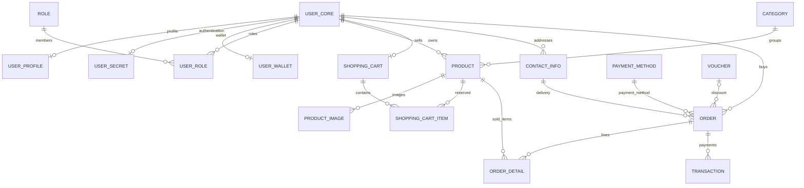
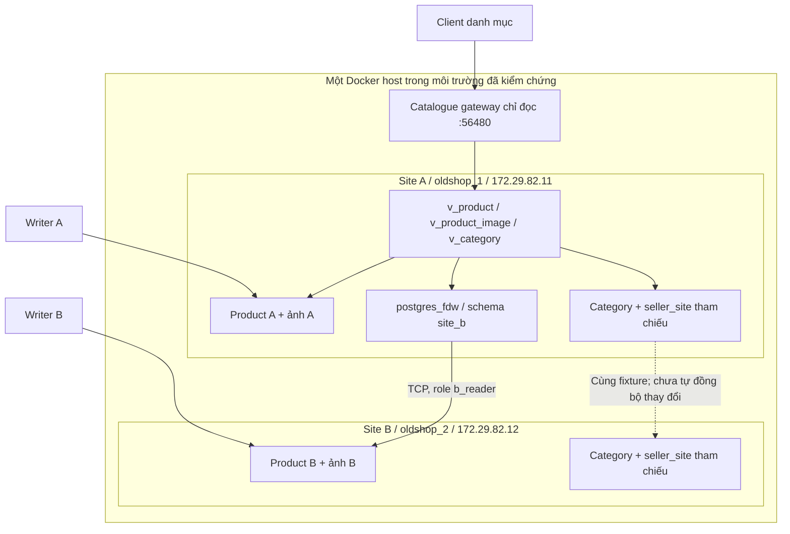

# BÁO CÁO GIẢI PHÁP VÀ KIẾN TRÚC CƠ SỞ DỮ LIỆU OLDSHOP

**Phạm vi:** kiến trúc dữ liệu ứng dụng OldShop, cấu hình indexing bằng JSON và phần triển khai phân mảnh danh mục trên hai site PostgreSQL độc lập.

**Thời điểm tổng hợp:** 04/11/2026.

**Căn cứ:** mã nguồn, cấu hình triển khai và các bằng chứng kiểm thử/benchmark đang lưu trong repository.

Báo cáo phân biệt phần đã triển khai, kết quả kiểm thử đã lưu và công việc dự kiến. Lần cập nhật tài liệu này không thực hiện thêm một lượt kiểm thử database hoặc triển khai trên máy mới.

| Yêu cầu | Nội dung trong báo cáo |
|---|---|
| 1. Tổng hợp thiết kế dữ liệu | Mục 2 và 3.1: thành phần, nhóm dữ liệu, ERD và nguồn dữ liệu có thẩm quyền. |
| 2. Thiết kế hệ thống phân tán | Mục 3.2: sơ đồ hai site, phân mảnh/phân bổ, tái tạo dữ liệu, truy vấn và giới hạn kiểm chứng. |
| 3. Thiết kế cấu trúc JSON | Mục 3.1.2: trường, kiểu dữ liệu, collection và document minh họa. |
| 4. Thiết kế indexing | Mục 3.3: workload, trường/loại index, lý do và bằng chứng đo. |
| 5. Kế hoạch hoàn thiện sản phẩm | Mục 4: tiến độ, việc còn lại, phân công theo vai trò và thời hạn đề xuất. |

## 1. Bài toán OldShop và định hướng giải pháp cơ sở dữ liệu

### 1.1. Mô tả bài toán

OldShop là hệ thống thương mại điện tử dành cho việc mua bán đồ cũ. Một người dùng có thể vừa mua sản phẩm của người khác, vừa đăng bán sản phẩm của mình. Vì hàng hóa do nhiều người dùng tự đăng, hệ thống cần cơ chế kiểm duyệt trước khi đưa sản phẩm ra danh sách bán công khai.

Hệ thống có ba nhóm vai trò chính:

| Vai trò | Trách nhiệm nghiệp vụ |
|---|---|
| Admin | Quản lý người dùng, theo dõi và xử lý tài khoản theo quyền được cấp |
| Moderator | Xem sản phẩm người dùng đăng, duyệt hoặc từ chối sản phẩm |
| User | Quản lý tin đăng của bản thân, cung cấp mô tả/ảnh/video và mua hàng của người dùng khác |

Luồng nghiệp vụ tiêu biểu: user đăng sản phẩm → moderator kiểm duyệt → sản phẩm được duyệt xuất hiện để mua → người mua tạo đơn → hệ thống xử lý các thay đổi liên quan đến đơn hàng, tồn kho và giao dịch. Việc đăng sản phẩm và việc mua hàng thuộc cùng một tài khoản, không cần tách thành hai loại tài khoản người mua/người bán độc lập.

### 1.2. Các vấn đề dữ liệu cần giải quyết

OldShop phát sinh đồng thời nhiều loại dữ liệu có yêu cầu lưu trữ khác nhau:

| Nhóm dữ liệu | Ví dụ | Yêu cầu |
|---|---|---|
| Dữ liệu nghiệp vụ có cấu trúc | User, role, giá, số lượng, trạng thái duyệt, đơn hàng, thanh toán | Quan hệ rõ ràng, ràng buộc khóa và xử lý giao dịch |
| Dữ liệu bán cấu trúc | Thuộc tính theo loại hàng, tags, danh sách tham chiếu ảnh, document đơn hàng | Cho phép object/array lồng nhau và các khóa thuộc tính thay đổi |
| Nội dung phi cấu trúc | Ảnh sản phẩm, avatar, video MP4, file đính kèm | Lưu và truy xuất nội dung file bằng object key |
| Dữ liệu phục vụ vận hành | Sự kiện đồng bộ, lần chạy ETL, lỗi, báo cáo tổng hợp | Có khả năng theo dõi, retry và đối soát |

Ví dụ, điện thoại có RAM và dung lượng lưu trữ; quần áo có kích thước và chất liệu. Nếu mọi thuộc tính đều trở thành cột cố định trong bảng `product`, schema sẽ khó mở rộng. Ngược lại, nếu toàn bộ dữ liệu đơn hàng và tồn kho chỉ là document linh hoạt, việc bảo vệ các quan hệ và giao dịch nghiệp vụ sẽ phức tạp hơn.

Khi số lượng tin đăng tăng, hệ thống còn phải tránh quét toàn bộ dữ liệu cho mỗi lần xem danh sách, tra cứu ảnh hoặc xử lý hàng đợi ETL. Việc bổ sung index phải dựa trên truy vấn thực tế và có bằng chứng đo, vì mỗi index cũng làm tăng dung lượng và chi phí ghi.

### 1.3. Giải pháp đề xuất và đã triển khai

OldShop sử dụng phối hợp ba công nghệ lưu trữ:

- **PostgreSQL:** nguồn dữ liệu chuẩn cho các trường nghiệp vụ/giao dịch và quan hệ có cấu trúc.
- **MongoDB:** nguồn chuẩn cho thuộc tính động/tags và nơi lưu các document bản đọc được ETL tạo từ dữ liệu cho phép của PostgreSQL.
- **MinIO:** nơi lưu nội dung thực của file; PostgreSQL/MongoDB giữ các tham chiếu theo quyền sở hữu dữ liệu.

FastAPI cung cấp API để người dùng thao tác với các kho này thông qua ứng dụng. ETL tạo và cập nhật các bản đọc/tổng hợp. Index được thiết kế theo workload và quản lý thêm bằng catalog JSON. Hạ tầng Docker có PostgreSQL standby và MongoDB replica set để mô phỏng nhiều node, trong phạm vi một máy chủ.

Phần mở rộng phân tán có hai PostgreSQL độc lập: site A lưu sản phẩm do nhóm seller A quản lý, site B lưu sản phẩm do nhóm seller B quản lý. Site A dùng `postgres_fdw` và view hợp nhất để đọc danh mục ở cả hai site. Module này chạy riêng với ứng dụng thương mại hiện hữu; đã có gateway đọc danh mục, còn luồng giỏ hàng, thanh toán và đồng bộ Mongo/media đa site chưa được tích hợp.

Giải pháp này là tích hợp nhiều hệ lưu trữ ở tầng ứng dụng và đồng bộ dữ liệu. Không có một bộ máy truy vấn SQL chung hay một transaction ACID duy nhất bao trùm cả PostgreSQL, MongoDB và MinIO.

## 2. Kiến trúc hệ thống cơ sở dữ liệu

### 2.1. Các thành phần và hướng kết nối

```text
Trình duyệt: Admin / Moderator / User
                   |
            Angular + Nginx
                   |
                FastAPI
          /        |        \
 PostgreSQL     MongoDB     MinIO
   primary     replica set  single-node
      |
      +-- WAL bất đồng bộ --> PostgreSQL standby
      |
      +-- dữ liệu nguồn + outbox --> ETL worker
                                      |
                         +------------+------------+
                         |            |            |
                      MongoDB    Báo cáo trên PG   MinIO
                     bản đọc      ACK/đối soát    media/cleanup
```

Ứng dụng đọc/ghi nghiệp vụ cốt lõi tại PostgreSQL primary. Các thuộc tính động được xử lý tại MongoDB. Upload và phát nội dung file đi qua lớp storage/media của ứng dụng tới MinIO khi cấu hình storage là `minio`.

PG standby nhận WAL từ primary. MongoDB gồm `mongo1`, `mongo2`, `mongo3` trong replica set `oldshop-rs`; vai trò PRIMARY/SECONDARY được xác định theo trạng thái replica set, không nên coi tên `mongo1` luôn đồng nghĩa với PRIMARY.

### 2.2. Triển khai vật lý hiện tại

File [docker-compose.distributed.yml](../../deploy/docker-compose.distributed.yml) định nghĩa stack `oldshop-data`. Profile `resilience` bổ sung PostgreSQL replica và hai MongoDB member so với cấu hình cơ sở.

| Thành phần | Trạng thái triển khai | Cổng host mặc định |
|---|---|---|
| Frontend | Angular/Nginx | `58080` |
| Backend | FastAPI | `58000` |
| PostgreSQL primary | Nơi ghi nghiệp vụ | `55432` |
| PostgreSQL standby | Bản sao streaming, chỉ đọc | `55433` |
| MongoDB | Replica set ba member khi bật profile | `57017` cho mongo1 nếu mở theo cấu hình GUI |
| MinIO | Một node lưu object | `59000` API, `59001` Console |
| ETL worker | Một process đồng bộ theo chu kỳ | Không cần cổng công khai |

Các cổng trên là cổng để công cụ trên host kết nối. Bên trong Docker network, ứng dụng sử dụng hostname/cổng nội bộ, ví dụ `pg-primary:5432`, `mongo1:27017`, `minio:9000`. pgAdmin4 và MongoDB Compass là công cụ quản trị, không phải nơi trực tiếp lưu dữ liệu.

Trong cấu hình đã kiểm chứng của stack này, container và volume nằm trên cùng một Docker host. Các node được tách về tiến trình/network/volume nhưng chưa được tách thành các miền lỗi vật lý độc lập.

Phần danh mục phân tán dùng project riêng `oldshop-sites`, không chuyển đổi database hay volume của `oldshop-data`:

| Thành phần phân tán | Database / vai trò | Địa chỉ mặc định trên host | Địa chỉ mạng Docker trong mô hình đã kiểm |
|---|---|---|---|
| Site A, service `pg-a` | `oldshop_1`, ghi fragment A và đọc view toàn cục | `127.0.0.1:56431` | `172.29.82.11:5432` |
| Site B, service `pg-b` | `oldshop_2`, ghi fragment B | `127.0.0.1:56432` | `172.29.82.12:5432` |
| Catalogue gateway | API chỉ đọc qua site A | `127.0.0.1:56480` | `172.29.82.20:8000` |

Đây là hai instance PostgreSQL độc lập trên hai IP trong cùng Docker host. Các địa chỉ này mô tả cấu hình mô phỏng đã có, không phải IP LAN/VPN của hai máy thật. Cấu hình nằm trong [compose.site-a.yml](../../deploy/sites/compose.site-a.yml), [compose.site-b.yml](../../deploy/sites/compose.site-b.yml), [compose.catalog.yml](../../deploy/sites/compose.catalog.yml); quy trình nằm trong [hướng dẫn hai site](../HUONG_DAN_CSDL_PHAN_TAN.md).

### 2.3. Sơ đồ và tài liệu thiết kế

ERD rút gọn và sơ đồ phân tán được trình bày trực tiếp bằng Mermaid tại mục 3.1.1 và 3.2.3. Các nguồn thiết kế chi tiết để đối chiếu gồm:

| Nội dung | Nguồn hiện có | Phạm vi sử dụng |
|---|---|---|
| Kiến trúc ứng dụng | [07_architecture_current.puml](../diagram/07_architecture_current.puml) | PG/Mongo/MinIO và ETL của ứng dụng hiện hữu. |
| ERD PostgreSQL đầy đủ ở giai đoạn Ngày 7 | [07_erd_current.dbml](../diagram/07_erd_current.dbml) | Bảng logic đến migration 006; đối chiếu thêm 007 và extension site khi mô tả hiện trạng. |
| Topology replication | [02_distribution_diagram.puml](../diagram/02_distribution_diagram.puml) | Primary/standby và Mongo replica set; không thay sơ đồ phân mảnh hai site. |
| Luồng ETL | [05_etl_flow.puml](../diagram/05_etl_flow.puml) | Trích xuất, biến đổi, nạp và đối soát. |
| Schema và tái tạo hai site | [01_site_schema.sql](../../database/distributed/01_site_schema.sql), [05_global_views.sql](../../database/distributed/05_global_views.sql) | Ownership, phân mảnh sản phẩm/ảnh và view toàn cục. |

Một số sơ đồ nguồn được lập ở giai đoạn trước; khi xuất sang PPT/PDF cần đối chiếu nội dung video MP4/bucket `product-videos`, indexing JSON và topology hai site. Các sơ đồ rút gọn trong báo cáo giải thích thiết kế, không phải ảnh chụp trạng thái vận hành.

## 3. Thiết kế và thực thi giải pháp cơ sở dữ liệu

### 3.1. Cơ sở dữ liệu hợp nhất

#### 3.1.1. PostgreSQL: dữ liệu có cấu trúc và nguồn nghiệp vụ

PostgreSQL quản lý các dữ liệu có quan hệ rõ ràng: người dùng, vai trò, danh mục, sản phẩm, quan hệ sản phẩm–ảnh, giỏ hàng, đơn hàng, chi tiết đơn, giao dịch và voucher. Các khóa chính, khóa ngoại, ràng buộc và transaction bảo vệ tính toàn vẹn của dữ liệu trong phạm vi PostgreSQL.

Dữ liệu người dùng được tách thành `user_core`, `user_profile`, `user_secret`, `user_wallet`, liên kết bằng `user_id`. Mục đích là phân chia các nhóm thông tin theo chức năng và đường truy cập. Việc tách bảng tự nó không tạo ra phân quyền bảo mật hay phân tán vật lý; vẫn cần kiểm soát truy cập tại ứng dụng/database.

Các thao tác nhạy cảm với tính nhất quán như tồn kho, ví và giao dịch sử dụng primary. Không coi bản sao PostgreSQL bất đồng bộ là nơi mặc định để quyết định số dư hoặc số lượng hàng khả dụng.

Các nhóm quan hệ chính:

| Nhóm | Bảng tiêu biểu | Liên kết và vai trò |
|---|---|---|
| Tài khoản và quyền | `user_core`, `user_profile`, `user_secret`, `user_wallet`, `role`, `user_role` | Các mảnh user dùng chung `user_id`; user–role là quan hệ nhiều–nhiều. |
| Danh mục và tin đăng | `category`, `product`, `product_image` | Product tham chiếu seller và category; mỗi ảnh thuộc một product bằng FK. |
| Giỏ hàng | `shopping_cart`, `shopping_cart_item` | Mỗi user tối đa một cart theo UNIQUE; cart item liên kết product và số lượng. |
| Đơn hàng và thanh toán | `order`, `order_detail`, `transaction`, `payment_method`, `voucher`, `contact_info` | Đơn có chi tiết và giao dịch; giá tại thời điểm mua nằm ở chi tiết đơn; địa chỉ giao hàng được xử lý tại PG. |
| Kiểm duyệt và vận hành | `review`, `violation_log`, `system_log`, `system_feedback`, `etl_outbox`, `etl_runs` | Nguồn nghiệp vụ, audit, sự kiện và trạng thái đồng bộ; các bản đọc được chiếu sang Mongo theo hợp đồng. |

ERD sau rút gọn các quan hệ nghiệp vụ chính; không liệt kê mọi cột, constraint và bảng vận hành:



Với các mảnh user, service tạo đủ các dòng trong một transaction; FK/PK một chiều không tự bắt buộc mọi core phải có đủ bảng con khi ghi SQL trực tiếp, nên sơ đồ dùng phía con `0..1`. View `users_full` tái tạo bằng JOIN và dùng để đọc. `order` phân hoạch HASH theo `order_id` thành bốn partition; `system_log` phân hoạch RANGE theo thời gian, có partition DEFAULT. Đây là phân hoạch trong instance, khác với phân bổ product sang hai site ở mục 3.2.

Schema SQL và [migrations 001–007](../../database/04_migrations) là nguồn đối chiếu cho khóa, kiểu, CHECK, trigger và index. Không cộng partition children vào số thực thể nghiệp vụ hoặc coi bản sao Mongo là một bảng giao dịch độc lập.

#### 3.1.2. MongoDB: dữ liệu bán cấu trúc

MongoDB lưu document BSON với object và array lồng nhau. Dữ liệu không hoàn toàn tùy ý: các model Pydantic được dùng để xây validator, còn các dictionary như `attributes` cho phép khóa linh hoạt.

Các nhóm document nghiệp vụ gồm `product_details`, `order_snapshots`, `reviews`, `system_logs`, `violation_logs`, `contact_messages`. Collection `etl_errors` phục vụ vận hành ETL.

Thiết kế các nhóm document chính:

| Collection | Trường và cấu trúc tiêu biểu | Ý nghĩa/ràng buộc |
|---|---|---|
| `product_details` | `product_id`, `category_id`, `description`, `condition`, `attributes`, `tags`, `images`, `updated_at` | Thuộc tính theo loại hàng; image reference gồm bucket/key; unique `product_id`. |
| `order_snapshots` | `order_id`, `buyer{id,region}`, `items[]`, `payments[]`, các trường tiền `_vnd`, `order_status`, `order_date`, `etl` | Bản đọc đơn; tiền VND nguyên không âm, không thay dữ liệu giao dịch nguồn. |
| `reviews` | `review_id`, `product_id`, `buyer_id`, `type`, `rating`, `content`, `status`, `evidence[]` | `rating=0` là report; review có rating 1–5; có trường phục vụ moderation. |
| `system_logs` | `log_id`, `created_at`, `action`, `actor_id`, `payload`, `etl` | Danh tính nguồn log theo cặp ID/thời điểm; payload có cấu trúc giới hạn. |
| `violation_logs` | `log_id`, `target_user_id`, `reason`, `action_taken`, `created_at` | Bản đọc vi phạm; không tự tạo actor khi dữ liệu nguồn thiếu. |
| `contact_messages` | `feedback_id`, `subject`, `content`, `status`, `attachments[]`, `created_at` | Form liên hệ; khác bảng sổ địa chỉ `contact_info` chỉ lưu tại PG. |

Các document dùng `_id` string, `schema_version=1` và cờ `deleted` theo model. Metadata `etl` ghi thời điểm đồng bộ và thông tin lượt chạy khi có. Ví dụ minh họa `product_details` theo cấu trúc hiện hành:

```json
{
  "_id": "product:123",
  "schema_version": 1,
  "product_id": 123,
  "category_id": 1,
  "description": "Điện thoại đã qua sử dụng",
  "condition": {"grade": 8, "warranty_months": 0, "defects": []},
  "attributes": {
    "brand": "Thuong hieu A",
    "ram_gb": 8,
    "storage_gb": 256
  },
  "tags": ["dien-thoai", "da-qua-su-dung"],
  "images": [
    {
      "bucket": "product-images",
      "key": "products/123/example.jpg",
      "content_type": "image/jpeg",
      "size": 123456,
      "image_id": 123,
      "is_primary": true,
      "display_order": 0
    }
  ],
  "updated_at": "2026-11-04T02:00:00Z",
  "deleted": false,
  "etl": {"synced_at": "2026-11-04T02:01:00Z", "run_id": "demo-041126"}
}
```

Đây là dữ liệu minh họa hợp đồng, không phải dump thực tế hoặc bộ seed để import; không xác nhận product/object trong ví dụ tồn tại. `product_id/category_id` là integer dương; `attributes` là object có khóa linh hoạt; `tags` là mảng string; `images` là mảng object reference; `condition.grade` trong khoảng 1–10. Thời gian thể hiện bằng ISO 8601 UTC trong JSON và phải được chuyển sang kiểu datetime/BSON Date khi lưu. Model document kiểm kiểu, giới hạn và từ chối trường ngoài hợp đồng; không chỉ kiểm JSON có cú pháp hợp lệ.

`attributes` và `tags` là dữ liệu do MongoDB sở hữu. Các trường bản đọc khác, chẳng hạn mô tả, danh mục và tham chiếu ảnh, có thể được chiếu từ PostgreSQL qua ETL. Vì vậy, không phải mọi trường trong MongoDB đều là nguồn dữ liệu độc lập với PostgreSQL.

Tags là metadata mô tả nghiệp vụ. Ngoài tags, MongoDB còn chứa thuộc tính động, dữ liệu nhúng và metadata tham chiếu file. Các document contract nằm trong [documents.py](../../backend/app/schemas/documents.py).

ETL hiện tạo ID ổn định dạng `product:123`, `order:...` hoặc ID ghép cho log theo [transform.py](../../backend/etl/transform.py), giúp upsert khi xử lý lại. Không đưa password/token hoặc địa chỉ/số điện thoại vào order snapshot. `attributes/tags` có thể rỗng trong seed nguồn; ví dụ trên không có nghĩa dữ liệu RAM/brand đã được nạp cho toàn bộ sản phẩm. JSON document nghiệp vụ này cũng khác JSON cấu hình index ở mục 3.3.

#### 3.1.3. MinIO: nội dung phi cấu trúc

MinIO lưu các byte thực của ảnh, video và file đính kèm dưới dạng object trong bucket. Một object được xác định bằng bucket và key. Metadata kỹ thuật như content type và kích thước hỗ trợ việc lưu/phát file.

Các bucket phục vụ ảnh sản phẩm, video sản phẩm, avatar và attachment. Bucket được cấu hình private; ứng dụng dùng credentials được cấp để upload hoặc đọc nội dung qua media gateway.

Video sản phẩm có thể là liên kết Google Drive/YouTube hoặc MP4 upload. Với MP4, file nằm trong MinIO khi dùng storage backend MinIO; với liên kết bên ngoài, nội dung file vẫn ở dịch vụ bên ngoài. Không tuyên bố mọi video liên kết đã được sao chép vào MinIO.

Lớp truy cập storage nằm trong [storage.py](../../backend/app/services/storage.py).

#### 3.1.4. Vì sao vẫn giữ `product_image` trong PostgreSQL?

`product_image` quản lý quan hệ có cấu trúc giữa sản phẩm và ảnh. Nó không chỉ chứa đường dẫn:

| Trường/nhóm trường | Ý nghĩa |
|---|---|
| `image_id` | Định danh bản ghi ảnh |
| `product_id` | Khóa ngoại xác định sản phẩm sở hữu ảnh |
| `image_url` | Tham chiếu đường dẫn phục vụ nội dung ảnh |
| `is_primary`, `display_order` | Vai trò và thứ tự hiển thị ảnh |
| Metadata khác | Các thông tin đi kèm như loại nội dung/kích thước nếu có |

Ví dụ quan hệ tham chiếu:

```text
PG product_image:
  product_id = 123
  image_url = /media/products/123/abc.jpg
  is_primary = true

MinIO:
  bucket = product-images
  key = products/123/abc.jpg
  content = dữ liệu nhị phân của ảnh

Mongo product_details.images:
  bản tham chiếu bucket/key và metadata được ETL đồng bộ
```

Đường dẫn `/media/...` là địa chỉ qua gateway của ứng dụng; không nhất thiết là URL trực tiếp do MinIO trả về. Ứng dụng ánh xạ đường dẫn tới bucket/key để đọc object. Cách này cũng giúp đường dẫn nghiệp vụ không phải phụ thuộc trực tiếp vào hostname/cổng MinIO.

MinIO quản lý object nhưng không thay PostgreSQL bảo đảm khóa ngoại tới sản phẩm, trạng thái ảnh chính hoặc thứ tự ảnh trong danh sách nghiệp vụ. Việc PostgreSQL lưu tham chiếu không đồng nghĩa PostgreSQL lưu nội dung ảnh, cũng không vi phạm phân chia ba loại dữ liệu.

Có thể thiết kế quan hệ ảnh hoàn toàn trong MongoDB, nhưng đó là phương án khác, cần thay đổi API, ownership, ETL và quy trình dọn file. Trong thiết kế hiện tại, PostgreSQL là nguồn chuẩn cho quan hệ ảnh; MongoDB có bản đọc; MinIO là nguồn chuẩn cho nội dung file. Cơ chế cleanup kiểm tra tham chiếu trước khi xóa để bảo vệ file còn được sử dụng, bao gồm các ảnh seed dùng chung.

#### 3.1.5. ETL kết nối các kho dữ liệu như thế nào?

ETL là Extract–Transform–Load: trích xuất dữ liệu nguồn, chuyển đổi sang dạng phù hợp và nạp vào đích. Trong OldShop, ETL không chỉ là chép nguyên một hàng SQL sang JSON.

| Bước | Ví dụ với sản phẩm |
|---|---|
| Extract | Đọc `product` và các dòng `product_image` liên quan từ PostgreSQL |
| Transform | Chuẩn hóa thời gian, chuyển các trường thành object/array, ánh xạ đường dẫn ảnh thành bucket/key, kiểm tra dữ liệu |
| Load | Upsert vào `product_details` trên MongoDB, giữ các trường Mongo-owned như `attributes` và `tags` |

Đồng bộ thay đổi được thực hiện bằng transactional outbox:

1. Khi dữ liệu nguồn thay đổi, trigger PostgreSQL ghi sự kiện outbox trong cùng transaction.
2. Nếu transaction nghiệp vụ rollback, sự kiện tương ứng cũng rollback.
3. Worker lấy sự kiện đến hạn, đọc trạng thái nguồn và xử lý các bản đọc liên quan.
4. Sau khi nạp thành công, worker đánh dấu sự kiện đã xử lý. Nếu lỗi, giữ trạng thái để retry và theo dõi lỗi.

Worker có cơ chế khóa để tránh các lượt đồng bộ ghi chồng nhau. Upsert theo khóa nguồn cho phép xử lý lại sự kiện mà không mặc định tạo thêm document trùng. Tuy nhiên, đây không phải bảo đảm exactly-once hay một transaction chung xuyên PostgreSQL–MongoDB–MinIO.

Các luồng ETL chính gồm sản phẩm, đơn hàng, review/report, log/contact, media và tổng hợp doanh số. Luồng media đưa file local/seed còn thiếu lên MinIO; ảnh/video upload mới có thể được ứng dụng ghi trực tiếp lên MinIO mà không chờ ETL. Báo cáo tổng hợp doanh số được ghi về PostgreSQL.

Bản đọc MongoDB có thể trễ so với PostgreSQL vì worker xử lý theo chu kỳ. Đây là nhất quán cuối cùng đối với dữ liệu sao chép. Nếu một kho lỗi, phải theo dõi backlog, retry và đối soát thay vì giả định tất cả kho luôn đồng bộ tức thì.

Chi tiết mã nguồn và ownership: [ETL](../../backend/etl), [thiết kế ETL/outbox](../design/05_etl.md).

### 3.2. Hệ thống cơ sở dữ liệu phân tán

#### 3.2.1. Bài toán và phạm vi lựa chọn

Phần danh mục OldShop cần cho phép từng site quản lý sản phẩm của nhóm người bán được giao, đồng thời cung cấp truy vấn toàn bộ danh mục. Vì vậy, phần mở rộng lựa chọn **phân mảnh ngang product theo site quản lý seller**, phân mảnh dẫn xuất ảnh và hợp nhất kết quả đọc tại site A. Hai site đều có khả năng ghi cục bộ; site B không phải standby của site A.

Báo cáo phân biệt hai mô hình cùng có trong dự án:

| Mô hình | Mục tiêu | Phần đã triển khai |
|---|---|---|
| Stack ứng dụng `oldshop-data` | Vận hành website, đồng bộ nhiều kho và kiểm chứng replication. | PG primary/standby, Mongo replica set, MinIO, ETL và ứng dụng. |
| Danh mục hai site `oldshop-sites` | Kiểm chứng phân bổ dữ liệu, ghi cục bộ và truy vấn liên site. | Hai PG độc lập, ownership/ID, FK/trigger, FDW chỉ đọc và gateway danh mục. |

Replication sao chép cùng dữ liệu sang node khác; partitioning chia bảng trong instance; phân mảnh liên site phân bổ những tập dòng khác nhau tới database độc lập. Triển khai hai site hiện có không phải MongoDB sharded cluster, cũng chưa thay toàn bộ commerce backend bằng ứng dụng đa site.

#### 3.2.2. Replication và phân hoạch trong stack ứng dụng

| Hạng mục | Cách thực hiện | Giới hạn |
|---|---|---|
| PostgreSQL replication | Một primary và một standby, truyền WAL bằng streaming bất đồng bộ | Standby chỉ đọc; có thể trễ so với primary |
| MongoDB replication | Replica set `oldshop-rs` với ba data-bearing member khi bật profile | Cùng dữ liệu của replica set, không chia mỗi member giữ một phần |
| Phân hoạch PostgreSQL | `order` phân hoạch HASH theo `order_id`; `system_log` phân hoạch RANGE theo thời gian | Các partition vẫn trong cùng instance/site hiện tại |
| Tách nhóm dữ liệu user | `user_core/profile/secret/wallet`, tái tạo bằng quan hệ theo `user_id` | Là phân rã bảng, chưa phân bổ sang các máy khác nhau |
| Network và lưu trữ | Các service có hostname/volume riêng, cấu hình credentials và healthcheck | Cùng Docker host, còn chung miền lỗi vật lý |
| Theo dõi ứng dụng | Readiness kiểm tra các phụ thuộc; verifier kiểm replication/topology | Healthcheck không thay bài kiểm thử failover và tính đúng dữ liệu |

[day6_failover.json](../evidence/day6_failover.json) lưu các tình huống trên môi trường thử riêng, gồm dừng/phục hồi Mongo secondary, dừng/phục hồi PG replica và kiểm ứng dụng. Evidence sử dụng MongoDB 7; không suy thành chứng nhận election trên mọi phiên bản MongoDB hoặc mọi tình huống mất primary/phân hoạch mạng. Healthcheck và trạng thái PRIMARY/SECONDARY tại một thời điểm không thay thế bài kiểm thử lỗi.

Các file triển khai: [Compose ứng dụng](../../deploy/docker-compose.distributed.yml), [PG replication](../../deploy/data/postgres/init-replication.sh), [PG standby](../../deploy/data/postgres/start-replica.sh), [Mongo init](../../deploy/data/mongo/init.js). Mô hình này vẫn dùng PG primary cho giao dịch, chưa tự định tuyến đọc sang standby hay tự promote PG.

#### 3.2.3. Sơ đồ chiến lược phân tán hai site



Sơ đồ biểu diễn chiến lược đã triển khai: ghi dữ liệu tại site sở hữu, đọc toàn cục qua view tại A và `postgres_fdw` đọc B. Gateway kết nối A bằng `global_reader`. Các bản category/mapping được cài cùng fixture ở hai site; mũi tên nét đứt không biểu diễn một pipeline replication đang chạy.

Phần `oldshop-sites` có network/volume riêng. Nó không tự dùng MongoDB/MinIO hay worker của `oldshop-data`. Do đó, truy vấn danh mục phân tán hiện trả metadata ảnh từ PG, không chứng minh nội dung ảnh fixture đã tồn tại trên object storage hoặc frontend thương mại đã chuyển sang API này.

#### 3.2.4. Quy tắc phân mảnh, phân bổ và tái tạo

Gọi `owner(seller_id)` là site trong bảng `seller_site`. Với tập product thuộc phạm vi hai site:

```text
P_A = { p thuộc Product | owner(p.seller_id) = A }
P_B = { p thuộc Product | owner(p.seller_id) = B }

I_A = { i thuộc ProductImage | i.product_id thuộc các khóa của P_A }
I_B = { i thuộc ProductImage | i.product_id thuộc các khóa của P_B }

Product      = P_A UNION ALL P_B
ProductImage = I_A UNION ALL I_B
```

| Dữ liệu | Quy tắc phân bổ | Cách thực hiện trong dự án |
|---|---|---|
| `product` | Fragment ngang theo site sở hữu seller. | `product.site_id` có mặc định `local_site()`; FK `(seller_id, site_id)` tới `seller_site`; trigger chặn ghi sai site và đổi ownership. |
| `product_image` | Fragment dẫn xuất theo product tại site. | FK product cục bộ; trigger chặn đổi ID/product ownership và kiểm quy tắc cấp khóa ảnh. |
| Category và seller–site mapping | Dữ liệu tham chiếu có bản ở cả hai site. | Nạp cùng fixture; view `v_category`, `v_seller_site` lấy bản A để tránh đếm lặp. Chưa có luồng tự đồng bộ khi thay reference data. |
| Các bảng còn lại | Schema ứng dụng được kế thừa tại hai site. | Chưa phân tán nghiệp vụ order/cart/payment; không coi việc có bảng là đã vận hành giao dịch liên site. |

Ba tính chất phân mảnh được giải thích trong phạm vi trên:

- **Đầy đủ:** mỗi seller được gán đúng một A/B; product hợp lệ tham chiếu seller/site nên thuộc một fragment. Đây không phải khẳng định dữ liệu thật của ứng dụng đã được di chuyển hết sang hai site.
- **Không giao nhau:** trigger kiểm site cục bộ và ownership; product ID/ảnh ID tại A là số lẻ dương, tại B là số chẵn dương, sequence tăng 2. Quy tắc lẻ/chẵn chống trùng ID, còn vị từ phân mảnh nghiệp vụ dựa trên seller ownership.
- **Tái tạo:** `v_product` và `v_product_image` hợp bảng local A với foreign table B bằng `UNION ALL`. View giữ cả dòng xóa mềm; API áp bộ lọc nghiệp vụ riêng. Category lấy một bản tham chiếu, không hợp hai bản giống nhau.

Định nghĩa cài đặt ở [01_site_schema.sql](../../database/distributed/01_site_schema.sql) và [05_global_views.sql](../../database/distributed/05_global_views.sql). Hai site dùng cùng schema xây từ baseline và migrations `001`–`007`, không sửa checksum lịch sử. `distributed_installation` lưu marker/version/source hash cho bootstrap; chạy lại đúng bản cài không tự nạp chồng fixture.

Fixture kiểm thử có **5 product và 8 ảnh mỗi site**, tổng 10 product/16 bản ghi ảnh; có trường hợp rỗng, nhiều ảnh, chưa duyệt, xóa mềm và dữ liệu ngoài khoảng tháng truy vấn. Đây là dữ liệu giả lập từ [fixture_manifest.json](../../database/distributed/fixture_manifest.json), không phải toàn bộ seed 1.000 sản phẩm của ứng dụng.

#### 3.2.5. Truy vấn liên site, phân quyền và tính nhất quán

Tại A, `server_b` dùng `postgres_fdw` kết nối B bằng role `b_reader`, import các bảng được cho phép vào schema `site_b`. View hợp nhất cung cấp giao diện đọc, trong khi writer ghi trực tiếp vào database sở hữu dữ liệu. Có thể đọc danh mục từ A mà không copy/import lại product B sau mỗi thay đổi. Cấu hình ở [04_fdw.sql](../../database/distributed/04_fdw.sql); quyền ở [03_permissions.sql](../../database/distributed/03_permissions.sql).

| Role | Phạm vi |
|---|---|
| `site_admin` | Cài đặt/quản trị schema và cấu hình site. |
| `site_writer` | Đọc/ghi product, ảnh hợp lệ ở site cục bộ; đọc reference data, không sửa site/mapping hoặc ghi trực tiếp bảng vận hành. |
| `b_reader` | Đọc các bảng danh mục/identity được cho phép ở B cho kết nối FDW; không cấp ghi hoặc đọc secret/wallet. |
| `global_reader` | Đọc các view toàn cục tại A cho gateway; không là tài khoản writer. |

HBA được giới hạn theo nguồn cấu hình; công cụ cài đặt còn thu hồi quyền gọi function nghiệp vụ của reader để tránh ghi gián tiếp qua `SECURITY DEFINER`. Đây là chính sách cho module site, không phải khẳng định mọi role của ứng dụng cũ đã được tách quyền tương tự.

Bộ [Q1–Q6](../../database/distributed/queries) bao gồm:

| Query | Mục tiêu kiểm chứng |
|---|---|
| Q1 | Đọc trực tiếp fragment B từ A qua foreign table, bằng quyền phù hợp. |
| Q2 | Hợp product và JOIN category, lọc dòng chưa xóa mềm. |
| Q3 | Product và ảnh ở site sở hữu, giữ cả product không có ảnh qua LEFT JOIN. |
| Q4 | Đếm product theo category, giữ category rỗng. |
| Q5 | Đếm và giá trung bình theo category trong khoảng thời gian nửa mở. |
| Q6 | Seller không có product hợp lệ trong khoảng thời gian, dùng NOT EXISTS. |

Gateway [catalogue_gateway.py](../../backend/app/catalogue_gateway.py) cung cấp `GET /products`, `GET /products/{product_id}`, `/health` và `/ready`. Lọc category/search/trạng thái và sắp xếp thực hiện trên kết quả hợp nhất trước `OFFSET/LIMIT`; query trả `total` toàn cục và ảnh được lấy theo nhóm product. Giá decimal được biểu diễn string trong JSON response của gateway; kiểu này khác trường integer VND của document snapshot Mongo.

Gateway dùng giao dịch **read-only, REPEATABLE READ**, kiểm đủ identity A/B trước khi trả dữ liệu. Khi một site không truy cập được, trả `503` thay vì thành công với danh mục thiếu. `/health` chỉ xác nhận process còn hoạt động, còn `/ready` kiểm được cả hai site. Gateway không tăng `view_count`, không mở endpoint ghi product/checkout và không merge `attributes/tags` từ Mongo.

Evidence cho thấy commit mới tại B xuất hiện ở giao dịch đọc mới tại A, trong khi giao dịch đọc đang mở giữ snapshot của nó. Điều này không có nghĩa hai database có một mốc snapshot toàn cục đồng bộ hoặc transaction ghi ACID xuyên site. Chưa triển khai giao dịch thanh toán liên site, tự chuyển ownership seller hoặc giải quyết xung đột reference data tự động.

#### 3.2.6. Kết quả kiểm chứng và giới hạn bằng chứng

[test_results.json](../evidence/distributed/test_results.json) ngày 04/11/2026 ghi **T01–T12 đều PASS**, với phạm vi `M1, one host / two virtual IPs` và `physical_hosts_verified: false`:

| Bằng chứng | Kết quả được ghi nhận |
|---|---|
| T01–T03 | Kết nối A→B đúng database/identity; commit/snapshot; reader/HBA/function không vượt quyền. |
| T04, T10 | Dừng từng site trong môi trường thử; site còn lại đọc/ghi local, truy vấn global lỗi khi thiếu site và phục hồi sau khi bật lại. |
| T05–T07 | Chặn khóa/FK/site/ownership/dữ liệu sai; tái tạo và so sánh schema; reference data không bị đếm lặp. |
| T08 | Q1–Q6 khớp kết quả kỳ vọng tính từ fixture, gồm các trường hợp rỗng. |
| T09 | Bốn writer đồng thời cấp 40 ID đúng phân bổ, không trùng; thao tác kiểm thử được rollback. |
| T11 | Bootstrap lại không nạp chồng; dựng cặp site thử sạch, đối chiếu schema/fixture/query. |
| T12 | Lưu plan và thời gian local/remote/global trên fixture nhỏ, cùng host. |

[schema_comparison.json](../evidence/distributed/schema_comparison.json) ghi `equal: true`; [inventory.json](../evidence/distributed/inventory.json) ghi hai database PostgreSQL 16.15 với migrations 001–007. [api_results.json](../evidence/distributed/api_results.json) ghi PASS cho phân trang/lọc toàn cục, API chỉ đọc, xử lý mất site và phục hồi. Đây là bằng chứng đã lưu của từng lượt kiểm, không phải trạng thái runtime được đo lại khi viết báo cáo.

[performance_results.json](../evidence/distributed/performance_results.json) là phép đo nhỏ có chi phí FDW/network trong cùng host; không dùng để suy ra phân tán nhanh hơn tập trung hoặc đủ sức chịu tải production. T01–T12 cũng không chứng minh chịu mất một máy vật lý vì hai container còn chung host.

#### 3.2.7. Những phần chưa hoàn thành

- Chưa có evidence xác nhận hai site chạy trên hai máy vật lý/VM độc lập; hướng dẫn LAN/VPN/Tailscale đã có nhưng chưa thay được kiểm chứng thực tế.
- Chưa tích hợp commerce frontend/backend với global view để vận hành giỏ hàng, tồn kho và thanh toán nhiều site; gateway hiện chỉ đọc danh mục.
- Chưa chuyển dữ liệu thật, điều chỉnh ID/ownership và kiểm đủ FK/đối soát khi migration từ ứng dụng cũ sang các site.
- Chưa triển khai đồng bộ Mongo metadata/media đa site hoặc cập nhật category/seller mapping tự động giữa A/B.
- Chưa có cơ chế tự động failover PostgreSQL, fencing primary cũ và chuyển endpoint ứng dụng một cách hoàn chỉnh.
- Chưa có MongoDB sharded cluster; replica set hiện tại phục vụ sao chép, không phải chia tải lưu trữ theo shard.
- MinIO vẫn single-node, chưa triển khai distributed object storage chịu mất node/máy.
- Chưa có tự động định tuyến đọc ứng dụng sang PostgreSQL standby; biến cấu hình replica không đồng nghĩa đường đọc đã được triển khai.
- Chưa kiểm chứng toàn diện RPO/RTO, độ trễ replication và phục hồi dưới tải trên nhiều máy.

MongoDB replica set có cơ chế bầu PRIMARY, nhưng vẫn cần kiểm thử với topology, phiên bản và client thực tế trước khi cam kết thời gian phục hồi. Docker restart policy khởi động lại container cũng không thay thế một cơ chế failover database.

Kết quả hiện tại là **ứng dụng đa kho có replication và module danh mục phân mảnh trên hai PostgreSQL độc lập, đã kiểm chức năng liên site trên cùng host**. Chưa hoàn thành thương mại đa site hoặc khả năng chịu mất host. Sao chép dữ liệu không thay thế backup vì thao tác xóa/sai dữ liệu cũng có thể được sao chép.

Hướng dẫn tái lập: [hai site PostgreSQL](../HUONG_DAN_CSDL_PHAN_TAN.md), [Tailscale Windows/Linux](../HUONG_DAN_TAILSCALE_WINDOWS_LINUX.md) và [sites.py](../../deploy/scripts/sites.py). Bộ verifier có fault injection; chỉ dùng đúng môi trường fixture/test mà công cụ yêu cầu, không gọi nó như một lệnh kiểm sức khỏe chỉ đọc trên hệ thống phục vụ người dùng.

### 3.3. Indexing: bài toán, giải pháp và thực thi

#### 3.3.1. Bài toán hiệu suất

Các đường truy vấn cần tối ưu gồm danh sách sản phẩm đã duyệt theo danh mục/thời gian, tìm kiếm nội dung, lấy review theo sản phẩm, tìm đơn theo người mua, kiểm tra tham chiếu ảnh dùng chung và lấy sự kiện ETL chưa xử lý.

Một index đơn trên từng cột không mặc định giải quyết được mọi truy vấn ghép điều kiện và sắp xếp. Thiết kế phải xem xét cột đứng đầu, chiều sắp xếp, predicate, kiểu index và độ chọn lọc. Đồng thời phải tính chi phí duy trì khi insert/update/delete, dung lượng và index chồng lặp.

Các lựa chọn dưới đây có trong [catalog hiện hành](../../database/indexing/catalog.json), không phải danh sách index mới cần tạo thêm:

| Trường cần tra cứu | Thiết kế index | Lý do lựa chọn và giới hạn |
|---|---|---|
| PG `user_core.email`, `username` và ID nghiệp vụ | Unique/B-tree theo PK/UNIQUE. | Định danh/login, chống trùng và bảo vệ quan hệ; không tạo thêm index trùng constraint. |
| PG `product(created_at DESC, product_id ASC)` | B-tree ghép, partial `status=1 AND is_deleted=false`. | Danh sách công khai có thứ tự ổn định, ID phá hòa khi trùng ngày; không bao phủ mọi trạng thái moderation. |
| PG `product.title`, `description` | GIN với `gin_trgm_ops`, partial cho sản phẩm công khai. | Hỗ trợ tìm chuỗi/ILIKE theo workload; khác index full-text và không đồng nghĩa tìm kiếm tiếng Việt hoàn chỉnh. |
| PG `order(buyer_id, order_date DESC)` và `order_detail.order_id` | B-tree theo lịch sử và JOIN. | Lấy đơn của người mua và chi tiết đơn; partition HASH(order_id) không tự prune theo buyer. |
| PG `order.voucher_id` | B-tree trên parent và các index con. | Tra các đơn dùng voucher, có tính cả dòng xóa mềm theo workload; không nhầm số root với số relation vật lý. |
| PG `product_image.image_url`, `user_profile.avatar_url` | B-tree không unique. | Tra tham chiếu trước khi dọn object; URL seed có thể dùng chung nên không ép unique. |
| PG outbox `event_id/available_at`, `entity_type/entity_key/event_id` | B-tree ghép, partial theo trạng thái chưa hoàn tất. | Claim hàng đợi và tìm entity cần retry; đánh đổi chi phí cập nhật trạng thái/index. |
| Mongo ID nguồn: `product_id`, `review_id`, `order_id` | Unique từng ID theo collection. | Ngăn bản đọc trùng khi replay ETL, phối hợp với `_id` ổn định. |
| Mongo `attributes.$**`, `(category_id, attributes.brand)` | Wildcard và compound. | Hỗ trợ thuộc tính linh hoạt và bộ lọc theo category/brand; không đảm bảo mọi tổ hợp lọc đều covered scan. |
| Mongo `images.key` | Partial multikey khi `deleted=false`. | Kiểm object còn được product đang sống tham chiếu; cần khớp điều kiện partial. |
| Mongo `(product_id, created_at DESC)`, `(buyer.id, order_date DESC)` | Compound trong reviews và order_snapshots. | Equality theo đối tượng rồi sắp xếp lịch sử mới nhất; thứ tự khóa theo đường truy vấn. |
| Mongo `system_logs.created_at` | TTL đơn trường, 7.776.000 giây, tương đương 90 ngày. | Retention bản sao Mongo; cần BSON Date, không cam kết xóa đúng tức thời và không xóa log nguồn PG. |

Trong mô hình hai site, mỗi database kế thừa schema/index qua 001–007; chưa có một bộ index toàn cục độc lập bao phủ cả A/B. `v_product` là view hợp nhất, còn dữ liệu và index vật lý nằm ở từng database. Khi đánh giá truy vấn FDW cần xem plan local/remote và lượng dữ liệu truyền; benchmark index của ứng dụng tập trung không tự chứng minh hiệu suất liên site. Hiện chỉ có phép đo fixture nhỏ của mục 3.2.6 cho module này.

#### 3.3.2. Giải pháp: tự thiết kế cấu hình, sử dụng bộ máy index của DB

OldShop định nghĩa cấu hình index mong muốn trong JSON. Phần tự thiết kế là lựa chọn trường, thứ tự khóa, chiều sắp xếp, loại index và options dựa trên workload. PostgreSQL/MongoDB vẫn trực tiếp xây và duy trì cấu trúc index vật lý.

Do đó, dự án **chưa tự lập trình cây B-tree/B+ tree hay thuật toán index thay thế DBMS**. Phần triển khai đọc khai báo key/options để gọi cơ chế index của DBMS, đồng thời quản lý vòng đời migration/snapshot cho PostgreSQL.

| Thành phần | Vai trò |
|---|---|
| [catalog.json](../../database/indexing/catalog.json) | Cấu hình mong muốn cho PostgreSQL và MongoDB |
| [catalog.schema.json](../../database/indexing/catalog.schema.json) | Schema mô tả định dạng khai báo; hỗ trợ editor/kiểm tra cấu hình |
| [index_config.py](../../backend/app/services/index_config.py) | Đọc và kiểm tra cấu hình bằng model/allowlist, tạo biểu diễn chuẩn hóa |
| [index_postgres.py](../../backend/app/services/index_postgres.py) | Biên dịch khai báo được hỗ trợ thành DDL và đối chiếu catalog PostgreSQL |
| [index_mongo.py](../../backend/app/services/index_mongo.py) | Đối chiếu và bổ sung index MongoDB từ key/options |
| [snapshots](../../database/indexing/snapshots) và [releases.json](../../database/indexing/releases.json) | Ghi phiên bản cấu hình và liên kết với lịch sử migration |

Catalog `index-v1` hiện khai báo 98 index PostgreSQL ở cấp root: 61 index ứng dụng/ETL và 37 index gắn với PK/UNIQUE; cùng 19 index MongoDB. Đây không phải tổng số index relation vật lý vì partition có index con. Các index của constraint được kiểm kê và bảo vệ, không tự tạo lại như standalone application index.

Các dạng được hỗ trợ gồm B-tree và GIN với một số biểu thức/opclass cho PostgreSQL; index đơn/ghép, text, wildcard, unique, sparse, partial, TTL theo các giới hạn của bộ kiểm tra cho MongoDB. Không mặc định chấp nhận mọi tính năng index mà DBMS cung cấp.

#### 3.3.3. Ví dụ cấu hình và ý nghĩa cấu trúc index

Ví dụ rút gọn một phần tử PostgreSQL trong catalog:

```json
{
  "name": "idx_product_visible_date_id",
  "schema": "public",
  "table": "product",
  "method": "btree",
  "unique": false,
  "keys": [
    { "column": "created_at", "order": "DESC", "nulls": "FIRST" },
    { "column": "product_id", "order": "ASC", "nulls": "LAST" }
  ],
  "managed_by": "application",
  "predicate": {
    "all": [
      { "column": "status", "op": "eq", "value": 1 },
      { "column": "is_deleted", "op": "eq", "value": false }
    ]
  }
}
```

Đây là B-tree ghép trên `(created_at DESC, product_id ASC)`, chỉ chứa các dòng sản phẩm đã duyệt và chưa xóa mềm. Thứ tự trong mảng `keys` có ý nghĩa; index `(A, B)` không mặc định tương đương `(B, A)`. Predicate giúp thu hẹp tập dòng được lập chỉ mục.

Khái niệm cấu trúc cần phân biệt: JSON có cấu trúc khai báo để diễn đạt thiết kế; B-tree là cấu trúc dữ liệu vật lý do PostgreSQL thực thi. JSON không thay cách PostgreSQL tổ chức nội bộ B-tree. Khi chạy `SELECT`, optimizer xét index vật lý và thống kê DB, không đọc lại file JSON trên host.

Với MongoDB, ví dụ index review theo sản phẩm và thời gian:

```json
{
  "collection": "reviews",
  "keys": [["product_id", 1], ["created_at", -1]],
  "options": { "name": "product_id_1_created_at_-1" }
}
```

Thiết kế đặt `product_id` đứng đầu cho điều kiện bằng, tiếp theo là `created_at` giảm dần để phục vụ lấy review mới. Đây là một phần tử cấu hình, không phải toàn bộ file catalog.

#### 3.3.4. Quy trình thực thi và lý do vẫn giữ SQL migration

```text
PostgreSQL:
JSON → validate/plan → sinh SQL + snapshot + release binding
     → review → migration runner → index vật lý → verify/EXPLAIN

MongoDB:
JSON → validate/plan → create_index(key, options)
     → đối soát → ghi snapshot đã áp → verify/explain
```

Các chức năng CLI gồm `validate`, `plan`, `apply`, `verify`. Plan báo `matched`, `missing`, `conflict`, `unmanaged`; plan PASS vẫn có thể có index missing. Verify mặc định đối chiếu snapshot đã áp, còn `--desired` đối chiếu catalog mong muốn.

PostgreSQL áp DDL qua migration đã đóng băng, giữ kiểm tra checksum và lịch sử. File [001_indexes.sql](../../database/04_migrations/001_indexes.sql) và [007_indexing_v2.sql](../../database/04_migrations/007_indexing_v2.sql) vẫn được giữ vì là lịch sử triển khai. `index-v1` mô tả bộ index tương ứng sau 007; không sinh 008 chỉ để đổi định dạng khai báo. Khi có bổ sung PostgreSQL index thực sự, generator có thể sinh migration tiếp theo cùng snapshot/release mới.

Các index 001–007 là thiết kế SQL đã có trước lớp cấu hình JSON. Không tuyên bố chúng đã được sinh từ JSON ngay từ đầu. Phần bổ sung JSON hiện quản lý cấu hình/đối soát và cung cấp đường sinh migration cho thay đổi tiếp theo.

Công cụ tự động chủ yếu xử lý bổ sung index. Đổi khóa/chiều/unique/TTL của index cùng tên có thể gây conflict và cần quy trình riêng; không tự xóa/rebuild để ép cấu hình khớp. Apply hai engine cũng không có transaction DDL chung xuyên hai DB.

Hướng dẫn lệnh vận hành nằm ở [mục 18 hướng dẫn hệ thống](../HUONG_DAN_CAU_HINH_VA_CHAY_HE_THONG.md#18-cấu-hình-và-chạy-indexing-json) và [hướng dẫn JSON](../HUONG_DAN_INDEXING_JSON.md).

#### 3.3.5. Kiểm chứng và kết quả đo hiệu suất

Phải tách ba loại bằng chứng:

| Loại kiểm tra | Điều được chứng minh | Không tự chứng minh |
|---|---|---|
| Unit/contract test | Parser, validation, compiler và các nhánh xử lý tuân theo test | Hiệu suất DB thật hoặc trạng thái DB đang phục vụ |
| Plan/verify catalog | Định nghĩa index thực tế khớp cấu hình/snapshot | Index được mọi truy vấn sử dụng hoặc làm mọi truy vấn nhanh hơn |
| Benchmark/explain | Cách thực thi và số đo trên workload/môi trường cụ thể | SLA chung, hiệu năng mọi máy hoặc mọi khối lượng dữ liệu |

Bằng chứng triển khai JSON tại [index_config_validation.json](../evidence/index_config_validation.json) ghi nhận kiểm tra trên PG/Mongo riêng, gồm parity sau 007, tạo migration mới trên DB UUID, kiểm tra rollback và xung đột Mongo. Log đi kèm có 92 passed, 31 skipped; đây là phạm vi môi trường kiểm thử được mô tả trong bằng chứng, không phải toàn bộ bài kiểm thử đều đã chạy.

Sau lỗi thiếu dependencies khi dùng Conda base, bộ 53 unit test indexing đã được chạy lại thành công bằng Python 3.13 và dependencies khóa trong container riêng; CLI validate cũng PASS. Hai lượt kiểm tra có môi trường khác nhau, không gộp chúng thành một lượt end-to-end duy nhất.

Benchmark Mongo đọc cấu hình JSON sử dụng 10.000 document trên mỗi collection thử nghiệm. Kết quả lưu trong [summary.json](../benchmark/index_config/mongo/summary.json):

| Truy vấn | Documents examined trước → sau | Số document trả về trước/sau | Execution time trước → sau |
|---|---:|---:|---:|
| Product theo category và `attributes.brand`, limit 20 | 192 → 20 | 20 / 20 | 4 → 8 ms |
| Review theo product, sort thời gian | 10.000 → 10 | 10 / 10 | 12 → 4 ms |
| Order snapshot theo buyer, sort thời gian | 10.000 → 10 | 10 / 10 | 16 → 4 ms |

Số document cần xét giảm trong cả ba trường hợp. Riêng product, thời gian mẫu sau index cao hơn trước; không che giấu kết quả này hoặc suy ra mọi truy vấn đều nhanh hơn. Đây là một explain mỗi pha, có độ phân giải thời gian hạn chế; chưa đủ để kết luận latency ổn định. Chi tiết phương pháp tại [README benchmark JSON](../benchmark/index_config/README.md).

Benchmark PostgreSQL cho việc lựa chọn index v2 lưu tại [báo cáo ngày 01/11/2026](../benchmark/indexing_v2/2026-11-01/README.md). Ví dụ các ứng viên đo riêng trên fixture lớn:

| Truy vấn | Median thời gian trước → sau | Mục đích index |
|---|---:|---|
| Q02_all | 1,086 → 0,213 ms | Danh sách sản phẩm theo thứ tự thời gian/ID |
| Q15_image_missing | 52,626 → 0,069 ms | Tra cứu tham chiếu URL ảnh |
| Q14_status | 21,227 → 0,157 ms | Lấy lần chạy ETL gần nhất |

Các số này thuộc thí nghiệm lịch sử trên môi trường riêng, không phải thời gian cam kết cho DB hiện tại. Việc chuyển cùng định nghĩa index sang JSON không tự thay đổi hiệu suất vật lý.

Các file `before_*.json`, `after_*.json` và `summary.json` dưới `docs/benchmark/` là kết quả chạy công cụ đo, không phải khai báo tạo index. Script chọn workload và cách đo được viết sẵn, nhưng chỉ số kết quả được thu từ lần chạy DB, không phải giá trị hardcode dùng thay phép đo. Khi muốn biết hiệu suất hiện tại phải chạy lại benchmark phù hợp và lưu bằng chứng mới.

## 4. Kế hoạch hoàn thiện sản phẩm

### 4.1. Tiến độ tổng hợp đến 04/11/2026

Trạng thái sau dựa trên mã nguồn và evidence được dẫn trong báo cáo. Không quy đổi thành phần trăm hoàn thành vì chưa có tổng effort hoặc phạm vi nghiệm thu cuối được chốt.

| Hạng mục | Kết quả đã có | Phần cần hoàn thiện |
|---|---|---|
| Thiết kế dữ liệu quan hệ | SQL schema, user split, order/log partition, ERD và ownership giữa ba kho. | Đối chiếu sơ đồ đầy đủ khi đưa extension site vào bản trình bày; giữ SQL làm nguồn cho constraint. |
| JSON và ETL | Document model/validator, outbox, full/incremental/reconcile và metadata ownership. | Cải thiện vận hành backlog/retention; thiết kế đường ghi metadata và đồng bộ đa site nếu mở rộng. |
| Indexing | Migrations 001–007, catalog `index-v1`, snapshot/verify và benchmark lịch sử. | Theo dõi usage/chi phí ghi và đo lại trên workload mục tiêu; không tự bỏ index cũ. |
| Phân tán danh mục | Hai PG độc lập, product/ảnh theo site, FDW/global views, T01–T12 và API evidence PASS. | Giữ giới hạn một host; kiểm chứng hai host thật nếu được chọn làm phạm vi nghiệm thu. |
| Ứng dụng đa site | Gateway danh mục chỉ đọc chạy riêng đã có kiểm thử. | Commerce backend/frontend, cart/checkout, ID/FK migration và Mongo/media đa site chưa hoàn thành. |
| Hồ sơ và demo | Nguồn báo cáo/slide Ngày 7 và tài liệu vận hành hiện có; báo cáo này bổ sung thiết kế site. | Đồng bộ PPT với 007/JSON/hai site; tổng duyệt và ghi rõ môi trường/giới hạn của từng bằng chứng. |
| Triển khai Windows | Có hướng dẫn PowerShell và phân tích lỗi 04/11. | Thu log máy gặp lỗi và nghiệm thu đúng topology; chưa xác nhận đã xử lý dứt điểm lỗi Docker Engine trên máy đó. |

### 4.2. Công việc, phân công và thời hạn đề xuất

**Các mốc sau là kế hoạch đề xuất, chưa phải deadline hoặc phân công cá nhân đã được xác nhận.** Dùng vai trò A/B/C/D theo [kế hoạch nhóm](../KE_HOACH_NANG_CAP_7_NGAY.md): A phụ trách PG/thiết kế dữ liệu; B phụ trách Mongo/storage; C phụ trách ETL/backend; D phụ trách hạ tầng và hồ sơ. Nhóm cần điền tên thực tế, xác nhận khả năng thực hiện và chốt hạn. Mốc giờ dưới đây theo giờ Việt Nam.

| Ưu tiên | Công việc còn lại | Vai trò phụ trách đề xuất | Hạn đề xuất | Đầu ra/tiêu chí hoàn thành |
|---|---|---|---|---|
| P0 | Thu thông tin và phân loại lỗi Windows; kiểm Engine, env/volume và topology trước retry. | D + C | 05/11/2026, 12:00 | Raw log/exit/container state và phiên bản có thời điểm; không suy nguyên nhân chỉ từ mã lỗi; không thay credentials dữ liệu cũ. |
| P1 | Rà schema/seed/bootstrap bị ngắt và đường phục hồi; chọn base/resilience phù hợp máy demo. | A + C + D | 05/11/2026, 18:00 | Checklist đúng phạm vi và restart giữ dữ liệu; nếu còn lỗi thì ghi blocker và bước xử lý cụ thể. |
| P1 | Chốt sơ đồ allocation, ownership/ID, JSON và index với source hiện hành. | A + B + C | 06/11/2026, 18:00 | ERD/sơ đồ liên kết đúng SQL, ví dụ có nhãn minh họa, bảng index có query/lý do và nguồn evidence. |
| P1 | Chốt nghiệm thu hai IP cùng host hay hai host; nếu chọn hai host thì kiểm LAN/VPN, HBA, quyền, truy vấn và lỗi/phục hồi. | D + A | 07/11/2026, 18:00 | Bộ evidence ghi hostname/IP/site và failure domain thực; nếu thiếu máy, giữ phạm vi một host và ghi phần chưa làm. |
| P1 | Đồng bộ báo cáo/PPT và kịch bản demo với năm yêu cầu. | D tổng hợp; A/B/C rà nội dung | 08/11/2026, 18:00 | ERD, phân tán, JSON, index, tiến độ/owner/hạn có mục rõ ràng; không dùng slide cũ để khẳng định commerce đa site. |
| P1 | Tổng duyệt ứng dụng và bài kiểm chứng phân tán trong môi trường thử. | C + D; cả nhóm phản biện | 09/11/2026, 18:00 | Lượt demo có log và nội dung nhất quán; có evidence dự phòng ghi đúng ngày/môi trường. |

Các phần mở rộng sản phẩm cần lập đợt riêng sau khi chốt yêu cầu và nguồn lực:

| Hướng mở rộng | Phụ trách đề xuất | Phụ thuộc trước khi cam kết thời hạn |
|---|---|---|
| Migration dữ liệu thật và commerce đa site | A + C | Chốt owner/ID/FK, luồng tồn kho/đơn hàng/thanh toán và quy trình rollback; chưa có deadline được xác nhận. |
| Mongo metadata/media đa site và đồng bộ reference data | B + C | Chốt nguồn ghi từng trường, namespace object/ID và giải quyết cập nhật; chưa có deadline được xác nhận. |
| PG auto-failover, backup/restore ngoài host và dự phòng storage | D + A + B | Có failure domain độc lập, chính sách fencing/endpoint và mục tiêu RPO/RTO; chưa có deadline được xác nhận. |

Các hạng mục này là kế hoạch, không được đánh dấu hoàn thành chỉ vì schema hoặc tài liệu triển khai đã tồn tại. Phần điều tra Windows tham khảo [phân tích ngày 04-11-26](../PHAN_TICH_LOI_WINDOWS_VA_KHUYEN_NGHI_04-11-26.md); tài liệu đó phân biệt lỗi bảo vệ env đã xác nhận với giả thuyết EOF/pipe còn cần log.

## 5. Tổng kết

OldShop giải quyết bài toán người dùng vừa mua vừa bán đồ cũ bằng hệ thống có quản lý tài khoản, kiểm duyệt tin đăng và xử lý giao dịch. Kiến trúc dữ liệu được phân chia theo yêu cầu nghiệp vụ thay vì đưa toàn bộ thông tin vào một loại kho lưu trữ.

| Nội dung | Kết quả đã đạt | Giới hạn cần trình bày rõ |
|---|---|---|
| Hợp nhất dữ liệu | PostgreSQL giữ nghiệp vụ/quan hệ, MongoDB giữ thuộc tính linh hoạt và bản đọc, MinIO giữ file | Có dữ liệu chiếu trùng theo ownership; không có ACID chung cho ba kho |
| ETL | Có extract/transform/upsert, transactional outbox, retry, quality/reconcile và tổng hợp | Bản đọc có độ trễ; vẫn cần vận hành và xử lý backlog/lỗi |
| Phân tán | Có replication trong stack ứng dụng; có hai PG độc lập phân mảnh product/ảnh, FDW/global views và gateway chỉ đọc, evidence T01–T12/API PASS | Đã kiểm hai IP cùng host; chưa commerce đa site, HA nhiều máy, PG auto-failover, Mongo sharding hoặc MinIO distributed |
| Indexing | Thiết kế theo workload, cấu hình JSON, migration/snapshot và verify | Dùng bộ máy index của DBMS; chưa tự viết cấu trúc index vật lý |
| Đánh giá hiệu suất | Có explain và benchmark trước/sau, số đo kèm điều kiện thử nghiệm | Không suy rộng mẫu đo thành cam kết hiệu năng cho mọi môi trường |
| Hoàn thiện sản phẩm | Có bảng tiến độ, backlog, vai trò và hạn đề xuất tại mục 4 | Chưa có tên người được giao hoặc deadline cuối được xác nhận; các việc chưa làm được ghi riêng |

Hướng tiếp theo là nghiệm thu môi trường mục tiêu, chốt phạm vi hai host và kiểm chứng truy vấn/quyền/phục hồi, sau đó mới mở rộng commerce và đồng bộ đa site. Election Mongo cần kiểm đúng phiên bản thực tế; PG failover và dự phòng object storage cần failure domain cùng quy trình riêng. Việc mở rộng phải kiểm cả tính đúng dữ liệu và khả năng phục hồi, bên cạnh thời gian truy vấn.

Báo cáo phản ánh trạng thái triển khai và phạm vi bằng chứng đã có; việc tổng hợp báo cáo không tự áp migration, tạo index mới hoặc thay đổi dữ liệu của hệ thống đang chạy.
